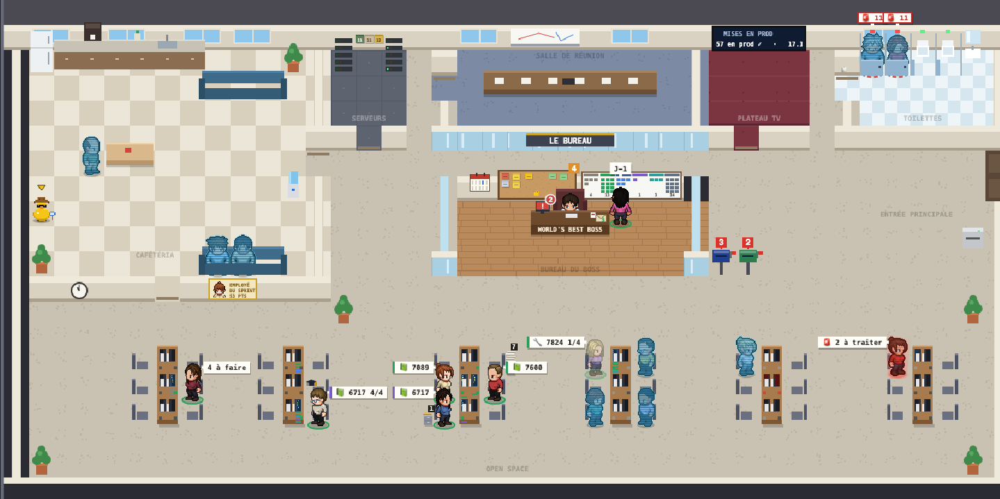

# Le Bureau

Une page Live pour [Kronn](https://github.com/DocRoms/Kronn) façon *The Office* : la journée de l'équipe et de ses agents IA dans un open space en pixel art. Collègues, workflows Kronn, mises en prod et validations en attente, d'un coup d'œil.



## Fonctionnalités

| Fonctionnalité | En bref |
| --- | --- |
| [Le plan](guide/fonctionnalites/01-plan.md) | Collègues, agents en hologramme (et ceux ajoutés depuis une baie de la salle Serveurs), visiteurs et invités de passage, placés selon ce qu'ils font ; lumière du jour ; loupe sur les événements forts (réouverture, mise en prod, visite, cérémonies), plan d'équipe validé par le boss, brouillon depuis un croquis ou une photo, passions de l'équipe, le canard en plastique qui se promène et grandit avec le sprint (stades, canetons, succès, petites scènes) ; l'agent qui sort de panne applaudi |
| [Qui fait quoi](guide/fonctionnalites/03-qui-fait-quoi.md) | Une carte par personne et par agent : ce qu'il fait maintenant |
| [Fil et récap](guide/fonctionnalites/04-fil-et-recap.md) | La journée heure par heure (ce qui t'attend en haut, tes actions, pannes, filtre par type), et son résumé depuis minuit |
| [Rejouer la journée](guide/fonctionnalites/05-rejouer.md) | Direct, ou relecture accélérée de minuit à maintenant |
| [Mode TV et cérémonies](guide/fonctionnalites/06-mode-tv.md) | Écran d'open space lisible à 3 m, tour de table du daily, sprint planning et rétrospective en salle de réunion |
| [Fiches](guide/fonctionnalites/07-fiches.md) | Journée d'un agent ou d'un collègue ; fiche d'un ticket ou d'une PR (PR de plusieurs dépôts, en retard ou en conflit, la remettre à jour, faire relire et corriger) ; programme d'un agent cron en clair et son prochain passage ; lancer (un champ par paramètre), relancer sans rien à remplir, interroger ; tes validations et les questions des discussions dans ta fiche de boss, à décider sur la page (bulle ✋ sur ton personnage) ; parler au canard et répondre à ses questions, son sprint et ses trophées ; fiche de paie ; cartes de passion (GitFut, Smash, dramas) |
| [Murs du bureau](guide/fonctionnalites/08-murs.md) | Kanban du sprint, prochains crons en post-it (salle Serveurs), mises en prod, employé du sprint, écran mural de la salle de réunion avec tes autres pages Kronn (ajout et retrait depuis la page) |
| [Avatars](guide/fonctionnalites/09-avatars.md) | Éditeur d'apparence, pour soi ou pour toute l'équipe |
| [Fraîcheur des données](guide/fonctionnalites/10-fraicheur.md) | Prochaine arrivée, sources en retard, crons du Bureau en échec, à relancer ou rafraîchir d'un clic |
| [Téléphone](guide/fonctionnalites/11-mobile.md) | Affichage mobile |
| [Thèmes saisonniers](guide/fonctionnalites/12-themes.md) | Noël, Nouvel an, Saint-Valentin, Halloween : décor, chapeaux, emojis, effets |
| [Thème de la page](guide/fonctionnalites/13-theme-page.md) | Pixel art en Classique (sombre), mode TV et bandeau « EN DIRECT » compris ; les thèmes d'une équipe (son pack) au bouton 🎨 |
| [Absences et télétravail](guide/fonctionnalites/14-absences.md) | Qui est là, d'après le planning de l'équipe : absents hors du bureau, télétravail en transparence, calendrier de deux semaines au mur du boss |
| [Courrier](guide/fonctionnalites/15-courrier.md) | Tes mails utiles (appli Mail du Mac, Gmail ou autre par IMAP), triés par des règles que le facteur te propose : une boîte aux lettres par compte à côté du bureau du boss, le facteur qui dépose, des porteurs qui remettent certains mails en personne jusqu'à leur lecture ; jamais le contenu |
| [Mise en prod](guide/fonctionnalites/16-mise-en-prod.md) | Mise en prod d'une PR de n'importe quel dépôt réglé : depuis la fiche de l'agent, d'une PR ou d'un ticket ; ticket déduit de la PR, rebase, CI, merge, release, staging puis prod avec tes validations, simulation possible ; annonce Teams éditée à chaque étape (⏳, chargeur, ✅, ❌) |

## Installer

### Prérequis

À préparer avant de lancer l'installateur. Seuls les deux premiers sont obligatoires : sans les autres, Le Bureau tourne, sans la partie indiquée.

| Prérequis | Pour quoi | Sans lui |
| --- | --- | --- |
| Kronn 0.14.1 ou plus, lancé sur ta machine | La page, ses datasets, les workflows | Rien ne s'installe |
| Python 3.9 ou plus (`python3`, celui que Kronn trouve dans son `PATH`) | L'installateur et les scripts des crons | Rien ne s'installe |
| Une connexion Atlassian dans Kronn (Kronn > MCP > Atlassian), créée avant l'installation | Sprint, tickets, Kanban, stand-up | Pas de Jira : blocs masqués |
| `gh` connecté (`gh auth login`, droits `repo` et `read:org`) et accès aux dépôts suivis | PR, mises en prod ; un profil d'équipe réservé à une organisation GitHub | Pas de PR ni de MEP ; profils réservés refusés |
| Le venv du dépôt avec Pillow : `python3 -m venv .venv && .venv/bin/pip install pillow` | Miniatures de l'écran mural « Mes pages Kronn », cartes GitFut, affiches des Top 3, sprite LPC de l'installateur | Cartes sans image (sauf sur macOS : repli sur `sips`) |
| Chrome ou Chromium | Miniatures de l'écran mural « Mes pages Kronn » | Cartes sans miniature |
| Un agent IA installé dans Kronn (Claude Code, par exemple) | « Lui poser une question », plan depuis un croquis | Boutons masqués |
| suno.com autorisé dans Kronn (Configuration > Artifacts) | Le lecteur Suno de la carte « Son écoute » | Lien vers Suno seulement |
| Azure CLI connecté (`az login --allow-no-subscriptions`), la connexion Kronn « Microsoft 365 » (globale) et le planning Excel de l'équipe sur SharePoint | Absences et télétravail, calendrier de l'équipe | Tout le monde au bureau, pas de calendrier |

macOS ou Linux (Windows n'est pas testé). Pour développer : Node 20 ou plus (tests) et la CLI `claude` (plan depuis un croquis en local).

```sh
git clone https://github.com/barberemi/pixel-bureau.git && cd pixel-bureau
python3 tools/install.py --dry-run   # voir ce qui serait créé
python3 tools/install.py             # installation interactive, relançable sans doublon
python3 tools/install.py --rattacher # refaire seulement les agents (personnages du pack) et l'écran du boss
```

L'installateur demande ton équipe (une équipe neuve avec le plan type par défaut, ou un profil de `teams/`, ou le dossier de ton équipe hors du dépôt, un « pack d'équipe », réservés aux membres de leur organisation GitHub quand ils en nomment une), qui tu es (tu prends le bureau du boss, les autres gardent leur place), le plan du bureau, ton board Jira (il en lit les colonnes et te propose comment classer chaque statut), tes dépôts et workflows de déploiement, les pages Kronn à montrer sur l'écran du boss et, si tu veux, ton courrier (comptes de l'appli Mail du Mac, Gmail ou autre par IMAP), puis crée la page, ses datasets, 16 workflows (un de moins sans Jira, un de moins sans Microsoft 365, deux de moins sans compte de courrier) et deux Quick Prompts dans **ton** Kronn, écrit `bureau.config.json` (jamais commité) et lance un premier rafraîchissement. Ouvre ensuite Kronn > Pages > « Le Bureau ». Aucun secret n'est stocké : les connexions sont référencées par leur id Kronn.

| Action | Commande |
| --- | --- |
| Mettre à jour | `git pull && python3 tools/publish.py all` |
| Désinstaller | `python3 tools/uninstall.py --dry-run`, puis sans `--dry-run` |
| Tester | `sh tools/test.sh` (Node 20+, aucune dépendance npm) |

Pour modifier la page ou les workflows : [guide/developpement.md](guide/developpement.md).

## Ton équipe

Le Bureau de ton équipe, dans tes bureaux : ses collègues, leur apparence, le plan de l'étage depuis un croquis ou une photo, les couleurs de ton entreprise, le tout dans un dossier privé à ton équipe, hors de ce dépôt. Pas à pas, avec l'équipe de la démo en exemple : [guide/equipe.md](guide/equipe.md).

## Contribuer

Bug, idée ou dette : ouvre une issue avec son formulaire. Pour proposer un changement : une branche, une PR avec le modèle proposé, la CI verte, puis un merge en squash. Le circuit et les règles du dépôt sont dans [CONTRIBUTING.md](CONTRIBUTING.md), le code de conduite dans [CODE_OF_CONDUCT.md](CODE_OF_CONDUCT.md). Une faille de sécurité : jamais dans une issue, voir [SECURITY.md](SECURITY.md). Les changements de chaque version : [CHANGELOG.md](CHANGELOG.md).

## Licence et crédits

Le code est sous licence [GNU AGPL 3.0](LICENSE), comme Kronn. Les sprites viennent du [Universal LPC Spritesheet Character Generator](https://liberatedpixelcup.github.io/Universal-LPC-Spritesheet-Character-Generator) (CC-BY-SA 3.0 / GPL 3.0 / OGA-BY 3.0 selon les calques) et la police pixel est [Press Start 2P](https://fonts.google.com/specimen/Press+Start+2P) de CodeMan38 (SIL Open Font License 1.1) : chaque artiste, calque par calque, est crédité dans [CREDITS.md](CREDITS.md), généré par `python3 sprites/credits.py`. Captures : page de démo.

Personnages : la démo et les agents sont un clin d'œil de fan à *The Office* (Dunder Mifflin, Michael, Dwight, Jim…), les hérauts à Yoda (*Star Wars*) et à Gandalf (*Le Seigneur des anneaux*). Ces noms et ces personnages appartiennent à leurs ayants droit (NBCUniversal, Lucasfilm, Tolkien Estate) ; Le Bureau n'a aucun lien avec eux, ni leur approbation, et n'en fait aucun usage commercial.
