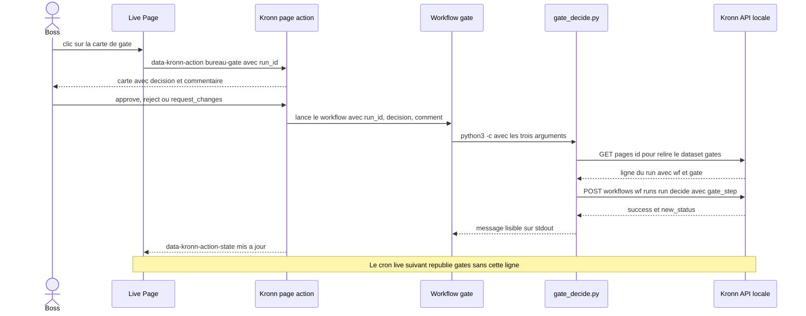

# Décider une gate depuis la page

Cette séquence décrit comment le boss approuve, rejette ou renvoie une gate d'un workflow d'agent depuis la page. Elle commence au clic sur une carte de gate (bouton `data-kronn-action="bureau-gate"`, lié à la ligne `run` du dataset `gates`) [src: file: page/src/55-actions.js:96] et se termine quand Kronn a changé le statut du run et que le cron live republie `gates` sans cette ligne. Elle touche la page, Kronn (action de page et workflow manuel « Le Bureau · décision gate ») et le script `gate_decide.py` [src: file: workflows/templates/gate.json:8].

## Notes

- Le `run_id` n'est jamais saisi : Kronn le relit dans le dataset `gates` (`dynamic_binding`, `find(run)`) [src: file: page/office_template.html:95].
- Le script retrouve workflow et étape dans le même dataset et envoie `gate_step` : Kronn refuse une décision périmée (le run n'attend plus cette gate) [src: file: workflows/gate_decide.py:7].
- `request_changes` sans commentaire échoue avant tout appel [src: file: workflows/gate_decide.py:38].
- La page observe `data-kronn-action-state` pour mettre à jour la carte [src: file: page/src/55-actions.js:103].
