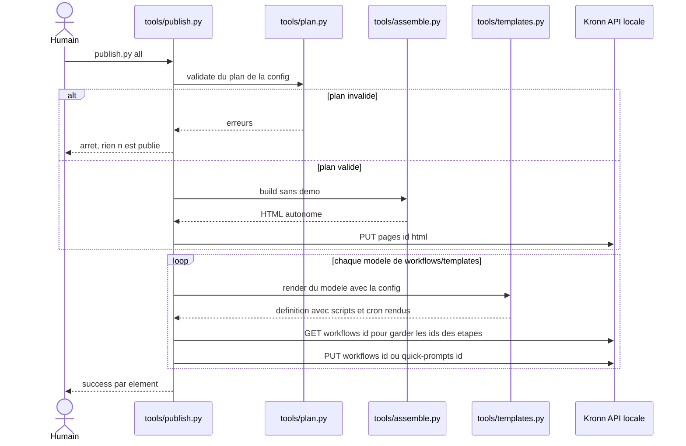

# Publication de la page et des workflows

Cette séquence décrit la mise en production d'un changement, lancée par l'humain seul avec `python3 tools/publish.py page|workflows|all` après `sh tools/test.sh --chrome` [src: file: tools/publish.py:1] [src: file: guide/developpement.md:43]. Elle commence à la lecture de `bureau.config.json` et se termine quand Kronn a reçu le HTML assemblé de la page et le rendu de chaque modèle de workflow [src: file: tools/publish.py:66].

## Notes

- Réservé à l'humain : un agent ne lance ni `tools/publish.py` ni `git push` [src: file: docs/briefing.md:23].
- Un workflow du Bureau sans id dans la config est créé (`POST /workflows`) et son id écrit dans `bureau.config.json` ; un id listé dans `own` n'est jamais republié [src: file: tools/publish.py:40] [src: file: tools/publish.py:50].
- `build(demo=False)` n'embarque pas les instantanés de démo : la page publiée attend ses propres données [src: file: tools/publish.py:29].
- `python3 tools/templates.py check` compare ensuite les workflows du Kronn au rendu des modèles ; modifier `bureau.config.json` fait apparaître tous les workflows en DIFF, c'est attendu [src: file: guide/developpement.md:45] [src: file: docs/briefing.md:25].
