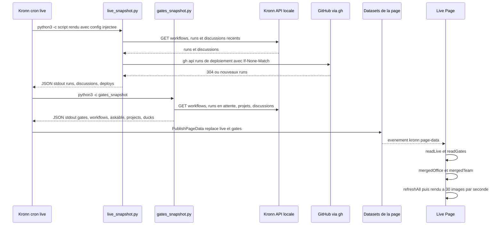

# Rafraîchissement des datasets (cron live)

Cette séquence décrit comment la page reçoit ses données sans aucun appel réseau de sa part. Elle commence quand le cron Kronn « Le Bureau · live (1 min) » se déclenche (`* @@cron_hours@@ * * *`) [src: file: workflows/templates/live.json:9] et se termine quand la page a fusionné le nouveau dataset `live` avec l'instantané complet `office` (cron toutes les 10 min) et rafraîchi la scène [src: file: page/src/90-boot.js:143]. Les autres crons (`office`, `team`, `payroll`, `canard`, `absences`) suivent le même schéma : étapes de collecte puis `PublishPageData` [src: file: workflows/templates/office.json:50].

## Notes

- Sortie d'une étape Exec sous 100 Ko : les scripts raccourcissent leurs listes [src: file: guide/developpement.md:76].
- Cache des ETag GitHub hors du dépôt : `~/.cache/kronn-bureau/deploys.json` ; un 304 ne compte pas dans la limite d'appels [src: file: workflows/live_snapshot.py:39] [src: file: workflows/live_snapshot.py:41].
- La page relit chaque dataset par une fonction `read*` tolérante (`d.current`, chaîne JSON ou objet ; `null` si absent) ; un dataset absent garde la valeur précédente [src: file: page/src/90-boot.js:84].
- `office`/`team` = état complet, `live` = surcouche ; la date `generated_at` la plus récente l'emporte [src: file: page/src/90-boot.js:94].
- Sans aucune donnée publiée, la page tourne sur `emptyOffice()` [src: file: page/src/90-boot.js:116].
