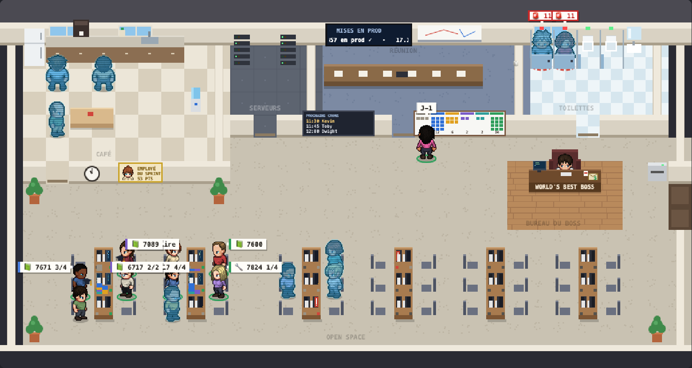

# Développer Le Bureau

## Dossiers

| Dossier | Contenu |
| --- | --- |
| `page/office_template.html` | Squelette : en-tête, canvas, barre de lecture, panneau, les 4 blocs `kronn-action` (Kronn les lit dans le HTML statique), marqueurs `/*__STYLES__*/` et `/*__SCRIPTS__*/` |
| `page/src/styles.css` | Toute la feuille de style |
| `page/src/NN-*.js` | Le script, concaténé **dans l'ordre des noms** en un seul `<script>` (une portée globale, pas de modules) : config `00`, plan `10`, sprites `20`, données `30-33`, états `35`, dessin `40-45`, panneau, actions, fiches et éditeur `50-65`, récap `69`, tuiles, fil et « Qui fait quoi » `70-72`, mode TV `75-76`, souris `80`, boucle et démarrage `90` |
| `workflows/` | Scripts Python des étapes Exec ; `_lib.py` = socle commun et `_plan.py` = règles des plans (aussi utilisées par `tools/plan.py`), recopiés dans chaque script qui les importe au rendu (Kronn lance `python3 -c` sans fichier voisin) ; `templates/` = modèles des workflows et du Quick Prompt |
| `layouts/` | Plans de bureau (format `bureau-layout/1`) ; `open-space.json` = le plan type (équipe neuve), `exemple-startup.json` = un autre bureau (30 x 16, sans plateau TV) |
| `team/` | `defaults.json` : valeurs communes proposées à l'installation (Kronn, rythme, Jira et GitHub vides) |
| `teams/<équipe>/` | Profil d'équipe : `team.json` (nom, organisation GitHub requise, plan), `roster.json` (l'équipe), `defaults.json` (Jira, GitHub, titre), `music/` (morceaux des collègues), `cast.json` (recettes de leurs avatars), `sprites/` et `sprites.json` (sprites fournis et leurs planches, `sprites/build_sprites.py`). aucun profil n'est livré (une équipe réelle garde ses noms hors du dépôt public) ; le même dossier hors du dépôt = un **pack d'équipe** (clé `team` = son chemin), qui peut aussi apporter ses plans (`layouts/`) et ses thèmes (`themes/`) : format dans `docs/conventions/pack-equipe.md` |
| `sprites/` | Recettes d'avatars communes `cast.json` (agents, intérimaires, visiteurs, équipe de démo), calques LPC `layers.json` (`build_layers.py`, qui note les fichiers LPC utilisés dans `lpc_used.json` ; après un changement de calques, `python3 sprites/credits.py` régénère `CREDITS.md`) ; `custom/` et `sprites.json` = sprites fournis d'une installation, jamais commités |
| `data/` | Instantanés de démo, équipe fictive Dunder Mifflin (aperçu local, captures et tests seulement, jamais dans la page publiée) |
| `tools/` | `install.py`, `uninstall.py`, `publish.py`, `templates.py`, `assemble.py`, `smoke.py`, `theme.py`, `release_notes.py`, `test.sh`, `shots.py` |
| `tests/` | `node --test` (sans npm) et `unittest` : logique de la page, états, installateur, modèles, scripts contre un faux Kronn et un faux `gh`, à une heure figée (midi à Paris, `tests/fakeclock/`, `BUREAU_TEST_NOW` pour une autre heure) |

## Configuration

- `bureau.config.json` : **propre à chaque installation**, jamais commité. Toutes les valeurs de l'installation : `kronn` (API, interface, projet), `page_id`, `workflows` (crons), `actions` (boutons), `own` (workflows gardés tels quels), `jira`, `github`, `rhythm` (fuseau, daily, heures de bureau, gel des MEP), `mep_workflow`, `agents`, `boss_pages` (pages Kronn de l'écran mural de la salle de réunion, demandées à l'installation ; liste de départ, ensuite rangée depuis la page dans le dataset `pagelist`, #61), `launch` (tes workflows lancés depuis la fiche d'un ticket : un id, ou `{wf, vars}` pour renommer ou retirer les variables, `LAUNCH_VARS` et `action_block()` dans `assemble.py` ; par défaut `impl` reçoit `jira_ticket_key`, `mep` `jira_ticket_key` et `pr_number`, `review` `repo` et `pr`, `fix` `pr` et `notes`, `estimate` `jira_ticket_key`, `story_points` et `raison` ; Kronn relit ces valeurs dans le dataset `actions`, publié en JSON plat par le cron équipe, étape `actions`, parce qu'il ne lit pas le dataset `team` stocké en texte), `gitfut` et `wiki_posters` (facultatifs : par défaut déduits du roster, logins `github` et `passion.top3.wiki`, injectés ainsi dans les scripts par `templates.script_code`), `chrome` (chemin du navigateur des miniatures, `false` pour les désactiver).
- `owner` = clé de qui a installé la page : cette personne prend le bureau du boss. `team` = le profil d'équipe (id de `teams/`) ou le chemin d'un pack d'équipe (`~/Sites/bureau-monequipe`, KT-60) ; absent : équipe neuve. `people` = les personnes ajoutées à cette installation (jamais dans le roster partagé), `music` = leurs morceaux. Relancer l'installateur garde les clés qu'il ne gère pas (posées à la main). `layout` = le plan du bureau (défaut : celui du profil, sinon `layouts/open-space.json`).
- Le roster vu par la page et les scripts = celui du profil, puis `people` (`roster()` dans `assemble.py`, seul point d'accès, comme `defaults()` et `music()`).
- Mises en prod suivies : `github.repo` avec `staging_workflow` et `prod_workflow` (le dépôt principal : ses MEP portent ticket et release, cron équipe), puis `github.deploys` = d'autres dépôts, `[{repo, label?, staging_workflow?, prod_workflow}]` (`label` par défaut : le nom du dépôt sans `front_`). Le cron live relit leurs runs chaque minute, en parallèle et par requête conditionnelle (ETag, `304` gratuit) ; un run du jour dont le titre contient une version est une MEP, nommée « label version » hors dépôt principal (`live_snapshot.py`), avec `by` = le login GitHub de qui a lancé le run. L'auteur d'une MEP (`mepChar`, `30-data.js`) : l'assigné du ticket de sa release (dépôt principal), sinon ce login, retrouvé chez un collègue du roster (`github`) ou de passage (logins `gh` de l'équipe) ; inconnu : un visiteur `g_mep_<login>` (`mepVisitors`, invité `on: "mep"`, sprite des intérimaires), présent le temps de la MEP et de sa fête (`mepVisitorState`, `35-state.js`). La scène du plateau TV (`stageAt`) n'est prise que par le déploiement en prod (phase `prod`, 3 h au plus) puis 10 min de fête : une release ou un staging seuls ne déplacent ni l'auteur ni le boss. Une équipe y met par exemple les autres dépôts de sa revue de PR multi-dépôt.
- Mise en prod (#58) : modèle `workflows/templates/mep.json` (id dans `launch.mep_pr`, hors `BUREAU_IDS`), script `workflows/mep.py` (une sous-commande par étape Exec, état du run dans `~/.cache/pixel-bureau/mep/runs/<run>.json`, copie git dans `~/.cache/pixel-bureau/mep/repos`), projets = `github` et `github.deploys` avec une clé `mep` (`assemble.mep_projects`), réglages détaillés dans [Mise en prod](fonctionnalites/16-mise-en-prod.md). `relaunch.py` passe désormais chaque variable à saisir, même vide (Kronn refuse une variable facultative absente).
- PR suivies (#56) : `github.pr_repos` = liste `["owner/repo", …]` des dépôts dont le cron équipe lit les PR ouvertes et mergées (`github_snapshot.py`, appels `gh` en parallèle bornés à 30 s, 12 dépôts au plus) ; absente, le dépôt principal puis ceux de `github.deploys`. Limites par dépôt : 100 ouvertes et 40 mergées pour le principal, 25 et 10 pour les autres ; au-delà de 100 Ko, les autres dépôts sont raccourcis d'abord. Un autre dépôt illisible est un avertissement (`warnings` du dataset `team`, panneau Fraîcheur), pas une erreur GitHub. Chaque PR porte son `repo` (owner/repo) jusqu'au dataset `team` (`prs` des personnes, `other_prs`, `merged_today`, événements `pr` et `review`) ; ses clés Jira viennent de son titre et de sa branche. Dans la page, une PR s'identifie par « owner/repo#n » (`prId`, `samePr`, `35-state.js`), s'affiche « #n » au dépôt principal et « dépôt#n » ailleurs (`prNum`). Le dataset `actions` en tire `prs[{id, n, repo}]` : « Faire relire » et « Corriger » sont liés par `prs.find(id)` et relisent `repo` et `n` ; la PR d'un ticket (`tickets[].pr`, Mettre en prod) reste une PR du dépôt principal.
- Remettre une PR à jour (#74) : le cron équipe lit l'état de fusion de chaque PR ouverte (`mergeStateStatus` : `DIRTY` = conflit), sa base, et son retard sur la base (`gh api …/compare`, refait seulement quand la PR ou sa base ont bougé, cache `~/.cache/pixel-bureau/behind.json`) : `conflict`, `behind`, `base` de chaque PR du dataset `team`. Le workflow du Bureau « remettre une PR à jour » (`actions.rebase`, modèle `rebase.json`, script `workflows/pr_update.py`) : `github.ci_labels` = `{"owner/repo": "label"}` (sinon le `ci_label` des réglages de mise en prod du dépôt) relance la CI après le push ; `github.checks` = `{"owner/repo": "commande"}` = contrôle lancé après un conflit résolu, dans le dossier de travail, avec `vendor` et `node_modules` reliés depuis ton dossier local du dépôt quand il est un projet Kronn. Prompt de l'agent : `tools/rebase_prompt.md`.
- Modèles incarnés par des agents (#78) : relire une PR (`review_child` sous-workflow, `review_one` à la demande, `review_cron` le cron), réestimer un ticket (`estimate`), rédiger une issue GitHub (`issue`), m'affecter et me désaffecter un ticket (`assign`, `unassign`). Ids dans `models.<clé>` (jamais dans `BUREAU_IDS` : un agent les incarne, par sa clé `model` dans `settings.json` du pack ou son `wf` dans la config). L'installateur les propose un par un (le cron des revues est créé désactivé ; rien n'est proposé pour un bouton qui a déjà ton workflow `launch.review` ou `launch.estimate`) ; `publish.py workflows` ne les crée jamais, il met à jour ceux qui ont un id. Sans ton workflow, « Faire relire » et « Réestimer » lancent le modèle (`assemble.MODEL_ACTIONS`). Emplacements : `@@github.config_id@@` (connexion GitHub de Kronn, `github.config_id`, sans elle pas de revue), `@@review.*@@` (`review.page_id` et `review.project_id` de l'installation ; `review.guidelines`, `review.skill_ids`, `review.repos`, `review.schedule` de l'équipe, dans `settings.json`), `@@jira.points_field@@` (premier de `jira.points_fields`), `@@jira.statuses.doing@@` et `todo` (la transition se choisit par la catégorie du statut, jamais par un id), `@@issue.*@@` (`issue.repo`, `issue.search_dirs`, `issue.discussion` facultative). Une étape `_requires` sur une clé vide disparaît, et les renvois `on_result` vers elle vont à l'étape gardée suivante. Grille de revue générique : `tools/review_rubric.md`. La revue tourne dans une copie isolée du projet (`require_isolation`, foreach d'un sous-workflow par PR, `templates.ISOLATED`). Remplacer ton propre workflow par le modèle sans perdre ses runs ni son agent : son id dans `models.<clé>`, puis `publish.py workflows`.
- Corriger les commentaires d'une PR (#75) : le cron équipe compte les fils de review non résolus de chaque PR ouverte (une requête GraphQL par dépôt, `threads`). Le workflow du Bureau « corriger les commentaires d'une PR » (`actions.fix_pr`, modèle `fix.json`, mêmes scripts que la remise à jour : `fix_prepare`, `fix_diff`, `fix_push` de `workflows/pr_update.py`, prompt `tools/fix_prompt.md`) ne remplace jamais ton workflow de `launch.fix` : quand il existe, le bouton « 🛠 Corriger » des fiches le lance, sur tous les dépôts ; sans lui, `launch.fix` comme avant. Échanges avec l'agent par des fichiers jamais commités (`.bureau-fix.json`, `.bureau-fix-replies.json`, `.bureau-fix-summary.md`, exclus par `.git/info/exclude`) ; réponses et résolutions par GraphQL (`addPullRequestReviewThreadReply`, `resolveReviewThread`).
- Tickets créés : étape `new_tickets` du cron équipe (JQL `created >= <dernier daily>`, auteur compris), mise en forme par `team_shape.py` (`team.new_tickets` : key, summary, type, status, cat, created, by, by_name). La page ne garde que les auteurs de l'équipe (`teamCreated`, par compte Jira ou par nom) : stand-up de la facilitatrice depuis `prevDaily`, fil du jour (« X crée »), pile de feuilles sur son caisson depuis `lastDaily` (`rolePile`).
- Changements de statut (âge dans le statut `since`, passages de colonne du jour) : étapes `team_keys` (clés du sprint en cours) puis `status_log` du cron équipe, `POST /rest/api/3/changelog/bulkfetch` filtré sur `status`. `team_shape.py` les rattache aux tickets de `jira_team` par id, au format de `expand=changelog`. Jamais `expand=changelog` sur `jira_team` ni `jira_closed` : il ramène chaque version de la description (12 Mo par run, 80 runs par jour). Pièges : bulkfetch date en millisecondes epoch (converties en ISO), et Kronn ne sait pas paginer son `nextPageToken` (dans le corps) : une seule page de 1000 changements (353 pour 57 tickets en octobre 2026).
- Étiquettes des agents (`41-people.js`) : icône (`agents[].icon`, sinon devinée du rôle par `AGENT_ICONS`) et métier court (`agents[].short`, sinon le rôle avant son premier « — », sans « Cron » ni cadence, 24 caractères). Réglage `ui.agent_label` : `both` (défaut, « 🔎 Dwight · Reviewer de PR »), `office` (prénom seul) ou `metier` (défaut du mode TV). Piles des bureaux (`40-furniture.js`) : barres de tickets `pileOf` de son côté de la table, caisson côté allée `rolePile` (`roleItems` : feuilles `sm`, dossiers `qa`, 6 dessinés + pastille du nombre) ; zones survolables `PILE_HITS` (remises à zéro à chaque image), infobulle `pileTip` (80-input.js). Paramètres d'affichage : Kronn transmet ceux de l'adresse `#page/<id>?tv=1&scene=standup` dans `KronnPageData.page.params` (onglet autonome seulement) ; `applyViewParams` (75-tv.js) les applique une fois, au démarrage ou au premier `kronn:page-data` qui en a, sans écrire le réglage mémorisé (`setTv(on,false)`). Passions (`38-passions.js`, roster `passion`) : `passionSlot` (un créneau par jour ouvré, rng clé × jour, fenêtre `PASSION_WINDOW`), `passionMoment` (état `passion`, zone `visit` = `besideSeat`, après `teamScene`), `holoEvening` (`soir_holo`, avant le test des heures de bureau), `drawPassion` (après le sprite) ; cartes `passionCards` (GitFut : dataset `gitfut` de l'étape `gitfut` du cron fiche de paie, fond retiré dans le navigateur par `gitfutCutout`). Écran du boss (`47-bosspages.js`) : dataset `bosspages` {generated_at, pages[{id, title, updated, img}]} publié par l'étape `pages` du cron fiche de paie (`workflows/pages_snapshot.py` : HTML + datasets de chaque page dans un fichier local avec `window.KronnPageData`, capture Chrome headless 1280×800, réduite en JPEG 320×200 par `jpeg()` de `_lib.py` (Pillow, au besoin celui du venv du dépôt, sinon `sips`), cache `~/.cache/pixel-bureau/thumbs/` par révision du HTML et des données, sortie bornée sous 90 Ko) ; `drawBossPages` remplace l'écran du bureau du boss (`bossScreenRect`, zone `bosspages` de `hitZone`), `openBossPages` la fenêtre de cartes (Échap ou fond pour fermer ; liens en `index.html#page/<id>` : Kronn ouvre dans l'onglet courant un lien vers sa propre adresse, et dans un nouvel onglet un chemin différent). Noms sur le plan : `nameShown(c)` ; en mode TV, un agent n'a son étiquette que dans un état de `AGENT_BUSY` (work, srv, meet, gate), survolé ou sélectionné.
- Scènes d'équipe (`37-scenes.js`, `teamScene`) : événements `move` du jour (`team.events`) vers les statuts de `jira.flow` (`jira_flow` dans la config de la page, défauts `assemble.JIRA_FLOW`). Réouvert : avec un invité `on: "reopen"` (le héraut, par défaut Gandalf, planche `sprites/common/mage`), face-à-face de 3 min en salle de réunion (places `meet` : l'assigné d'un côté de la table, l'auteur et le héraut en face, bulle du héraut agrandie ; places `gate` à défaut, `heraldScene`), puis le héraut repart ; sans héraut, l'auteur va voir l'assigné 2 min. Mise en prod réussie : avec un invité `on: "prod"` (par défaut Yoda, planche `sprites/common/yoda` ; « le sage » dans la démo, recette à peau `#rrggbb`), `prodHeraldState` : 3 min en zone `stage` à côté de l'auteur (zone `daily` si la prod finit pendant le daily, `stageout` si le plateau est fermé), réplique `shout` agrandie (`{name}` = prénom de l'auteur, retiré avec sa virgule s'il est inconnu), puis départ. Les bulles dessinées sont notées dans `BUBBLE_BOXES` (41-people.js) : une bulle `big` prend la position qui en recouvre le moins (centrée, à droite, à gauche, puis surélevée avec une tige). À tester : l'assigné porte le dossier au testeur (`deliver`), pile de dossiers sur le caisson du testeur (`rolePile`). Validé : pouce du testeur (`thumbs`), bras levés de l'assigné (`cheer`). Sprint : `kickoff` devant le Kanban 5 min après le daily du premier jour, `pizza` de 12h à 12h40 le dernier jour (boîtes sur la table de la cuisine, `sceneFurniture`). Priorité : après le daily et la MEP ; pour le boss, après ses validations.
- Tickets à estimer au sprint planning : étapes `future_sprints` (sprints futurs du board, dans son ordre), `planning_jql` (`planning_jql.py` : JQL des 2 premiers, champs de points vides via `cf[id] is EMPTY`, hors statuts terminés) et `planning_tickets` du cron équipe ; `team_shape.py` publie `team.planning` = `{sprints:[{id, name, start, end}], tickets:[{key, summary, type, status, cat, sprint, who}]}` (null sans Jira), lu par `scenePlanEstimate` (`76-tvscenes.js`).
- Cérémonies (`ceremonyAt`, `ceremonyHost` dans `30-data.js`) : `rhythm.planning` (vendredi 10h, 30 min, facilitatrice) et `rhythm.retro` (jeudi 15h, 60 min, `every: 2` depuis `from: "2026-10-15"`, animateur tiré au sort d'après la date, hors intérimaires). Sur le plan, `ceremonyState` (`37-scenes.js`) : animateur en bout de table (`headSpot`, place `meet` tournée de côté), les autres en zone `meet` ; priorité après le daily et la MEP, pour le boss après la fête de MEP. En TV (`76-tvscenes.js`), `sceneMode` = `daily`, `planning`, `retro` ou rien ; `planningScenes`, `retroScenes`, `toggleScenes`, touches S, P, R. Tests : `tests/ceremonies.test.js`.
- Invités de passage : les communs (`team/guests.json` : les hérauts Gandalf et Yoda, planches dans `sprites/common/`, composées de calques LPC par `sprites/heralds.py` (recettes, aussi lues pour les crédits), assemblées dans `sprites/common.json` par `build_sprites.py` ; `common_guests: false` dans la config pour les retirer), puis la clé `guests` du roster du profil, puis de la config (`guests()` dans `assemble.py`, embarqués avec le roster ; même clé : le dernier remplace). Chacun : `key`, `name`, `sprite` (sprite fourni) ou une recette dans `cast.json`, `role`, `stay` ([min, max] en minutes, défaut [20, 40]), `chance` (de passer, défaut 1), `at` (« HH:MM », heure fixe, avec `jitter` minutes de flottement), `days` (`all` = aussi le week-end), `tour` (le tour des salles dans l'ordre de `GUEST_TOUR` au lieu de saluer les collègues), `shout` (sa bulle). `on: "coffee"` : la tournée de café (`49-coffee.js`, #84), tous les jours ouvrés à `at` (± `jitter`) : 3 min à la machine à café (`shout` en bulle, loupe), puis 2 min par café pour chaque présent au bureau (ni télétravail ni absent), le boss compris, au plus court depuis la machine ; il se place derrière chacun (le boss à son bureau : à gauche du bureau) ; les tasses restent côté écran jusqu'à `until` (« 17:00 » par défaut) ; `feed` = la ligne du fil à son arrivée (`{name}` : son nom). Au plus une visite par jour ouvré, à une heure tirée au sort pour la date (la même pour tous), entre une heure après l'ouverture et une heure avant la fermeture (`rhythm.office_hours`) ; toutes les 3 min il change d'endroit : un collègue à son bureau ou un coin du bureau (`guestState`, `35-state.js`). Jamais un collègue (`person` ignoré) : hors équipe, Qui fait quoi, compteurs et fil. Exemples : les hérauts Gandalf et Yoda (`team/guests.json`), David Wallace dans la démo, le tour de minuit de Hank dans le pack d'exemple (`tests/fixtures/pack-exemple/`). Un sprite fourni peut n'être qu'une planche de marche (`*walk*.png`) : `build_sprites.py` en tire la pose d'attente.
- Le canard (`39-duck.js`) : `duckAt(t)` = position, fonction pure du temps (rng `keySeed('duck')` × jour depuis `parisMidnight`) : segments « marche vers une case tirée au sort (`walkable`, hors `seatTiles`) par `findPath`, une case par `DUCK_STEP` (1,4 s), puis pause de 20 à 60 s », prolongés au besoin et gardés pour le jour (`DUCK_DAY`, refait si le plan change) ; calculés à midi du jour (`duckWith`) pour que la fermeture du plateau ne dépende que de la date. Trié avec les personnages dans `render` (`DUCK_POS`, `drawDuck` : dessin ×`DUCK_SCALE` 1,6 (canetons et accessoires compris ; bulle, anneau et zone de clic suivent par `DUCK_K`), flèche jaune flottante sauf quand il attend, où la bulle « ? » la remplace), zone `duck` de `hitZone` (`duckHit`, flèche comprise), ligne `duckRow` du groupe « Et aussi » du panneau (`duckStatus`, `duckRoom` = libellé du plan dans la même `light_rooms`, sinon open space ; invités `c.guest&&c.present` au-dessus, vue « Tous » seulement), fiche `renderDuck` (vue `duck` de `drawSide`). Données : dataset `gates` (`gates_snapshot.py`, chaque minute) `projects` = `[{id: "none", name: "Sans projet"}]` + `GET /projects`, `ducks` = discussions dont le titre commence par « 🦆 » (14 jours, 15 au plus, `{id, title, project, updated, awaiting}`, `awaiting` = `pending_question_count` > 0), lus par `readDuckData`. Bouton `bureau-duck` (`launchBlock`, ligne liée `{id}` → `project_id`) : workflow « Le Bureau · parler au canard » (`workflows/templates/duck.json`, clé `actions.duck`, variables `project_id` et `topic`), étape Exec `duck_start.py` : `POST /discussions` (`project_id` null pour « none », titre « 🦆 » + première ligne du sujet, 70 caractères, `ClaudeCode`, `fr`), puis `POST /discussions/{id}/run` (la création ne lance pas l'agent ; `/run` le met en file avant de répondre en flux, on n'attend que les en-têtes), sortie `{discussion_id, url}`. Ces discussions ne sont jamais des visiteurs (`is_bureau_disc` de `_lib.py`, `bureauDisc` de `30-data.js`).
- Questions des discussions (KT-27) : `gates_snapshot.py` (cron live) publie `questions` (en attente, 14 jours, 15 au plus) et `qrows`, une ligne par réponse cliquable (`<question>|<option>`, `|all:<option>` pour un formulaire, `|_text`, `|_decline`). La page (`QUESTIONS`, 90-boot.js) en fait des visiteurs qui attendent au bureau du boss (`discQuestions`, 35-state.js, daté par la question), les compte chez le boss (`loneQuestions`, `askCount`) et dessine la carte `questionCard` (55-actions.js). Le bouton lance « Le Bureau · réponse à une question » (`question_answer.py`), qui relit la question dans Kronn avant `POST …/questions/{id}/answer` ou `/decline`.
- Le canard d'équipe (`39-duckgame.js`) : dataset `duck` publié par le cron « Le Bureau · canard d'équipe » (`workflows/templates/canard.json`, clé `workflows.canard`, toutes les heures) : étapes `sprint_info` et `velocity` (Jira, `/rest/greenhopper/1.0/rapid/charts/velocity`, 12 sprints fermés), `prev_window` (`duck_window.py` : dates du sprint précédent pour le JQL), `reopens`, puis `duck_snapshot.py` → `{target, sprints[{name, done, target, held}], canetons, streak, trophies{id: {ok, period?, detail?, progress?}}, warnings}` (runs Kronn pour « Zéro panne », discussions « 🦆 » pour « Bavard », `gh run list` des workflows de prod et `gh pr list` de `github.repo` pour « Lève-tôt » et « Relu dans la journée »). La page calcule le stade à l'instant T (`duckProgress` : points des tickets `done` dont `since` ≤ T, sur `target`), l'allure (`duckLook` : stade, `duckWorn` = accessoires des succès gagnés, un seul de `DUCK_HEADS`, `kids` = canetons), la dessine (`duckGameImg(vue, stade, accessoires)`, toile 24 × 24, calques `DG_LAYERS` sur `DUCK_ARTS`, cache `DG_IMG`), fait suivre les canetons (`drawDuckKids` : sa position `DUCK_STEP` × 0,9 × `DUCK_SCALE` plus tôt par caneton), et fournit à la loupe ses événements (`duckLoupeEvents` : `duck:<sprint>:<stade>`, `hatch:<sprint>`). Fiche : `renderDuckGame`. Démo : `DUCKGAME_DEMO`. Les succès portent leur date (`at`) : `duckWorn(t)` ne les met qu'à partir de là.
- Absences et télétravail (KT-1) : dataset `absences` publié par le cron « Le Bureau · absences » (`workflows/templates/absences.json`, clé `workflows.absences`, toutes les heures en semaine), seulement si la config a une section `microsoft` : `{"config_id": <connexion Kronn « Microsoft 365 », globale>, "planning": {"site": <id Graph du site SharePoint>, "item": <id Graph du classeur>}}` (sinon `templates.skipped` : pas créé). Étapes : `month_now` et `month_next` (`absence_month.py` : nom de la feuille, sans accents ; en décembre le suivant reste `decembre`, le classeur est annuel), `sheet_now` et `sheet_next` (ApiCall Graph `…/workbook/worksheets/{sheet}/usedRange(valuesOnly=true)`, `$.values`), puis `absences_snapshot.py` → `{generated_at, days[AAAA-MM-JJ, 10 jours ouvrés du lundi de cette semaine au vendredi de la suivante ; le week-end, à partir du lundi qui vient], ferie[…], people{clé: {jour: "mm"}}}` : deux lettres, matin puis après-midi, `b` bureau, `t` télétravail, `a` absent (C, F, E, M confondus : jamais la raison). Les personnes sont retrouvées par leur nom complet (`planning_names` : champ `person` du roster, injecté au rendu ; comparé sans accents ni ordre des mots). La connexion Microsoft 365 de Kronn emprunte le `az login` du Mac : expirée, le cron échoue.
- Petites scènes de 3 s (`43-fx.js`) : `fxEvents(t)` liste les événements datés de moins de `FX_WIN` (10 min) : succès (`trophy`, date `at` du cron), changements de stade (`duckStageTimes` : cumul des points des tickets `done` par `since`, mue au début du sprint ; `hatch` pour œuf vers caneton), caneton né (`kid`), agent rétabli (`recover` : `agentRecoveries`, un run réussi juste après un échec de moins de 40 min ou une alarme). `fxFrame` (boucle, avant `render`) ouvre une scène par nouvel identifiant (`FX.cur`, `t0` en temps réel), rien quand on fait glisser l'heure, le premier passage ne fait que noter ; `FX_MS` d'animation puis `FX_HOLD` de bulle. Dessin : `fxDuckLook` (allure du canard pendant la scène), `fxDrawDuck`, `fxDuckWobble`, `fxDrawKid` (dans `drawDuck`), `fxOverlay` (dans `render`, après les bulles : « ✅ Rétabli ! » et 👏 des agents `FX_WORKING`).
- La page en reçoit une partie (`page_config()` dans `assemble.py`) ; les scripts la reçoivent injectée au rendu. Un id d'action vide retire le bouton.
- Chaque source est facultative : sans Jira ni GitHub, les blocs concernés sont masqués.

## Modifier puis publier

```sh
python3 -m venv .venv && .venv/bin/pip install pillow websocket-client   # une fois
sh tools/test.sh --chrome              # tests + page assemblée chargée dans Chrome headless
python3 tools/publish.py page          # ou workflows, ou all
python3 tools/templates.py check       # les workflows du Kronn = le rendu des modèles
```

Un changement = une branche et une PR, mergée en squash après CI verte ; `main` ne reçoit pas de push direct (hook `.githooks/pre-push`, à activer une fois par clone : `git config core.hooksPath .githooks`). Publier depuis `main` à jour, après le merge.

Commits signés (KT-59), une fois par poste, avec une clé SSH (celle de `ssh-add -l`, ou une nouvelle `ssh-keygen -t ed25519`) :

```sh
gh auth refresh -h github.com -s admin:ssh_signing_key        # une fois : droit de déclarer une clé de signature
gh ssh-key add ~/.ssh/id_ed25519.pub --type signing --title "Signature (poste)"
git config user.email "<id>+<login>@users.noreply.github.com"  # adresse publique, sans l'adresse pro (gh api user --jq .id)
git config gpg.format ssh
git config user.signingkey ~/.ssh/id_ed25519.pub
git config commit.gpgsign true && git config tag.gpgsign true
echo "$(git config user.email) $(cat ~/.ssh/id_ed25519.pub)" >> ~/.config/git/allowed_signers
git config gpg.ssh.allowedSignersFile ~/.config/git/allowed_signers   # pour git log --show-signature
```

Réglages du dépôt seulement (pas `--global`) : les agents qui commitent dans ce dépôt (Claude Code, Kronn) signent avec la même clé, par l'agent SSH. Vérifier : `git log --show-signature -1` en local, « Verified » sur GitHub. Les commits de `main` sont des squash faits par GitHub, qui les signe lui-même.

La CI GitHub Actions (`.github/workflows/tests.yml`) relance `sh tools/test.sh --chrome` sur chaque PR et chaque push sur `main`, avec Node 20 et Python 3.9. Chrome se choisit par `BUREAU_CHROME` (sinon le premier trouvé : macOS, puis `google-chrome`, `chromium`) et reçoit les options de `BUREAU_CHROME_ARGS` (CI : `--no-sandbox`).

- On édite `page/src/*` et `page/office_template.html`, jamais `dist/`. Pas d'`import` ni de ressource externe : la sandbox des pages n'accepte que du inline (images en `data:`), HTML de moins de 1 Mo.
- Un nouveau fichier `page/src/NN-nom.js` est pris à sa place dans l'ordre.
- Poids de la page (KT-28) : `tools/assemble.py` retire commentaires et indentation du JS et du CSS (`tools/compact.py`, les sources gardent les leurs ; une ligne vide ou de commentaire disparaît, les sauts de ligne restent) et n'embarque que les sprites fournis qu'un personnage peut porter (`used_sprites` : clé ou sprite du roster, des invités et des agents, nom cité entre apostrophes dans le JS). `smoke.py` affiche le poids de chaque bloc (`assemble.weights` : sprites et calques, JS, démo, CSS, polices, équipe et plan, squelette) et une alerte à partir de 90 % de la limite.
- Captures de la documentation : `.venv/bin/python tools/shots.py [nom...]` (page de démo, dans `guide/img/`). Si Chrome affiche les barres de défilement (réglage de macOS), `BUREAU_CHROME_ARGS=--hide-scrollbars` : sinon tout le cadrage se décale.
- Régression visuelle (KT-57) : `.venv/bin/python tools/visual.py` compare 8 captures clés (`NAMES`, mises en scène de `tools/shots.py` ; `Date` figée à l'heure de la démo, animations sur un temps virtuel avancé d'un nombre fixe d'images : deux rendus donnent la même image) aux références de `tests/visual/` ; échec au-delà de 0,3 % de pixels différents, captures et différences dans `dist/visual/`. Les références sont faites par la CI sous Linux : quand l'affichage change exprès, poser le label « références visuelles » sur la PR (`.github/workflows/visual-refs.yml` les refait, les commite sur la branche et relance les tests ; le run « Tests » que crée son push attendrait une approbation sans fin, il le supprime). Sous macOS la comparaison est indicative. Règle de PR : des références changées demandent un changement dans `guide/` (page de la fonctionnalité ou captures) ; label « références seules » quand seul Chrome a changé.
- Contrat crons → page : `test_contract_page_reads_every_cron_output` (`tests/test_scripts.py`) lance chaque script qui écrit un dataset et vérifie que la page le lit (`tests/helpers/contract.js`) ; un nouveau dataset s'y ajoute avec son lecteur `readXxx`.

## Versions et release

- Versions `0.MINOR.PATCH` (MINOR = fonctionnalités, PATCH = correctifs), tag sans `v` comme Kronn. La version courante est dans `VERSION`, affichée en pied de page (`assemble.version()`).
- `CHANGELOG.md` (Keep a Changelog) : chaque PR ajoute sa ligne dans « Unreleased » (case du modèle de PR).
- Sortir une version : une PR qui passe `VERSION` au nouveau numéro et renomme « Unreleased » en `## [0.x.y] - AAAA-MM-JJ` (avec une nouvelle section « Unreleased » vide au-dessus) ; après le merge, `git tag -s 0.x.y -m "0.x.y" && git push origin 0.x.y` (sans `-m`, git ouvre un éditeur), puis fermer la milestone. Le workflow `.github/workflows/release.yml` vérifie que le tag correspond à `VERSION` et au changelog (`tools/release_notes.py --check`) puis publie la GitHub Release avec la section de cette version. Une milestone par version choisit ce qui part dedans.

## Ajouter un thème

Un thème d'interface = un fichier `page/src/theme-<id>.css` qui ne contient que des couleurs. L'habillage pixel (cadres crénelés, boutons en relief, barres de titre, police pixel, mode TV et son bandeau « EN DIRECT ») est commun à tous les thèmes : `page/src/pixel.css`, assemblé après `styles.css` et avant les thèmes. L'assemblage prend le thème tout seul et le bouton 🎨 le propose : rien d'autre à brancher.

1. Copier `page/src/theme-classique.css` en `page/src/theme-<id>.css` (`<id>` en minuscules, sans espace) ; pour un thème clair, passer `color-scheme` à `light` et inverser fonds et textes. Le thème d'une seule équipe va plutôt dans son pack, `themes/theme-<id>.css`, ses polices dans `fonts/` du pack (voir [Le Bureau de ton équipe](equipe.md#5-les-couleurs-de-ton-entreprise)).
2. Première ligne : `/* @nom: Nom affiché */` (le nom du bouton 🎨).
3. Remplacer partout `data-skin="classique"` par `data-skin="<id>"`.
4. Changer les couleurs du bloc `:root[data-skin="<id>"]` :
   - fonds `--bg`, `--panel`, `--chip` ; textes `--ink`, `--muted`, `--accent`, `--ok`, `--warn`, `--err` ; `color-scheme` (light ou dark) ;
   - habillage pixel : `--line` (cadres et barres de titre) et `--on-line` (leur texte), `--line-hover`, `--brand` (aplat de la marque) avec `--on-brand`, `--brand-lo`, `--brand-hi` (relief du bouton actif), `--bevel` (relief des boutons), `--drop` (ombre décalée), `--btn-hover`, `--sel-bg` (carte sélectionnée), `--h1-shadow`, `--appr-ink` et `--appr-bg` (badge apprenti), `--on-warn` et `--on-err` (texte des pastilles), `--select-arrow` (flèche des sélecteurs, une image SVG en `url(data:…)` de la couleur du texte).

   Mode TV (facultatif) : un bloc `:root[data-skin="<id>"] body.tv` qui redéfinit les variables `--tv-*` de `styles.css` (fond, barres, cartes, traits, textes, états, `--tv-btn-bevel`) ; sans lui, l'écran mural garde les couleurs sombres du Classique.
5. `sh tools/test.sh` : `tests/test_theme.py` vérifie le nom, les variables et les contrastes (texte au moins 4,5:1 sur chaque fond, texte des aplats `--on-<aplat>` au moins 4,5:1 sur `--line`, `--err`, `--warn`, `--brand`, et de même pour le bloc du mode TV s'il existe), avec `tools/theme.py`. Un thème illisible ne passe pas. Le thème d'un pack se vérifie par `python3 tools/theme.py check <pack>/themes/theme-<id>.css` (la CI du pack le lance).
6. Ajouter une capture : une entrée `theme-<id>` dans `SHOTS` de `tools/shots.py` (copier `theme-classique`, avec `applySkin('<id>')`), `.venv/bin/python tools/shots.py theme-<id>`, puis une ligne dans `guide/fonctionnalites/13-theme-page.md`.

Une police : un `.woff2` (sous-ensemble latin) dans `page/fonts/` avec sa licence, déclarée par `@font-face{...src:url(data:font/woff2;base64,@@font:page/fonts/<fichier>.woff2@@)...}` (intégrée en base64 à l'assemblage : la sandbox des pages n'accepte que `font-src data:`). Pour être facile à lire, la réserver aux éléments courts (titre, horloge, chiffres), à la taille où elle est nette. Pour qu'un thème soit le défaut d'une équipe : `"ui": {"skin": "<id>"}` dans le `defaults.json` de son pack.

## Modèles de workflows

`workflows/templates/*.json` sont la source des 27 workflows (dont 7 modèles d'agents facultatifs, #78) et des 2 Quick Prompts : `publish.py workflows` pousse leur rendu dans les ids (et crée un workflow du Bureau ajouté depuis l'installation, son id rangé dans la config) de la config, en gardant les ids des étapes.

- Emplacements remplacés au rendu : `@@page_id@@`, `@@kronn.project_id@@`, `@@jira.*@@`, `@@owner_name@@`, `@@script:workflows/x.py@@`. Les variables Kronn (`{{steps.x}}`) restent intactes : jamais de `{{` ni de `@@` dans un script.
- Une étape `"_requires": "jira"` disparaît sans connexion Jira.
- `templates.py export` régénère les modèles après une modification faite dans l'interface de Kronn.
- Toute sortie d'étape Exec reste sous 100 Ko (limite de Kronn) : les scripts raccourcissent leurs listes au besoin.
- Un script n'écrit jamais dans le dossier du projet Kronn : seulement `~/.cache/pixel-bureau` ou un dossier temporaire. Chaque workflow le déclare (`workspace_config.main_tree_read_only`), sinon Kronn le fait attendre le dossier du projet et le refuse au-delà de 60 s quand plusieurs crons partent à la même minute (étape `__workspace__` en échec).

## Aperçu local, avant de merger

`python3 tools/preview.py` assemble la page de ta branche avec ta config et les datasets actuels de ta page Kronn, et l'ouvre dans le navigateur (`dist/apercu.html`, jamais commité). Rien n'est publié : c'est la page que tu aurais après le merge, avec tes vraies données. `--mail` y ajoute un relevé réel du courrier (sans section `mail` dans la config : tous les comptes de l'appli Mail). Les boutons d'action ne marchent pas hors de Kronn.

## Courrier (cron « courrier »)

`workflows/mail_snapshot.py`, toutes les 10 min aux heures du bureau, publie le dataset `mails` : les mails non lus de chaque compte de `mail.accounts`, triés par les règles, sans jamais le contenu (expéditeur, objet, heure, lu, destinataire direct ou en copie). Sans compte, le workflow n'est pas créé.

```json
"mail": {
  "accounts": [
    {"id": "pro", "label": "Pro", "provider": "mac-mail", "account": "Exchange", "color": "#1f3f8f"},
    {"id": "perso", "label": "Perso", "provider": "imap", "host": "imap.gmail.com", "user": "moi@gmail.com",
     "secret": "keychain:pixel-bureau-perso", "only": "category:primary", "show": "list"}
  ],
  "keep": ["@monentreprise.com"], "ignore": ["atlassian.net", {"from": "github.com", "account": "pro"}],
  "days": 14, "scan": 150
}
```

- `mac-mail` : l'appli Mail du Mac par `osascript` (Kronn tourne sur ce Mac ; au premier passage, macOS demande d'autoriser `kronn` à piloter Mail). La boîte de réception du compte est trouvée par son rôle ; les `scan` mails les plus récents sont lus en groupe (une boîte Exchange de plusieurs milliers de mails : environ 15 s).
- `imap` : boîte ouverte en lecture seule, en-têtes lus sans marquer lu. Le mot de passe (Gmail : un mot de passe d'application) est dans le trousseau macOS, `security add-generic-password -s pixel-bureau-perso -a moi@gmail.com -w`, jamais dans la config. `only` : recherche Gmail (`category:primary` : l'onglet Principal).
- Tri : règle `ignore`, puis règle `keep`, puis en-têtes de robot (`List-Unsubscribe`, `List-Id`, `Auto-Submitted`, `Precedence`) écartés, le reste utile. Une règle : une adresse, un domaine (sous-domaines compris), ou `{"from", "account"}` pour un seul compte. `show: "count"` : ni nom ni objet dans le dataset.
- Un compte en échec reste dans le dataset (`ok` faux, `error`), et l'erreur part dans le journal du run.
- Porteurs (`mail.messengers`) : `{"id": "gazette", "match": {"subject_contains": ["GAZETTE"], "from": ["@exemple.com"]}, "carrier": "g_porteur", "bubble": "📰 Gazette", "when": "arrival", "account": "pro"}` (`account` facultatif ; `when` : `arrival`, ou `{"received": "Fri", "deliver": "Mon 09:00"}`). Un mail qui correspond passe avant le tri et les règles, hors du compteur (`carried` du dataset) ; `carrier` est la clé d'un invité (roster du pack), qui attend devant le bureau du boss tant que le mail est non lu. Rien ne le marque lu depuis la page : on le lit dans sa messagerie, et l'invité repart au relevé suivant (10 min au plus). `carrier: "sender"` (l'expéditeur en personne) n'est pas encore fait.
- Règles validées : dataset `mail_rules` (workflow « Le Bureau · règles du courrier », clé `actions.mail_rules` : `mail_snapshot.py senders`, un agent sans outils et à sortie typée (`tools/mail_rules_prompt.md`), `mail_snapshot.py merge`, gate du boss, publication), avant `mail.keep` / `mail.ignore`. Le cron le lance lui-même sans règles, puis au-delà de 10 expéditeurs inconnus, au plus une fois par semaine (`~/.cache/pixel-bureau/mail_rules.json`) ; `python3 tools/mail.py rules` le lance à la main.

## Console Support (cron « relevé du Support »)

Réglage `support` du pack d'équipe (`settings.json`) ou de la config, fusionné clé à clé : `{"name": "Support Scranton", "team": "<id de l'équipe Teams>", "channel": "19:…@thread.tacv2", "days": 7, "model": "haiku"}` (`claude` : chemin de la CLI si Kronn ne la trouve pas). Sans `team` ni `channel`, ni le cron ni le modèle ne sont créés.

- `workflows/support.py poll` (cron `support_poll`, toutes les 15 min aux heures du bureau, en semaine ; « ↻ » de sa ligne du panneau Fraîcheur le lance) publie le dataset `support`. Lire un canal demande la permission Graph `ChannelMessage.Read.All`, absente du jeton Azure CLI : le script lance la CLI `claude`, dont le connecteur claude.ai Microsoft 365 l'a. Jamais une étape Agent de Kronn : Kronn les lance avec `--strict-mcp-config`, qui coupe les connecteurs claude.ai.
- Réglage du relevé : `--model haiku`, `--tools ""` (aucun outil intégré), `--allowedTools` limité à la lecture des messages du canal, les autres outils vus au relevé précédent interdits (`--disallowedTools=`, liste gardée dans `~/.cache/pixel-bureau/support.json`), `--setting-sources project` (ni hooks ni réglages utilisateur), `--max-turns 1`, `MCP_CONNECTION_NONBLOCKING=0` (sans lui, les connecteurs ne sont pas encore branchés au premier tour). Le modèle fait les appels en parallèle ; leurs résultats bruts sont lus dans le flux `stream-json` et publiés tels quels, sans qu'il les relise. Mesuré : 0,005 $ et 7 s par relevé, 0,012 $ quand les réponses de 7 fils sont relues ; le tout premier relevé, sans la liste des outils à interdire, environ 0,15 $.
- Les réponses d'un fil et son message principal en entier (`read_resource` : sujet, réactions, message transféré) ne sont relus que s'il a bougé depuis sa dernière lecture (`lastModifiedDateTime`) ou n'a jamais été lu en entier, 8 fils au plus par relevé. ✅ sur le message principal = traité ; les personnes qui ont réagi n'arrivent pas (masquées par le connecteur), ni le nom d'un emoji de l'organisation (`custom`). Un collègue qui répond fait sortir le fil du compte ; l'auteur qui relance son propre fil, non.
- Modèle `support` (clé `models.support`, proposé par l'installateur, incarné par l'agent du pack dont `model` vaut `support`) : `open` (relit le message dans le relevé, crée la discussion Kronn « 🎧 … » de l'investigation dans le projet du Bureau, `state.disc`), publication de l'état, étape Agent avec `room_id: {{state.disc}}` (la même discussion à chaque tour), `draft` (la réponse au format, numérotée), publication, gate (`gate_request_changes_target: investigate` : le commentaire de « changements » est mis en tête de la consigne de l'agent par Kronn), `post` (réponse en fil, `POST …/messages/{id}/replies` avec le jeton Azure CLI, HTML : libellés en gras, mention en italique), publication. Un refus à la gate laisse le run en échec après la gate : le fil passe « ignoré ».
- Agent Support : celui dont un workflow est le modèle `support` (`CFG.support.wf`). Son personnage peut porter `holo` (pack, `agents[]`) : `leger` (cyan qui laisse voir les couleurs), `rouge` (rouge, socle de projection), `alerte` (léger au repos, rouge en intervention : fil à traiter, run en cours ou gate) ; en alerte, il est à son poste même sans run du jour (`supportAgentState`, `48-support.js`).
- La page relie un run à son fil par la variable `message_id` (recopiée dans les runs, `VARS_KEPT`) : les runs du jour et les gates en attente précisent l'état sans attendre le relevé.

## Installateur

Questions : Kronn, ton équipe (une équipe neuve par défaut, ou un profil de `teams/`, ou un pack d'équipe dont il demande le chemin : une équipe qui nomme une organisation GitHub n'est installable que par ses membres actifs, vérifié avec `gh api user/memberships/orgs/<org>`, droit `read:org`), qui tu es (le champ `github` du roster propose la bonne personne ; « quelqu'un d'autre » reste dans ta config), le plan du bureau (un de `layouts/` ou ton propre fichier, refusé s'il ne passe pas `plan.py check` ; écrit dans la clé `layout` de la config), projet, Jira (testé à travers Kronn ; les colonnes du board sont lues pour proposer le classement des statuts, `jira.statuses`, `jira.flow` et `done_status`, d'après le nom de chaque colonne, sinon la catégorie Jira de son statut), GitHub (dépôt, workflows de déploiement en staging et en prod parmi ceux du dépôt, autres dépôts dont suivre les mises en prod : `github.deploys`, un nouveau dépôt reprend les workflows du principal ; dépôts dont lire les PR, facultatif : `github.pr_repos`, écrite seulement si la liste diffère du principal et des dépôts de mises en prod), agent IA, tes agents (un personnage par workflow actif, placé par le plan), courrier (facultatif : comptes de l'appli Mail du Mac détectés par `osascript`, comptes IMAP dont le mot de passe va au trousseau macOS avec un essai de connexion ; clé `mail.accounts`, les règles d'avant sont gardées), avatar, musique. Il crée la page et ses 14 datasets (et ajoute ceux qui manquent à une page existante), les workflows et les Quick Prompts, écrit la config, publie et lance un premier rafraîchissement. Relançable sans doublon.

- Réutiliser plutôt que créer (question `reuse`) : homonymes orphelins repris, ou id donné élément par élément, mis à jour ou gardé tel quel (`own`). Un workflow qui sert une autre page encore présente n'est jamais repris d'office.
- `uninstall.py` ne touche ni aux éléments `own`, ni aux connexions, ni aux autres workflows, et refuse une installation marquée `"protect": true` dans sa config (gardé par l'installateur).

## Plan du bureau (`layouts/*.json`)

Le plan n'est plus codé en dur : `10-world.js` construit grille, sols, portes, sièges, places et cases bloquées depuis le plan embarqué par `assemble.py` (marqueur `__LAYOUT__` ; `layout` dans `bureau.config.json`, sinon celui du profil d'équipe, sinon `layouts/open-space.json`).

- `tiles` : le sol en texte, une chaîne par rangée, un caractère par case ; `legend` dit ce que vaut chaque caractère (`#` mur, `=` vitre, `.` moquette, `c` carrelage, `s` serveurs, `r` réunion, `p` plateau, `w` toilettes, `b` parquet, `E` paillasson).
- `doors` (seuils dessinés), `exit`, `closable` (porte du plateau fermée le vendredi et le week-end), `islands` (colonnes des tables et rangs des sièges), `boss` (place et bureau), `plants`, `windows`, `blocked` (facultatif : cases bloquées en plus des meubles).
- `furniture` : meubles du catalogue (`boss_desk`, `meeting_table`, `server_rack`, `counter`, `fridge`, `kitchen_table`, `sofa`, `water_cooler`, `copier`, `toilets`, `stage_closure`), chacun posé par `at` ; il bloque son emprise (`FURN_TYPES` de `40-furniture.js`, `FURNITURE` de `tools/plan.py`, tenus identiques par un test).
- `wall` (décor mural : `whiteboard`, `mirror`, `sign` avec `text`), `clock`, `mailbox` (facultatif : case de la première boîte aux lettres du courrier, sur du sol ; sans elle, juste dehors à droite du bureau du boss), `labels` (noms des pièces, position en cases).
- `spots` : places de chaque zone (`[x, y, orientation]`) ; `free_seats` : places des intérimaires ; `light_rooms` : pièces éclairées la nuit ; `objects` : rectangles cliquables (TV, Kanban, paie, employé du sprint, calendrier) ; `planning` n'est plus lu (#60 : les prochains crons sont en post-it entre les deux premières baies `server_rack`).
- `seating` : qui s'assoit où, par numéro de siège (`{"I2.R2": "p_pam"}` = îlot 2, côté droit, rang 2). Le plan est maître : la place `seat` du roster ou d'un agent (numéro de siège, `"I2.R2"` ; une place en `[x, y]` est ignorée) ne sert que s'il ne place pas la personne. Les autres reçoivent un siège libre, toujours le même tant que le plan ne change pas : collègues, puis agents, puis intérimaires (`free_seats` d'abord). La place du boss revient aux intérimaires.
- Vérifier un plan, voir ses sièges, son rendu :
  ```sh
  python3 tools/plan.py check [plan.json] [--json]   # erreurs bloquantes et avertissements, avec les coordonnées
  python3 tools/plan.py seats [plan.json]            # sièges numérotés, qui s'y assoit, et qui change de place par rapport au plan actuel
  .venv/bin/python tools/plan.py preview [plan.json] # capture du plan dans dist/plan.png
  python3 tools/plan.py share plan.json              # le proposer à toute l'équipe (share defaut : retour au plan embarqué)
  python3 tools/plan.py from-image croquis.jpg       # brouillon depuis un croquis ou une photo (CLI claude), vérifié et corrigé
  ```
  Le vérificateur contrôle la forme (taille, rangées, légende, murs du bord et du fond), la sortie et les portes, les meubles et sièges sur du sol, l'accès depuis la sortie à chaque siège (par son allée) et à chaque place, les zones dont la machine à états a besoin, les places libres, les objets cliquables. `publish.py page` refuse un plan invalide.
- Plan d'équipe partagé : `plan.py share` lance le workflow « Le Bureau · plan » (`layout_save.py` revérifie avec les règles de `_plan.py`, une gate attend le boss, puis `PublishPageData` remplace le dataset `layout` : `{updated_at, layout}`, `layout` null = plan embarqué). La page le lit au démarrage (`readLayout`, 00-config) et à chaque rafraîchissement : `applyLayout` refait monde, toile, fond, meubles, lumières (`buildWorld`, `sizeCanvas`, `buildFurniture`, `buildBg`, `bakeFurniture`, `buildRooms`) et téléporte chacun à sa place. Sans dataset lisible, le plan embarqué reste.
- Brouillon depuis une image : `tools/plan_prompt.md` décrit le format et les règles au modèle ; c'est aussi le début du Quick Prompt « Le Bureau · plan vers brouillon » (`workflows/templates/sketch.json`, emplacements `@@text:tools/plan_prompt.md@@` et `@@root@@` = dossier du dépôt, pour les commandes). `plan.py from-image` lance `claude -p` (outil Read seul, `--resume` d'un tour à l'autre) : un brouillon, puis jusqu'à trois corrections avec les erreurs de `validate`. La clé `_notes` (suppositions) est affichée puis retirée ; `{"_error": …}` = pas un plan. `BUREAU_CLAUDE` remplace le CLI (tests : un faux `claude`). Le Quick Prompt n'a pas de variable : seul un QP sans variable s'enchaîne dans une discussion, après l'image jointe. Exemple : `guide/img/croquis.png` → `guide/exemples/plan-croquis.json`.
- Obligatoires pour la page : `boss` (`seat`, `desk`), `spots`, `objects`, `islands`. Les listes `closable`, `plants`, `windows`, `furniture`, `light_rooms`, `wall`, `labels`, `free_seats` sont facultatives (la page s'en passe, test dans `tests/layout.test.js`).
- Les seuils de porte et le bord du plateau se déduisent du plan (murs voisins, sol de plateau), plus de rangées écrites en dur.
- Zones facultatives (plateau TV, canapé, table, fontaine, copieur…) : sans elles, les personnages se replient ailleurs (`ZONE_FALLBACK` de `35-state.js`). La toile prend la taille du plan.
- Décor des thèmes saisonniers (`46-themes.js`) ancré sur le plan : ce qui décore un meuble suit ce meuble (`onF`, absent du plan = pas de décor), l'open space suit les îlots, ce qui flotte (ballons, nœuds) est placé en proportion du plan.


- `tests/layout.test.js` vérifie que le plan type redonne exactement l'ancien monde (`tests/fixtures/world_open-space.json`).

## Repères

- Plan : grille 40 x 20 cases de 32 px (canvas 1280 x 640). Crons Kronn en UTC : leurs heures (`@@cron_hours@@` dans les modèles) sont calculées depuis `rhythm.timezone` et `rhythm.office_hours`, 2 h avant l'ouverture et 1 h après la fermeture, été comme hiver (`cron_hours()` dans `assemble.py` ; Paris 8h-20h = 4h-20h59 UTC). Les jours (`1-5` du cron équipe) restent ceux d'UTC. Page et scripts en heure du bureau.
- Rendu à 30 images par seconde ; meubles immobiles cuits une fois (`bakeFurniture`).
- Démo (aperçu local, captures, tests) : équipe fictive Dunder Mifflin, `data/*.json` et `tests/fixtures/bureau.config.json` (`assemble.demo_config()`), sur le plan type. Rien de réel : une vraie installation lit ses données dans Kronn.
- Feuille de route : https://claude.ai/code/artifact/56db95ed-d247-4574-aeef-9990cd9360bc
