# Le plan

Un open space en pixel art où chaque personnage montre ce qui se passe dans Kronn et dans l'équipe, minute par minute.


## Qui est sur le plan

| Personnage | Ce que c'est | Où le voir |
| --- | --- | --- |
| Collègue (en couleur) | Une personne de l'équipe (roster du pack d'équipe, ou ajoutée à l'installation) | À sa place, ses tickets Jira en bulle |
| Agent (hologramme bleu) | Un workflow Kronn, avec un personnage de *The Office* | Son étape dans un nuage, l'outil en cours dans une petite bulle sombre |
| Visiteur | Une discussion Kronn du jour, ou plus ancienne (14 jours) tant qu'une de ses questions t'attend | En salle de réunion, puis au café ; devant le bureau du boss avec un « ? » tant qu'une question t'attend |
| Le boss | La personne qui a installé la page (`owner`) | Au bureau du boss, bras levés quand une validation l'attend |
| Invité de passage | Quelqu'un qui passe voir l'équipe (clé `guests` du roster) | Au plus une fois par jour ouvré, 20 à 40 min, à une heure tirée au sort ; il se promène |

Un invité de passage entre par la porte, va saluer des collègues à leur bureau, prend un café, s'assoit sur le canapé, puis repart. L'heure et la durée de sa visite sont tirées au sort pour chaque date : tout le monde le voit au même moment, et il ne passe pas forcément tous les jours (`chance`). Il n'apparaît que sur le plan ; un clic ouvre sa fiche, avec son heure d'arrivée et de départ. Un invité peut aussi venir à heure fixe (même la nuit, même le week-end), faire le tour de toutes les salles et lancer sa phrase dans sa bulle.

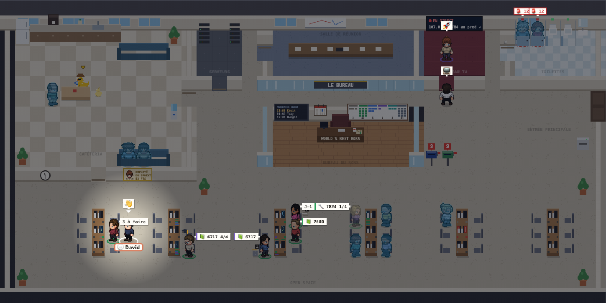

## Où ils vont

- **Bureau** : étape IA ou script en cours.
- **Salle serveurs** : appel d'API. **Salle de réunion** : sous-workflows.
- **Bureau du boss** : validations et questions qui t'attendent.
- **Toilettes** : en panne (🚨 après 3 échecs d'affilée). Quand un run réussit juste après la panne, l'agent sort avec la bulle « ✅ Rétabli ! » et les agents au travail l'applaudissent (👏) pendant quelques secondes.
- **Plateau TV** : mises en prod du jour (fermé le vendredi et le week-end). Pendant le déploiement en prod, son auteur monte sur la scène et le boss vient suivre devant le plateau, puis tout le monde fête la mise en prod. Une release publiée ou un déploiement sur staging seul (un test, sans prod derrière) n'y amènent personne : ils restent dans le fil, sur l'écran du plateau et dans la fiche des mises en prod.
- **Café, canapés** : run réussi récemment, ou rien à faire. La cafétéria a deux canapés de trois places, l'un en bas, l'autre en haut à droite près du comptoir : chacun prend une place libre, personne ne s'assoit sur un autre.

Quand un ticket passe en Reopen dans Jira, Gandalf entre par la porte. Lui, celui qui a réouvert le ticket (souvent le testeur) et le développeur se retrouvent en salle de réunion : le développeur d'un côté de la table (« 😨 7089 »), le testeur et Gandalf en face, et Gandalf crie en grand « Vous ne passerez pas ! ». Trois minutes plus tard, il repart par la porte et chacun retourne à sa place. Sans héraut des reopens, le testeur va simplement le dire au développeur à sa place. La scène se rejoue à l'heure exacte du changement de statut.

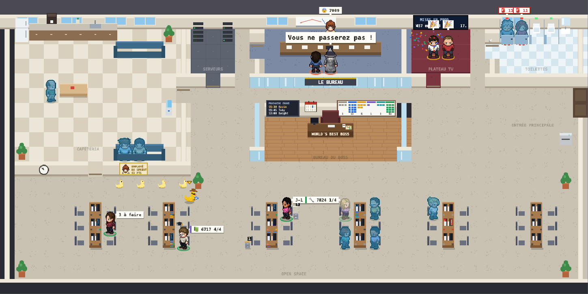

Quand une mise en prod réussit, Yoda entre aussi par la porte. Il monte sur la scène du plateau TV à côté de celui qui a fait la mise en prod (l'assigné du ticket de la release, ou, pour un autre dépôt suivi, celui qui a lancé le déploiement sur GitHub ; le boss y est déjà, au saxophone) et le félicite en grand : « Fier de toi, je suis. ». Trois minutes plus tard, il repart. Si la prod finit pendant le daily, il les rejoint à la table du daily ; le vendredi et le week-end, plateau fermé, il attend devant le ruban. Sa réplique ne cache jamais les bulles de ses voisins : elle se décale à droite, à gauche ou au-dessus.

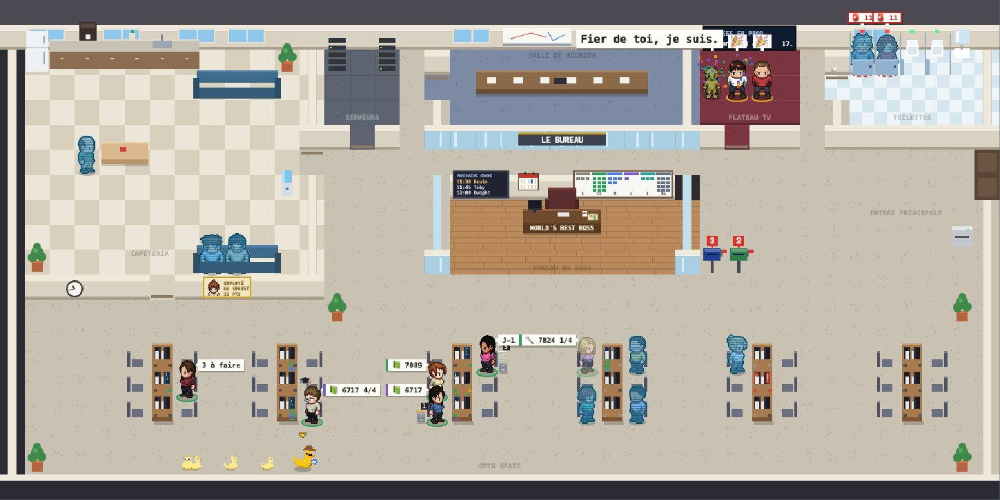

Une mise en prod d'un autre dépôt suivi peut être lancée par quelqu'un qui n'est ni dans l'équipe ni dans le sprint (une autre équipe, un ops). Il vient quand même : il entre par la porte quand le déploiement en prod démarre, sous son login GitHub, le suit sur la scène du plateau TV, fête la mise en prod, puis repart. Dans le fil : « 🚀 bobvance met api 2.4.0 en prod ».

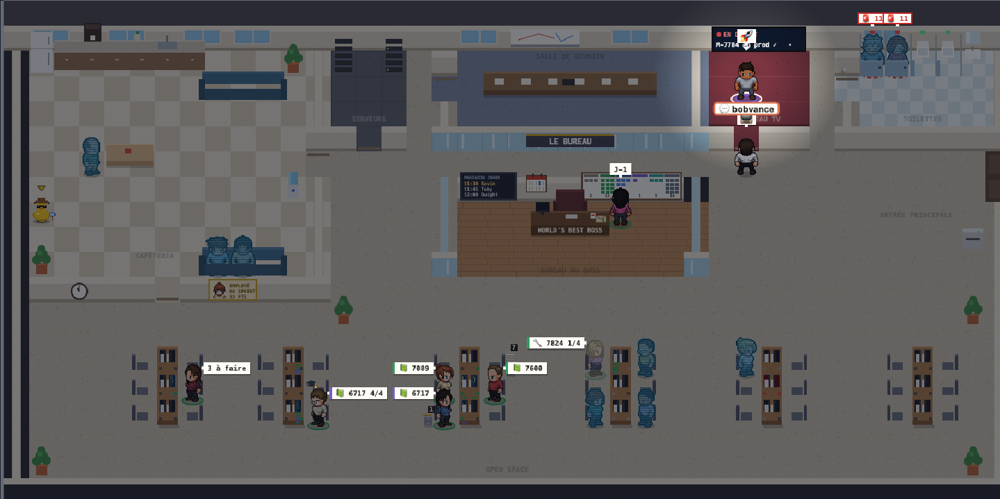

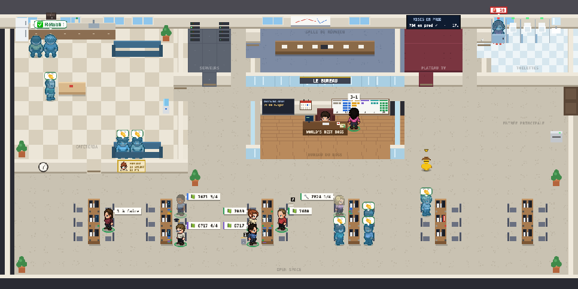

Gandalf et Yoda viennent dans tous les bureaux, quelle que soit l'équipe (`team/guests.json`). Pour les retirer : `"common_guests": false` dans `bureau.config.json` ; pour en changer le nom, la réplique ou l'allure : un invité de même clé (`g_gandalf`, `g_yoda`) dans le roster de l'équipe ou dans la config.

D'autres changements de colonne se jouent aussi, à l'heure exacte du changement de statut :
- **Ticket à tester** : le développeur porte le dossier au bureau du testeur (« 📁 6717 »), et le dossier rejoint la pile du testeur, sur le caisson à côté de son bureau.
- **Ticket validé** : le testeur lève le pouce depuis son bureau (« 👍 6550 validé ») et le développeur lève les bras (🙌), boss compris.

| Ticket livré au testeur | Ticket validé |
| --- | --- |
| 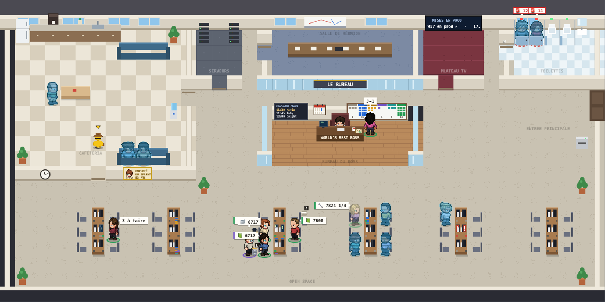 | 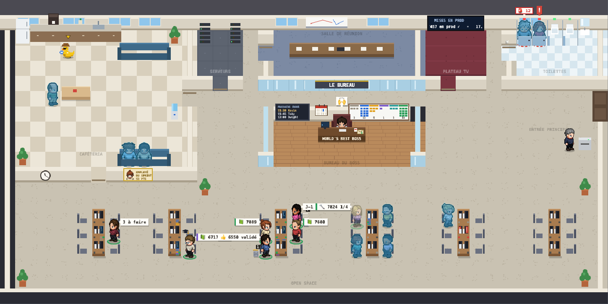 |

Le sprint a ses rendez-vous : le premier jour, juste après le daily, l'équipe passe 5 min devant le Kanban (🏁) ; le dernier jour, des boîtes de pizza arrivent sur la table de la cuisine vers midi et tout le monde y mange de 12h à 12h40 (🍕).

| Lancement du sprint | Pizzas du dernier jour |
| --- | --- |
| 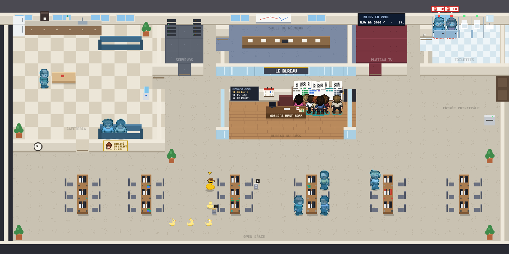 | 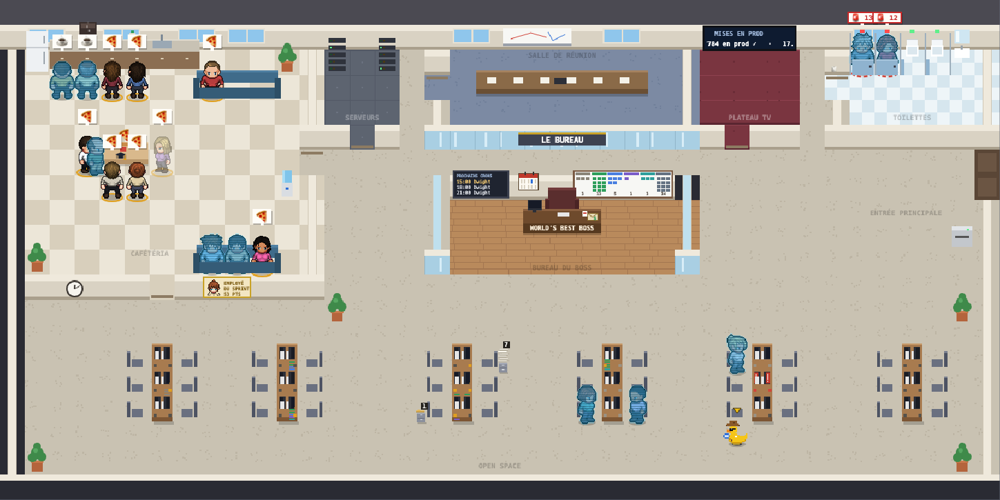 |

L'anneau sous les pieds double la couleur par une forme (lisible par les daltoniens) : plein = au travail, pointillés = attend une validation, tirets = en panne.

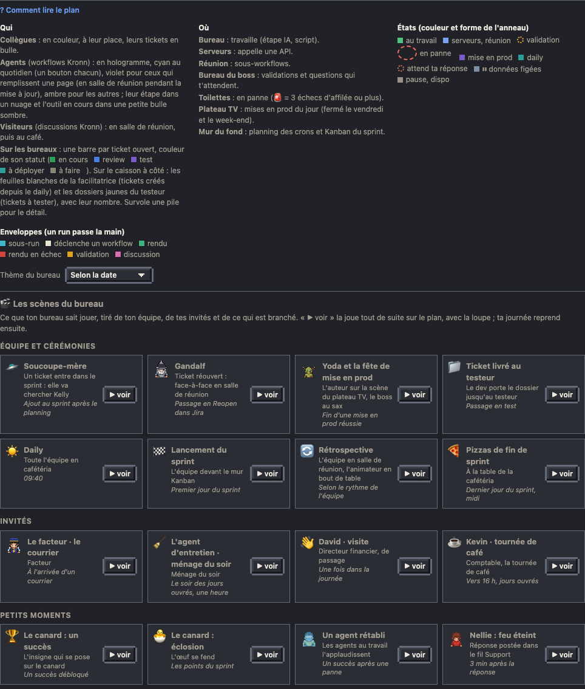

## Détails

- Chaque agent porte une icône et son métier à côté de son prénom (« 🔎 Dwight · Reviewer de PR », « 🚨 Creed · Erreurs prod ») : sur le plan, dans Qui fait quoi, dans le panneau et sur sa fiche. L'icône est devinée depuis le nom du workflow (🔎 revue, 📰 veille, ⚡ performance, 🚨 erreurs, 🧪 tests, 🚀 MEP, 🧳 migration…). En mode TV, seul le métier s'affiche.

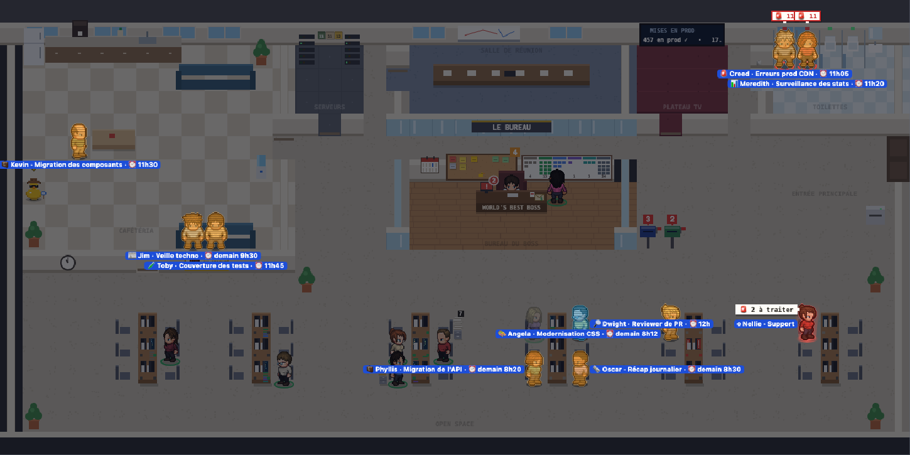
- Clic sur un personnage : sa fiche (voir [Fiches](07-fiches.md)). Survol : son nom et ce qu'il fait.
- La lumière suit le soleil au bureau : fenêtres, crépuscule, voile de nuit qui s'ouvre autour de chaque personnage, lampes des bureaux occupés.
- Quand un run en lance un autre, une enveloppe passe d'un agent à l'autre (sous-run, déclenchement, validation, discussion).
- « Sur le plan » dans le panneau met une famille en avant (équipe, agents ou visiteurs), avec ses noms.
- En bas du panneau, « Et aussi » liste les invités du moment (Yoda, Gandalf, un invité de passage…), tant qu'ils sont dans le bureau, et le canard, avec ce qu'il fait (« se promène · cafétéria », « attend ta réponse »). Survol : il ressort sur le plan. Clic : sa fiche. Ce groupe n'apparaît que dans la vue « Tous ».

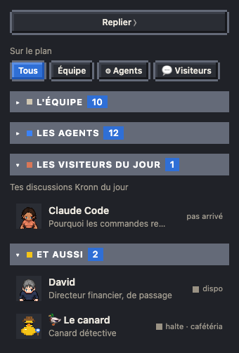
- « Replier ⟩ » en haut du panneau le réduit à une bande : le plan prend presque toute la largeur (×1 sur un écran de 1440 px au lieu de ×0,77). Un clic sur un personnage le rouvre.
- Au clavier : Tab jusqu'à la liste de l'équipe, flèches pour passer d'une personne à l'autre (elle ressort sur le plan), Entrée pour ouvrir sa fiche.

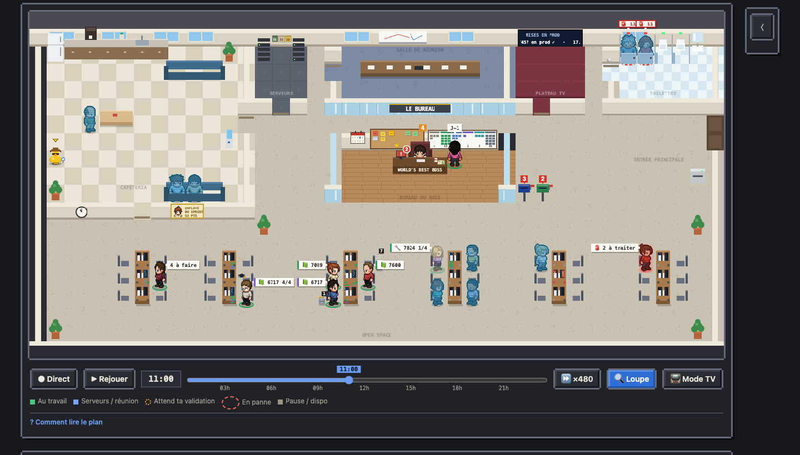
- Les bulles des tickets affichent depuis combien de jours le ticket est dans sa colonne (« 📗 7685 · en review · 6 j »).
- Sur les bureaux, des piles montrent le travail de chacun :
  - devant chaque collègue, sous son écran, une barre par ticket ouvert (5 au plus), de la couleur de son statut : vert en cours, bleu en review, violet en test, bleu-vert à déployer, gris à faire ;
  - sur un caisson dans l'allée, à côté de la facilitatrice, une feuille blanche par ticket créé par l'équipe depuis le dernier daily (la pile repart de zéro à chaque daily) ;
  - sur un caisson à côté du testeur, un dossier jaune par ticket du sprint en test.

  Les caissons affichent le nombre exact (6 éléments dessinés au plus). Survole une pile pour le détail : « Karen : 3 tickets à tester · DM-6717, … ».

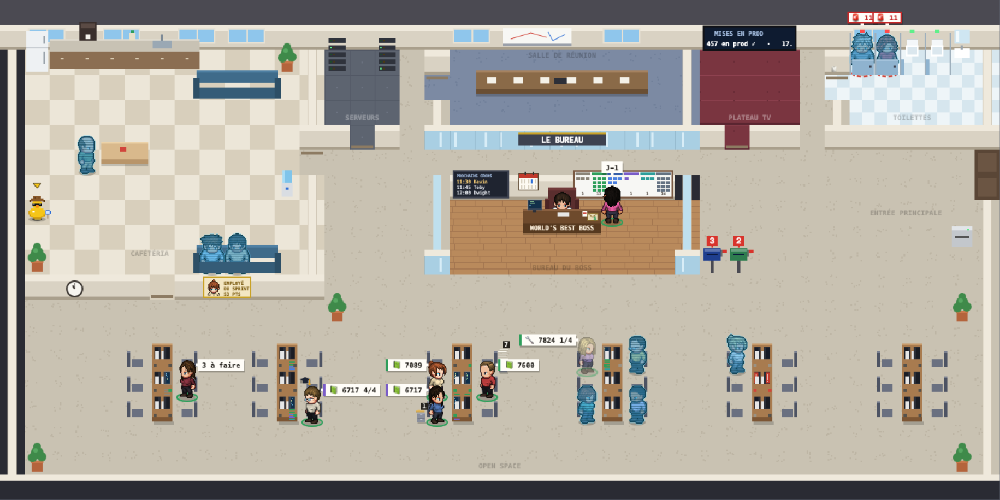
- Selon la date, le bureau se déguise : voir [Thèmes saisonniers](12-themes.md). « Comment lire le plan » permet d'en essayer un tout de suite.

## Les passions de l'équipe

Chacun peut avoir une passion (clé `passion` du roster), qui se joue sur le plan une fois par jour ouvré, à une heure tirée au sort entre 10h30 et 17h, la même pour tous :

- **Badminton** : la personne se lève et frappe un volant qui traverse la pièce (2 min).
- **Basket** : une minute de tirs au panier, avec le score et des « SWISH! ».
- **Boxe** : gants aux mains, quelques séries au sac de frappe (« POW! », 2 min).
- **Le soir en hologramme** (`soir_holo`) : en semaine, de la fin des heures de bureau à 3h du matin (le vendredi soir compris, jusqu'au samedi 3h), la personne vient travailler en semi-hologramme (reflet bleu, lignes de balayage), avec son petit robot IA.

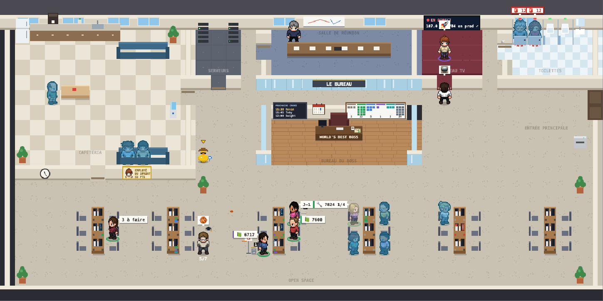

Les cartes de passion des fiches sont décrites dans [Fiches](07-fiches.md).

## Le canard

Un canard de bain jaune se promène tout le temps dans tout le bureau : jour et nuit, en semaine comme le week-end, et en mode TV. Il marche lentement vers une case libre tirée au sort, en se dandinant, s'y arrête de 20 secondes à une minute, puis repart ailleurs : cafétéria, salle serveurs, toilettes, open space… Il est un peu plus grand que nature et une petite flèche jaune flotte au-dessus de lui, pour le repérer d'un coup d'œil sur la moquette. Son parcours ne dépend que de la date et de l'heure : tout le monde le voit au même endroit au même instant, et le rejeu le refait à l'identique.

Un clic sur lui ouvre sa fiche (voir [Fiches](07-fiches.md)) : c'est la [méthode du canard en plastique](https://fr.wikipedia.org/wiki/M%C3%A9thode_du_canard_en_plastique), on lui explique son problème dans une discussion Kronn.

Quand une de ses discussions attend ta réponse, en direct (pas en rejeu), il quitte sa promenade, marche jusqu'au bureau du boss et attend devant, de face, avec une bulle « ? » à la place de sa flèche. Le groupe « Et aussi » du panneau dit aussi « attend ta réponse », et sa fiche ouvre la discussion dans un nouvel onglet. Une fois ta réponse donnée, il reprend sa promenade.

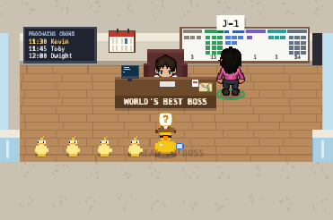


### Le canard d'équipe

Le canard appartient à toute l'équipe : il grandit avec le travail collectif du sprint, jamais avec celui d'une personne.

- **Ses stades** : œuf, caneton, canard de bain, canard détective, canard sage, canard doré. Ils suivent les points des tickets du sprint passés en terminé, rapportés à la cible du sprint : la moyenne des points terminés des 4 derniers sprints fermés. Caneton dès 25 % de la cible, canard de bain dès 50 %, détective dès 75 %, sage à 100 %, doré à 120 %. Le premier jour du sprint suivant, il mue et repart de l'œuf. Le stade suit l'heure affichée, rejeu compris.
- **Ses canetons** : un sprint est tenu quand ses points terminés atteignent la moyenne des 4 sprints d'avant. Chaque sprint tenu parmi les 8 derniers lui donne un caneton, qui le suit en file indienne pendant sa promenade (6 dessinés au plus, puis « ×8 »).
- **Ses succès** : des faits réels de l'équipe lui font porter un accessoire. Un seul couvre-chef à la fois (couronne, puis auréole, puis casquette), qui remplace le chapeau du détective ; le caneton les porte en plus petit, l'œuf n'en a pas.

| Succès | Quand | Accessoire |
| --- | --- | --- |
| Zéro panne | Aucun agent en panne (3 échecs d'affilée) la semaine dernière | Lunettes de soleil |
| Lève-tôt | Une mise en prod réussie avant 11 h depuis le début du sprint, sur un des dépôts suivis | Casquette |
| Pas un reopen | Aucun ticket réouvert pendant le sprint précédent | Auréole |
| Relu dans la journée | Chaque PR ouverte la semaine dernière a eu sa première review en moins de 24 h ouvrées | Loupe |
| Bavard | 10 discussions avec le canard, depuis le début | Cape |
| Triplé | Les 3 derniers sprints tenus | Couronne |

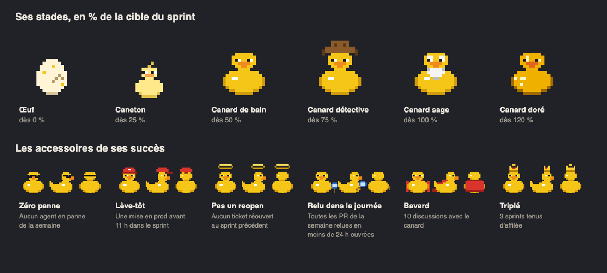

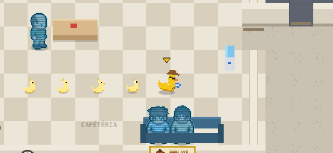

Ses moments forts se jouent en petites scènes de 3 secondes (puis leur bulle reste 4 secondes), à l'heure du fait, en direct comme en rejeu :

- **Succès débloqué** : l'accessoire tombe du ciel et se pose sur lui, dans des étincelles, avec la bulle « 🏆 Lève-tôt ! ». Il ne le porte qu'à partir de cette heure : celle de la mise en prod pour « Lève-tôt », le lundi à l'ouverture du bureau pour les succès de la semaine passée, le début du sprint pour ceux du sprint.
- **Éclosion** : quand il atteint le stade caneton, l'œuf tremble, se fend (« crac ! »), la coquille vole et le caneton sort.
- **Changement de stade** : un nuage « POUF » le cache, il ressort à son nouveau stade (« Canard détective ! ») ; au premier jour du sprint, le même nuage le fait muer en œuf.
- **Caneton né** : au début d'un sprint qui suit un sprint tenu, un petit œuf tremble juste derrière lui, puis le nouveau caneton rejoint la file.

| Succès débloqué | Éclosion |
| --- | --- |
| 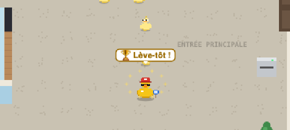 | 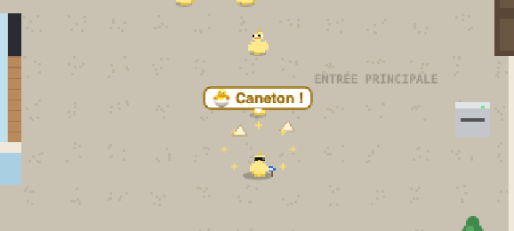 |

Quand il change de stade, gagne un succès ou qu'un caneton naît (dans les 2 heures qui suivent le début d'un sprint, si le précédent est tenu), la [loupe](#loupe-sur-les-événements-forts) s'ouvre aussi sur lui. Les chiffres viennent du cron « Le Bureau · canard d'équipe » (toutes les heures, 0 token) : graphique de vélocité et réouvertures dans Jira, runs des agents et discussions dans Kronn, mises en prod et reviews avec `gh`. Sans ces données, il reste un canard de bain, sans canetons.

## Changer de plan pour toute l'équipe

Le plan se décrit dans un fichier JSON (voir [Développer, plan du bureau](../developpement.md#plan-du-bureau-layoutsjson)). Chacun est placé par le plan (`seating`, par numéro de siège : `I2.R2` = îlot 2, côté droit, rang 2), les autres reçoivent un siège libre, toujours le même.

```sh
python3 tools/plan.py check mon-plan.json    # erreurs et avertissements
python3 tools/plan.py seats mon-plan.json    # qui s'assoit où, et qui change de place
python3 tools/plan.py share mon-plan.json    # le proposer à toute l'équipe
python3 tools/plan.py share defaut           # revenir au plan de l'installation
```

`share` lance le workflow « Le Bureau · plan » : il revérifie le plan, puis attend la validation du boss. La demande apparaît dans la fiche du boss (clic sur son personnage, qui porte alors la bulle ✋), avec son résumé (taille, sièges, places qui changent) et ses boutons Approuver, Rejeter, Changements. Une fois validé, la page se redessine sans rechargement et chacun rejoint sa nouvelle place. Un plan refusé n'est jamais publié.

| Sur le plan : la bulle ✋ du boss | Dans sa fiche : la carte de décision |
| --- | --- |
| 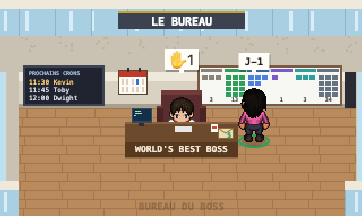 | 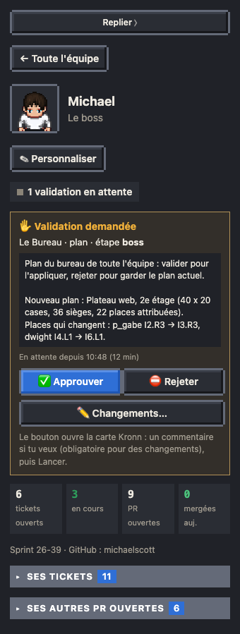 |

## Partir d'un croquis ou d'une photo

Pas besoin d'écrire le JSON : Claude dessine un brouillon à partir d'un croquis ou d'une photo du plan (PNG, JPEG ou WebP ; une photo HEIC s'exporte d'abord en JPEG). Le vérificateur le relit et Claude corrige ses erreurs, 4 tours au plus. Ce qui manque au dessin mais dont le Bureau a besoin (salle serveurs, toilettes, bureau du boss) est ajouté là où c'est plausible, et chaque supposition est listée.

- **En local** : `python3 tools/plan.py from-image croquis.jpg` (CLI `claude` connecté, Opus par défaut, `--model sonnet` pour aller plus vite). Le brouillon arrive dans `dist/plan-brouillon.json` avec son aperçu `dist/plan-brouillon.png`, puis la commande demande s'il faut le proposer à l'équipe (`plan.py share`, toujours validé par le boss).
- **Dans Kronn** : dans une discussion, joins l'image à ton message puis enchaîne le Quick Prompt « Le Bureau · plan vers brouillon ». L'agent écrit le même brouillon, le vérifie, regarde l'aperçu et te demande avant de le proposer.

| Croquis | Brouillon obtenu (premier tour, sans retouche) |
| --- | --- |
| 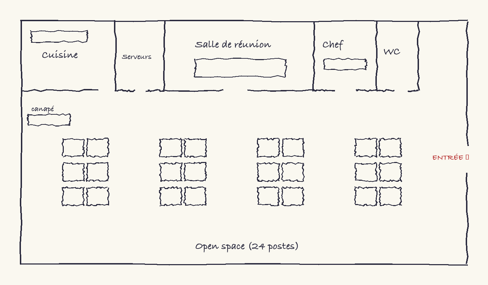 | 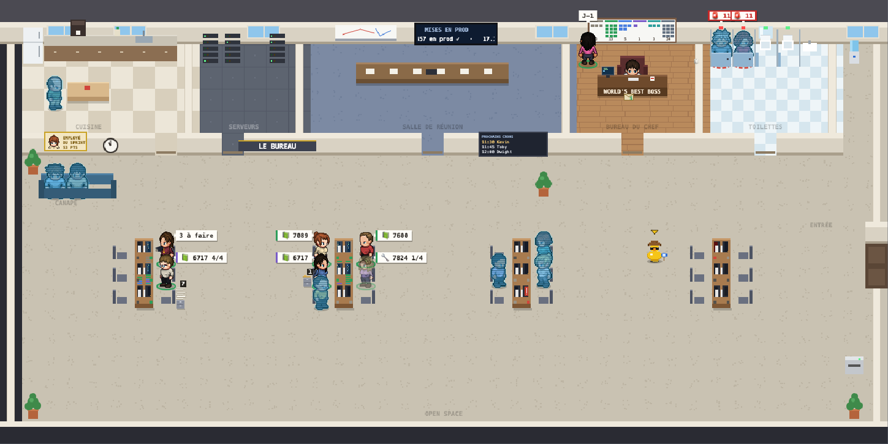 |

Le brouillon garde l'esprit des lieux, pas les cotes : une case vaut environ 50 cm, les postes deviennent des îlots (une table, un siège de chaque côté). Relis les suppositions, retouche le JSON si besoin (`plan.py check`), puis propose-le.

## Collègues de passage

Une personne qui a des tickets dans le sprint sans être dans le roster de l'équipe est « de passage » : elle n'est pas ajoutée à l'équipe. Son rôle affiché est « De passage » ; elle a la place libre la plus au fond du plan, jamais celle d'un collègue, d'un agent ou d'un intérimaire, et la garde d'un rafraîchissement à l'autre. Elle reste à sa place tant qu'elle a un ticket ouvert dans le sprint, au travail s'il est en cours (aux heures de bureau, comme tout le monde ; sans ticket ouvert, elle n'est pas là) et ne vient ni au daily ni aux cérémonies. Pour la faire entrer dans l'équipe : l'ajouter au roster.

## Loupe sur les événements forts

Quand un événement fort commence, un cadre de couleur entoure la scène sur le plan, qui reste entier, et une fenêtre flottante l'agrandit en bas à gauche de l'écran (à droite si elle couvrait la scène). La fenêtre porte un liseré de la couleur de l'événement, la légende (qui et quoi ; clic : sa fiche ; ✕ : fermer) et une barre du temps restant.

| Une réouverture : Gandalf convoque Pam | Le daily |
| --- | --- |
| 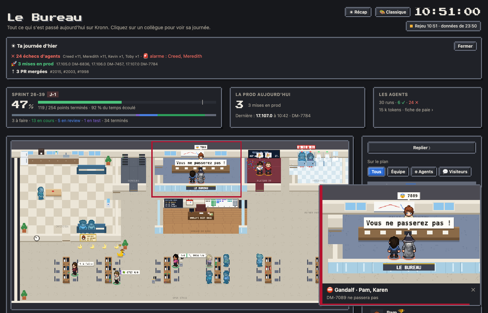 | 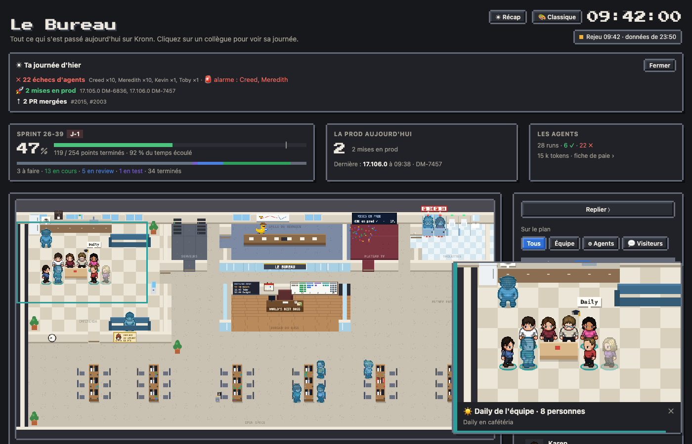 |

- **Les événements** : un ticket réouvert (⛔, le héraut convoque l'assigné), une mise en prod réussie (🎉, le sage félicite l'auteur), la fête d'une MEP (🎉), un invité qui arrive (👋), le pouce du testeur qui valide (👍), le canard qui change de stade (🦆), gagne un succès (🏆) ou dont un caneton naît (🐣), et les cérémonies : daily (☀️), sprint planning (🗓), rétro (🔄), lancement du sprint (🏁), pizza de fin de sprint (🍕). Pour une cérémonie, la légende la nomme et compte l'équipe (« Daily de l'équipe · 10 personnes »), l'animateur en dessous.
- **Une loupe à la fois**, ouverte une fois les personnages arrivés (40 s au plus d'attente), pendant 20 s ; deux événements au même endroit (la fête et le sage) n'en font qu'une.
- **En rejeu accéléré** (même à x1500), la lecture s'arrête dès qu'un événement commence, le temps que les personnages arrivent et que la loupe passe, puis reprend. Deux événements au même endroit : le plus parlant d'abord (le sage avant la fête de MEP). Rien quand on fait glisser l'heure, ni quand la souris est sur le plan.
- **Fermer** : ✕, clic sur le plan ou Échap. **Couper** : bouton « 🔍 Loupe » sous le plan (retenu dans le navigateur) ; sur l'écran mural, `?loupe=0` dans l'adresse.
- **Animations réduites** : avec le réglage système « réduire les animations », la loupe est éteinte par défaut ; le bouton « 🔍 Loupe » la rallume (choix retenu).
- Aussi en mode TV, où personne ne clique : la fenêtre se pose sur les cartes de chiffres et se referme seule.
