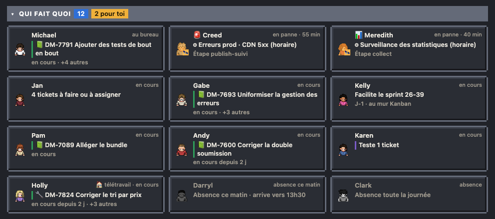

# Qui fait quoi

Une carte par personne et par agent actif : ce qu'il fait maintenant, son ticket ou son étape, depuis quand (pour un ticket : depuis son entrée dans la colonne, d'après l'historique Jira).

- La couleur du bord suit l'état (au travail, en panne, validation, pause).
- Collègues : ticket en cours (son titre sur deux lignes au plus, sans le « [Composant] » du début), puis en gris sa colonne, depuis quand et « +3 autres ». Les rôles sans ticket à eux ont un titre court et leur détail en gris : la testeuse « Teste 7 tickets » / « le plus ancien depuis 3 j · 2 écrits cette semaine », la facilitatrice « Facilite le sprint 26-39 » / « J-1 · au mur Kanban », la PO « 3 tickets à faire ou à assigner ». Agents : workflow et étape ; l'intérimaire d'une page, déjà au nom de sa page, dit « ↻ Met sa page à jour, sur l'écran » plutôt que le nom de son workflow. Sa famille (🧰 au quotidien, 📺 pages, 🛰 autres) est une pastille au coin du portrait : le texte ne bouge pas.
- Au survol d'une carte : tout son texte, avec la liste complète de ses tickets (clé et titre).
- Le compteur « pour toi » signale les cartes qui demandent une action du boss.
- Absences (planning de l'équipe) : pendant les heures de bureau, une carte grisée en fin de grille (plus rien le soir ni le week-end), « Absence toute la journée » ou « Absence ce matin · arrive vers 13h30 », jamais la raison ; le télétravail s'écrit devant l'état (« 🏠 télétravail · en cours »). Voir [Absences et télétravail](14-absences.md).
- Clic sur une carte : la fiche du personnage. Sur téléphone, cette liste passe avant le plan.
