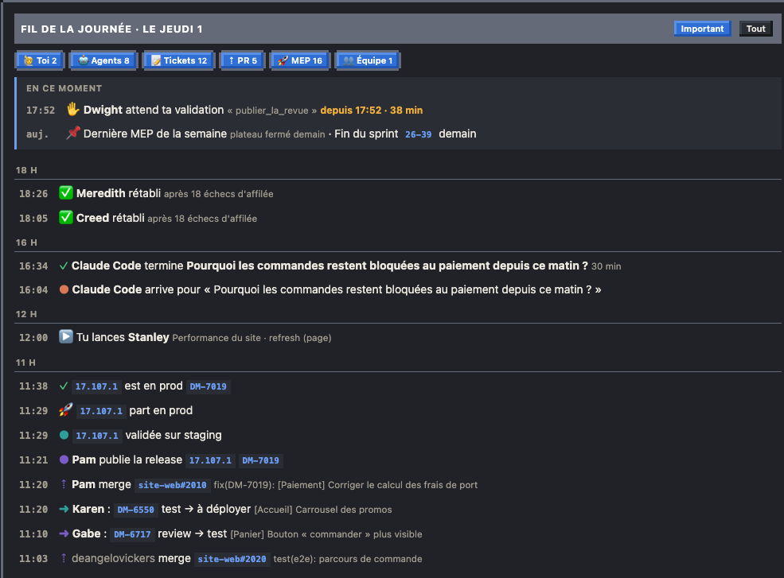
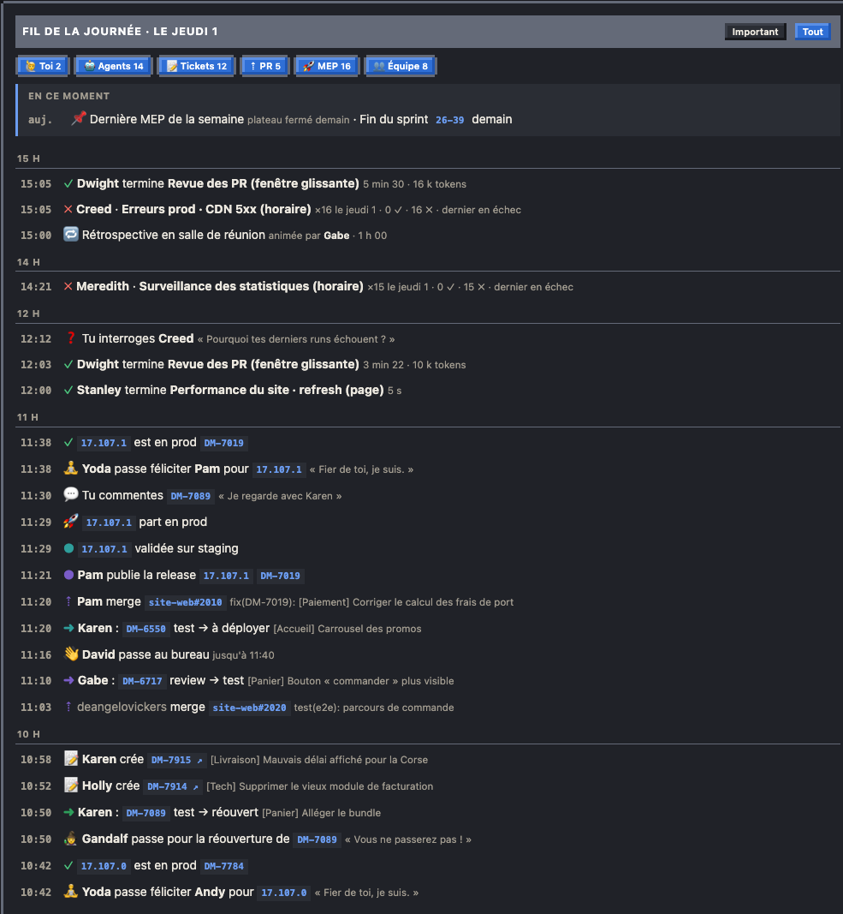
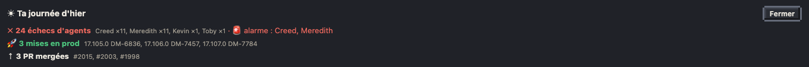

# Fil de la journée et récap

Le fil raconte la journée, heure par heure ; le récap la résume en quelques lignes.

- **En ce moment**, en haut du fil (dans « Important » comme dans « Tout ») : ce qui t'attend, avec depuis quand (« ✋ Dwight attend ta validation « publier_la_revue » · depuis 17:52 · 38 min », un visiteur, le canard ou un agent interrogé qui attend ta réponse, depuis l'heure de sa question), puis une seule ligne de repères déduite du calendrier : « 📌 Dernière MEP de la semaine · Fin du sprint 26-39 demain », « Pas de MEP aujourd'hui (vendredi) », « Premier jour du sprint », « Bon week-end » (le dernier jour ouvré, à partir de 15 h). Le nom du sprint mène à sa tuile en haut de page. Calculé pour l'heure affichée : le rejeu montre ce qui attendait à ce moment-là.
- Tes actions : en « Important », ce que tu lances à la main (bouton Relancer, lancement depuis une page, ou dans Kronn) : « 🔁 Tu relances Kevin · Migration des blocks », « 🤖 Tu lances Implémentation ticket sur EW-7852 · Ryan s'y met » ; dans « Tout », ce que tu poses depuis Le Bureau : « 💬 Tu commentes DM-7089 », « ❓ Tu interroges Creed », « 🦆 Tu ouvres une discussion avec le canard ». Les commentaires et les questions arrivent avec le cron du bureau (toutes les 10 min).
- Une validation décidée quitte « En ce moment » et entre dans le fil : « ✅ Tu valides la gate de Dwight · « publier_la_revue » · après 25 min d'attente » (ou « ⛔ Tu refuses »), datée par l'étape Gate du run.
- Événements : runs d'agents (regroupés au-delà de 4 runs par jour : « Creed ×38, 31 ✓ 7 ✗ »), tickets créés par l'équipe (« 📝 Jan crée DM-7910 », aussi dans le bandeau du mode TV), tickets Jira qui changent de statut, PR ouvertes, relues et mergées, releases, staging et prod, daily, discussions.
- Pannes des agents, avec la règle de l'alarme du plan (3 échecs d'affilée) : « 🚨 Creed en panne · 3 échecs d'affilée sur Erreurs prod » au 3e échec, puis « ✅ Creed rétabli · après 18 échecs d'affilée » au premier succès. En « Important », ces deux lignes remplacent le regroupement « Creed ×16 · 0 ✓ · 16 ✗ » ; « Tout » garde le regroupement pour les chiffres.
- Le canard d'équipe : « 🏆 Le canard débloque un succès » et « 🐣 Un caneton est né » (début d'un sprint qui suit un sprint tenu) en « Important » ; ses changements de stade et sa mue au début du sprint dans « Tout ».
- Dans « Tout » seulement : le sprint planning et la rétrospective à leur heure (« 🔁 Rétrospective en salle de réunion · animée par Clark · 1 h 00 ») et les visites : le gardien des reopens à chaque réouverture, le héraut des mises en prod à chaque prod réussie, les invités à leur arrivée (« 👋 David passe au bureau · jusqu'à 11:40 », ou « passe voir » le collègue qu'il salue en premier).

- Liens dans chaque ligne :
  - un nom en gras ouvre la fiche de la personne ou de l'agent (et l'allume sur le plan au survol) ;
  - une étiquette ouvre une fiche dans la page : ticket du sprint, PR (la fiche de son ticket, avec ses PR et les boutons Relire et Corriger), version (la fiche de la mise en prod) ;
  - une étiquette avec ↗ s'ouvre dehors : Jira pour un ticket créé aujourd'hui ou hors du sprint, GitHub pour une PR sans ticket du sprint ;
  - un nom grisé n'a pas de fiche (relecteur hors de l'équipe, par exemple) : la raison s'affiche au survol.

  Un clic ailleurs sur la ligne ouvre, comme avant, la fiche de la personne principale (ou celle de la mise en prod).
- Filtre « Important » (par défaut) ou « Tout », et pastilles par type, avec leur nombre de lignes : 🙋 Toi (tes actions et tes validations), 🤖 Agents (runs, pannes, visiteurs), 📝 Tickets, ⇡ PR, 🚀 MEP, 👥 Équipe (daily, sprint, cérémonies, visites, canard). Un clic éteint ou rallume un type ; le navigateur s'en souvient. « En ce moment » reste affiché quels que soient les filtres. Le titre dit « hier » quand les données sont celles de la veille.

- Bouton « ☀ Récap » de l'en-tête : ce qui s'est passé depuis minuit (ouvert d'office avant midi, sur la journée d'hier).
