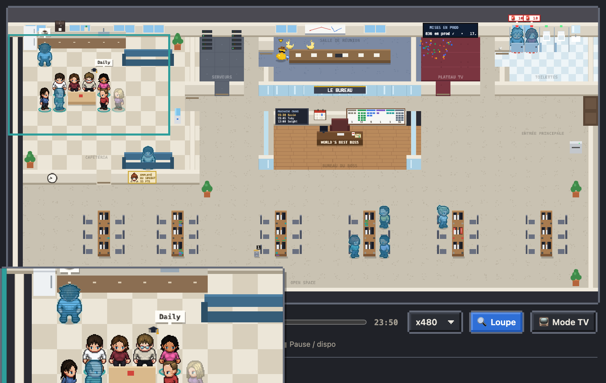
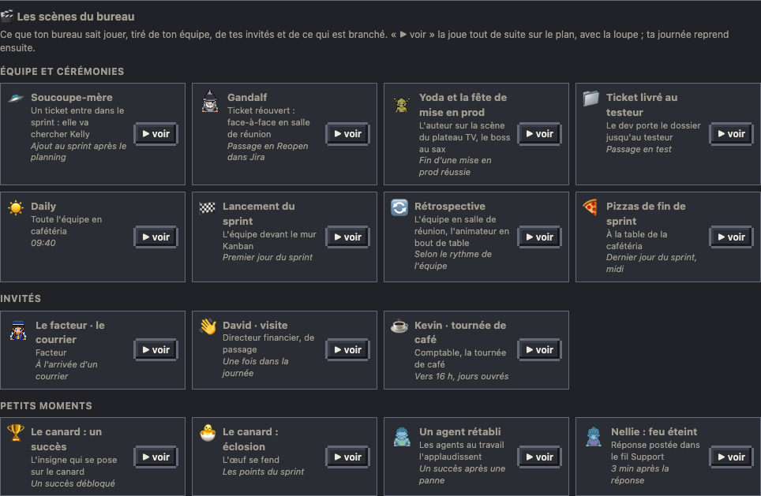

# Rejouer la journée

La barre sous le plan déplace l'heure affichée : tout le bureau (personnages, écrans, fil, tuiles) se recale.

- « ● Direct » : l'heure réelle. « ▶ Rejouer » : la journée en accéléré, retour au direct à la fin.
- **L'heure** : tape-la dans le champ (« 14:36 », « 14h36 » ou « 9 ») puis Entrée, et le bureau s'y place, en pause. Pendant que tu fais glisser le curseur, une bulle au-dessus donne l'heure ; les heures de la journée sont marquées sous la frise.
- Le curseur va du premier run du jour (un quart d'heure avant) à la dernière donnée reçue.
- **La vitesse** : le bouton « ⏩ ×480 » passe à la suivante à chaque clic (×1, ×2, ×10, ×60, ×480). En lecture rapide, les personnages marchent plus vite (jusqu'à 8 fois à ×480), pour arriver à temps à leurs scènes et repartir sans traîner.
- **« ⏵ revoir »**, sur chaque ligne du fil de la journée : le bureau se place 20 s avant ce moment et le rejoue en ×1, pour voir la scène (soucoupe-mère qui va chercher la facilitatrice, Gandalf, Yoda, une mise en prod…) et la montrer. La loupe s'ouvre sur la scène comme en direct.
- L'en-tête dit d'où viennent les données (direct, instantané, démo) ; voir [Fraîcheur](10-fraicheur.md). En rejeu ou en pause, son badge passe en ambre : « Rejeu 09:30 · données de 23:50 ».

## Les scènes du bureau

Dans « Comment lire le plan », la galerie liste ce que ton bureau sait jouer : les scènes de l'équipe et les cérémonies (soucoupe-mère, ticket réouvert, fête de mise en prod, ticket livré au testeur, daily, lancement du sprint, rétrospective, pizzas), tes invités (tournée de café, facteur, visites), les passions de l'équipe et les petits moments (canard, agent rétabli, « feu éteint » du Support). Elle se tire de ton installation : un invité ajouté au pack ou une passion au roster y apparaît, une console Support ou un courrier non branchés n'y sont pas. Les états qui durent (travailler, l'hologramme du soir) ne sont pas des scènes.

« ▶ voir » joue la scène tout de suite, à l'heure affichée, même si elle n'a pas eu lieu aujourd'hui : un bandeau « 🎬 Démonstration » le rappelle sur le plan, la loupe s'ouvre comme en direct, puis la journée revient telle qu'elle était (ou tout de suite avec « ✕ Revenir »). Les scènes de l'équipe se jouent aux heures de bureau : le soir, place d'abord le curseur dans la journée.

