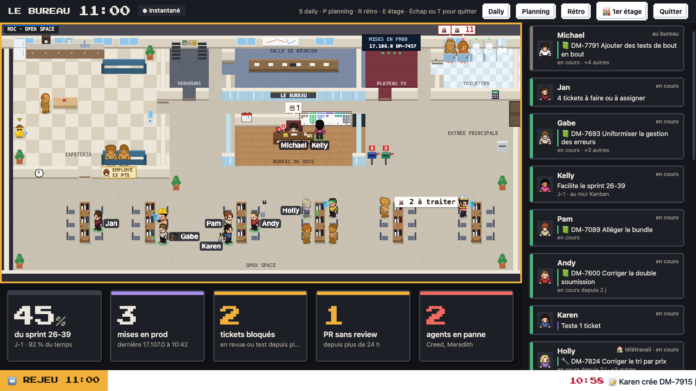
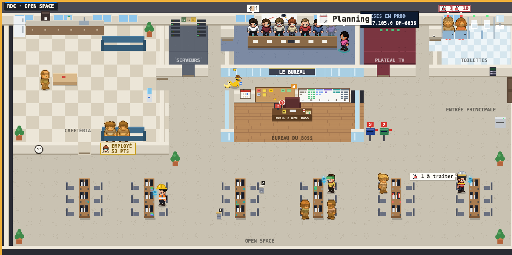
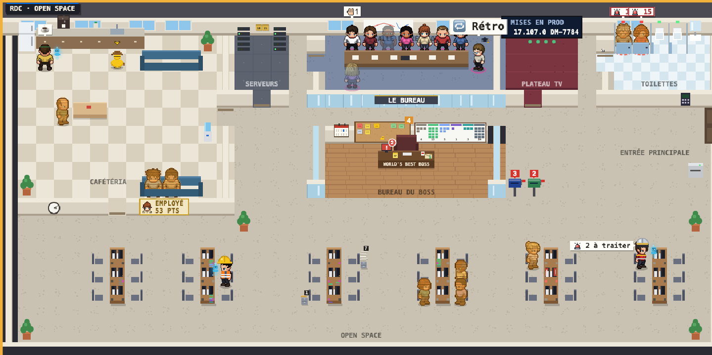
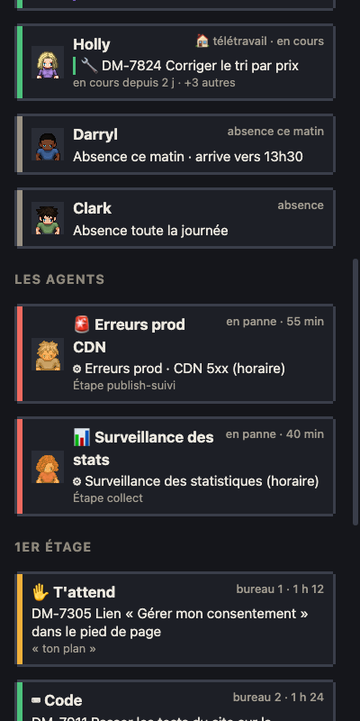
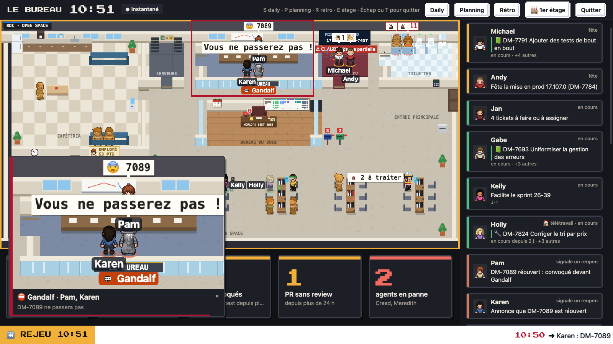

# Mode TV

Pour l'écran de l'open space : plein écran, textes lisibles à 3 m, chiffres du jour en bas.

- Bouton « 📺 Mode TV » ou touche **T** ; **Échap** pour sortir.
- On n'y fait que changer d'étage : un bouton par étage ouvert dans la barre du haut (RDC, -1, 1er, 2e, 3e), l'étage affiché en couleur ; la touche **E** passe à l'étage suivant. La TV reste sur le plan, à toute heure : pas de scènes du daily, du planning ni de la rétro.
- Hors du direct (rejeu, pause), le bandeau du bas dit « ⏪ REJEU hh:mm » en ambre à la place de « EN DIRECT », et le plan est cerclé d'ambre. Aux étages, il donne aussi l'heure du relevé des valeurs grisées ⏱ des tableaux noirs (« ⏪ REJEU 09:15 · ⏱ = relevé de 11:00 ») : la pastille du rejeu, au bout des onglets d'étage, n'est pas affichée en TV.
- Pour l'écran de l'open space, ouvre la page en mode TV par son adresse : Fraîcheur > « ⚙ État de l'installation » la donne toute faite, à copier (choix de l'étage et de la loupe). Elle a la forme `<interface Kronn>/standalone/pages/<id de la page>?tv=1`, où l'interface est `kronn.ui` de ta config (`http://localhost:5173/` pour un Kronn lancé en développement, `http://localhost:3140/` en Docker ou en appli). Paramètres : `&floor=` un étage (`-1`, `1`, `2`, `3`) ou `alt` pour alterner les étages occupés ; `&skin=darkmode` (ou l'id d'un thème du pack d'équipe) pour choisir son thème (le mode TV n'a pas de bouton 🎨 ; sans ce paramètre, l'écran prend celui de l'installation) ; `&loupe=0` pour couper la [loupe sur les événements forts](01-plan.md#loupe-sur-les-événements-forts). Kronn 0.15.2 ou plus ; l'ancienne adresse `#page/<id>?tv=1` marche encore (Kronn la redirige). Dans la vue intégrée de Kronn, ces paramètres ne changent rien.
- Le poste branché à l'écran doit joindre le Kronn de la personne qui a installé la page : sa machine, ou une machine du réseau qui l'atteint.
- Plan en haut (les agents y affichent leur métier plutôt que leur prénom, et seulement quand ils travaillent vraiment : à leur bureau, en salle serveurs, en réunion ou en attente de validation ; sinon au survol), « Qui fait quoi » à droite (l'équipe, puis les agents au travail ou en panne, nommés par leur métier ; mêmes cartes que sur la page : titre sur deux lignes, depuis quand ; la colonne défile toute seule), bande de chiffres (sprint, mises en prod avec la dernière version passée, tickets bloqués, PR sans review, agents en panne) et fil qui défile en bas. La barre du haut ne garde que l'horloge, la fraîcheur des données, les étages et Quitter : tout le reste est dans les chiffres.
- Sur le plan, les collègues n'ont plus leurs bulles de tickets : leur travail est déjà dans « Qui fait quoi ». Restent les bulles des agents, de la mise en prod (🚀, 🎉) et du daily.

## Sprint planning et rétrospective

Deux cérémonies réunissent toute l'équipe en salle de réunion, l'animateur en bout de table avec sa bulle (sur le plan, en mode TV comme ailleurs).

| Sprint planning | Rétrospective |
| --- | --- |
|  |  |

- **Sprint planning** : chaque vendredi de 10h à 10h30, animé par la facilitatrice.
- **Rétrospective** : un jeudi sur deux de 15h à 16h (à partir du 15 octobre 2026), animée par un collègue tiré au sort, le même sur tous les écrans.
- Réglages `rhythm.planning` et `rhythm.retro` de `bureau.config.json` : `{day, at, minutes, every?, from?}` (`every` : toutes les N semaines à compter de la semaine de `from`), `null` pour retirer une cérémonie.

