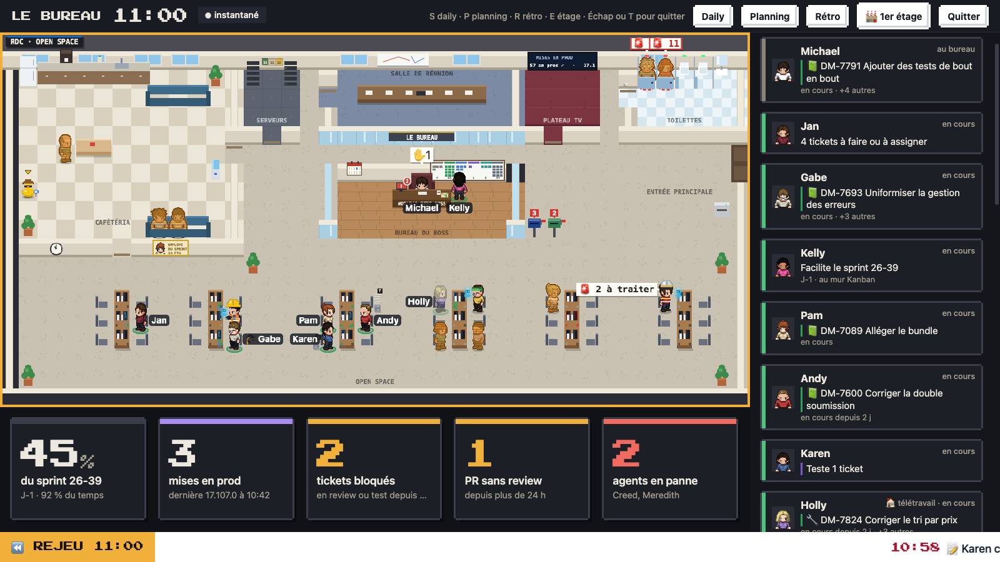
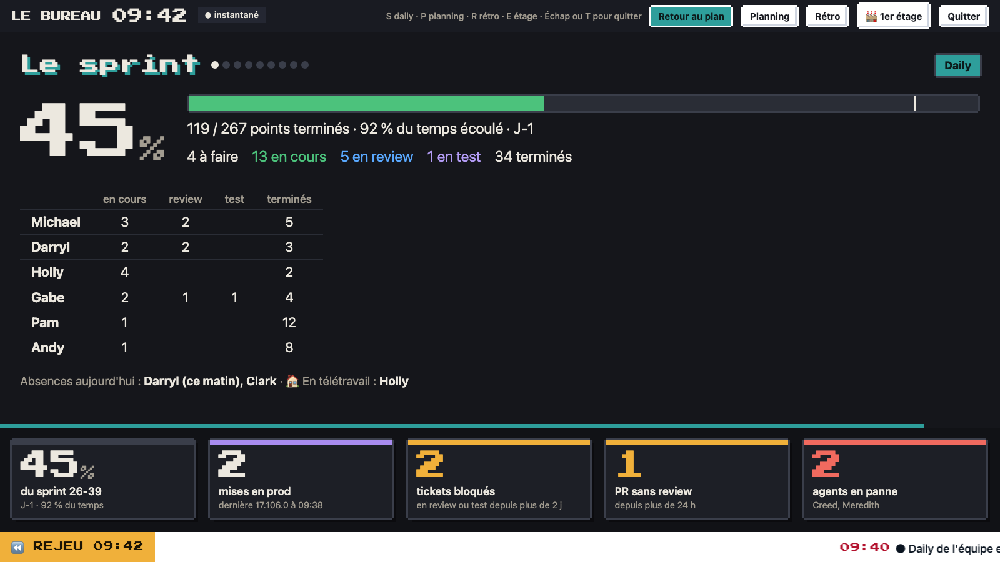
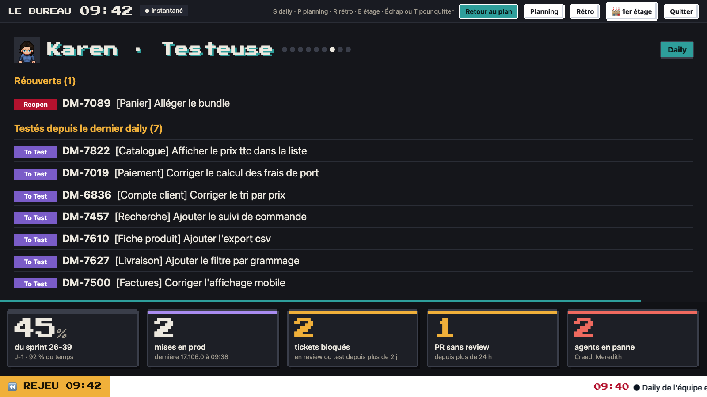
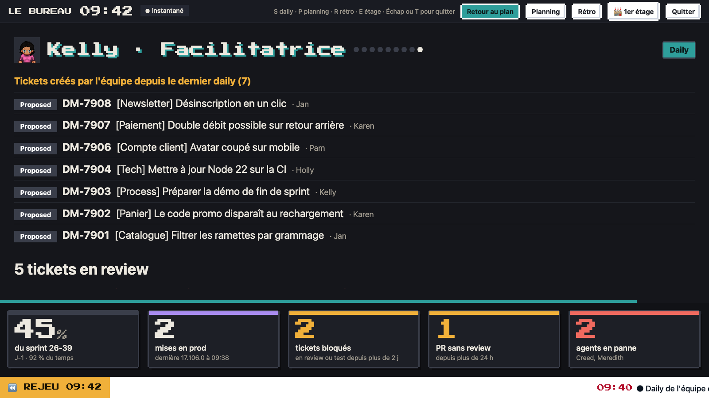
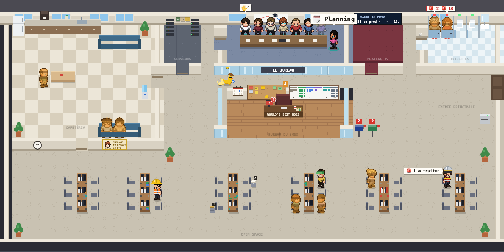
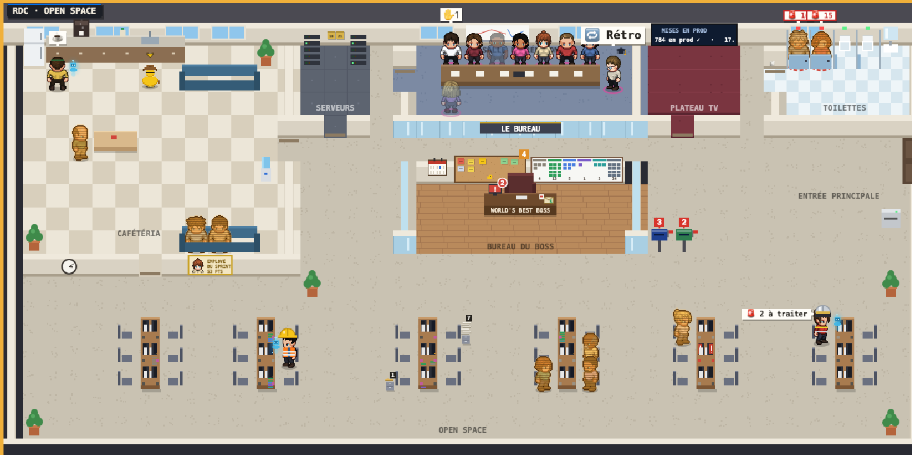
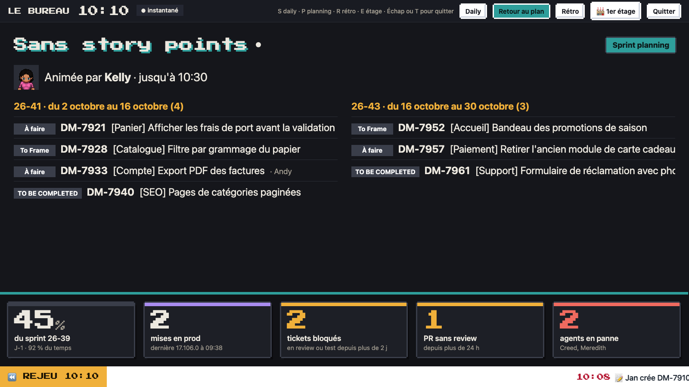
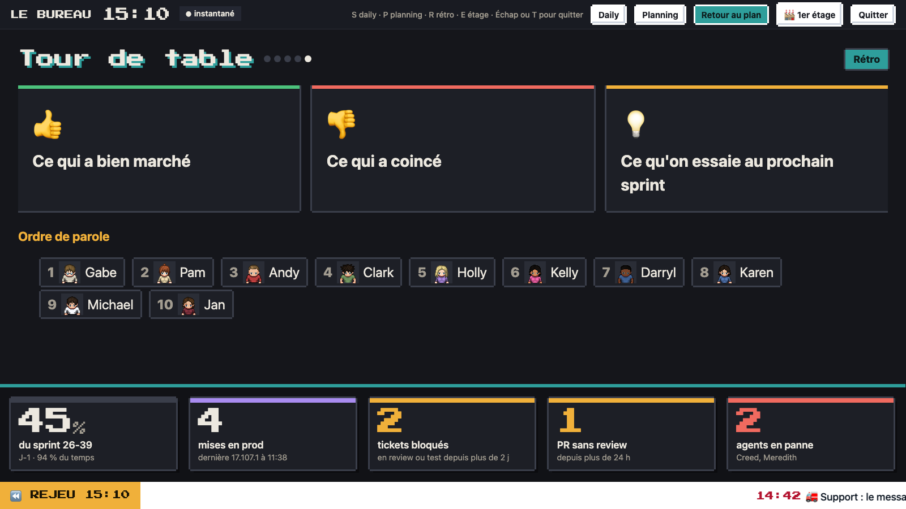
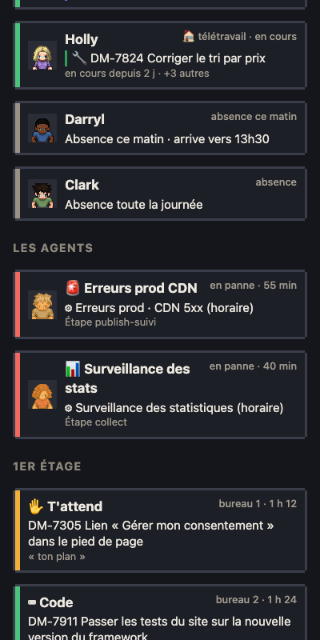
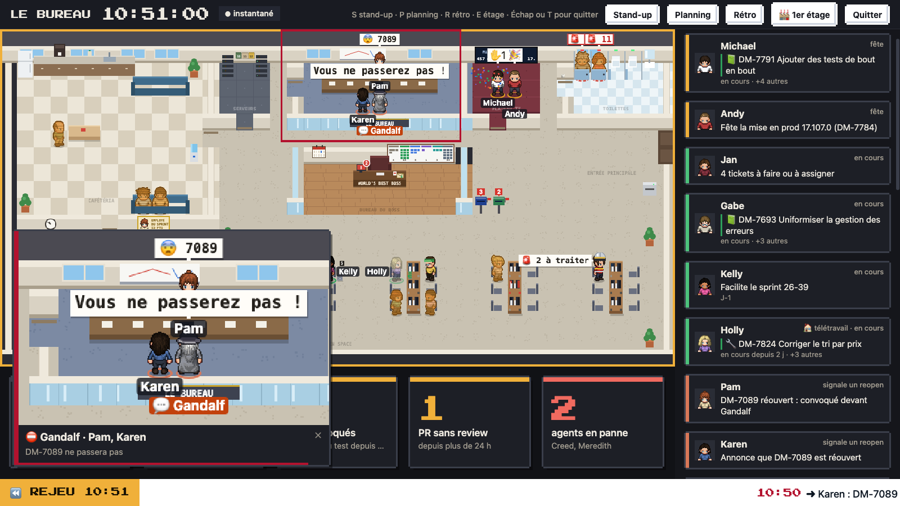

# Mode TV et daily

Pour l'écran de l'open space : plein écran, textes lisibles à 3 m, chiffres du jour en bas.

- Bouton « 📺 Mode TV » ou touche **T** ; **Échap** pour sortir.
- Hors du direct (rejeu, pause), le bandeau du bas dit « ⏪ REJEU hh:mm » en ambre à la place de « EN DIRECT », et le plan est cerclé d'ambre.
- Pour l'écran de l'open space, ouvre la page en mode TV par son adresse : Fraîcheur > « ⚙ État de l'installation » la donne toute faite, à copier (choix de l'étage, du daily et de la loupe). Elle a la forme `<interface Kronn>/standalone/pages/<id de la page>?tv=1`, où l'interface est `kronn.ui` de ta config (`http://localhost:5173/` pour un Kronn lancé en développement, `http://localhost:3140/` en Docker ou en appli). Paramètres : `&floor=` un étage (`-1`, `1`, `2`, `3`) ou `alt` pour alterner les étages occupés ; `&scene=standup` pour démarrer sur le daily ; `&skin=classique` (ou l'id d'un thème du pack d'équipe) pour choisir son thème (le mode TV n'a pas de bouton 🎨 ; sans ce paramètre, l'écran prend celui de l'installation) ; `&loupe=0` pour couper la [loupe sur les événements forts](01-plan.md#loupe-sur-les-événements-forts). Kronn 0.15.2 ou plus ; l'ancienne adresse `#page/<id>?tv=1` marche encore (Kronn la redirige). Dans la vue intégrée de Kronn, ces paramètres ne changent rien.
- Le poste branché à l'écran doit joindre le Kronn de la personne qui a installé la page : sa machine, ou une machine du réseau qui l'atteint.
- Plan en haut (les agents y affichent leur métier plutôt que leur prénom, et seulement quand ils travaillent vraiment : à leur bureau, en salle serveurs, en réunion ou en attente de validation ; sinon au survol), « Qui fait quoi » à droite (l'équipe, puis les agents au travail ou en panne, nommés par leur métier ; mêmes cartes que sur la page : titre sur deux lignes, depuis quand ; la colonne défile toute seule), bande de chiffres (sprint, mises en prod avec la dernière version passée, tickets bloqués, PR sans review, agents en panne) et fil qui défile en bas. La barre du haut ne garde que l'horloge, la fraîcheur des données et les boutons : tout le reste est dans les chiffres.
- Sur le plan, les collègues n'ont plus leurs bulles de tickets : leur travail est déjà dans « Qui fait quoi ». Restent les bulles des agents, de la mise en prod (🚀, 🎉) et du daily.

- Pendant le daily (ou touche **S**, bouton « Daily »), les scènes tournent toutes les 20 s : le sprint, puis un tour de table (lead, devs, testeur, PO, apprentis, facilitateur en dernier) avec le vrai travail de chacun. Flèches pour passer d'une scène à l'autre. Le testeur : ses tickets réouverts d'abord (étiquette rouge), puis ceux testés depuis le dernier daily, l'un sous l'autre sur toute la largeur ; une liste trop longue défile toute seule.
- La scène « Le sprint » cite les absences et le télétravail du jour (« Absences aujourd'hui : Darryl (ce matin), Clark · 🏠 En télétravail : Holly ») ; le tour de table saute les absents. Voir [Absences et télétravail](14-absences.md).

- La facilitatrice clôt le tour avec les tickets créés par l'équipe depuis le dernier daily, dans le sprint ou le backlog : numéro, titre, statut et qui l'a créé. Les tickets de personnes hors de l'équipe n'y sont pas.

## Sprint planning et rétrospective

Deux cérémonies réunissent toute l'équipe en salle de réunion, l'animateur en bout de table avec sa bulle ; en mode TV, leurs scènes tournent d'elles-mêmes.

| Sprint planning | Rétrospective |
| --- | --- |
|  |  |
|  |  |

- **Sprint planning** : chaque vendredi de 10h à 10h30, animé par la facilitatrice. Une seule scène, qui reste à l'écran : les tickets des 2 prochains sprints du board sans story points, une colonne par sprint (statut, numéro, titre, assigné), pour les estimer ensemble. Les tickets terminés n'y sont pas ; un ticket disparaît au rafraîchissement suivant du cron équipe dès qu'il a ses points.
- **Rétrospective** : un jeudi sur deux de 15h à 16h (à partir du 15 octobre 2026), animée par un collègue tiré au sort, le même sur tous les écrans. Scènes : le sprint, ce qu'on a livré (avec l'employé du sprint), ce qui a coincé (tickets bloqués, réouverts, PR sans review), les agents sur 7 jours, puis le tour de table (bien, coincé, à essayer) avec l'ordre de parole, qui reste à l'écran.
- Touches **P** (planning) et **R** (rétro), boutons de la barre ; **S** reste le daily.
- Réglages `rhythm.planning` et `rhythm.retro` de `bureau.config.json` : `{day, at, minutes, every?, from?}` (`every` : toutes les N semaines à compter de la semaine de `from`), `null` pour retirer une cérémonie.

