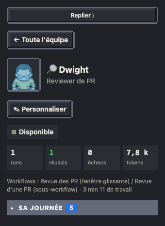
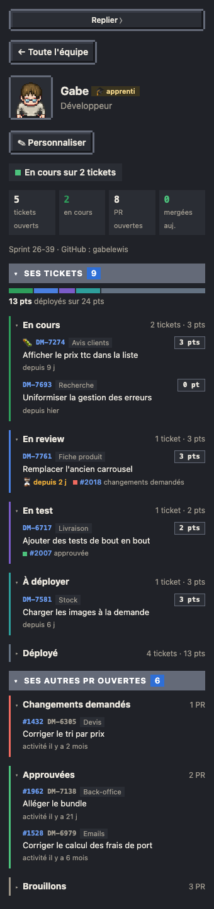
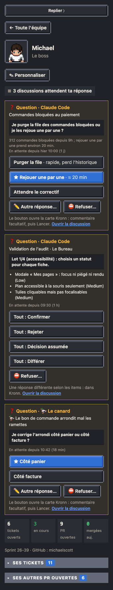
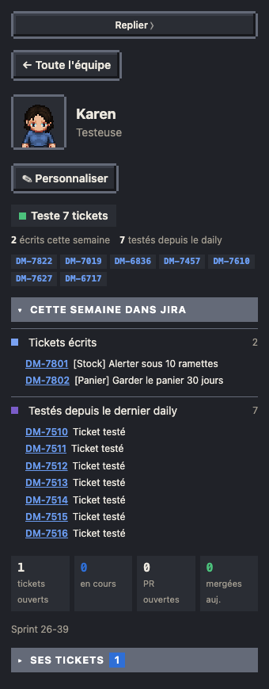
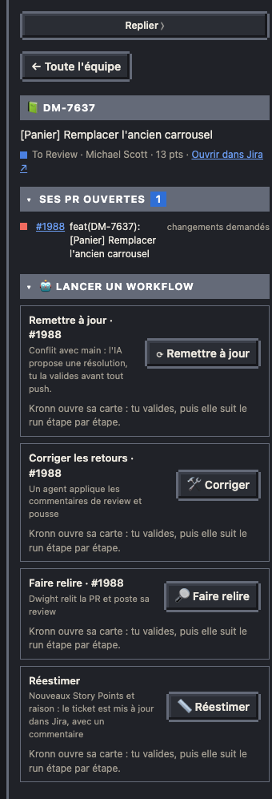
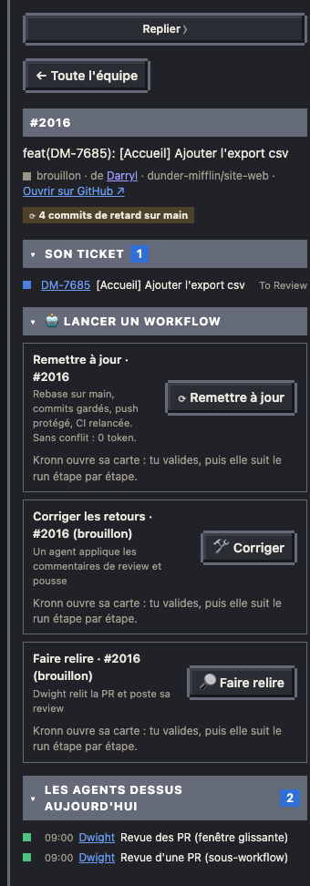
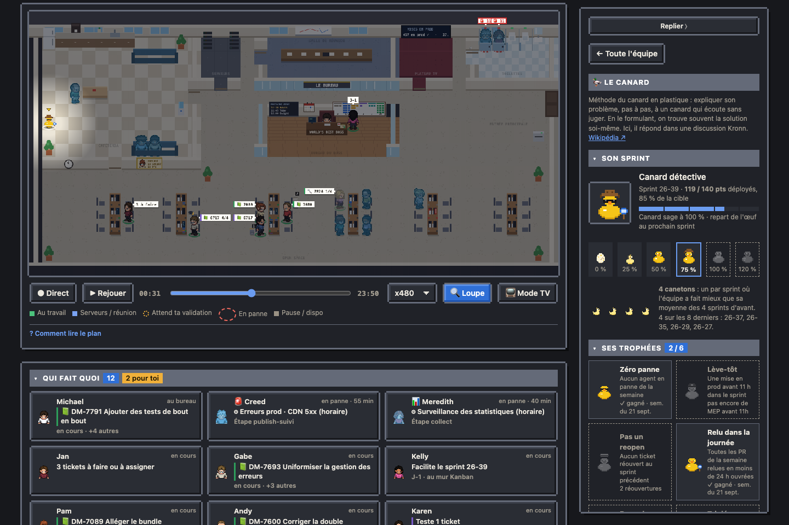
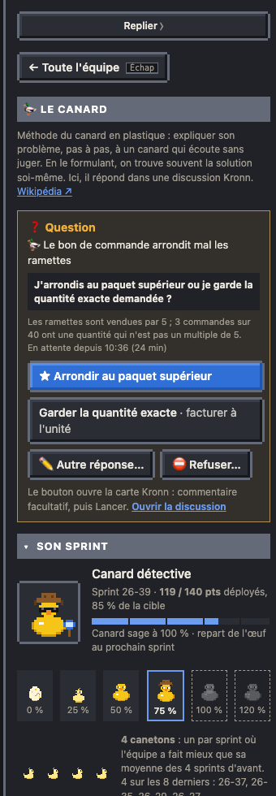

# Fiches

Clic sur un personnage (plan, panneau ou « Qui fait quoi ») : sa fiche s'ouvre dans le panneau.

| Agent | Collègue |
| --- | --- |
|  |  |

**Agent** : runs, réussites, échecs et tokens du jour, workflows, sa journée run par run avec les étapes et les erreurs. Boutons (cartes Kronn, sans token sauf « interroger ») :
- **⏰ Son programme** (agent cron) : pour chaque cron de l'agent, son programme en clair à l'heure du bureau (« Du lundi au vendredi toutes les 3 heures de 9h30 à 21h30 » : Kronn lit les crons en heure UTC, la fiche les traduit), un anneau qui se remplit jusqu'au prochain passage (« Prochain passage aujourd'hui à 12h (dans 1 h) ») et son dernier passage du jour. **↻ Passer maintenant** lance un passage en plus, tout de suite, sans rien à remplir : son programme ne change pas.
- **Relancer** : relance un workflow manuel, sans variables (refusé s'il tourne déjà) ; la carte Kronn ne demande rien. Absent pour un workflow qui attend une saisie obligatoire, comme Réestimer : celui-là se lance depuis la fiche du ticket, qui envoie la clé et te demande le reste.
- **▶ Lancer…** : pour chaque workflow de l'agent qui demande une saisie (une intention, un dépôt…), un champ par paramètre, avec son libellé, son exemple et * sur les obligatoires (zone de texte ou liste quand le workflow le déclare). Le bouton reste grisé tant qu'un obligatoire est vide ou qu'une valeur est refusée, avec la raison sous le champ : le « ; » sépare les paramètres (remplace-le par une virgule), et une valeur doit suivre le format déclaré par le workflow ; les retours à la ligne deviennent des espaces. Il copie alors la ligne déjà remplie : colle-la dans le champ **Paramètres** de la carte Kronn, puis Lancer, rien à retoucher. Ta saisie tient pendant que la fiche se met à jour. Le workflow « Le Bureau · relancer un workflow » revérifie chaque nom avant de lancer ; l'agent se met au travail sur le plan dès que le run démarre. Tous les agents l'ont, ceux ajoutés depuis une baie compris, sans rien régler.
- **Lui poser une question** : un agent IA lit ses runs et répond en 5 phrases.
- **Agent ajouté** (agent créé depuis une baie de la salle Serveurs, voir [Le plan](01-plan.md#ajouter-un-agent)) : ✎ Renommer (prénom, métier) ou ✕ Retirer du bureau ; un code à coller dans la carte Kronn, comme à sa création.
- **Décider** une validation : trois boutons directs, ✅ Approuver, ⛔ Rejeter, ✏️ Changements… ; la carte Kronn qui s'ouvre prend un commentaire (obligatoire pour des changements), puis Lancer.

**Boss** (ton personnage) : ce qui attend ta décision, chaque validation avec ses trois boutons (Approuver, Rejeter, Changements) : celles de tes agents, et celles des workflows qui n'ont pas de personnage sur le plan (« Le Bureau · plan », qui propose un nouveau plan pour toute l'équipe). Puis chaque question qu'une discussion Kronn t'a posée et qui attend encore (14 jours, comme le canard) : celles des visiteurs, du canard et des agents interrogés depuis la page. Tant qu'une validation ou une question t'attend, ton personnage porte la bulle ✋ avec leur nombre, et le récap de la journée le rappelle.



Une carte de question se décide sur la page :

- **Question simple** : un bouton par option (★ = celle que l'agent recommande), « ✏️ Autre réponse… » (texte libre) et « ⛔ Refuser… ». Chaque bouton ouvre la carte Kronn : un commentaire facultatif, puis Lancer.
- **Formulaire** (une réponse par item, comme les lots de fiches de dette d'un audit Kronn) : « Tout : Confirmer », « Tout : Différer »… donnent la même réponse à chaque item ; une réponse différente selon les items se donne dans Kronn (lien « Ouvrir la discussion »).
- La réponse part par le workflow « Le Bureau · réponse à une question » (sans agent, 0 token), qui relit la question dans Kronn : déjà décidée ailleurs, rien n'est envoyé.

**Collègue** : tickets ouverts, en cours, PR ouvertes et mergées du jour, ce qu'il a écrit, trié ou testé (PO, facilitateur, testeur).

Sous « Personnaliser », sa ligne d'état tient sur une ligne (« Teste 7 tickets », « En cours sur 2 tickets » ; la phrase complète au survol), suit l'heure affichée (direct ou rejeu) et se complète au besoin :
- ses compteurs Jira de la semaine (« **2** écrits cette semaine », « **7** testés depuis le daily ») ;
- les tickets qu'il traite sans qu'ils soient à lui (ceux que teste la testeuse), en étiquettes : clic = la fiche du ticket, survol = son titre.



**Ses tickets** (dans la fiche d'un collègue) : en tête, une barre de ses points du sprint, un segment par colonne aux couleurs des groupes (en tickets si aucun n'est estimé ; survol : le détail), et les points déployés sur le total. Puis un groupe par colonne du board, bordé à gauche d'un liseré à sa couleur (▸ : replié, clic pour l'ouvrir ; « À faire » et « Déployé » repliés par défaut), le ticket le plus ancien dans sa colonne en premier (« Déployé » : le plus récent). Chaque ticket tient sur deux ou trois lignes :
- la clé (lien Jira), 🐛 si c'est un bug, le composant (le « [Panier] » du début du titre, sorti en étiquette) et ses points (« 0 pt » compris ; rien s'il n'est pas estimé) ;
- le titre, qui ouvre la fiche du ticket ;
- depuis quand il est dans sa colonne (en cours, en review, en test, à déployer), en orange avec ⏳ quand il est bloqué (en review ou en test depuis plus de 2 jours, comme en mode TV), « Réouvert » quand son statut Jira est celui des réouvertures (`jira_flow.reopened`), et ses PR ouvertes avec l'état de leur review.

Les PR qui citent un de ses tickets sont sur la ligne du ticket : le bloc suivant, « Ses autres PR ouvertes », ne garde que les autres (sans ticket, ou d'un ticket hors de ses tickets du sprint). Le compteur « PR ouvertes » en haut de la fiche les compte toutes. Même présentation que « Ses tickets » : un groupe par état de review, bordé de sa couleur (changements demandés, en attente de review, approuvées, puis brouillons, repliés par défaut), la plus récemment active d'abord. Chaque PR : son numéro (lien GitHub), le ticket qu'elle cite (lien Jira, en gris) et le composant, son titre sans le préfixe « feat(DM-1): », puis sa dernière activité (« il y a 6 mois » : une PR oubliée se voit), en orange avec ⏳ quand elle attend une review depuis plus de 24 h.

**Ticket** : clic sur un ticket (Kanban, fiche d'un collègue) : son statut et depuis quand, qui l'a, ses points, ses PR ouvertes avec leur review, le lien Jira, et les workflows à lancer dessus selon son statut :
- **Implémenter** : ticket à faire ou en cours, sans PR. Après ta validation du plan, le workflow t'assigne le ticket et le passe « En cours » dans Jira, puis code, ouvre la PR et la fait relire.
- **Faire relire** : sur chacune de ses PR pas encore approuvées, brouillons compris (la carte dit alors « (brouillon) »).
- **Corriger les retours** : sur une PR avec changements demandés, même en brouillon (avec des consignes facultatives).
- **Mettre en prod** : ticket à déployer ; grisé les jours de gel des mises en prod.
- **🚀 Mise en prod** (sur chaque PR, si son dépôt a des réglages de mise en prod) : la mise en prod de cette PR, dépôt et numéro relus par Kronn ; voir [Mise en prod](16-mise-en-prod.md).
- **Commenter** : à tout statut. Le texte se saisit dans la carte Kronn ; il part sur le ticket dans Jira avec le compte de ta connexion Atlassian, suivi de « (depuis Le Bureau) ». C'est un workflow du Bureau (« Le Bureau · commenter un ticket », un appel Jira, 0 token), créé par l'installateur quand Jira est connecté.
- **Réestimer** (si `launch.estimate` est configuré) : sur un ticket non terminé du sprint. Les nouveaux Story Points et la raison se saisissent dans la carte Kronn ; ton workflow de réestimation met le ticket à jour dans Jira et y laisse un commentaire.

Chaque bouton ouvre la carte Kronn du workflow : tu valides, puis elle suit le run étape par étape. Les workflows se choisissent dans `bureau.config.json` (clé `launch` : `impl`, `mep`, `mep_pr`, `review`, `fix`) ; sans eux, la fiche n'a pas de boutons. N'importe quel workflow Kronn convient : si ses variables ne portent pas les noms attendus, donne-les.

```json
"launch": {
  "impl": "<id du workflow>",
  "mep": {"wf": "<id>", "vars": {"ticket": "issue_key", "pr": null}},
  "review": {"wf": "<id>", "vars": {"repo": "project", "pr": "mr"}}
}
```

Rôles et noms par défaut : `impl` → `ticket` (`jira_ticket_key`) ; `mep` → `ticket` (`jira_ticket_key`), `pr` (`pr_number`) ; `review` → `repo`, `pr` ; `fix` → `pr`, `notes`, et `repo` (facultatif : absent tant que tu ne le nommes pas, par exemple `{"wf": "…", "vars": {"repo": "repo"}}`) ; `estimate` → `ticket` (`jira_ticket_key`), `points` (`story_points`), `reason` (`raison`), par exemple `{"wf": "…", "vars": {"ticket": "ticketKey"}}` si ton workflow nomme autrement la clé du ticket. `null` : ton workflow n'a pas cette variable, elle n'est pas envoyée.



**PR** : clic sur une PR dans le fil. Son nom avec son dépôt, son titre, l'état de sa review, son auteur (sa fiche), le lien GitHub, le ticket qu'elle cite (sa fiche) et les runs d'agents du jour qui l'ont traitée (une revue de Dwight, une correction). Puis les mêmes boutons que dans la fiche du ticket : **Faire relire** (PR pas encore approuvée) et **Corriger les retours** (changements demandés).

Sous l'auteur, l'état de la PR face à sa branche de base, relu à chaque passage du cron équipe : **⛔ conflit avec main**, **⟳ 4 commits de retard sur main** ou **✓ à jour de main**. **⟳ Remettre à jour** (PR en retard, en conflit, ou d'état encore inconnu) la rejoue sur sa base sans rien écraser :
- dans une copie du dépôt dédiée au run (`~/.cache/pixel-bureau/pr`), rebase sur sa base avec ses commits gardés tels quels (ni squash ni messages changés) ;
- sans conflit : push protégé (`--force-with-lease`, refusé si quelqu'un a poussé entre-temps), puis le label de CI du dépôt retiré et reposé ; 0 token ;
- avec un conflit : un agent IA le résout commit par commit, la commande de contrôle du dépôt tourne (`github.checks`), puis une validation t'attend dans ta fiche de boss, avec les fichiers, ce qui a été gardé de chaque côté et le résultat du contrôle. **Approuver** pousse ; **Rejeter** ou **Changements** ne pousse rien.


Une PR se reconnaît à son dépôt et à son numéro : `#2039` pour le dépôt principal (`github.repo`), `front_api#16` pour un autre dépôt suivi (`github.pr_repos`, par défaut le principal et ceux des mises en prod). Deux PR #16 de deux dépôts ne se confondent jamais : chacune a sa fiche, ses boutons (Faire relire envoie son dépôt et son numéro), sa ligne dans la fiche du collègue et du ticket, et compte dans « PR ouvertes ». Une PR est rattachée à un ticket par la clé Jira de son titre ou de sa branche (`feat/EW-7317-…`). Corriger une PR d'un autre dépôt demande un workflow qui prend le dépôt (`launch.fix.vars.repo`) ; sinon le bouton n'est proposé que pour le dépôt principal. Pour une PR d'un dépôt non suivi, la page n'en connaît que ce qu'en disent les runs : l'auteur, les agents, le lien GitHub.



**Visiteur** : la discussion Kronn, ses messages importants, le run qui l'a lancée, et la carte de chaque question qui t'attend (la même que dans la fiche du boss).

**Le canard** (clic sur le canard du plan) : une phrase sur la [méthode du canard en plastique](https://fr.wikipedia.org/wiki/M%C3%A9thode_du_canard_en_plastique), puis :
- **Ses questions** : quand une de ses discussions t'a posé une question, sa carte de réponse en tête de la fiche, la même que dans ta fiche de boss (un bouton par option, réponse libre, refus). Elle disparaît au passage du cron qui suit ta réponse.
- **Parler au canard** : un sélecteur de projet Kronn (« Sans projet » en premier, le choix est retenu dans ton navigateur) et un bouton. La carte Kronn demande un titre facultatif (celui de la liste ; vide : la première ligne du sujet) et le sujet (texte libre ou numéro de ticket) ; le workflow du Bureau « Le Bureau · parler au canard » ouvre une discussion « 🦆 … » avec Claude Code dans ce projet et lance l'agent. Pas de boutons en mode TV.
- **Son sprint** (le [canard d'équipe](01-plan.md#le-canard-déquipe)) : son stade, les points déployés sur la cible du sprint et le pourcentage atteint, une barre jusqu'au stade suivant, les 6 stades (ceux pas encore atteints estompés), puis ses canetons : un par sprint où l'équipe a fait mieux que sa moyenne des 4 sprints d'avant (au survol d'un caneton : son sprint, ses points et cette moyenne). Les stades atteints sont sur fond, l'actuel encadré, ceux à venir en pointillés.
- **Ses trophées** : les 6 succès, gagnés (avec leur période) ou grisés avec leur progression (« 3 / 10 », « 6 / 8 »). Un succès gagné mais qu'il ne porte pas encore (ceux de la semaine passée arrivent le lundi à l'ouverture du bureau) dit « le porte lundi à 08:00 », son accessoire estompé et sa carte encadrée ; gagnés sur fond, les autres en pointillés.
- **Ses discussions** : celles des 14 derniers jours (15 au plus), les plus récentes d'abord, avec leur projet, un lien vers Kronn et « attend ta réponse » quand l'agent t'a posé des questions. Elles ne comptent jamais comme des visiteurs.





La **fiche de paie** (enveloppe sur le bureau du boss) donne tokens, runs et échecs par agent sur 7 jours, avec un coût estimé.

## Cartes de passion

Selon la clé `passion` du roster, la fiche d'un collègue affiche aussi :

- **Carte GitFut** : sa carte de joueur façon FIFA Ultimate Team, notée sur 99 d'après son activité GitHub ([gitfut.com](https://gitfut.com)), sans le fond, cliquable. Chaque personne du roster qui a son vrai login GitHub (champ `github`, celui de gitfut.com/<login>) a sa carte, et la personne qui installe aussi (login de `gh`) ; la clé `gitfut` de `bureau.config.json` (`{clé du roster: login GitHub}`, `false` pour aucune) remplace cette liste ; le cron horaire la récupère une fois par jour (script `gitfut_snapshot.py`, image réduite par Pillow, celui du venv du dépôt quand Kronn lance le python3 du système).
- **Smash Bros Ultimate** (`smash` : `pseudo`, `main`, `rank` en texte ou en liste, `tournament`, `url`) : pseudo, personnage principal, classements (mondial, européen, français : un par pastille, le premier en avant), dernier tournoi, lien vers son profil.
- **Top 3 dramas** (`dramas` : `top` (3 titres), `now`) : façon Netflix, avec l'épisode en cours.
- **Top 3 libre** (`top3` : `title`, `top` (3 titres), `now`) : même carte, sur le sujet de son choix (ex. « Films de François Civil »).

Sans les infos, la carte s'affiche avec « à venir ».

