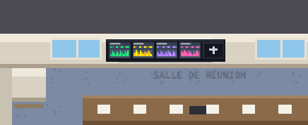
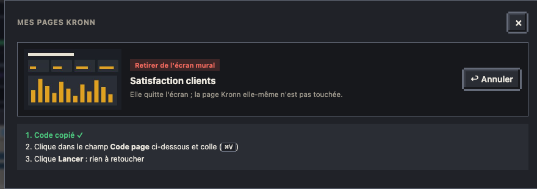

# Murs du bureau

Les objets du plan sont cliquables et ouvrent leur détail dans le panneau.

| Kanban du sprint | Planning des crons | Mises en prod du jour |
| --- | --- | --- |
|  |  |  |

- **Kanban** (à droite du bureau du boss) : tickets et points par colonne Jira.
- **Prochains crons en post-it** (au fond de la salle Serveurs, entre les deux baies) : un post-it par cron à venir, les trois prochains de la journée (hors crons horaires), de la couleur de l'agent, avec l'heure dessus. Quand le cron a tourné, son post-it tombe et le suivant prend sa place. Au survol, la liste en clair (heure, agent) ; un clic ouvre le planning : les prochains crons de la journée et ceux déjà passés.

- **Calendrier de l'équipe** (au mur du bureau du boss, à gauche de son fauteuil) : un petit calendrier mural, affiché quand le planning des absences est branché ; un clic ouvre qui est là cette semaine et la suivante. Voir [Absences et télétravail](14-absences.md).
- **Écran du plateau TV** : chaque mise en prod (release, staging, production) avec ses liens GitHub ; confettis quand elle arrive en prod, et le héraut des mises en prod qui vient féliciter l'auteur sur la scène (voir [le plan](01-plan.md)). Plateau fermé le vendredi et le week-end. Une mise en prod lancée à la main sur GitHub apparaît en moins d'une minute : les déploiements sont relus chaque minute par une requête conditionnelle, que GitHub ne décompte pas tant que rien ne bouge.
- **Employé du sprint** (mur de la cafétéria) : le plus de points déployés.
- **Enveloppe de paie** : la fiche de paie des agents.
- **Écran mural « Mes pages Kronn »** (au mur de la salle de réunion, à la place du tableau blanc) : tes autres pages Kronn, quatre miniatures à la fois (elles défilent s'il y en a plus) et une case « + ». Un clic ouvre la fenêtre « Mes pages Kronn » : une carte par page (miniature, titre, dernière mise à jour) qui l'ouvre dans un nouvel onglet de Kronn, un **×** pour la retirer de l'écran, et **+ Ajouter une page** (la liste de tes pages Kronn qui n'y sont pas encore). Ajout et retrait passent par une carte Kronn, comme les agents : un clic sur × ou sur « Ajouter » replie la grille et montre la page concernée, les trois étapes et, juste dessous, la carte Kronn ; le bouton a copié un **code page**, à y coller (workflow « Le Bureau · pages », 0 token), puis Lancer. « ↩ Annuler » referme la carte ; après le lancement, « ↩ Retour à mes pages » ramène la grille, déjà à jour. La case « + Ajouter » de la grille ouvre directement la liste des pages. La liste est rangée dans la page (dataset `pagelist`), sans republier : l'écran mural et la fenêtre suivent tout de suite, et le même workflow refait aussitôt les miniatures (« ⏳ Miniature en cours… » en attendant, une dizaine de secondes). La liste de départ est celle de l'installation (clé `boss_pages` de `bureau.config.json`). Les miniatures sont refaites seulement quand une page change, avec Chrome ou Chromium, réduites par Pillow (macOS ou Linux) ; sans Chrome, les cartes restent sans image. Rien en mode TV : ce sont tes pages. L'ordinateur du bureau du boss redevient un écran ordinaire.

