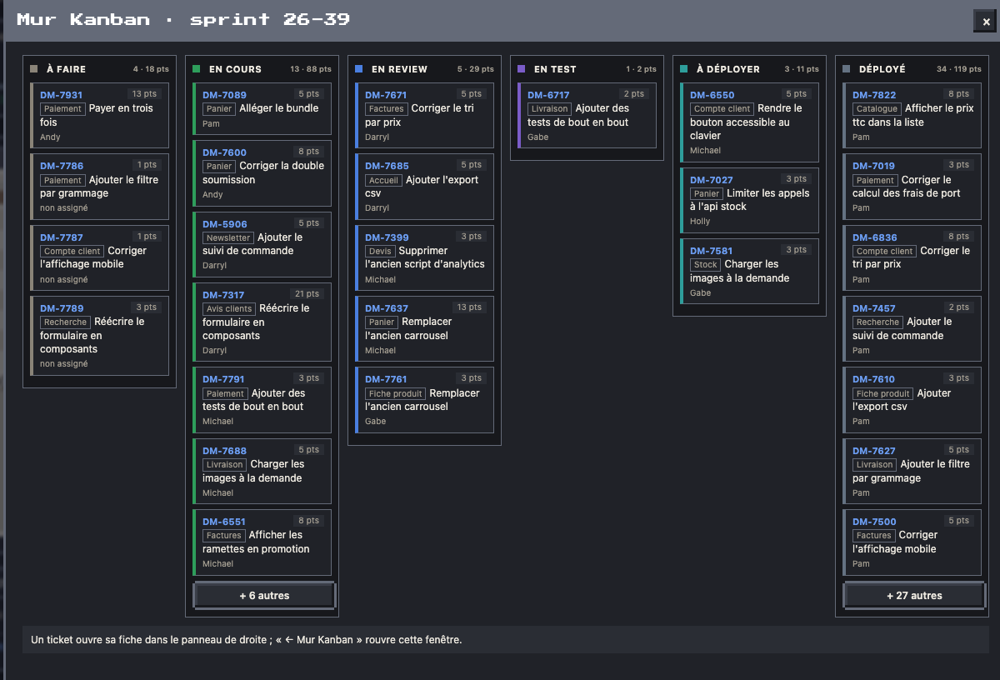
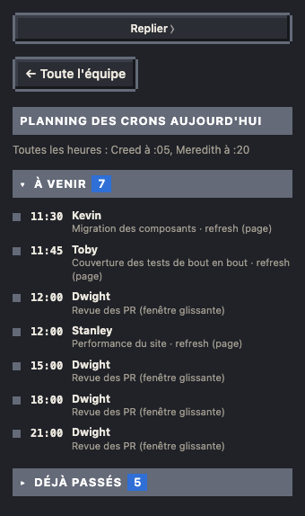
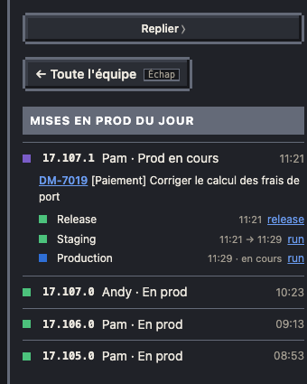
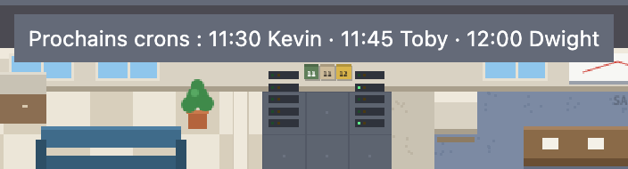
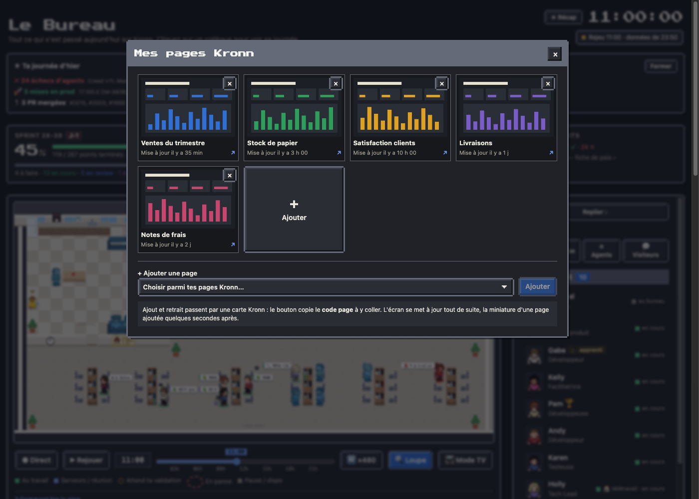

# Murs du bureau

Les objets du plan sont cliquables et ouvrent leur détail dans le panneau.

| Kanban du sprint | Planning des crons | Mises en prod du jour |
| --- | --- | --- |
|  |  |  |

- **Kanban** (à droite du bureau du boss) : tickets et points par colonne Jira.
- **Prochains crons en post-it** (au fond de la salle Serveurs, entre les deux baies) : un post-it par cron à venir, les trois prochains de la journée (hors crons horaires), de la couleur de l'agent, avec l'heure dessus. Quand le cron a tourné, son post-it tombe et le suivant prend sa place. Au survol, la liste en clair (heure, agent) ; un clic ouvre le planning : les prochains crons de la journée et ceux déjà passés.

- **Calendrier de l'équipe** (au mur du bureau du boss, à gauche de son fauteuil) : un petit calendrier mural, affiché quand le planning des absences est branché ; un clic ouvre qui est là cette semaine et la suivante. Voir [Absences et télétravail](14-absences.md).
- **Écran du plateau TV** : chaque mise en prod (release, staging, production) avec ses liens GitHub ; confettis quand elle arrive en prod, et le héraut des mises en prod qui vient féliciter l'auteur sur la scène (voir [le plan](01-plan.md)). Plateau fermé le vendredi et le week-end. Une mise en prod lancée à la main sur GitHub apparaît en moins d'une minute : les déploiements sont relus chaque minute par une requête conditionnelle, que GitHub ne décompte pas tant que rien ne bouge.
- **Employé du sprint** (mur de la cafétéria) : le plus de points déployés.
- **Enveloppe de paie** : la fiche de paie des agents.
- **Écran du bureau du boss** : tes autres pages Kronn, en miniatures. L'écran les fait défiler (une toutes les 4 s, halo doré : il se clique) ; un clic ouvre une fenêtre avec une carte par page (miniature, titre, dernière mise à jour) qui ouvre la page dans un nouvel onglet de Kronn. Les pages se choisissent à l'installation (l'installateur liste tes pages Kronn, tu donnes leurs ids, ou leur début, dans l'ordre voulu), rangées dans `bureau.config.json` (clé `boss_pages`). Les miniatures sont refaites par le cron horaire seulement quand une page change, avec Chrome ou Chromium, réduites par Pillow (macOS ou Linux) ; sans Chrome, les cartes restent sans image. Rien en mode TV : ce sont tes pages.

