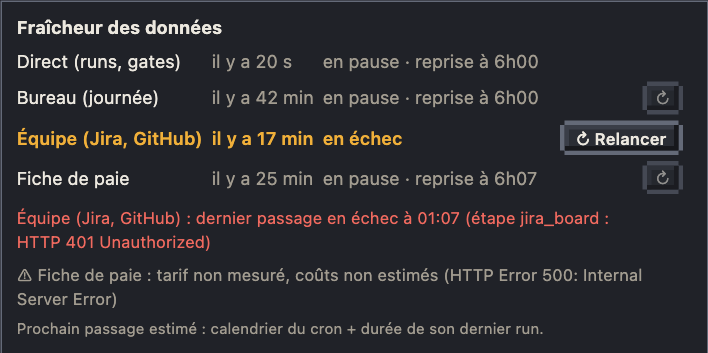

# Fraîcheur des données

Le badge de l'en-tête dit quand les prochaines données arrivent ; au survol, l'état de chaque source.

- Compte à rebours jusqu'au prochain passage du cron live (toutes les minutes), « ✓ à jour » à l'arrivée, « en pause » hors des heures des crons.
- Survol : chaque source (direct, journée, équipe, fiche de paie, canard d'équipe, absences, courrier, relevé Support quand ils sont branchés) avec son âge et son prochain passage estimé (calendrier du cron + durée de son dernier run), en rouge si elle est en retard.
- **↻ Relancer** sur une ligne en échec ou en retard, **↻** discret sur les autres (rafraîchir sans attendre) : relance tout de suite le cron de cette source, après confirmation dans la carte Kronn ; refusé s'il tourne déjà. Pas pour Direct (passe chaque minute), ni en mode TV.
- Diagnostic sous le tableau : cron du Bureau en échec (étape et message, par exemple Jira refusé), erreurs GitHub, Jira muet, dernier relevé Support en échec, dernier nettoyage des vieux runs.
- Avertissements « ⚠ » : un cron qui réussit avec une partie de ses données manquante (tarif non mesuré, projets ou discussions du canard illisibles, page du boss sautée, carte GitFut non récupérée, déploiements non relus…) le dit ici, une ligne par avertissement avec le nom de sa source (3 au plus par source), et dans son run Kronn ; la ligne disparaît au passage suivant réussi.
- Données arrêtées depuis plus de 3 minutes : les personnages passent en « ⏸ données figées » au lieu de rester au travail toute la nuit.

