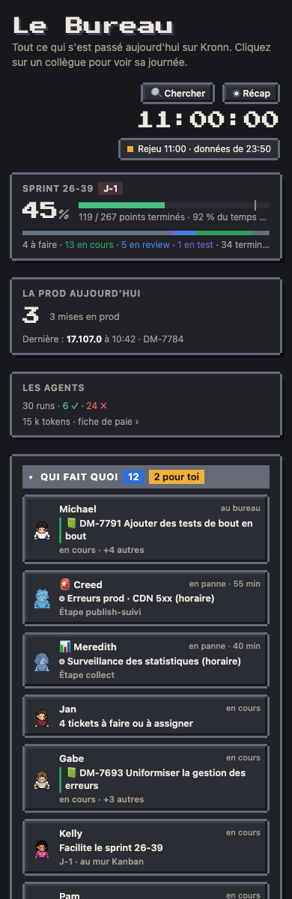

# Téléphone

- **En-tête** : les boutons (🔍 Chercher, ☀ Récap, thème) passent à la ligne au-dessus de l'horloge quand la place manque.
- **Sous 620 px** : « Qui fait quoi » avant le plan, plan entier en miniature (un toucher ouvre la fiche), légende repliée.
- **Fenêtre étroite ou page en split** (Kronn à côté d'autre chose) : le plan entier rétrécit pour tenir dans sa colonne, au lieu d'être coupé et de défiler à l'horizontale.
