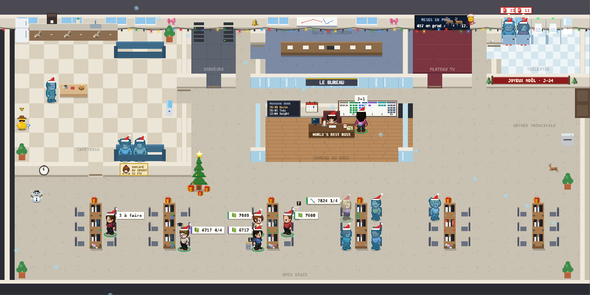
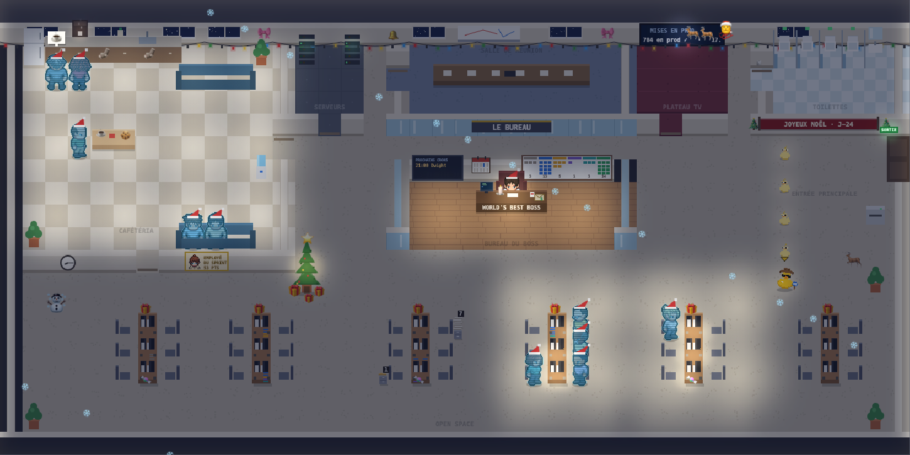
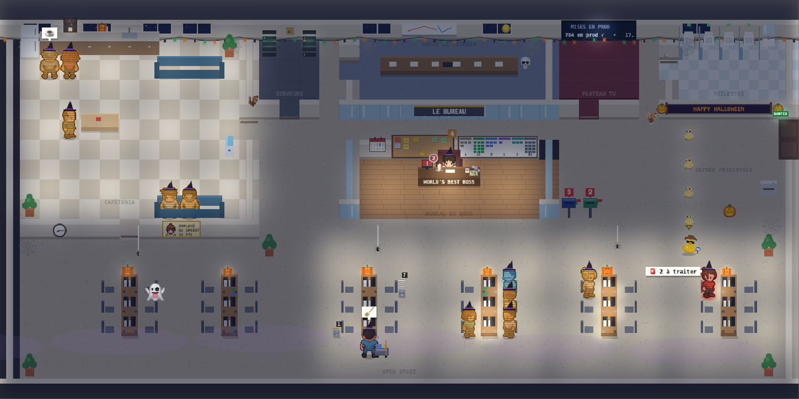
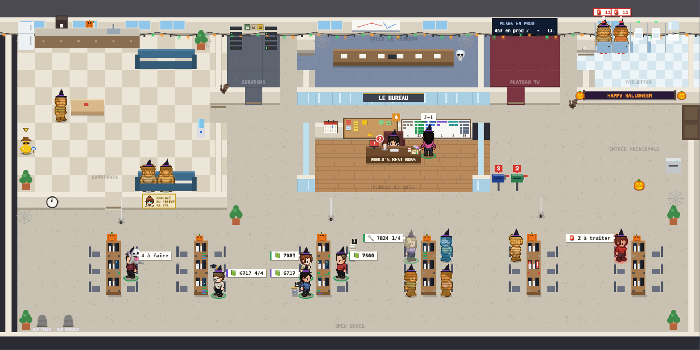
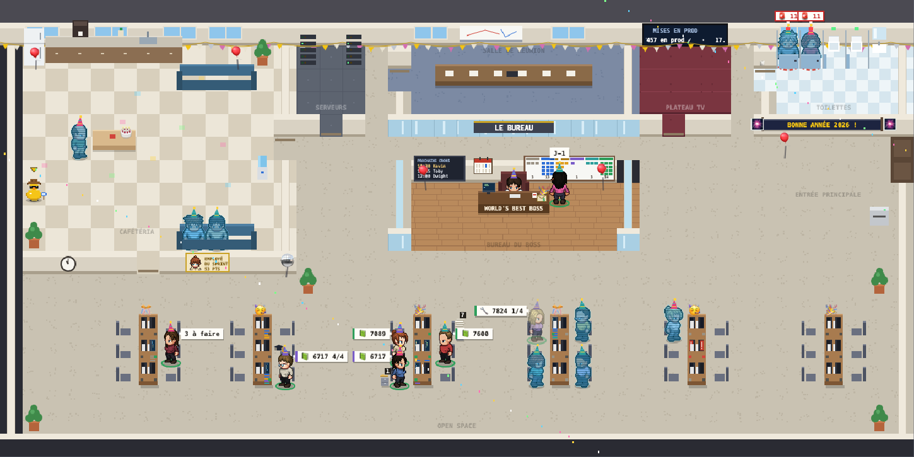
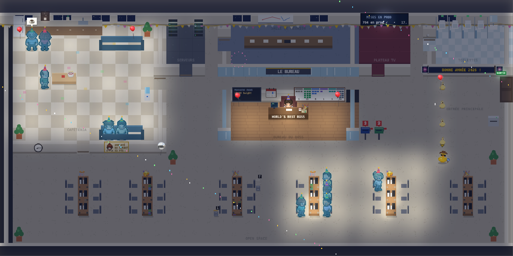
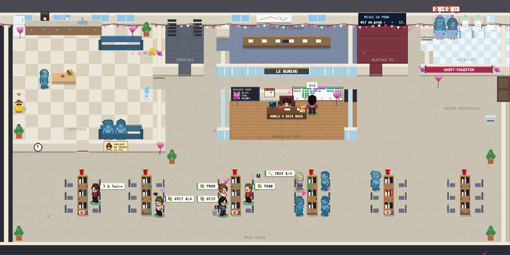
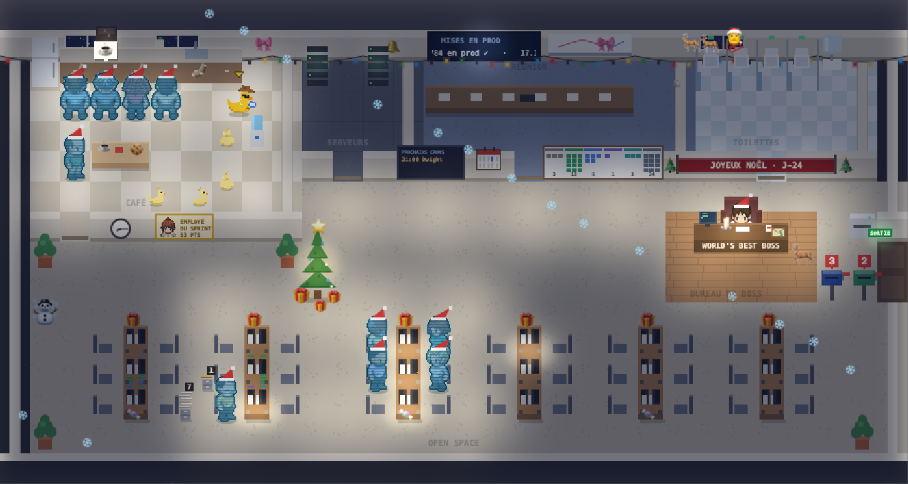

# Thèmes saisonniers

Le bureau se déguise selon la date : décor, chapeaux, emojis, effets. Le thème suit la date affichée (heure de Paris), donc aussi « Rejouer ». Le décor suit le plan : la banderole va sur le mur des toilettes, les chaussettes sur le comptoir, le sapin devant les îlots ; un meuble absent du plan, et son décor n'apparaît pas.

| Thème | Dates | Ce qui change |
| --- | --- | --- |
| 🎄 Noël | 1er au 30 déc. | Bonnets, guirlande lumineuse, sapin et cadeaux, bonhomme de neige, renne, chaussettes sur le comptoir, chocolat chaud, flocons, traîneau du Père Noël dans le ciel, cadeaux à la place des enveloppes, banderole « JOYEUX NOËL · J-12 » |
| 🎆 Nouvel an | 31 déc. au 2 janv. | Chapeaux pointus, confettis qui tombent, ballons, boule à facettes et ses lumières en cafétéria, gâteau, feux d'artifice le soir ; le 31 après midi, compte à rebours « MINUIT DANS 3 H 12 », puis « BONNE ANNÉE » |
| 💘 Saint-Valentin | 13 et 14 févr. | Cœurs qui s'envolent des gens, Cupidon qui traverse le plan, ballons cœurs, roses sur les îlots, bouquet, chocolats, lettres d'amour à la place des enveloppes |
| 🎃 Halloween | 24 au 31 oct. | Chapeaux de sorcière, citrouilles allumées le soir, toiles d'araignée, araignées qui pendent, fantôme qui flotte, chauves-souris, crâne en salle de réunion, tombe « RIP » pour chaque agent en panne, lune, brume et éclairs la nuit, bonbons à la place des enveloppes |

| Noël | Noël, le soir |
| --- | --- |
|  |  |
| **Halloween, le soir** | **Halloween, de jour** |
|  |  |
| **Nouvel an** | **Nouvel an, le soir** |
|  |  |
| **Saint-Valentin** | **Noël sur un autre plan** |
|  |  |

- **Voir un thème tout de suite** : « ? Comment lire le plan », puis « Thème du bureau ». Le choix dure le temps de la visite.
- **Config** (`bureau.config.json`) : `"ui": {"themes": false}` coupe les thèmes, `"ui": {"theme": "noel"}` en impose un.
- **Animations réduites** : avec le réglage système « réduire les animations », ce qui passe au-dessus du plan (flocons, traîneau, confettis, feux d'artifice, Cupidon, chauves-souris, fantôme, brume, éclairs) n'est pas dessiné ; le décor reste.
- **Les vannes visent les agents**, jamais un collègue (tombes « RIP » réservées aux agents en panne).
- **Ajouter un thème** : une entrée dans `THEMES` (`page/src/46-themes.js`, dates `MM-JJ`), puis son décor (emojis via `E(emoji, x, y, taille)`, mis en cache). Captures : `.venv/bin/python tools/shots.py theme-<nom>`.
