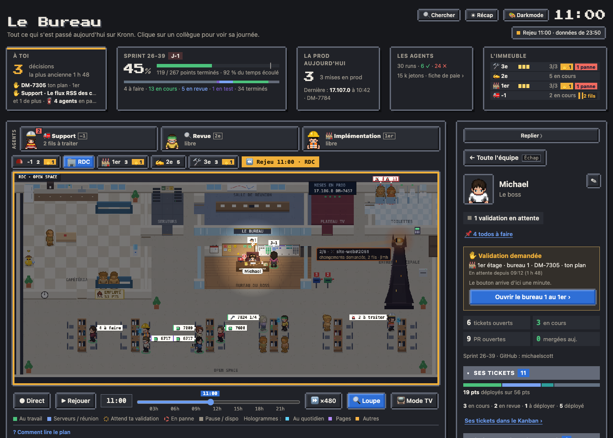
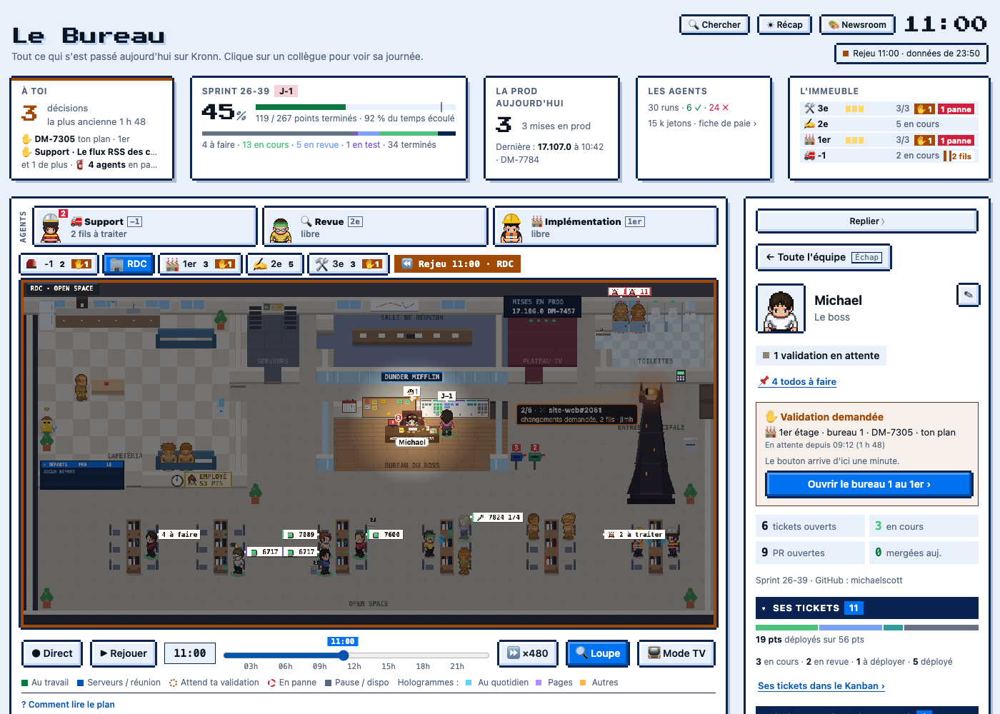
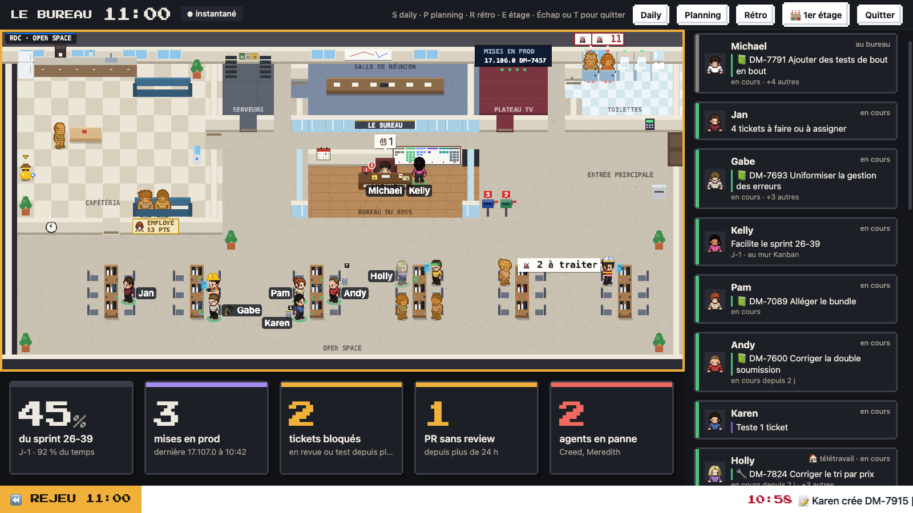

# Thème de la page

La page est en pixel art : cadres en escalier, boutons en relief qui s'enfoncent au clic, barres de titre en aplat, police pixel sur le titre, l'horloge, les gros chiffres et les noms de projet du tableau des départs, toujours à des tailles où elle est nette (16 ou 24 px) ; le reste du texte garde la police habituelle, sur une échelle de sept tailles (11 à 24 px), pour rester lisible. Le Bureau la livre dans deux thèmes, **Darkmode** (le défaut) et **Newsroom** ; une équipe ajoute les siens (ses couleurs, celles de son entreprise) dans son pack d'équipe. Chaque thème du dépôt a son plan du même nom (`layouts/darkmode.json`, `layouts/newsroom.json`) : un habillage. Le plan propose son thème, sans l'imposer.

- **Darkmode** : fond anthracite, texte crème, cadres et barres de titre gris bleuté, bleu d'origine pour les compteurs et la sélection. Toujours sombre, même quand Kronn est en clair. Son plan : l'open space type.
- **Newsroom** : une chaîne d'info en continu, fond blanc bleuté, cadres bleu nuit, bleu vif en aplat ; toujours clair, et son mode TV « Newsroom nuit » sur fond marine. Son plan : une rédaction de 40 × 20 cases, avec cafétéria, salle serveurs, salle de réunion, plateau TV, bureau du boss et open space de six îlots (trois pour l'équipe, trois pour les agents), et l'enseigne de l'équipe au mur.

- **Thème d'équipe** : un fichier `themes/theme-<id>.css` du pack d'équipe, proposé à cette équipe seulement ([Les couleurs de ton entreprise](../equipe.md#5-les-couleurs-de-ton-entreprise)). Il peut être clair, et habiller aussi le mode TV.
- **Mode TV** : sombre (couleurs d'origine pour le Darkmode ; un thème d'équipe peut avoir les siennes). L'écran mural garde le style pixel (cadres, police pixel sur l'horloge, les gros chiffres) ; le fond sombre est plus reposant sur un grand écran allumé toute la journée. Le bandeau du bas passe en « breaking news » : étiquette rouge « EN DIRECT », texte qui défile sur bande blanche, sans clignoter. Pas de bouton 🎨 en mode TV : le thème vient de l'installation, ou de l'adresse (`?tv=1&skin=darkmode`).

- **Par défaut** : celui de l'équipe (`ui.skin` des réglages de son pack), sinon celui que propose le plan (`skin`), sinon Darkmode. Réglage de l'installation : `ui.skin` dans `bureau.config.json`.
- **Choix de chacun** : le bouton 🎨 de l'en-tête passe d'un thème à l'autre ; le choix passe avant celui de l'installation, jusqu'au rechargement dans Kronn ; pour un thème durable, c'est `ui.skin` de l'installation ou `&skin=` dans l'adresse de l'écran mural. 

Ajouter un thème : [guide/developpement.md](../developpement.md#ajouter-un-thème).
