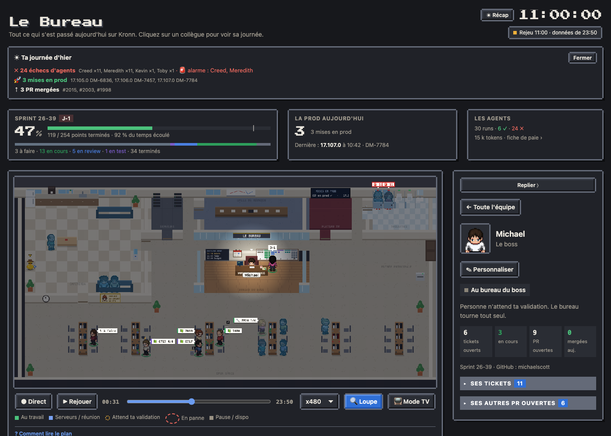
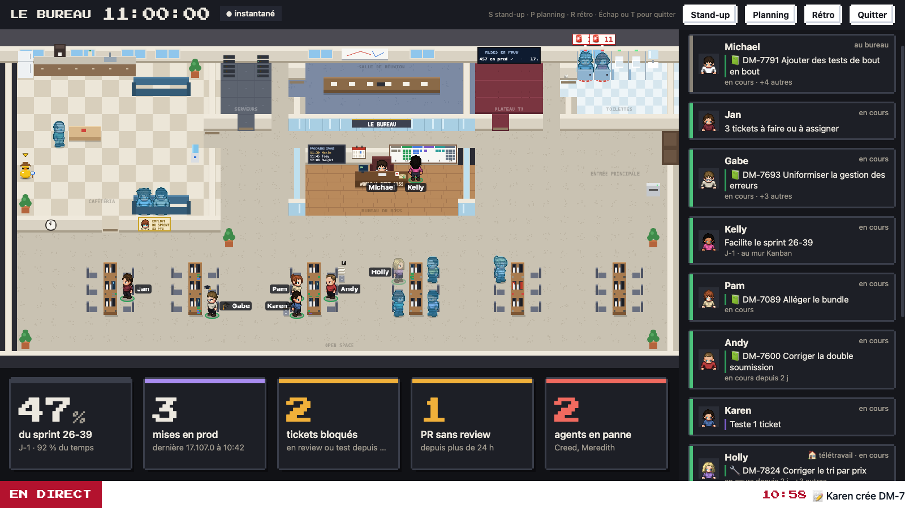
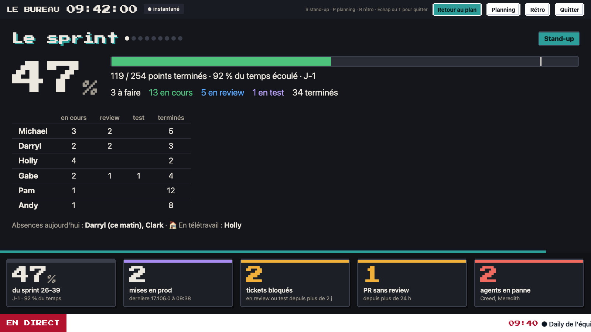
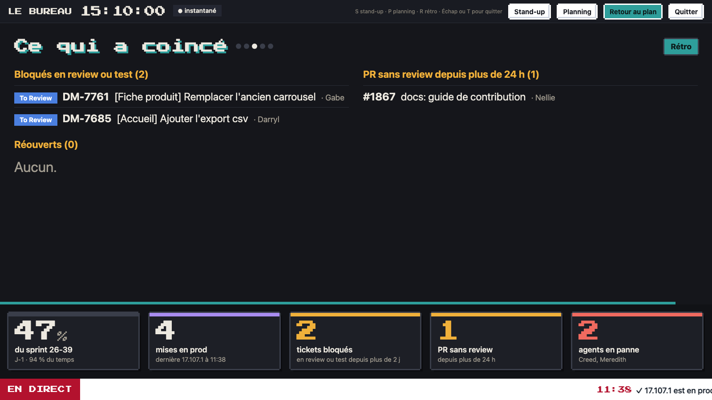

# Thème de la page

La page est en pixel art : cadres en escalier, boutons en relief qui s'enfoncent au clic, barres de titre en aplat, police pixel sur le titre, l'horloge et les gros chiffres (le reste du texte garde la police habituelle, pour rester lisible). Le Bureau la livre dans un seul thème, **Classique** ; une équipe ajoute les siens (ses couleurs, celles de son entreprise) dans son pack d'équipe. Le plan ne change pas, seule l'interface autour.

- **Classique** : fond anthracite, texte crème, cadres et barres de titre gris bleuté, bleu d'origine pour les compteurs et la sélection. Toujours sombre, même quand Kronn est en clair.
- **Thème d'équipe** : un fichier `themes/theme-<id>.css` du pack d'équipe, proposé à cette équipe seulement ([Les couleurs de ton entreprise](../equipe.md#5-les-couleurs-de-ton-entreprise)). Il peut être clair, et habiller aussi le mode TV.
- **Mode TV** : sombre (couleurs d'origine pour le Classique ; un thème d'équipe peut avoir les siennes). L'écran mural garde le style pixel (cadres, police pixel sur l'horloge, les gros chiffres et les titres de scène) ; le fond sombre est plus reposant sur un grand écran allumé toute la journée. Le bandeau du bas passe en « breaking news » : étiquette rouge « EN DIRECT », texte qui défile sur bande blanche, sans clignoter. Pas de bouton 🎨 en mode TV : le thème vient de l'installation, ou de l'adresse (`?tv=1&skin=classique`).

| Le plan | Le stand-up | La rétro |
| --- | --- | --- |
|  |  |  |

- **Par défaut** : celui de l'équipe (`ui.skin` des réglages de son pack), sinon Classique. Réglage de l'installation : `ui.skin` dans `bureau.config.json`.
- **Choix de chacun** : avec un thème d'équipe, le bouton 🎨 de l'en-tête passe d'un thème à l'autre ; le choix est gardé dans ce navigateur et passe avant celui de l'installation. Sans autre thème que le Classique, pas de bouton 🎨.

Ajouter un thème : [guide/developpement.md](../developpement.md#ajouter-un-thème).
