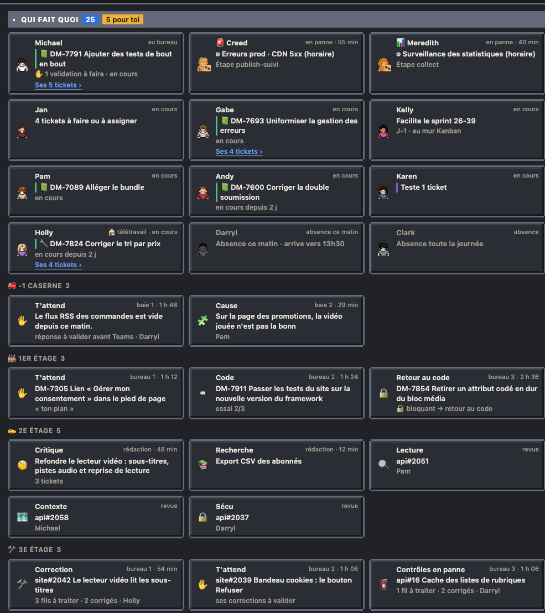
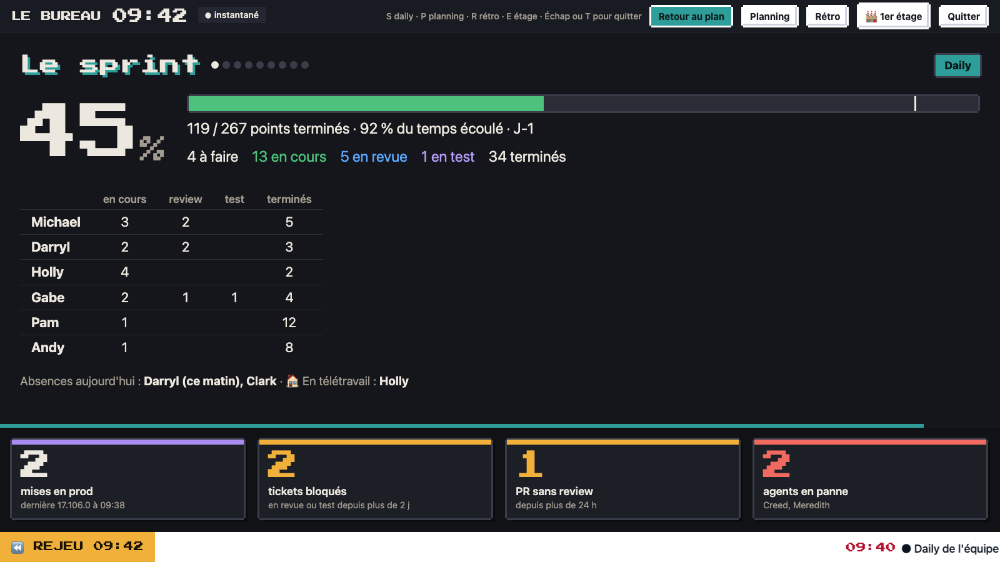
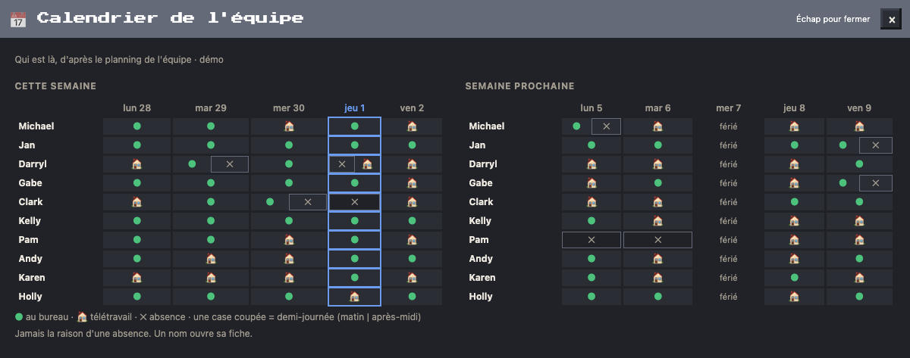

# Absences et télétravail

Le Bureau sait qui est là : il lit le planning de l'équipe (le classeur Excel de la DSI, sur SharePoint) toutes les heures en semaine. Il ne montre jamais la raison d'une absence : congés, formation, école ou maladie, tout devient « absence ».

- **Sur le plan**, une personne absente n'est pas à son bureau. Absente le matin, elle arrive vers 13h30 ; absente l'après-midi, elle part vers 12h30. Un jour férié, personne ne vient (sauf le boss).
- **En télétravail**, elle reste à sa place, en transparence, avec le reste de sa journée : ses tickets, ses scènes, le daily et les cérémonies (en visio).
- **Le boss** reste toujours à son bureau sur le plan ; son absence ou son télétravail se lisent dans sa fiche (« 📅 Selon le planning : … »).
- **Qui fait quoi** : pendant les heures de bureau (`rhythm.office_hours`), les absents ont une carte grisée en fin de grille (« Absence ce matin · arrive vers 13h30 ») ; le télétravail s'écrit devant l'état (« 🏠 télétravail · en cours »). La fiche dit la même chose.
- **Daily et cérémonies** : un absent n'y va pas, n'est pas tiré au sort pour animer la rétro ; si la facilitatrice est absente, le boss anime le planning.
- **Mode TV** : le tour de table du daily saute les absents, et la scène « Le sprint » les cite : « Absences aujourd'hui : Darryl (ce matin), Clark · 🏠 En télétravail : Holly ».

## Le calendrier de l'équipe

Un petit calendrier est accroché au mur du bureau du boss, à gauche de son fauteuil, à côté du tableau en liège de tes todos ([Mes todos](18-todos.md)). Un clic dessus ouvre la fenêtre « Calendrier de l'équipe » : cette semaine et la suivante côte à côte (l'une sous l'autre sur un écran étroit), du lundi au vendredi (le week-end, à partir du lundi qui vient). Un nom ferme la fenêtre et ouvre sa fiche dans le panneau.

- `●` au bureau, `🏠` télétravail, `—` absence ; une case coupée en deux = une demi-journée (matin | après-midi) ; les jours fériés sont marqués ; aujourd'hui est encadré.
- Un nom ouvre la fiche de la personne.
- Sans planning (pas de section `microsoft`), ni calendrier au mur, ni absences : tout le monde est au bureau, comme avant.

## Mise en place

- Le planning est lu par Microsoft Graph avec la connexion **Microsoft 365** de Kronn (Kronn > MCP, sans clé, **globale**), qui emprunte ton `az login` (Azure CLI) : `brew install azure-cli` puis `az login --allow-no-subscriptions`.
- Le classeur (site et fichier, tels que Graph les donne) est dans `microsoft.planning` du pack d'équipe ; l'id de la connexion, propre à chaque installation, va dans `microsoft.config_id` de `bureau.config.json` : `tools/install.py` la propose quand le pack a un planning. Le cron « Le Bureau · absences » est alors créé (ou, si la connexion est posée après coup, par `python3 tools/upgrade.py`) ; sans connexion, il ne l'est pas, et l'installateur le dit.
- Les personnes sont retrouvées par leur nom complet (champ `person` du roster), sans accents ni ordre des mots (« Beesly Pam » = « Pam Beesly »).
- Le classeur est annuel. `microsoft.planning.item` est celui par défaut ; ceux des autres années vont dans `microsoft.planning.years`, sur le même site : `"years": {"2027": {"item": "…", "file": "2027-Planning-… .xlsx"}}`. Fin décembre, les jours de janvier du calendrier sont lus dans le classeur de l'année suivante (sans lui, janvier n'est pas lu) ; en janvier, le classeur de l'année est pris de lui-même. Après cette version : `git pull && python3 tools/upgrade.py`.
- Si la connexion `az` expire, le cron échoue : la [fraîcheur des données](10-fraicheur.md) le signale, relance `az login`.
