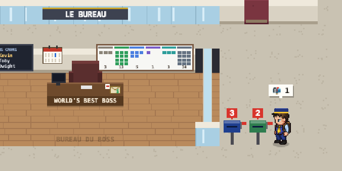
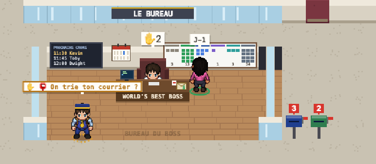

# Courrier

Le Bureau montre tes mails utiles, sans quitter la page : ceux de l'appli Mail de ton Mac (ton compte pro, ou n'importe quel compte que tu y as ajouté) et, si tu veux, d'autres comptes lus en IMAP (un Gmail perso par exemple). Il ne lit jamais le contenu d'un mail : seulement l'expéditeur, l'objet, l'heure, s'il est lu, et si tu es destinataire direct ou en copie.

## Les boîtes aux lettres

Une boîte par compte, dehors, à droite du bureau du boss, de la couleur du compte. Son drapeau se lève quand du courrier utile attend, et le compteur dit combien.

- **Le compteur** : les mails non lus des 14 derniers jours qui passent tes règles. `?` tant que tes règles ne sont pas posées (sans tri, le nombre ne veut rien dire) ; `!` quand la lecture du compte a échoué (la fiche dit pourquoi).
- **Au survol** : le compte, ses mails utiles et ses non lus. **Au clic** : la fiche Courrier, le compte cliqué en premier.
- **En mode TV**, les boîtes et leurs compteurs restent visibles (on voit que quelque chose attend), mais jamais un expéditeur ni un objet.

## Le facteur

Quand un mail utile arrive, le facteur entre par la porte, va aux boîtes aux lettres, dépose le courrier (« 📬 2 ») et repart. Il passe au plus une fois toutes les 30 minutes : les mails arrivés entre-temps attendent sa tournée suivante. Arrivés la nuit, ils viennent avec le premier passage du matin. Sa fiche dit quand il est passé.

Sa tenue : chemise bleu ciel, gilet bleu marine, cravate jaune, sacoche en cuir (calques LPC, crédités dans `CREDITS.md`) et un képi dessiné pour le Bureau. Il passe aussi en mode TV et dans le rejeu, à l'identique.

## La fiche Courrier

- Une section par compte : ses mails utiles, du plus récent au plus ancien, avec « à toi » ou « en copie », 🚩 s'il est suivi, et « Ouvrir ↗ » (dans l'appli Mail, ou dans Gmail).
- En bas de chaque compte, les ignorés regroupés par expéditeur (Jira 9, GitHub 6…).
- Un compte réglé en « nombre seul » (`show: "count"`) ne montre que son nombre : ni expéditeur ni objet n'arrivent jusqu'à la page.

## Le tri, et le facteur qui le propose

Un mail non lu est **ignoré** s'il correspond à une règle « ignorer », **utile** s'il correspond à une règle « garder », sinon ignoré s'il a les en-têtes d'un envoi automatique (lettre d'information, liste de diffusion, notification), et utile sinon. Une règle : une adresse (`jan@exemple.com`), un domaine (`atlassian.net`, sous-domaines compris), éventuellement pour un seul compte.

Tu n'écris pas les règles toi-même : **le facteur vient les proposer**.

- **Au premier passage** du cron (pas encore de règles, les boîtes affichent `?`), le workflow « Le Bureau · règles du courrier » résume tes expéditeurs des 30 derniers jours (nombre de mails, non lus, envois automatiques ; jamais un objet ni un contenu), un agent propose quoi garder et quoi ignorer, et le facteur **reste devant ton bureau** avec « ✋ 📮 On trie ton courrier ? ». La proposition est dans ta fiche, à valider ou rejeter, comme les autres validations.
- **Validées**, les règles vont dans le dataset `mail_rules` : le cron trie avec elles dès son passage suivant, sans rien republier. Celles de la config (`mail.keep`, `mail.ignore`) ne servent qu'avant.
- **Ensuite**, le facteur revient quand au moins 10 expéditeurs ne sont couverts par aucune règle, au plus une fois par semaine. Pour le faire venir tout de suite : **📮 Revoir mes règles** en bas de la fiche Courrier, ou `python3 tools/mail.py rules`.
- Coût : une proposition d'agent au premier passage, puis au plus une par semaine ; le relevé du courrier, lui, reste à 0 token.

## Mise en place

- À l'installation (`python3 tools/install.py`), réponds oui à « Afficher ton courrier » : il propose les comptes de l'appli Mail, puis des comptes IMAP. Pour un Gmail : un mot de passe d'application (myaccount.google.com/apppasswords), rangé dans le trousseau macOS, jamais dans la config ; seulement l'onglet Principal si tu veux.
- Le cron « Le Bureau · courrier » relève les comptes toutes les 10 minutes, aux heures du bureau, à 0 token. Au premier passage, macOS demande d'autoriser Kronn à piloter Mail : accepte.
- Le détail de la config (`mail.accounts`, règles) : [guide de développement](../developpement.md#courrier-cron-courrier).
