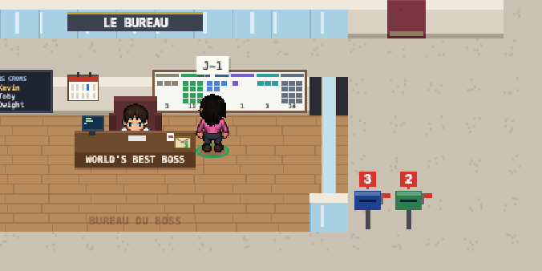
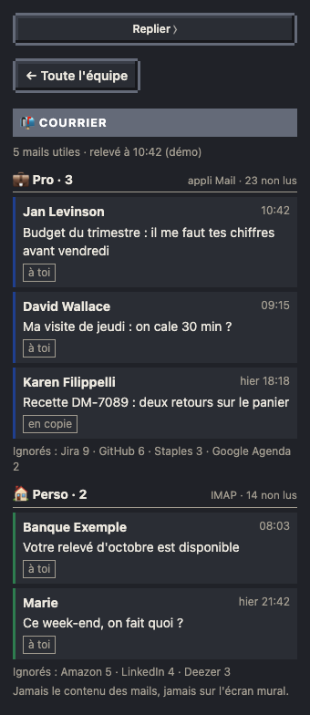

# Courrier

Le Bureau montre tes mails utiles, sans quitter la page : ceux de l'appli Mail de ton Mac (ton compte pro, ou n'importe quel compte que tu y as ajouté) et, si tu veux, d'autres comptes lus en IMAP (un Gmail perso par exemple). Il ne lit jamais le contenu d'un mail : seulement l'expéditeur, l'objet, l'heure, s'il est lu, et si tu es destinataire direct ou en copie.

## Les boîtes aux lettres

Une boîte par compte, dehors, à droite du bureau du boss, de la couleur du compte. Son drapeau se lève quand du courrier utile attend, et le compteur dit combien.

- **Le compteur** : les mails non lus des 14 derniers jours qui passent tes règles. `?` tant que tes règles ne sont pas posées (sans tri, le nombre ne veut rien dire) ; `!` quand la lecture du compte a échoué (la fiche dit pourquoi).
- **Au survol** : le compte, ses mails utiles et ses non lus. **Au clic** : la fiche Courrier, le compte cliqué en premier.
- **En mode TV**, les boîtes et leurs compteurs restent visibles (on voit que quelque chose attend), mais jamais un expéditeur ni un objet.

## La fiche Courrier

- Une section par compte : ses mails utiles, du plus récent au plus ancien, avec « à toi » ou « en copie », 🚩 s'il est suivi, et « Ouvrir ↗ » (dans l'appli Mail, ou dans Gmail).
- En bas de chaque compte, les ignorés regroupés par expéditeur (Jira 9, GitHub 6…).
- Un compte réglé en « nombre seul » (`show: "count"`) ne montre que son nombre : ni expéditeur ni objet n'arrivent jusqu'à la page.

## Le tri

Un mail non lu est **ignoré** s'il correspond à une règle « ignorer », **utile** s'il correspond à une règle « garder », sinon ignoré s'il a les en-têtes d'un envoi automatique (lettre d'information, liste de diffusion, notification), et utile sinon. Une règle : une adresse (`jan@exemple.com`), un domaine (`atlassian.net`, sous-domaines compris), éventuellement pour un seul compte.

## Mise en place

- À l'installation (`python3 tools/install.py`), réponds oui à « Afficher ton courrier » : il propose les comptes de l'appli Mail, puis des comptes IMAP. Pour un Gmail : un mot de passe d'application (myaccount.google.com/apppasswords), rangé dans le trousseau macOS, jamais dans la config ; seulement l'onglet Principal si tu veux.
- Le cron « Le Bureau · courrier » relève les comptes toutes les 10 minutes, aux heures du bureau, à 0 token. Au premier passage, macOS demande d'autoriser Kronn à piloter Mail : accepte.
- Le détail de la config (`mail.accounts`, règles) : [guide de développement](../developpement.md#courrier-cron-courrier).
