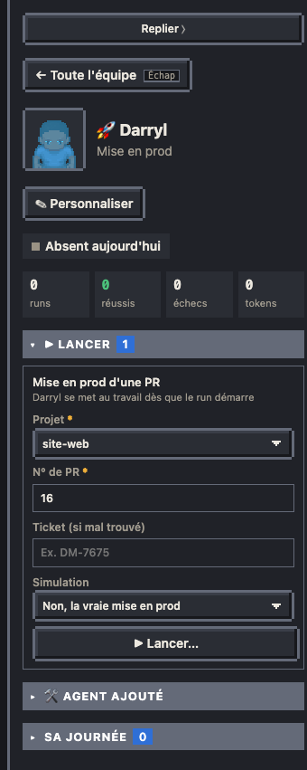
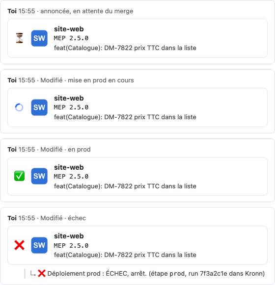

# Mise en prod d'une PR

Une mise en prod part d'une **PR**, de n'importe quel dépôt réglé pour : pour un ticket qui a une PR sur deux dépôts, tu lances deux mises en prod, dans l'ordre que tu veux. Le workflow « Mise en prod d'une PR » est un modèle du Bureau (`workflows/templates/mep.json`, script `workflows/mep.py`), créé et mis à jour par `publish.py workflows` : on le modifie dans le dépôt, jamais dans l'éditeur de Kronn.



## Lancer

- **Fiche de l'agent** qui incarne le workflow (« ▶ Lancer… ») : le projet (liste des dépôts réglés), le n° de PR, et le ticket seulement si la détection se trompe.
- **Fiche d'une PR**, ou chaque PR de la fiche d'un ticket : « 🚀 Mise en prod » (PR ni brouillon ni avec changements demandés, et un de ses tickets en To Deploy, `jira.flow.validated` ; sinon grisé avec la raison, comme les jours de gel ; une PR sans ticket Jira ne se met pas en prod). Kronn relit le dépôt et le numéro dans le dataset `actions` : rien à saisir.
- **Kronn**, directement, avec les mêmes variables : `project` (dépôt ou nom court), `pr_number`, `jira_ticket_key` (facultatif), `dry_run` (`oui` = simulation).

**Plusieurs à la fois** : des mises en prod de projets différents tournent en même temps ; sur un même projet, une seule à la fois (Kronn refuse la seconde tant que la première n'est pas finie, gates comprises), car deux mises en prod du même dépôt calculeraient le même tag, partageraient la copie git et pourraient déployer en prod une version plus ancienne après une plus récente. Sur le plan, l'agent va à la porte du boss dès qu'une de ses mises en prod attend une validation (« Attend ta validation · pilote 2 MEP : front_api DM-1, front_web DM-2 ») ; le panneau du boss, la fiche de l'agent et les compteurs montrent toutes ses validations en attente. Le plateau TV ne montre que la dernière mise en prod passée en prod.

Le **ticket** est déduit de la PR : la première clé du projet Jira (`jira.project`) trouvée dans le nom de la branche, puis le titre, puis la description. Sans ticket, la mise en prod s'arrête tout de suite : relance avec « Ticket ».

## Les étapes

| Étape | Ce qu'elle fait |
| --- | --- |
| resolve | lit la PR (ouverte), déduit le ticket |
| fetch_ticket_type | type du ticket dans Jira |
| tag | prochain tag : Bug = correctif (`2.4.0` → `2.4.1`), sinon fonctionnalité (`2.4.0` → `2.5.0`) |
| **gate du début** | la PR, le ticket, le tag, les déploiements et l'aperçu de l'annonce : approuver lance la mise en prod |
| rebase | base de la PR fusionnée dans la branche puis squash en un seul commit posé sur la base, qui garde les lignes `Co-Authored-By` et `Signed-off-by` des commits (qui a écrit le code, un modèle d'IA compris) (pas de commit de merge, pas de rejeu commit par commit : une branche qui a déjà fusionné sa base ne re-conflicte pas), push protégé (`--force-with-lease`), dans une copie du dépôt sous `~/.cache/pixel-bureau/mep` |
| teams_post | l'annonce Teams ⏳ dans le canal des mises en prod, une fois la PR remise sur sa base : un conflit avec la base, l'échec le plus courant, n'annonce rien |
| citest | label de la CI reposé, attente du résultat (25 min au plus) |
| **gate** | tests verts : merger ? |
| merge | l'annonce passe au chargeur animé (mise en prod en cours), puis merge en rebase |
| **gate** | créer la release ? |
| release | release du tag (« 2.4.1 - EW-7801 »), notes générées par GitHub |
| staging | déploiement staging avec les entrées du projet, attente |
| **gate** | staging en ligne : la prod ? |
| prod | déploiement prod, attente, l'annonce passe en ✅, puis les PR du ticket dans tous les projets |
| **gate de fin** | le ticket est-il terminé ? |
| dry_guard | en simulation, saute directement à done : ni retour IA ni statut de fin, rien n'est écrit dans Jira |
| ai_time, transition_deployed | si terminé : lance le modèle « estimer le temps gagné par l'IA » sur le ticket (sans sa validation : la gate de fin en tient lieu ; il tourne à côté, la mise en prod ne l'attend pas), puis statut de fin ; sans le modèle, l'ancien Quick Prompt `mep.feedback_qp` (étape `ai_feedback`) |
| done | fin ; « Changements » sur la gate de fin y mène directement (le ticket reste en l'état, le run finit en succès) |
| teams_failed | seulement après l'échec d'une étape : l'annonce passe en ❌, la raison et le run en réponse dans le fil, et le run finit en échec |

Un refus sur une gate arrête la mise en prod là où elle en est ; l'annonce Teams reste alors en l'état (édite-la ou supprime-la dans Teams). Chaque échec a son code (conflit avec la base, push refusé, CI rouge, déploiement en échec, délai dépassé) et son message dans le run.

**Simulation** (`dry_run` = oui) : tout est lu pour de vrai (PR, ticket, dernière release, CI), le rebase et le squash se font dans la copie locale, mais rien n'est poussé, mergé, créé ni déployé, et le ticket Jira n'est ni commenté ni déplacé. L'annonce part dans le canal de test (`mep.teams.test_channel`) au lieu de celui des mises en prod (`mep.teams.channel`).

## L'annonce Teams



Un seul message par mise en prod, une carte sur trois lignes à côté du logo du projet : le projet, `MEP <tag>`, le titre de la PR. Devant le logo, l'état : ⏳ annoncée, un chargeur animé pendant la mise en prod (merge cliqué), ✅ en prod, ❌ en échec (la raison en réponse dans le fil). Le logo ne change jamais de taille ni de place. Le message part à ton nom (jeton `az login`, Microsoft Graph) ; en simulation, dans le canal de test. Une erreur Teams n'arrête jamais la mise en prod : elle est seulement signalée dans le run.

Images : `tools/teams_logo.py` (Pillow) fait le chargeur commun (`sprites/teams/loader.png`, APNG de 12 images) et, pour un projet sans logo, une pastille à initiales (`badge API "#7c3aed" logos/front_api.png`), ou réduit un vrai logo à 48 px (`logo source.png …`). Teams n'accepte que PNG et JPEG, et limite l'édition d'un message à 28 Ko : chargeur et logo compris, la carte reste en dessous.

## Réglages (`bureau.config.json`)

- Par projet, une clé `mep` sur `github` (dépôt principal) ou sur une entrée de `github.deploys` ; seuls ces projets sont proposés. `staging_workflow` et `prod_workflow` restent ceux de l'entrée.
  ```json
  "mep": {"ci_workflow": "CI_Quality-test.yaml", "ci_label": "ci-test",
          "staging_inputs": {"envchoice": "stg", "versionTag": "{tag}"},
          "prod_inputs": {"versionTag": "{tag}"}, "staging_url": "https://…"}
  ```
  `{tag}` devient le tag de la release. Sans `ci_workflow`, l'étape de CI est passée. `logo` : PNG du projet, chemin relatif au pack d'équipe (`logos/front_api.png`).
- `mep.teams` : `{"team": "<id de l'équipe>", "channel": "<id du canal>", "test_channel": "<canal des simulations>"}` (et `test_team` s'il est dans une autre équipe). Sans elle, pas d'annonce.
- Temps gagné par l'IA : le modèle du Bureau `models.ai_time` quand il est installé (voir [Temps gagné par l'IA](22-temps-gagne-ia.md)) ; sinon `mep.feedback_qp` (ancien Quick Prompt du retour IA) et `mep.feedback_vars` (ses autres variables, passées vides). `mep.done_transition` : id de la transition Jira de fin. Sans eux, ces étapes sont retirées ; sans Jira, aussi la gate de fin.
- `mep.project_id` : projet Kronn du workflow, qui borne les connexions de l'étape Agent de l'ancien retour IA (`mep.feedback_qp`). Il doit avoir la connexion GitHub de l'équipe (`github.config_id`), sinon le Quick Prompt ne lit pas les PR (« outside this bridge token's scope »). Par défaut `review.project_id`, puis `kronn.project_id`.
- L'id du workflow est rangé dans `launch.mep_pr` (jamais dans `workflows` ni `actions`) : l'agent qui l'incarne (préfixe de l'id dans `agents[].wf`) garde sa fiche, « ▶ Lancer… » et sa fiche de paie. L'ancien bouton « Mettre en prod » du ticket (`launch.mep`) reste tant que cette clé existe.
