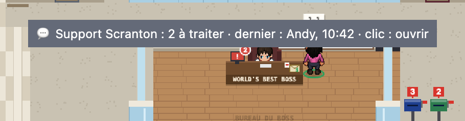
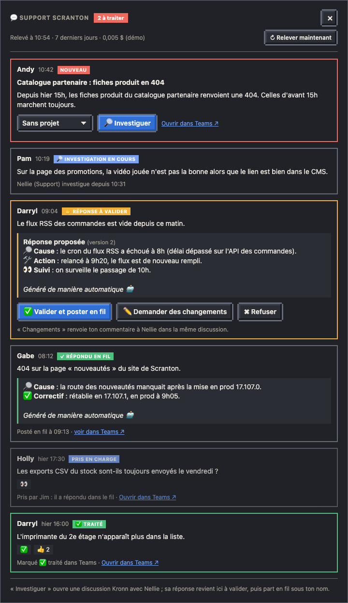
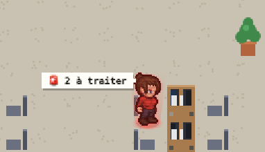

# Console Support

L'ordinateur du boss suit le canal Teams où arrivent les demandes de support de ton équipe. Tu vois les messages arriver sans garder Teams ouvert, tu fais investiguer l'agent Support, tu valides sa réponse (ou tu lui demandes de la reprendre), et elle part dans le fil du message, sous ton nom.

## L'écran du boss

Quand un message attend, l'écran de l'ordinateur du boss passe au rouge, clignote, affiche « ! » et une pastille avec le nombre **à traiter** : les messages pas encore investigués, ceux dont l'investigation s'est arrêtée en route, et les réponses qui attendent ta validation. Un fil auquel un collègue a déjà répondu dans Teams sort du compte.



- **Au survol seulement**, l'infobulle : le canal, le nombre à traiter, l'auteur et l'heure du dernier message. Pas de bulle permanente sur le plan.
- **Au clic** : la fenêtre du canal.
- Rien à traiter : l'écran redevient normal.
- **En mode TV**, l'écran du boss et l'agent Support restent en alerte (la fenêtre, elle, ne s'ouvre pas), et le bandeau « EN DIRECT » annonce chaque nouveau message du jour (« 🚒 Support : nouveau message de Pam, « sujet » »), puis rappelle toutes les heures un message que personne n'a pris (« attend depuis 2 h »). Jamais le texte du message : le prénom et le sujet, ou le début du message.
- Réglage « réduire les animations » du système : l'écran reste rouge, sans clignoter.

## La fenêtre

Les fils des 7 derniers jours, du plus récent au plus ancien, chacun avec son état.



1. **Nouveau** : l'auteur, l'heure et le message ; le projet à investiguer (un de tes projets Kronn, ou « Sans projet »), « 🔎 Investiguer » et « Ouvrir dans Teams ↗ ». Investiguer ouvre la carte Kronn, pour un commentaire si tu veux (une piste, un contexte).
2. **Investigation en cours** : l'agent Support et depuis quand, le lien vers sa discussion Kronn. Tu peux y lire ce qu'il trouve et lui écrire.
3. **Réponse à valider** : la réponse proposée, telle qu'elle sera postée, et sa version.
   - **✅ Valider et poster en fil** : elle part dans le fil Teams, sous ton nom.
   - **✏️ Demander des changements** : ton commentaire repart à l'agent, dans la même discussion ; il reprend sa réponse, qui revient ici à valider, autant de fois que nécessaire.
   - **✖ Refuser** : rien n'est posté, le fil passe « ignoré » (hors du compte).
4. **Répondu en fil** : la réponse postée, l'heure, « voir dans Teams ↗ ». Un fil auquel tu as répondu toi-même dans Teams compte aussi comme répondu.

Chaque fil montre aussi son sujet (s'il en a un), le contenu d'un message transféré et les réactions posées sur le message principal. Ce qui se passe dans Teams compte aussi :

- **✅ sur le message principal** : « ✅ Traité », en vert, hors du compte (la règle du canal : on met ✅ quand le sujet est terminé). Seul ✅ compte ; un emoji propre à l'organisation n'arrive que comme « 🙂+ », sans son nom.
- **Un collègue a répondu dans le fil** : « Pris en charge », avec son nom, hors du compte.
- **L'auteur relance après cette réponse**, sans ✅ : « ↩ Relancé », de nouveau à traiter.

« ↻ Relever maintenant » relit le canal sans attendre le relevé suivant.

## La réponse

Concise, une ligne par section avec son emoji, puis une ligne vide et la mention en italique :

```
🔎 Cause : le cron du flux RSS a échoué à 8h.
🛠️ Action : relancé à 9h20, le flux est de nouveau rempli.
👀 Suivi : on surveille le passage de 10h.

Généré de manière automatique 🤖
```

Les libellés des sections sont en gras dans Teams.

## L'agent Support

Un agent du Bureau incarne l'investigation : c'est lui qui travaille sur le plan pendant qu'il cherche, et qui attend avec « ✋ » quand sa réponse est à valider. Il lit le message, le code du projet choisi en lecture seule, ton commentaire, et ce qui a été écrit dans sa discussion depuis le tour précédent.



Avec le réglage `holo: "alerte"` de son personnage (pack de l'équipe), son hologramme dit où en est le Support :

- **en intervention**, tant qu'un fil est à traiter, pendant l'investigation et quand il attend ta validation : hologramme rouge sur un socle de projection, et la bulle « 🚨 2 à traiter » quand il ne travaille pas encore. Il vient à son poste même s'il n'a encore rien lancé de la journée ;
- **une réponse vient de partir en fil** : « 🧯 Feu éteint » pendant 3 minutes, et il repasse au cyan léger ;
- **au repos** : cyan léger, ses couleurs encore visibles sous l'hologramme.

Sa fiche montre le nombre de fils à traiter, les deux derniers, et « 💬 Ouvrir la console Support » : on investigue depuis la console (le projet se choisit dans une liste), jamais par un « Lancer » à remplir à la main.

`holo: "leger"` ou `holo: "rouge"` donnent ces hologrammes à n'importe quel agent, sans le lien avec le Support.

## Mise en place

- Le canal se règle dans le pack de ton équipe (ou dans ta config) : clé `support` (`name`, `team`, `channel`). Sans canal, rien n'est créé et l'écran reste normal.
- La lecture du canal passe par le **connecteur Claude Microsoft 365** de ton compte claude.ai (il a le droit de lire les messages d'un canal, que la connexion Azure CLI n'a pas) et la CLI `claude` : un relevé toutes les 15 minutes aux heures de bureau, en semaine, pour environ 0,005 $ chacun.
- La réponse en fil part avec ta connexion Azure CLI (`az login`), sous ton nom.
- Détails techniques : [guide de développement](../developpement.md#console-support-cron-relevé-du-support).
