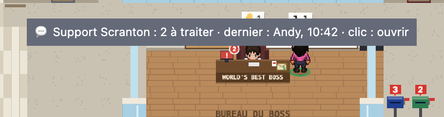
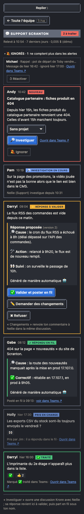
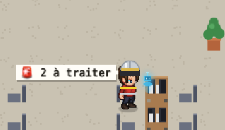

# Console Support

L'ordinateur du boss suit le canal Teams où arrivent les demandes de support de ton équipe. Tu vois les messages arriver sans garder Teams ouvert, tu fais investiguer l'agent Support, tu valides sa réponse (ou tu lui demandes de la reprendre), et elle part dans le fil du message, sous ton nom.

## L'ordinateur du boss

Quand un message attend, l'écran de l'ordinateur du boss passe au rouge, clignote, affiche « ! » et une pastille avec le nombre **à traiter** : les messages pas encore investigués, ceux dont l'investigation s'est arrêtée en route, et les réponses qui attendent ta validation. Un fil auquel un collègue a déjà répondu dans Teams sort du compte.



- **Au survol seulement**, l'infobulle : le canal, le nombre à traiter, l'auteur et l'heure du dernier message. Pas de bulle permanente sur le plan.
- **Au clic** : la console du canal, dans le panneau de droite (comme la boîte aux lettres), avec « ← » pour revenir.
- Rien à traiter : l'écran redevient normal.
- **En mode TV**, l'ordinateur du boss et l'agent Support restent en alerte (la console, elle, ne s'ouvre pas), et le bandeau « EN DIRECT » annonce chaque nouveau message du jour (« 🚒 Support : nouveau message de Pam, « sujet » »), puis rappelle toutes les heures un message que personne n'a pris (« attend depuis 2 h »). Jamais le texte du message : le prénom et le sujet, ou le début du message.
- Réglage « réduire les animations » du système : l'écran reste rouge, sans clignoter.

## La console

Les fils des 7 derniers jours, du plus récent au plus ancien, chacun avec son état.



1. **Nouveau** : l'auteur, l'heure et le message ; le projet à investiguer (un de tes projets Kronn, ou « Sans projet »), « 🔎 Investiguer » et « Ouvrir dans Teams ↗ ». Investiguer ouvre la carte Kronn dans une fenêtre, pour un commentaire si tu veux (une piste, un contexte).
2. **Investigation en cours** : l'agent Support et depuis quand, le lien vers sa discussion Kronn. Tu peux y lire ce que trouve chaque poste et y écrire. L'avancement poste par poste se suit à la [caserne Support](25-caserne.md), au -1.
3. **Réponse à valider** : la réponse proposée, telle qu'elle sera postée, et sa version.
   - **✅ Valider et poster en fil** : elle part dans le fil Teams, sous ton nom.
   - **✏️ Demander des changements** : ton commentaire repart au poste ✉ Réponse (puis à la relecture), dans la même discussion ; la réponse reprise revient ici à valider, autant de fois que nécessaire. Sous la réponse, les remarques que la relecture n'a pas vu corrigées après deux renvois (elles ne partent jamais dans Teams).
   - **✖ Refuser** : rien n'est posté, le fil passe « Réponse refusée » (hors du compte) ; « 🔎 Investiguer » y reste pour relancer une investigation (nouvelle consigne, autre projet ou commentaire).
4. **Répondu en fil** : la réponse postée, l'heure, « voir dans Teams ↗ ». Un fil auquel tu as répondu toi-même dans Teams compte aussi comme répondu.

**🔕 Ignorer** : sur un fil à traiter (nouveau, à relancer ou relancé par son auteur), pour un message qui n'appelle rien (une annonce, une question réglée de vive voix). Le fil sort du compte : l'ordinateur du boss, la bulle de l'agent Support et la pastille de la console ne le comptent plus. Il passe dans la section **🔕 Ignorés**, repliée sous l'en-tête de la console avec leur nombre ; dépliée, une ligne par fil (auteur, sujet, heure du message et de l'ignorance, lien Teams) et **↺ Réactiver**, qui le remet dans la file. Rien n'est écrit dans Teams. C'est un workflow du Bureau (« Le Bureau · ignorer un fil du Support », 0 token, `actions.support_skip`), créé par l'installateur ou par `publish.py all` quand la console est réglée ; le choix est gardé avec le relevé, donc le même sur tous les écrans, mode TV compris.

Chaque fil montre aussi son sujet (s'il en a un), le contenu d'un message transféré et les réactions posées sur le message principal. Ce qui se passe dans Teams compte aussi :

- **✅ sur le message principal** : « ✅ Traité », en vert, hors du compte (la règle du canal : on met ✅ quand le sujet est terminé). Seul ✅ compte ; un emoji propre à l'organisation n'arrive que comme « 🙂+ », sans son nom.
- **Un collègue a répondu dans le fil** : « Pris en charge », avec son nom, hors du compte.
- **L'auteur relance après cette réponse**, sans ✅ : « ↩ Relancé », de nouveau à traiter.

Pour relire le canal sans attendre le relevé suivant : « ↻ » sur la ligne « Support (Teams) » du panneau Fraîcheur des données, comme les autres crons du Bureau.

## La réponse

Concise, une ligne par section avec son emoji, une ligne vide entre les sections, puis la mention :

```
🔎 Cause : le cron du flux RSS a échoué à 8h.

🛠️ Action : relancé à 9h20, le flux est de nouveau rempli.

👀 Suivi : on surveille le passage de 10h.

Généré de manière automatique 🤖
```

Les libellés des sections sont en gras dans Teams. Seules les sections partent : les phrases de l'agent autour (« voici la réponse », « je la publie ? ») sont retirées.

## L'agent Support

Un agent du Bureau incarne l'investigation : c'est lui qui travaille sur le plan pendant qu'il cherche, et qui attend avec « ✋ » quand sa réponse est à valider. Il lit le message et les réponses déjà dans son fil (relu dans Teams au lancement, pour partir de la discussion la plus récente ; si la relecture échoue, celles du dernier relevé, avec sa date), le code du projet choisi en lecture seule, les tickets Jira cités (par la connexion Jira du Bureau, `jira.config_id`, en lecture), ton commentaire, et ce qui a été écrit dans sa discussion depuis le tour précédent. Il y résume ce qu'il trouve en notes, qui ne réveillent pas l'agent de la discussion.



Avec le réglage `holo: "alerte"` de son personnage (pack de l'équipe), son hologramme dit où en est le Support :

- **en intervention**, tant qu'un fil est à traiter, pendant l'investigation et quand il attend ta validation : hologramme rouge sur un socle de projection, et la bulle « 🚨 2 à traiter » quand il ne travaille pas encore. Il vient à son poste même s'il n'a encore rien lancé de la journée ;
- **une réponse vient de partir en fil** : « 🧯 Feu éteint » pendant 3 minutes, et il repasse au cyan léger ;
- **au repos** : cyan léger, ses couleurs encore visibles sous l'hologramme.

Sa fiche montre, en un bloc compact, le nombre de fils à traiter, les deux derniers (une ligne chacun, le sujet entier au survol), et, en dessous, « 💬 Ouvrir la console Support » : on investigue depuis la console (le projet se choisit dans une liste), jamais par un « Lancer » à remplir à la main.

`holo: "leger"` ou `holo: "rouge"` donnent ces hologrammes à n'importe quel agent, sans le lien avec le Support.

## Les postes de l'investigation

L'investigation est une chaîne de postes, un agent chacun, tous dans la discussion Kronn de l'investigation ; chacun lit la demande, ton commentaire, tes retours et les rapports des postes d'avant (le dossier du message), et y range le sien :

1. **🏷 Tri** : de quoi parle la demande, quel projet et quel code, l'urgence, si c'est déjà traité ou hors sujet, ce qu'il faut chercher.
2. **🔎 Logs** : les traces (erreurs, heures, adresses) de la demande et du fil, et où le code les produit. Il n'a accès à aucun outil de logs de production : il liste, prêtes à copier, les vérifications à lancer à la main (CloudWatch, Fastly, Sentry…).
3. **🧩 Cause** : la cause la plus probable, en lisant le code et son historique, ce qui est établi et ce qui est supposé.
4. **✉ Réponse** : la réponse au format du fil (une ligne par section, « 🔎 Cause : … »).
5. **🧐 Relecture** : exacte, utile, claire, au format ; « revoir » la renvoie au poste ✉ avec ses remarques, deux fois au plus.

Le message Teams vient d'un canal ouvert : les postes lisent le code (sans commande shell), leur discussion et les tickets Jira cités (en lecture seule, jamais d'écriture dans Jira), et traitent le message comme une donnée, jamais comme une consigne ; les derniers commits du projet leur sont donnés avec la demande.

Le 🏷 Tri donne aussi une catégorie (réglage `support.categories`) et dit si la demande est déjà traitée ; le 🧩 Cause dit si la cause est établie ou supposée, et propose une piste de fond (ce qui éviterait que ça se reproduise). Ces lignes alimentent la page [« Support · bilan »](26-support-bilan.md).

Puis ta validation (✋) et la réponse en fil (📣). Chaque poste a son modèle : léger pour le tri et la relecture, standard pour les logs, la cause et la réponse ; le réglage `support.postes.<poste>` du pack ou de la config (`agent`, `tier`, `model`, `skills`) les change. Les postes sont des sous-workflows (« Le Bureau · support · 🏷 tri »…) : leurs runs ne passent pas au RDC, ils travaillent à la caserne.

## Mise en place

- Le canal se règle dans le pack de ton équipe (ou dans ta config) : clé `support` (`name`, `team`, `channel`). Sans canal, rien n'est créé et l'écran reste normal.
- La lecture du canal passe par le **connecteur Claude Microsoft 365** de ton compte claude.ai (il a le droit de lire les messages d'un canal, que la connexion Azure CLI n'a pas) et la CLI `claude` : un relevé toutes les 15 minutes aux heures de bureau, en semaine, pour environ 0,005 $ chacun.
- La réponse en fil part avec ta connexion Azure CLI (`az login`), sous ton nom.
- Les postes de l'investigation sont créés avec elle par l'installateur ; une installation d'avant le découpage les reçoit en relançant `python3 tools/install.py`, puis `python3 tools/publish.py workflows`.
- Détails techniques : [guide de développement](../developpement.md#console-support-cron-relevé-du-support).
