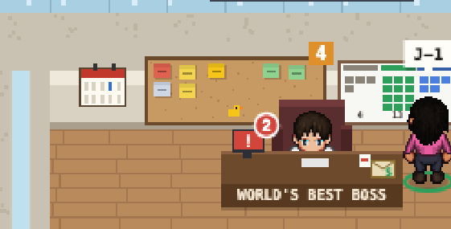
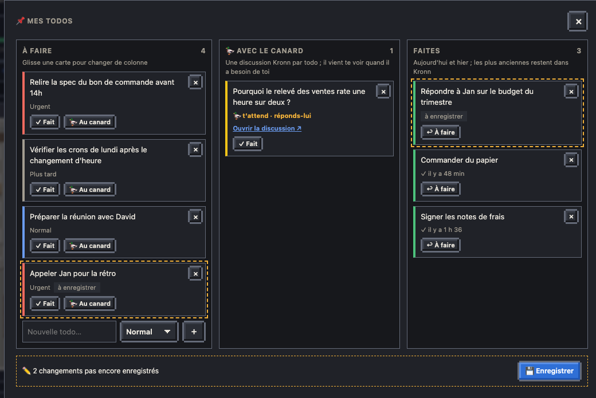

# Mes todos

Tes todos du jour, sur le mur de ton bureau : un tableau en liège à côté du calendrier de l'équipe, et au clic une fenêtre en trois colonnes. Ce sont des tâches Kronn : tu les retrouves aussi parmi les tâches de Kronn, où rien ne se perd.

## Le tableau en liège

Accroché au mur du bureau du boss, entre le calendrier de l'équipe (décalé à gauche pour lui faire la place) et le mur Kanban. Un post-it par todo, en trois colonnes : à faire (couleur de la priorité : rouge urgent, jaune normal, gris plus tard), avec le canard (jaune, un petit canard en bas de la colonne), faites (vert).

- **La pastille orange** : ce qui t'attend, c'est-à-dire les todos à faire et celles où le canard t'a posé une question.
- **Au survol** : « Mes todos : 4 à faire · 1 avec le canard (1 t'attend) ». **Au clic** : la fenêtre. Au clavier : **📌 Mes todos** dans ta fiche de boss.
- **En mode TV**, le tableau n'apparaît pas : ce sont tes todos, pas celles de l'équipe.
- Sans le workflow « Le Bureau · todos » et sans aucune todo, pas de tableau.

## La fenêtre en colonnes

- **À faire** : une carte par todo, sa priorité, ✓ Fait, 🦆 Au canard, et × pour la supprimer. En bas, le champ « Nouvelle todo… » et sa priorité (Normal, Urgent, Plus tard), puis Entrée ou ＋.
- **🦆 Avec le canard** : le canard ouvre une discussion Kronn sur la todo, avec son texte pour sujet, et y réfléchit. La carte dit s'il y réfléchit ou s'il **t'attend**, et « Ouvrir la discussion ↗ » mène à la discussion. Quand il a une question, il vient te voir à ton bureau, comme pour toute discussion du canard. Rien d'autre n'est lancé : aucun agent ne se met au travail sans que tu le demandes.
- **Faites** : celles d'aujourd'hui et d'hier, ↩ À faire pour en reprendre une. Les plus anciennes restent dans Kronn.
- **Glisser une carte** d'une colonne à l'autre revient au même : vers le canard, c'est « Au canard ».

## Enregistrer

Chaque changement s'affiche tout de suite, en pointillé avec « à enregistrer », et reste dans ce navigateur, même si tu recharges la page. Le bandeau du bas compte les changements en attente.

**💾 Enregistrer** les envoie tous d'un coup : le bouton copie le code todos, tu le colles dans la carte Kronn qui s'ouvre (⌘V), puis Lancer. Un seul run, 0 token, pour toute la liste. Le tableau suit quelques secondes après, et les cartes perdent leur pointillé. Un code relancé deux fois ne crée pas de doublon (ni tâche ni discussion).

## Ce qu'il y a derrière

- Une todo est une tâche Kronn taguée `bureau-todo` : à faire = statut `todo`, avec le canard = `in_progress` et sa discussion liée, faite = `done`, supprimée = `archived` (rien n'est effacé).
- Le relevé : le cron « Le Bureau · live (1 min) », chaque minute (`workflows/todos.py`, dataset `todos`). L'enregistrement : le workflow « Le Bureau · todos » (`todos.py save`), qui publie aussi le dataset.
- Une todo créée ou déplacée depuis Kronn apparaît au relevé suivant ; seules celles qui portent le tag `bureau-todo` viennent sur le tableau.
