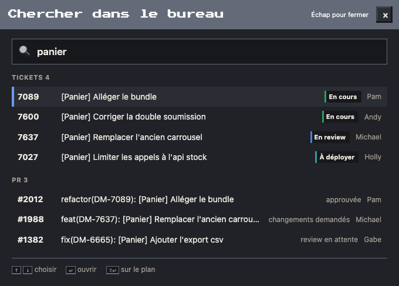

# Chercher

Un ticket, une PR, un collègue, un agent ou une de tes pages Kronn, sans parcourir le Kanban ni le panneau : une fenêtre, un champ, et les résultats au fil de la frappe.

## L'ouvrir

- **🔍 Chercher**, en haut de la page à côté de ☀ Récap.
- Au clavier, n'importe où sur la page : **⌘K** (Ctrl+K hors Mac) ou **/**.
- Pas en mode TV : l'écran d'open space ne se pilote pas au clavier.

La fenêtre se rouvre sur ta dernière recherche, déjà sélectionnée : tape pour la remplacer.

## Ce qu'elle trouve

Chaque mot tapé doit se trouver dans la ligne, sans tenir compte des accents ni des majuscules : « cedric test » trouve Cédric, le testeur.

| Groupe | Cherché dans | La ligne montre |
| --- | --- | --- |
| Tickets | le numéro (7637 ou DM-7637) et le titre, tickets du sprint et non assignés | numéro, titre, colonne, personne ; ceux en cours d'abord, les déployés à la fin |
| PR | le numéro (#2012) et le titre, PR de l'équipe et des autres dépôts suivis | numéro, titre, état de la review, auteur |
| Personnes | le prénom et le rôle | prénom, rôle |
| Agents | le nom et le métier | icône, nom, métier |
| Pages Kronn | le titre des pages de l'écran du boss | titre |

Cinq lignes par groupe au plus ; au-delà, la fenêtre dit combien d'autres et invite à préciser.

## Ouvrir un résultat

| Touche | Effet |
| --- | --- |
| ↑ ↓ | choisir une ligne |
| ↵ ou clic | ouvrir : un ticket ou une PR dans le volet du [Mur Kanban](08-murs.md), filtré sur sa personne ; un collègue ou un agent dans sa [fiche](07-fiches.md) ; une page Kronn dans un onglet de Kronn |
| ⇧↵ ou ⇧ clic | le montrer sur le plan : la personne du ticket ou l'auteur de la PR, dans sa fiche, le plan assombri autour d'elle |
| Échap | fermer |
