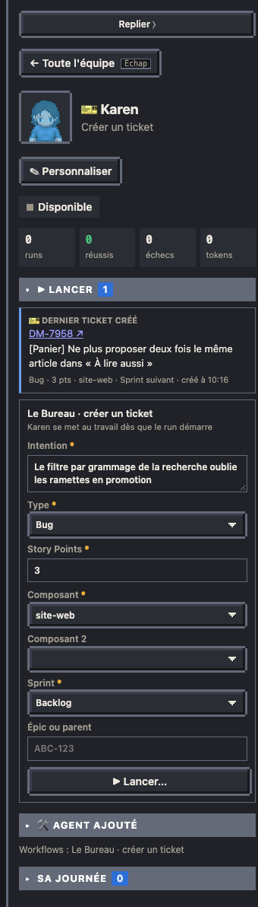
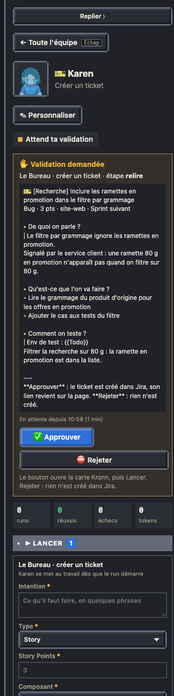

# Créer un ticket

Un ticket Jira écrit au modèle de ton équipe, sans ouvrir Jira : tu donnes l'intention, l'agent du modèle « créer un ticket » la rédige, tu relis le ticket tel qu'il sera créé, puis le Bureau le crée et son lien revient sur la page.

## Le lancer

Depuis la **fiche de l'agent** qui incarne le modèle (Karen sur les captures), bloc **▶ Lancer** :

| Champ | |
| --- | --- |
| Intention | obligatoire : ce qu'il faut faire, en quelques phrases |
| Type | liste des types de l'équipe, son type par défaut déjà choisi |
| Story Points | obligatoires |
| Composant | la liste des composants du projet Jira (les dépôts) ; obligatoire quand l'équipe la donne |
| Composant 2 | facultatif, pour un ticket qui touche deux dépôts |
| Sprint | Backlog (par défaut) ou Sprint suivant : le premier sprint à venir du board, jamais le sprint en cours |
| Épic ou parent | facultatif (ABC-123) |

« Lancer… » reste grisé tant qu'il manque un champ obligatoire, et tant qu'un ticket est en cours de rédaction ou attend ta validation : jamais deux à la fois. Une fois lancé, le formulaire se vide.

## Le relire

L'agent lit le modèle de ticket de l'équipe (`jira.create.template`), regarde au besoin quelques fichiers du dépôt du composant, puis rédige le titre et la description en wiki Jira. Il ne crée rien.

La validation arrive sur sa fiche, avec l'alerte ✋ habituelle : le titre, le type, les points, les composants, le sprint et l'épic, puis la description en texte lisible (titres en ▸, panneaux en │).

- **✅ Approuver** : le ticket est créé.
- **⛔ Rejeter** : rien n'est envoyé à Jira. Relance avec une autre intention si besoin.

Pas de « Changements » : un refus ne fait pas réécrire le ticket.

## La création

Par l'API REST v2 de Jira, sans IA : la description garde ses panneaux, et les `{{…}}` du modèle de l'équipe passent tels quels. Les points vont dans le champ de l'écran de création (`jira.create.points_field`), puis dans celui du board (premier de `jira.points_fields`) s'il est différent.

Le ticket revient sur la page :

- sur la fiche de l'agent, **🎫 Dernier ticket créé** : sa clé (lien vers Jira), son titre, son type, ses points, ses composants et son sprint ;
- dans le fil : « Karen crée DM-7958 », à la place de la ligne du créateur Jira.

Les relevés de la journée le relisent : le bloc disparaît le lendemain, le ticket reste dans Jira.

## Réglages

Modèle du Bureau `ticket`, proposé par l'installateur quand Jira est connecté (`models.ticket`). Réglage `jira.create`, dans le pack de l'équipe (`settings.json`) ou ta config, qui le surcharge clé à clé :

| Clé | Par défaut | |
| --- | --- | --- |
| `types` | Story, Bug, Task | types proposés, avec leur nom dans ton Jira |
| `type` | le premier | type choisi d'avance |
| `components` | aucune liste | composants proposés ; sans liste, le champ est libre |
| `component_required` | oui avec une liste | composant obligatoire |
| `points_field` | le champ du board | champ des points de l'écran de création |
| `template` | aucun | le modèle de ticket de l'équipe : un fichier, ou un chemin dans un dépôt (cherché dans les clones locaux) |

Le personnage vient du pack (`agents[]` avec `model: "ticket"`), comme les autres modèles.
