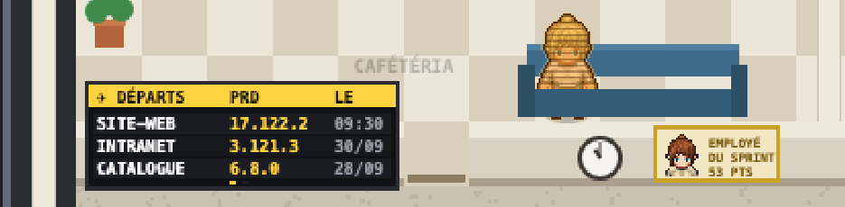
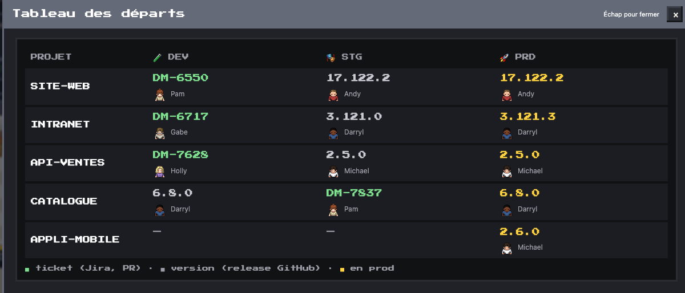
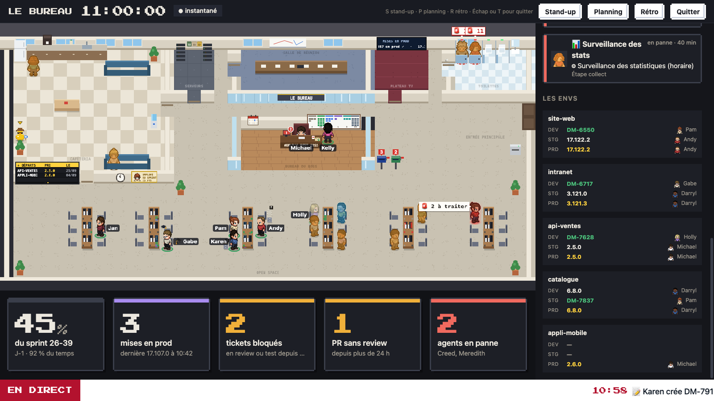

# Tableau des départs

Ce qui tourne sur **DEV**, **STG** et **PRD**, pour tous les projets suivis, d'un coup d'œil. Un panneau d'aéroport pend au mur du bureau ; un clic ouvre le tableau complet.

## Le panneau, sur le plan

- Les **mises en prod**, la plus récente en haut : le projet, la version en prod, et l'heure du départ s'il a eu lieu aujourd'hui, sinon le jour (JJ/MM).
- Trois projets à la fois ; le panneau passe aux suivants toutes les 5 secondes, en lettres qui défilent comme dans un hall d'aéroport. Les points en bas disent sur quelle page on est.
- Au survol, une infobulle ; au clic, la fenêtre « Tableau des départs ». En relecture de la journée, une mise en prod d'après l'heure rejouée n'est pas encore partie.

Le panneau est un objet **facultatif** du plan : le rectangle `objects.departs` (`x`, `y`, `w`, `h`, en pixels ; 150 × 50 conviennent). Le plan type n'en a pas ; le plan d'une équipe le place où il veut, par exemple à la place de l'horloge de la cafétéria (horloge et employé du sprint décalés à droite de la porte).

## La fenêtre

Une ligne par dépôt suivi (`github.repo` puis `github.deploys`, dans cet ordre), une colonne par env :

- **en vert**, la branche d'un ticket : sa clé, liée au ticket dans Jira, et sa PR à côté quand le Bureau la connaît ; une branche sans ticket est liée à la branche sur GitHub ;
- **en gris**, une version (ou une image de test), liée à sa release sur GitHub ;
- **en jaune**, la version en prod ;
- sous chaque valeur, qui l'a déployée (son avatar s'il est dans l'équipe) ; un tiret quand l'env n'existe pas pour ce dépôt.

Ce qui tourne sur un env, c'est son **dernier déploiement réussi** : un essai annulé ou en échec ne change rien. La fenêtre suit les données (relues chaque minute).

## En mode TV

Au bout de « Qui fait quoi » (après l'équipe et les agents), le bloc **Les envs** : trois lignes par projet (DEV, STG, PRD), la clé du ticket plutôt que la branche, et qui a déployé. Le défilement automatique y passe à chaque tour.

## D'où viennent les données

Le cron live (chaque minute) relit déjà les workflows de déploiement de GitHub Actions de chaque dépôt suivi, avec un ETag (GitHub répond 304 tant que rien ne bouge) : le tableau n'ajoute **aucun appel**. Il publie `departs` dans le dataset `live` :

- **DEV** et **STG** : le dernier run réussi du workflow hors prod (`staging_workflow`, ou le workflow du réglage `deploy`) dont le titre nomme l'env (`dev` ; `stg` ou `staging`), hors nom de la branche ; 20 runs lus ;
- **PRD** : le dernier run réussi du workflow de prod (`prod_workflow`) dont le titre porte une version ;
- la valeur : la version quand le titre en porte une et pas la branche, sinon la branche, sinon l'image de test nommée dans le titre (« dev_DM-12-2 »).

## Couleurs

Le panneau et la fenêtre ont leurs propres couleurs, des variables `--dep-*` de la feuille de style (fond, bandeau, en-têtes, nom, version, version en prod, branche, qui et quand). Le thème d'un pack les surcharge (par exemple un bandeau à la couleur de l'équipe et les versions en prod en jaune).
