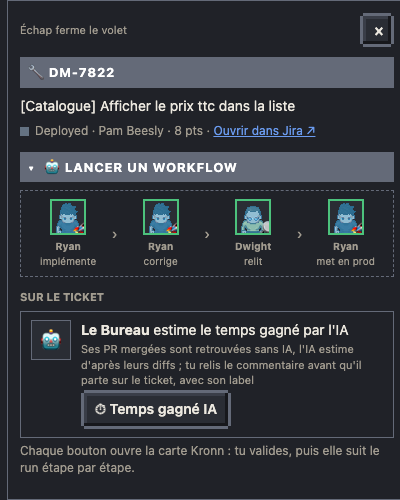

# Temps gagné par l'IA

Sur un ticket terminé, un commentaire qui dit combien de temps l'IA a fait gagner, estimé d'après ses PR mergées, avec un label de suivi pour les compter. Le Bureau trouve les PR lui-même, sans IA ; une seule étape IA lit leurs diffs et estime ; tu relis le commentaire tel qu'il sera posté.



## Le lancer

- **Depuis la fiche d'un ticket terminé** (volet du Kanban) : « ⏱ Temps gagné IA », dans « Sur le ticket ». Le bouton est grisé quand le label de suivi est déjà sur le ticket (relu par le cron équipe).
- **En fin de mise en prod** : quand tu réponds « le ticket est terminé » à la dernière validation de la [mise en prod d'une PR](16-mise-en-prod.md), elle lance le modèle sans sa validation (la tienne en tient lieu), puis passe le ticket au statut de fin sans l'attendre. En simulation, rien n'est lancé.

La carte Kronn propose deux champs facultatifs :

| Champ | |
| --- | --- |
| PR (si mal trouvées) | `owner/dépôt#12, owner/dépôt#13` : exactement ces PR, sans recherche ni garde-fou |
| Forcer | Oui : reposte même si le label de suivi est déjà sur le ticket |

## Ce qui se passe

| Étape | |
| --- | --- |
| ticket, summary, instance, detail | le ticket dans Jira, puis ses PR dans le panneau Development (API dev-status : la clé d'instance GitHub est lue dans le résumé, « GitHub » seul renverrait une liste vide) |
| discover | sans PR liée dans Jira : recherche GitHub de la clé dans les dépôts suivis (`github.pr_repos`), PR qui la citent dans leur titre ou leur branche ; puis chaque PR par `gh` : état, volume, diff (fichiers générés réduits à leur nom, 60 Ko en tout), l'outil et le modèle qui ont écrit le code, la relecture par un autre modèle |
| estimate | la seule étape IA (`tier: default`, sans outil) : pour chaque PR, le temps sans IA et avec IA, d'après la nature du travail plus que le nombre de lignes ; une phrase « ce qui a bien marché » ; sa confiance |
| compose | le commentaire au gabarit de l'équipe, en wiki Jira |
| **validation** | le détail par PR et le commentaire tel qu'il sera posté : **Approuver** le poste, **Rejeter** n'écrit rien |
| comment, label | le commentaire (API REST v2 de Jira, mise en forme gardée), puis le label de suivi (ajouté, rien n'est retiré) |

Rien n'est écrit dans Jira quand :

- le label de suivi est déjà là (sauf « Forcer ») ;
- aucune PR mergée n'est trouvée : relance avec « PR » ;
- une PR du ticket est encore ouverte : le run donne la liste trouvée ; relance une fois tout mergé, ou avec « PR » = seulement celles à estimer. Une PR fermée sans merge est écartée.

### Outil, modèle et relecture

Pas devinés par l'IA :

- **outil et modèle** : les lignes `Co-Authored-By` des commits des PR (`Claude Opus 5.5 (1M context) <noreply@anthropic.com>` donne « Claude Code » et « Claude Opus 5.5 »), et « Generated with Claude Code » dans la description d'une PR ; sinon les valeurs par défaut du réglage. La mise en prod garde ces lignes dans son commit unique.
- **relu par un autre modèle** : « Copilot » si Copilot a laissé une review, « Claude (revue Kronn) » si le modèle de revue du Bureau en a laissé une (signée « Review automatique ») ; sinon « Non ».

## Réglages

Installation : `python3 tools/install.py` propose le modèle (« Estimer le temps gagné par l'IA », `models.ai_time`, Jira connecté), puis `python3 tools/publish.py all`.

Gabarit : `jira.ai_feedback`, dans `bureau.config.json` ou dans `settings.json` du pack d'équipe (la config surcharge clé à clé).

```json
"jira": {"ai_feedback": {
  "label": "feedback_ia", "lang": "en", "title": "AI Usage Feedback",
  "tool": "Claude Code", "model": "Claude Opus 4.8",
  "fields": [["Tool used", "{tool}"], ["Model used", "{model}"],
             ["Were the suggestions challenged by another model?", "{challenged}"],
             ["What went well", "{went_well}"], ["Time saved (estimate)", "{saved}"],
             ["What didn't go well", "Nothing"], ["Additional comments", "{per_pr}"]]}}
```

- `label` : le label de suivi (défaut `temps_gagne_ia`).
- `lang` : `fr` (défaut) ou `en` : langue de « ce qui a bien marché », des heures (`~1,5 h` ou `~1.5h`) et des valeurs calculées.
- `title` et `fields` : le titre en gras, puis une puce par champ `[libellé, valeur]` ; un libellé qui finit par « ? » n'a pas de deux-points. Valeurs : du texte fixe, ou `{tool}`, `{model}`, `{challenged}`, `{went_well}`, `{saved}` (total avec sans IA et avec IA), `{per_pr}` (gain par PR), `{confidence}` (confiance de l'estimation), `{ticket}`.
- `tool`, `model` : quand aucun commit ne le dit.
