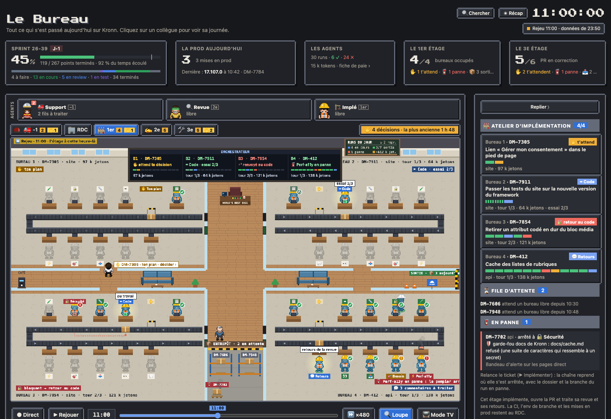
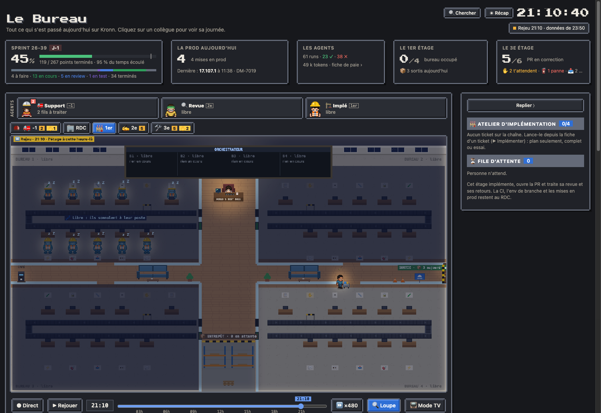
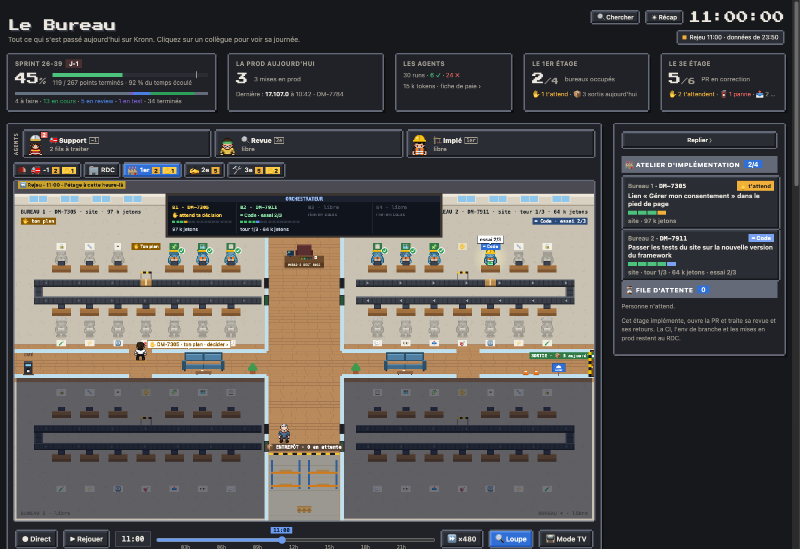
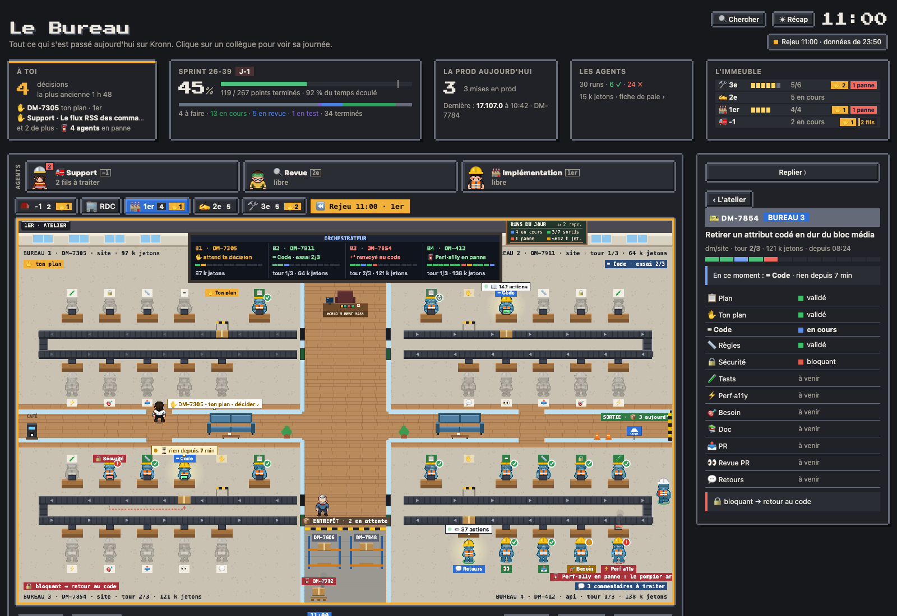
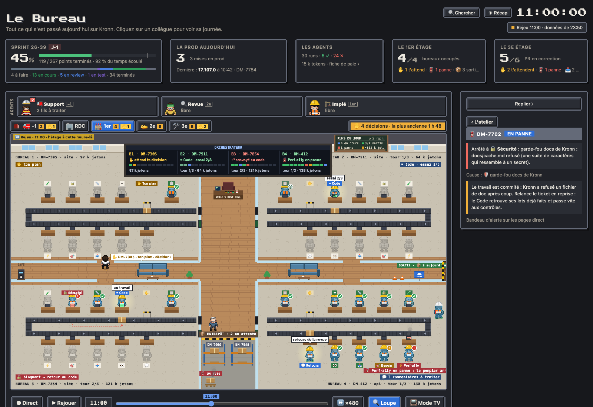
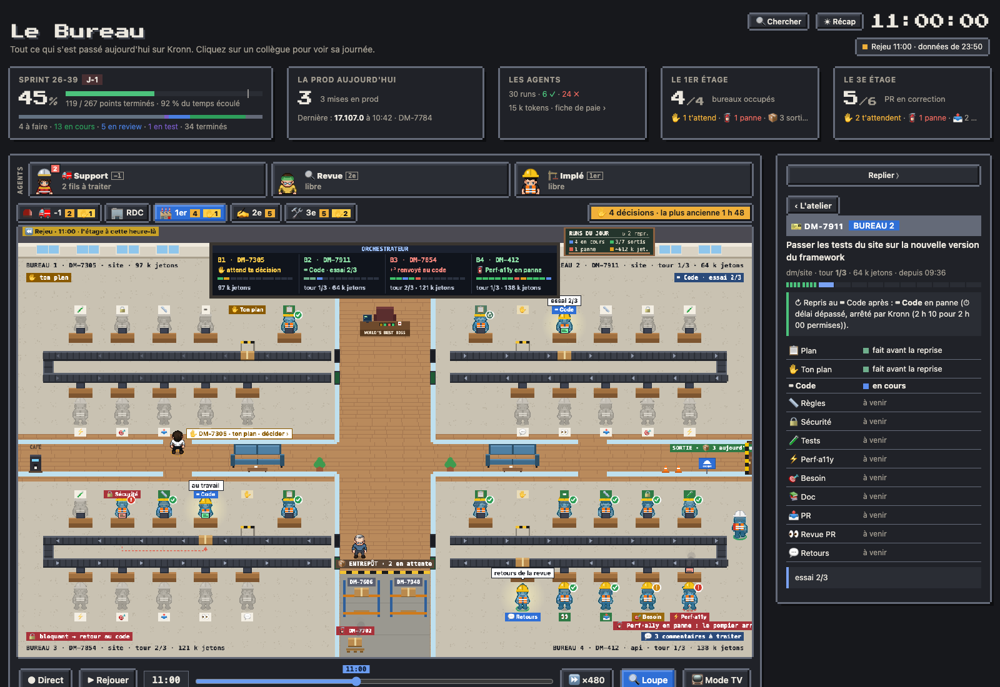

# L'atelier d'implémentation (1er étage)

Le 1er étage montre les tickets en cours d'implémentation par la chaîne de postes : un bureau par ticket et par dépôt (quatre en parallèle ; un ticket à plusieurs composants Jira prend un bureau et ouvre une PR par dépôt, les PR sœurs se citent entre elles), et au mur un tableau qui croise les postes et les tickets. L'étage ne traite que l'implémentation, la PR et ses retours : la CI, l'env de branche et les mises en prod restent au rez-de-chaussée. Au poste 💬 Retours, les commentaires de la revue sont corrigés par le même travail que le bouton 🛠 Corriger (fils et commentaires hors fil, contrôles du dépôt, « Version N », fils résolus), sans validation : ta relecture de la PR vient après. S'il a poussé des corrections, la revue relit la PR une seconde fois, puis les retours : deux passes au plus.

## Monter à l'étage

Les boutons d'étage au-dessus du plan (« 🏢 RDC », « 🏭 1er », le nom de l'étage en entier au survol) apparaissent quand la chaîne est installée (`models.impl_chain`). Le chiffre sur l'onglet du 1er compte les bureaux occupés (pastille neutre), « ✋ n » en ambre les validations qui t'y attendent ; l'étage choisi est retenu par le navigateur.

Les workflows de l'étage (la chaîne et ses postes, modèles `impl*`) ne passent plus au rez-de-chaussée : pas d'intérimaire pour eux dans l'open space, et « Nouvel agent » (la baie de la salle Serveurs) ne les propose pas. Le **lanceur** (`models.impl`, « ▶ Implémenter ») reste au RDC : l'agent qui l'incarne est un homme de chantier, casque jaune et gilet orange. Quand un ticket arrive au 1er, il va prendre son carton à son bureau et le porte jusqu'à l'entrée principale (« 📦 DM-7305 → 1er étage »), pendant une minute ; le colis apparaît alors dans l'entrepôt du 1er.

## Ce qu'on y voit

- **Quatre bureaux sur toute la largeur**, autour d'un couloir central et d'un couloir horizontal ; chaque bureau a sa porte au milieu, côté couloir horizontal. Les titres : bureau 1 en haut à gauche, 2 en haut à droite, 3 en bas à gauche, 4 en bas à droite. Un ticket garde son bureau jusqu'à sa sortie.
- **Le tapis roulant** : le carton du ticket entre par une trappe côté couloir central, avance de poste en poste (rangée du haut vers le mur, virage, rangée du bas) et ressort par la trappe de sortie, toujours côté couloir central (les bureaux 1 et 3 sont en miroir). Onze postes y ont leur bureau : six en haut (📋 Plan, ✋ Ton plan, ⌨ Code, 📏 Règles, 🔒 Sécurité, 🧪 Tests), cinq en bas à partir du virage (⚡ Perf·a11y, 🎯 Besoin, 📤 PR, 👀 Revue PR, 💬 Retours) ; 📚 Doc n'a pas de bureau, il est dans la barre des postes et la fiche. Quand le ticket change de poste, le carton glisse ; après un bloquant, il recule jusqu'au Code, sous une flèche rouge en pointillé. La barrière jaune et noire est « Ton plan ».
- **Un agent par poste**, derrière son bureau, sous l'icône de son poste ; le nom s'y ajoute quand il travaille, bloque, est en panne ou attend ta décision (au survol, sinon). L'étage est un chantier : les agents, des hologrammes bleus, portent le casque jaune et le gilet orange à bandes (debout, le gilet est à la même hauteur que sur l'agent du chantier au RDC, sous le menton) ; à la sortie, une bande jaune et noire, deux plots et le panneau « casque obligatoire ».
  - **au travail** : hologramme vif, il tape, son écran est allumé, une lumière l'éclaire et une bulle dit ce qu'il fait : sa dernière action et le nombre d'actions depuis le début de l'étape (📖 lit un fichier, ⌨ lance une commande, ✏ écrit, 🔎 cherche), avec une pastille verte qui clignote quand l'action a moins de 30 s. Sans action depuis 5 minutes, la bulle passe au jaune : « ⏳ rien depuis 7 min ». En rejeu, elle redit « au travail » (le relevé ne dit que ce que fait l'agent maintenant). Le compteur avance à chaque relevé, toutes les minutes ;
  - **a travaillé** : une pastille ✓ (ou ! pour un avis) apparaît avec un petit saut, et l'agent s'étire ;
  - **attend son tour** : silhouette grise derrière un écran éteint ;
  - **bloquant** : pastille ! rouge, écran rouge ; **en panne** (le sous-workflow du poste a échoué, par exemple l'API d'un agent indisponible) : fumée et étincelles sur l'écran, une étiquette « 🧯 … en panne : le pompier arrive », et le pompier de l'étage (casque blanc de la sécurité) vient de la porte avec un extincteur tant que la panne dure ; le grand tableau le dit aussi.
- **L'orchestrateur** (casque blanc, bloc-notes à la main) vient dans le bureau pendant ses étapes, quand aucun poste ne travaille : quand il écrit le plan, après le 📋 Plan, et quand il décide, après les contrôles, de livrer ou de renvoyer au code. Il se tient à côté de la barrière, sous une lumière, sa bulle dit ce qu'il fait, et l'étiquette du bureau le dit (« 🧠 l'orchestrateur écrit le plan ») ; le grand tableau aussi. Sans lui, le bureau paraissait vide pendant plusieurs minutes.

  

- **Un bureau libre** s'éteint doucement. Seul le bureau 1 garde son équipe : elle somnole à son poste et, de temps en temps, l'un d'eux va au café, sur un canapé ou dans le couloir, puis revient (2 promeneurs au plus). Les bureaux 2 à 4 libres sont vides. Quand un ticket arrive, les lumières se rallument, les promeneurs rentrent et, dans un bureau vide, l'équipe monte par la porte de sortie, l'un après l'autre, pendant que Bernard apporte le carton ; quand Bernard emporte le carton du ticket sorti, elle redescend par la même porte.
- **Le tableau noir « Runs du jour »**, au mur du haut à droite du grand tableau (à la place de deux fenêtres) : depuis minuit, les tickets en cours, les tickets sortis sur les tickets du jour, les runs en panne et les jetons ; les reprises sont à part, en haut à droite (« ↻ 8 reprises »), car on compte par ticket, pas par run. Il est purement indicatif, comme ceux des autres étages : rien au clic, l'historique est dans la page « Chaîne · bilan ». En rejeu, il garde les chiffres du dernier relevé.
- **Le grand tableau de l'orchestrateur**, en haut : une colonne par bureau, avec le ticket, le poste en cours (ou l'étape de l'orchestrateur) ou la décision, la barre des postes, le tour et les jetons (le titre du ticket est dans le panneau).
- **Le boss**, dans son fauteuil rouge derrière son bureau à quatre boutons ; un pack d'équipe peut lui donner un dessin pour cet étage (`atelier_sprite` dans le roster, par exemple en constructeur, casque et gilet) (un par bureau, jaune quand ce bureau t'attend). Quand une gate t'attend, il se lève et va à la porte du bureau, avec au-dessus de lui l'étiquette « ✋ DM-7305 · ton plan · décider › », puis revient s'asseoir. Une escalade (« la chaîne demande un humain ») allume un gyrophare au-dessus de la porte. À la porte, un clic sur lui ou sur son étiquette ouvre la fiche du bureau, sa décision en haut ; à son fauteuil, un clic ouvre sa fiche, la même qu'au RDC (ses validations, ses todos, ses tickets), dans le panneau de droite ; elle reste ouverte quand tu changes d'étage.
- **L'entrepôt**, en bas du couloir central : les tickets en attente sur les rayonnages, les tickets en panne sur des palettes (🧯, à relancer).
- **Les livraisons** : un ticket qui arrive apparaît au fond de l'entrepôt (« ✨ DM-7305 arrive du RDC ») ; **Bernard** (le manutentionnaire : âgé, un peu dégarni, lunettes, blouse bleue) va le chercher et l'apporte à la trappe d'entrée avec son transpalette ; un ticket qui sort (PR ouverte) attend à la trappe de sortie, Bernard vient le chercher et repart par la porte de sortie. Il n'y a qu'un Bernard : les livraisons passent l'une après l'autre, et entre deux il attend à l'entrepôt, à droite, où un compteur dit combien de tickets sont sortis aujourd'hui. Le café est au bout gauche du couloir ; deux canapés (avec leur table basse) sont entre chaque porte et le couloir central, jamais devant une porte.
- **Les thèmes** : les agents portent les chapeaux du RDC. À Noël, Bernard devient le Père Noël, les cartons sont des paquets cadeaux, une guirlande court sur le grand tableau et un sapin attend dans le couloir ; à Halloween, Bernard passe en fantôme avec sa citrouille, les cartons sont des citrouilles et une toile d'araignée pend au tableau ; au Nouvel an et à la Saint-Valentin, des ballons dans le couloir (et un cœur qui s'envole quand un poste rend son ✓, une rose sur le bureau du boss).
- **Le ménage du soir** : après sa tournée du RDC, l'agent d'entretien monte au 1er pour 40 minutes, avec son chariot. Il entre par la porte de sortie, balaie chaque bureau (2, 4, 3, 1, le bureau où il passe s'éclaire) en le parcourant d'un bout à l'autre, puis l'allée de l'entrepôt, et repart dès qu'il a rejoint la porte. Comme au RDC, sa tournée suit l'heure du plan : « Rejouer » la montre, et le fil le dit (« a fini le RDC, il monte au 1er étage », puis « a fini le ménage, tout est propre »).

- **Jour et nuit**, comme au RDC : des fenêtres au-dessus des bureaux 1 et 2 prennent la couleur du ciel (soleil à Paris, étoiles la nuit). Hors des heures de bureau, l'éclairage baisse ; seuls restent allumés les bureaux qui ont un ticket (la chaîne tourne aussi la nuit : chaque poste sous sa lampe, le tapis éclairé), le grand tableau, la lampe du bureau du boss et la sortie. Comme au RDC, le boss reste à son fauteuil le soir et le week-end, et les agents restent à leur poste (ceux des bureaux libres somnolent et se promènent comme en journée) ; seul Bernard rentre chez lui. Le soir, chacun a sa lumière, comme au RDC : le boss, les agents à leur poste et ceux qui marchent (promeneurs, Bernard, l'agent d'entretien, le pompier) ; elle les suit quand ils se déplacent.
- **Les trajets** : le tapis laisse une allée le long du mur extérieur (à gauche des bureaux 1 et 3, à droite des bureaux 2 et 4). Un agent qui sort passe derrière sa rangée, fait le tour par cette allée si sa rangée est loin de la porte, puis sort par la porte : il ne marche plus sur le tapis ni sur les autres.
- **Rejouer** : l'étage suit l'heure du plan, comme le RDC ; en lecture rapide, Bernard et les agents marchent plus vite, comme au RDC. En rejeu ou en pause, il est reconstruit à cette heure-là d'après les moments du relevé (24 h) : bureaux occupés, poste du carton, gate ouverte ; le bandeau « ⏪ Rejeu · 09:36 » le rappelle. Les scènes (Bernard qui apporte ou emporte un carton) se jouent quand le curseur avance sur ce moment, en lecture ou en glissant doucement ; « ⏵ revoir » sur une ligne du 1er dans le fil monte à l'étage et la rejoue en ×1. Un saut du curseur pose l'étage sans rejouer, sauf une arrivée ou une sortie de moins de 2 min, qui se joue quand même (en direct aussi, en montant à l'étage).

## Loupe, mode TV et scènes

- **La loupe** (bouton « 🔍 Loupe ») suit aussi l'étage : un ticket qui sort (Bernard l'emporte), un ticket qui arrive, le boss à la porte d'un bureau qui attend ta décision, un retour au code, un poste en panne, le ménage du soir.
- **Le mode TV** reste sur l'étage choisi : la colonne de droite montre les bureaux (ticket, poste, barre des postes), l'entrepôt et les pannes. Le bouton « 🏭 1er étage / 🏢 RDC » de la barre (ou la touche E) change d'étage ; l'adresse de l'écran mural peut fixer l'étage (`?tv=1&floor=1`) ou alterner les deux (`?tv=1&floor=alt` : 60 s sur l'open space, 40 s sur l'atelier quand des tickets y sont).
- **Les scènes du bureau** (« Comment lire le plan ») ne montrent que celles de l'étage affiché. Au 1er : un ticket arrive, un ticket sort, un poste rend son verdict, le boss va à la porte, l'escalade, le retour au code, le poste en panne, le ménage du soir, le soir au 1er ; « ▶ voir » la joue dès le premier clic, sur le plan à n'importe quelle heure, même sans ticket sur la chaîne, avec les quatre bureaux pris ou un jour sans ménage (la scène part alors de bureaux de démonstration), puis l'atelier revient tel qu'il était.

## Le panneau

Sur le 1er étage, le panneau liste les bureaux (ticket, poste en cours, barre des postes, tour, jetons), la file et les pannes. Un clic sur un agent dit ce qu'il fait et où est sa place (le chemin jusqu'à son bureau est tracé quand il se promène) ; comme au RDC, le plan s'assombrit autour de lui (et du boss quand sa fiche est ouverte), et Échap ou un clic ailleurs le rend ; un clic sur un carton de l'entrepôt dit depuis quand il attend, ou où il est tombé en panne. Un clic sur un bureau, son carton ou sa colonne du tableau, dans le panneau ou sur le plan, ouvre sa fiche : « En ce moment » (l'étape qui tourne, la dernière action de l'agent, le nombre d'actions et depuis quand), le verdict de chaque poste (dont 📚 Doc, la doc du dépôt à jour, qui n'a pas de bureau sur le tapis : il est dans la barre des postes et la fiche), la note, le lien vers le run dans Kronn et, quand une gate t'attend (« ce que j'ai compris » après le cadrage, ton plan, escalade, relecture de la PR), la carte de décision habituelle, tout en haut, sous le titre, avec ce qu'il faut valider et « ↗ Lire en entier dans Kronn ». La gate du cadrage s'ouvre à chaque ticket : tu corriges la compréhension de la chaîne autant de fois que tu veux avant qu'elle planifie.

La fiche du boss à l'étage : « ← L'atelier » (ou Échap) revient aux bureaux. Ses validations se décident sur place ; ses tickets et ses PR ouvrent le Mur Kanban, en fenêtre, sans quitter l'étage ; un lien vers quelqu'un du RDC (un collègue, un agent, une fiche du rez-de-chaussée) redescend au RDC, où sa fiche s'ouvre.

## Depuis le rez-de-chaussée

L'étage se suit aussi sans y monter, comme les agents du RDC. Chaque élément ci-dessous mène à l'étage, sur la fiche du ticket (ou son carton à l'entrepôt, sa palette en panne).

- **Le fil de la journée** raconte la chaîne, à l'heure où c'est arrivé (le rejeu suit) : « 🎫 DM-7854 arrive au 1er étage », « ✋ … t'attend au 1er « ton plan » », « 🔒 Sécurité bloque … : retour au code », « 🧯 … : 🧪 Tests en panne », « 📦 … sort en PR ». Une gate du 1er qui t'attend est en haut, dans « En ce moment », avec depuis quand. Elle est aussi dans la **fiche du boss**, au RDC comme à l'étage (« 🏭 1er étage · bureau 1 · DM-7305 · ton plan », ses boutons, et « Voir le bureau au 1er »), et compte dans le ✋ du boss. Arrivées et sorties passent aussi dans le bandeau défilant du mode TV.
- **⌘K** trouve un ticket de la chaîne par sa clé, son titre ou son dépôt (« DM-7854 · bureau 3 · 🔒 retour au code »), et un poste trouve les bureaux où il travaille ou qu'il bloque (« sécurité », « code »).
- **Qui fait quoi** ajoute un bloc « 1er étage » : un poste au travail par bureau (ou la gate qui t'attend, comptée dans « pour toi »), son ticket, son bureau et depuis quand. En mode TV, le même bloc vient sous les agents dans la colonne du RDC.
- **Les chiffres du haut** ont une tuile « L'immeuble » : une ligne par étage installé, de haut en bas (3e, 2e, 1er, -1), avec une fenêtre allumée par bureau occupé (au 1er et au 3e), « ✋ n » en ambre pour ce qui t'attend et les pannes en rouge ; les tickets sortis aujourd'hui et la file au survol. Un clic sur une ligne monte à l'étage.
- **Aux étages, sous 1600 px de large**, le panneau de droite se replie de lui-même pour que le plan soit lisible ; il revient au RDC comme tu l'avais laissé.

## En panne : reprendre là où ça s'est arrêté

Un run de la chaîne qui échoue (un poste qui plante, l'API d'un agent indisponible) reste dans « 🧯 En panne » pendant 24 h, avec le poste où il s'est arrêté. Relance le ticket (▶ Implémenter) : la chaîne reprend là, avec le dossier du ticket et la branche du run en panne. Le plan déjà validé n'est pas redemandé, les lots déjà écrits et les contrôles déjà rendus ne sont pas refaits. Au lancement, « Reprise » vaut « Auto » ; « Reprendre » force la reprise (par exemple un plan seulement relancé jusqu'à la PR), « Repartir de zéro » recommence tout.

**Pourquoi c'est tombé en panne.** La panne dit sa cause en une ligne, lue dans l'étape en échec du sous-workflow le plus profond (par exemple le Code, sous la chaîne), et classée :

| Type | Exemple | Le conseil de la fiche |
|---|---|---|
| 🛡 garde-fou docs de Kronn | « docs/architecture/x.md refusé (une suite de caractères qui ressemble à un secret) » | au Code, avec le travail fini et commité, ce n'est plus une panne : la chaîne passe seule aux contrôles, le poste 📚 Doc relit les docs refusées et la PR les cite dans ses points ouverts. Sinon (agent pas fini, aucun commit, autre poste) : relance en reprise |
| ⏱ délai dépassé | « arrêté par Kronn (4 h 36 pour 2 h 00 permises) » : coupure réseau, agent figé | relance, la chaîne reprend au poste arrêté |
| 🔌 agent ou API indisponible | quota, réseau, service en panne, appel d'API en échec | attends qu'il revienne, puis relance |
| 📜 script en erreur | « exit 2 : KeyError: 'base' » | lis l'étape dans Kronn avant de relancer |
| ❔ autre | la première ligne de la sortie de l'étape | lis l'étape dans Kronn |

La cause est sous le ticket dans « 🧯 En panne », au survol de sa palette à l'entrepôt, dans sa fiche (avec le conseil), dans le fil du RDC (« 🧯 DM-7702 : ⌨ Code en panne ⏱ délai dépassé… ») et sur l'écran mural. Le lien « ↗ L'étape en échec dans Kronn » ouvre le run qui a vraiment planté (le sous-workflow, pas la chaîne) ; sur la fiche d'un bureau, « ↗ Le run dans Kronn » ouvre son run, et non plus la liste des runs.

**Un run repris** ne refait pas les postes d'avant la reprise : ils ne sont plus gris (« attend son tour ») mais « ↻ repris », faits par le run d'avant (agent à son poste, pastille ↻, barre des postes hachurée verte). Sa fiche dit après quelle panne : « ↻ Repris aux contrôles après : ⌨ Code en panne (🛡 garde-fou docs de Kronn…) », avec le lien vers le run d'avant.

## Données

Le cron `live` lit chaque minute les runs de la chaîne et de ses postes dans l'API Kronn (0 token) et publie le dataset `atelier`, avec les moments des dernières 24 h (arrivée, gate, retour au code, panne, PR ouverte, datés par les étapes des runs) pour le fil du RDC, et le nombre de PR ouvertes depuis minuit. La cause d'un run fini ne change plus : elle est gardée dans `~/.cache/pixel-bureau/atelier_causes.json` (200 runs au plus), le cron ne relit pas ses sous-runs à chaque minute. Le tableau « Runs du jour » (`jour` du dataset) compte les runs de la chaîne depuis minuit (fuseau du bureau), par ticket et dépôt. Sans la chaîne installée, ni ses étapes ni les onglets n'existent.
