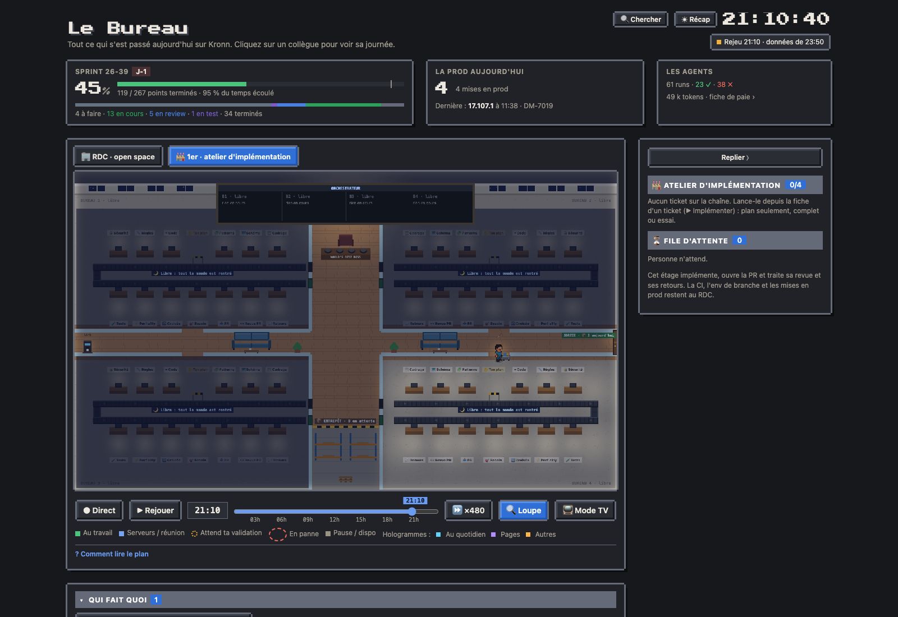
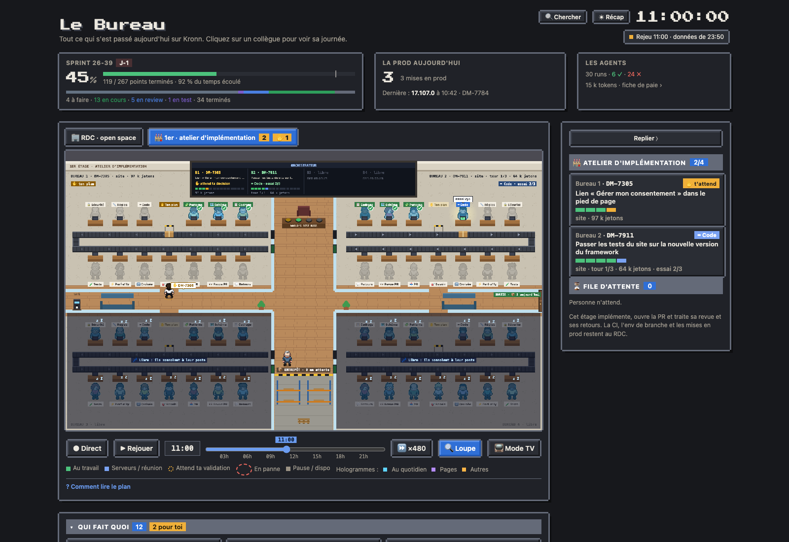

# L'atelier d'implémentation (1er étage)

Le 1er étage montre les tickets en cours d'implémentation par la chaîne de postes : un bureau par ticket et par dépôt (quatre en parallèle ; un ticket à plusieurs composants Jira prend un bureau et ouvre une PR par dépôt, les PR sœurs se citent entre elles), et au mur un tableau qui croise les postes et les tickets. L'étage ne traite que l'implémentation, la PR et ses retours : la CI, l'env de branche et les mises en prod restent au rez-de-chaussée.

## Monter à l'étage

Les onglets au-dessus du plan (« 🏢 RDC · open space », « 🏭 1er · atelier d'implémentation ») apparaissent quand la chaîne est installée (`models.impl_chain`). Le chiffre sur l'onglet du 1er compte les bureaux occupés, « ✋ n » les validations qui t'y attendent ; l'étage choisi est retenu par le navigateur.

Les workflows de l'étage (le lanceur, la chaîne et ses postes, modèles `impl*`) ne passent plus au rez-de-chaussée : pas d'intérimaire pour eux dans l'open space, leurs validations ne sont pas comptées chez le boss, et « Nouvel agent » (la baie de la salle Serveurs) ne les propose pas.

## Ce qu'on y voit

- **Quatre bureaux sur toute la largeur**, autour d'un couloir central et d'un couloir horizontal ; chaque bureau a sa porte au milieu, côté couloir horizontal. Les titres : bureau 1 en haut à gauche, 2 en haut à droite, 3 en bas à gauche, 4 en bas à droite. Un ticket garde son bureau jusqu'à sa sortie.
- **Le tapis roulant** : le carton du ticket entre par une trappe côté couloir central, avance de poste en poste (rangée du haut vers le mur, virage, rangée du bas) et ressort par la trappe de sortie, toujours côté couloir central (les bureaux 1 et 3 sont en miroir). Quand le ticket change de poste, le carton glisse ; après un bloquant, il recule jusqu'au Code, sous une flèche rouge en pointillé. La barrière jaune et noire est « Ton plan ».
- **Un agent par poste**, derrière son bureau, sous le nom de son poste :
  - **au travail** : hologramme vif, il tape, son écran est allumé, une lumière l'éclaire et une bulle dit ce qu'il fait ;
  - **a travaillé** : une pastille ✓ (ou ! pour un avis) apparaît avec un petit saut, et l'agent s'étire ;
  - **attend son tour** : silhouette grise derrière un écran éteint ;
  - **bloquant** : pastille ! rouge, écran rouge ; **en panne** (le sous-workflow du poste a échoué, par exemple l'API d'un agent indisponible) : fumée et étincelles sur l'écran, une étiquette « 🧯 … en panne : le pompier arrive », et un pompier vient de la porte avec un extincteur tant que la panne dure ; le grand tableau le dit aussi.
- **Un bureau libre** s'éteint doucement ; ses agents somnolent à leur poste. De temps en temps, l'un d'eux va au café, sur un canapé ou dans le couloir, puis revient (4 promeneurs au plus sur l'étage, 2 par bureau). Quand un ticket arrive, les lumières se rallument et les promeneurs rentrent.
- **Le grand tableau de l'orchestrateur**, en haut : une colonne par bureau, avec le ticket, le poste en cours ou la décision, la barre des postes, le tour et les jetons.
- **Le boss**, dans son fauteuil rouge derrière son bureau à quatre boutons (un par bureau, jaune quand ce bureau t'attend). Quand une gate t'attend, il se lève et va à la porte du bureau, puis revient s'asseoir. Une escalade (« la chaîne demande un humain ») allume un gyrophare au-dessus de la porte.
- **L'entrepôt**, en bas du couloir central : les tickets en attente sur les rayonnages, les tickets en panne sur des palettes (🧯, à relancer).
- **Les livraisons** : un ticket qui arrive est apporté de l'entrepôt à la trappe d'entrée par **Bernard** (le manutentionnaire : âgé, un peu dégarni, lunettes, blouse bleue) et son transpalette ; un ticket qui sort (PR ouverte) attend à la trappe de sortie, Bernard vient le chercher et repart par la porte de sortie. Il n'y a qu'un Bernard : les livraisons passent l'une après l'autre, et entre deux il attend à l'entrepôt, à droite, où un compteur dit combien de tickets sont sortis aujourd'hui. Le café est au bout gauche du couloir ; deux canapés (avec leur table basse) sont entre chaque porte et le couloir central, jamais devant une porte.
- **Les thèmes** : les agents portent les chapeaux du RDC. À Noël, Bernard devient le Père Noël, les cartons sont des paquets cadeaux, une guirlande court sur le grand tableau et un sapin attend dans le couloir ; à Halloween, Bernard passe en fantôme avec sa citrouille, les cartons sont des citrouilles et une toile d'araignée pend au tableau ; au Nouvel an et à la Saint-Valentin, des ballons dans le couloir (et un cœur qui s'envole quand un poste rend son ✓, une rose sur le bureau du boss).
- **Le ménage du soir** : après sa tournée du RDC, l'agent d'entretien monte au 1er pour 40 minutes, avec son chariot. Il entre par la porte de sortie, balaie chaque bureau (2, 4, 3, 1, le bureau où il passe s'éclaire), puis l'entrepôt, et repart. Comme au RDC, sa tournée suit l'heure du plan : « Rejouer » la montre, et le fil le dit (« a fini le RDC, il monte au 1er étage », puis « a fini le ménage, tout est propre »).

- **Jour et nuit**, comme au RDC : des fenêtres au-dessus des bureaux 1 et 2 prennent la couleur du ciel (soleil à Paris, étoiles la nuit). Hors des heures de bureau, l'éclairage baisse ; seuls restent allumés les bureaux qui ont un ticket (la chaîne tourne aussi la nuit), le grand tableau et la sortie. Comme au RDC, le boss reste à son fauteuil le soir et le week-end, et les agents restent à leur poste (ceux des bureaux libres somnolent et se promènent comme en journée) ; seul Bernard rentre chez lui.
- **Les trajets** : le tapis laisse une allée le long du mur extérieur (à gauche des bureaux 1 et 3, à droite des bureaux 2 et 4). Un agent qui sort passe derrière sa rangée, fait le tour par cette allée si sa rangée est loin de la porte, puis sort par la porte : il ne marche plus sur le tapis ni sur les autres.
- Les scènes ne se jouent que sur l'étage affiché : en montant, l'étage se pose tel qu'il est ; au retour au RDC, chacun reprend sa place.

## Loupe, mode TV et scènes

- **La loupe** (bouton « 🔍 Loupe ») suit aussi l'étage : un ticket qui sort (Bernard l'emporte), un ticket qui arrive, le boss à la porte d'un bureau qui attend ta décision, un retour au code, un poste en panne, le ménage du soir.
- **Le mode TV** reste sur l'étage choisi : la colonne de droite montre les bureaux (ticket, poste, barre des postes), l'entrepôt et les pannes. Le bouton « 🏭 1er étage / 🏢 RDC » de la barre (ou la touche E) change d'étage ; l'adresse de l'écran mural peut fixer l'étage (`?tv=1&floor=1`) ou alterner les deux (`?tv=1&floor=alt` : 60 s sur l'open space, 40 s sur l'atelier quand des tickets y sont).
- **Les scènes du bureau** (« Comment lire le plan ») ne montrent que celles de l'étage affiché. Au 1er : un ticket arrive, un ticket sort, un poste rend son verdict, le boss va à la porte, l'escalade, le retour au code, le poste en panne, le ménage du soir ; « ▶ voir » la joue sur le plan à n'importe quelle heure, même sans ticket sur la chaîne, avec les quatre bureaux pris ou un jour sans ménage (la scène part alors de bureaux de démonstration), puis l'atelier revient tel qu'il était.

## Le panneau

Sur le 1er étage, le panneau liste les bureaux (ticket, poste en cours, barre des postes, tour, jetons), la file et les pannes. Un clic sur un agent dit ce qu'il fait et où est sa place (le chemin jusqu'à son bureau est tracé quand il se promène) ; un clic sur un carton de l'entrepôt dit depuis quand il attend, ou où il est tombé en panne. Un clic sur un bureau, son carton ou sa colonne du tableau, dans le panneau ou sur le plan, ouvre sa fiche : le verdict de chaque poste (dont 📚 Doc, la doc du dépôt à jour, qui n'a pas de bureau sur le tapis : il est dans la barre des postes et la fiche), la note, le lien vers le run dans Kronn et, quand une gate t'attend (« ce que j'ai compris » après le cadrage, ton plan, escalade, relecture de la PR), la carte de décision habituelle. La gate du cadrage s'ouvre à chaque ticket : tu corriges la compréhension de la chaîne autant de fois que tu veux avant qu'elle planifie.

## Depuis le rez-de-chaussée

L'étage se suit aussi sans y monter, comme les agents du RDC. Chaque élément ci-dessous mène à l'étage, sur la fiche du ticket (ou son carton à l'entrepôt, sa palette en panne).

- **Le fil de la journée** raconte la chaîne, à l'heure où c'est arrivé (le rejeu suit) : « 🎫 DM-7854 arrive au 1er étage », « ✋ … t'attend au 1er « ton plan » », « 🔒 Sécurité bloque … : retour au code », « 🧯 … : 🧪 Tests en panne », « 📦 … sort en PR ». Une gate du 1er qui t'attend est en haut, dans « En ce moment », avec depuis quand. Arrivées et sorties passent aussi dans le bandeau défilant du mode TV.
- **⌘K** trouve un ticket de la chaîne par sa clé, son titre ou son dépôt (« DM-7854 · bureau 3 · 🔒 retour au code »), et un poste trouve les bureaux où il travaille ou qu'il bloque (« sécurité », « code »).
- **Qui fait quoi** ajoute un bloc « 1er étage » : un poste au travail par bureau (ou la gate qui t'attend, comptée dans « pour toi »), son ticket, son bureau et depuis quand. En mode TV, le même bloc vient sous les agents dans la colonne du RDC.
- **Les chiffres du haut** ont une 4e tuile, « Le 1er étage » : les bureaux occupés, puis sur une ligne ce qui t'attend, les pannes, les tickets sortis aujourd'hui et la file (le tout au survol). Un clic monte à l'étage.

## En panne : reprendre là où ça s'est arrêté

Un run de la chaîne qui échoue (un poste qui plante, l'API d'un agent indisponible) reste dans « 🧯 En panne » pendant 24 h, avec le poste où il s'est arrêté. Relance le ticket (▶ Implémenter) : la chaîne reprend là, avec le dossier du ticket et la branche du run en panne. Le plan déjà validé n'est pas redemandé, les lots déjà écrits et les contrôles déjà rendus ne sont pas refaits. Au lancement, « Reprise » vaut « Auto » ; « Reprendre » force la reprise (par exemple un plan seulement relancé jusqu'à la PR), « Repartir de zéro » recommence tout.

## Données

Le cron `live` lit chaque minute les runs de la chaîne et de ses postes dans l'API Kronn (0 token) et publie le dataset `atelier`, avec les moments des dernières 24 h (arrivée, gate, retour au code, panne, PR ouverte, datés par les étapes des runs) pour le fil du RDC, et le nombre de PR ouvertes depuis minuit. Sans la chaîne installée, ni ses étapes ni les onglets n'existent.
