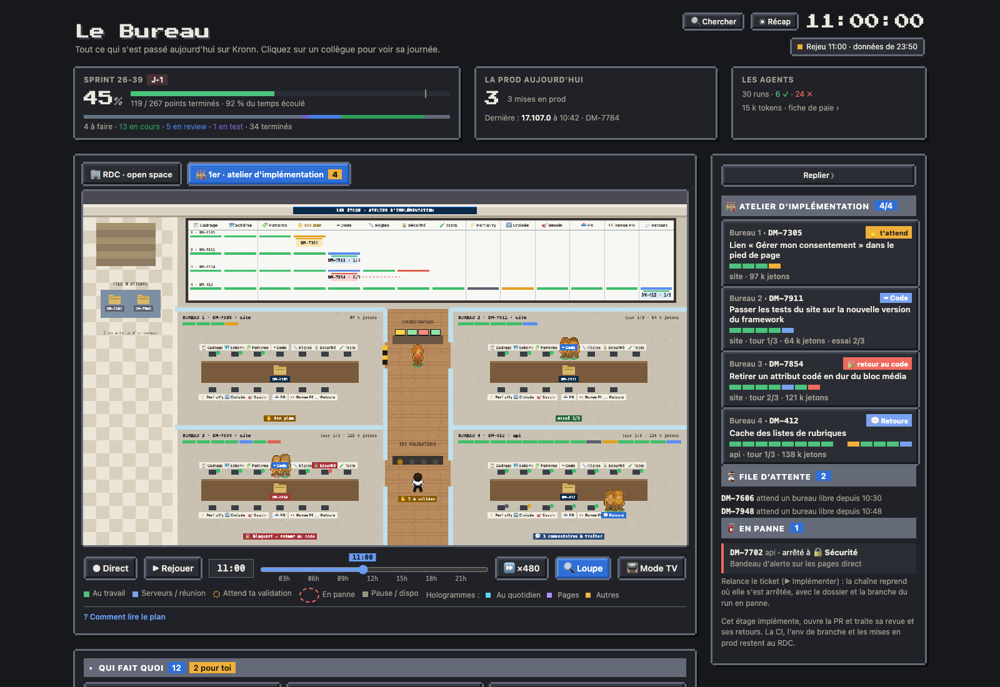
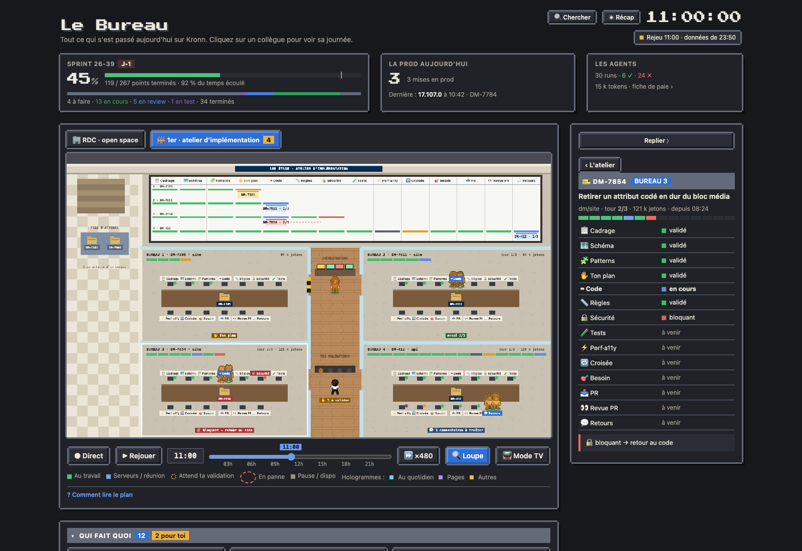

# L'atelier d'implémentation (1er étage)

Le 1er étage montre les tickets en cours d'implémentation par la chaîne de postes : un bureau par ticket et par dépôt (quatre en parallèle ; un ticket à plusieurs composants Jira prend un bureau et ouvre une PR par dépôt, les PR sœurs se citent entre elles), et au mur un tableau qui croise les postes et les tickets. L'étage ne traite que l'implémentation, la PR et ses retours : la CI, l'env de branche et les mises en prod restent au rez-de-chaussée.

## Monter à l'étage

Les onglets au-dessus du plan (« 🏢 RDC · open space », « 🏭 1er · atelier d'implémentation ») apparaissent quand la chaîne est installée (`models.impl_chain`). Le chiffre sur l'onglet du 1er compte les bureaux occupés ; l'étage choisi est retenu par le navigateur.

## Ce qu'on y voit

- **Le tableau mural** : une colonne par poste (cadrage, schéma, patterns, ton plan, code, règles, sécurité, tests, perf · a11y, revue croisée, conformité au besoin, PR, revue de la PR, retours), une ligne par bureau. Les barres disent ce qui est validé, en cours, bloquant, en avis ou sauté ; la carte du ticket est sous son poste courant, avec son tour de contrôle ; un retour au code est tracé en pointillé rouge.
- **Les quatre bureaux** : la plaque (ticket, dépôt, tour, jetons), la barre d'avancement, la table avec un carton par poste et sa lampe d'état. Les deux agents du poste en cours s'y assoient ; une note en bas de la pièce résume la situation (plan à valider, nouvel essai du Code, retour au code, commentaires à traiter). La porte d'un bureau qui attend ta décision est barrée de ruban jaune et noir.
- **Le couloir** : l'orchestrateur et ses quatre écrans, puis ton pupitre de validations, une lampe par bureau qui clignote quand une gate t'attend.
- **La file d'attente**, sur le palier : les tickets qui attendent un bureau libre.

## Le panneau

Sur le 1er étage, le panneau liste les bureaux (ticket, poste en cours, barre des postes, tour, jetons), la file et les pannes. Un clic sur un bureau, dans le panneau ou sur le plan, ouvre sa fiche : le verdict de chaque poste, la note, le lien vers le run dans Kronn et, quand une gate t'attend (« ce que j'ai compris » après le cadrage, ton plan, escalade, relecture de la PR), la carte de décision habituelle. La gate du cadrage s'ouvre à chaque ticket : tu corriges la compréhension de la chaîne autant de fois que tu veux avant qu'elle planifie.

## En panne : reprendre là où ça s'est arrêté

Un run de la chaîne qui échoue (un poste qui plante, l'API d'un agent indisponible) reste dans « 🧯 En panne » pendant 24 h, avec le poste où il s'est arrêté. Relance le ticket (▶ Implémenter) : la chaîne reprend là, avec le dossier du ticket et la branche du run en panne. Le plan déjà validé n'est pas redemandé, les lots déjà écrits et les contrôles déjà rendus ne sont pas refaits. Au lancement, « Reprise » vaut « Auto » ; « Reprendre » force la reprise (par exemple un plan seulement relancé jusqu'à la PR), « Repartir de zéro » recommence tout.

## Données

Le cron `live` lit chaque minute les runs de la chaîne et de ses postes dans l'API Kronn (0 token) et publie le dataset `atelier`. Sans la chaîne installée, ni ses étapes ni les onglets n'existent.
