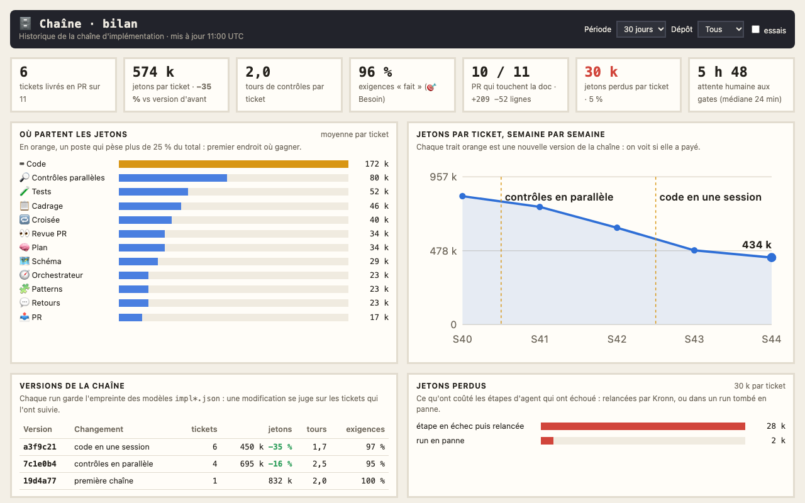
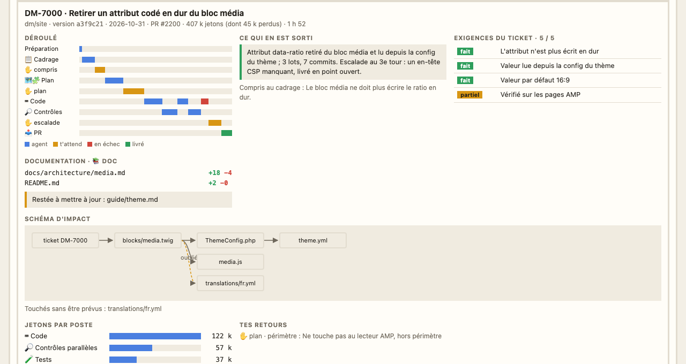

# Le bilan de la chaîne d'implémentation

Une page Kronn à part, « Chaîne · bilan », garde l'historique des tickets passés sur la chaîne de postes (l'[atelier d'implémentation](23-atelier.md)) : combien de jetons chaque poste consomme, ce qu'a donné chaque version de la chaîne, où ça fait des allers-retours, ce que les contrôles trouvent vraiment. Elle sert à suivre la chaîne et à l'améliorer. Ses chiffres du haut tiennent dans l'écran du vidéoprojecteur.

## L'installer et la projeter

`python3 tools/install.py` crée la page avec la chaîne (`models.impl_chain`) et son cron « bilan de la chaîne (15 min) ». Pour la projeter dans la salle de réunion : « Mes pages Kronn » sur l'écran mural, « ＋ Ajouter » la page « Chaîne · bilan », puis « 📽 Projeter en TV ». Le vidéoprojecteur montre son chiffre clé : les jetons par ticket, avec l'écart par rapport à la version d'avant de la chaîne.

## Ce qu'on y voit

En haut, les filtres : période (7 ou 30 jours), dépôt, et les essais (écartés par défaut, ils faussent les moyennes).

- **Les chiffres de la période** : tickets livrés en PR, jetons par ticket, tours de contrôles, exigences faites (poste 🎯 Besoin), PR qui touchent la doc et leurs lignes, jetons perdus, attente humaine aux gates.
- **Où partent les jetons** : la moyenne par ticket de chaque poste ; en orange, celui qui pèse plus d'un quart du total.
- **Jetons par ticket, semaine par semaine**, avec un trait à chaque nouvelle version de la chaîne : on voit si une modification a payé.
- **Versions de la chaîne** : pour chaque version (empreinte des modèles `impl*.json`, et le dernier commit qui les a changés), tickets, jetons, tours et exigences faites.
- **Jetons perdus** : étapes d'agent en échec relancées, runs tombés en panne.
- **Allers-retours par ticket** : propositions du cadrage, tes retours à chaque gate, essais du Code, tours de contrôles, escalades. Une colonne foncée sur plusieurs tickets montre un poste ou une gate à revoir.
- **Ce que trouvent les contrôles** : bloquants et avis trouvés, corrigés au tour suivant, ou restés jusqu'à la livraison ; un contrôle qui trouve beaucoup sans rien faire corriger est marqué « à revoir ».
- **Le schéma d'impact a-t-il vu juste ?** Les fichiers prévus par 🗺 Schéma comparés à ceux que le diff touche vraiment.
- **Pourquoi tu dis « Changements »** : tes retours aux gates, classés par mots-clés (périmètre, mauvaise lecture, convention, découpage).
- **Tickets passés**, le plus récent d'abord ; un clic ouvre la fiche du ticket.

## La fiche d'un ticket

Le déroulé du run (agents, attente à tes gates, échecs), ce qui en est sorti, les exigences du ticket et leur état, la doc modifiée et celle restée à mettre à jour, le schéma d'impact dessiné, les jetons par poste et tes retours. Les fiches détaillées sont gardées pour les tickets les plus récents.

## D'où viennent les données

Chaque run de la chaîne laisse son bilan dans `~/.local/share/pixel-bureau/historique/` (réglage `impl.historique`), réécrit après chaque étape : tours, retours, schéma, diff, exigences, contrôles, version. Le cron (sans jetons) le complète avec Kronn (jetons et durée de chaque étape et de chaque poste, attente aux gates, panne ou rejet) et publie le dataset `bilan` de la page. Un run d'avant l'historique est repris de Kronn seulement (marqué « partiel » : ni schéma ni exigences).

Après la mise à jour : `python3 tools/install.py` (crée la page et le cron), puis `python3 tools/publish.py all`.
