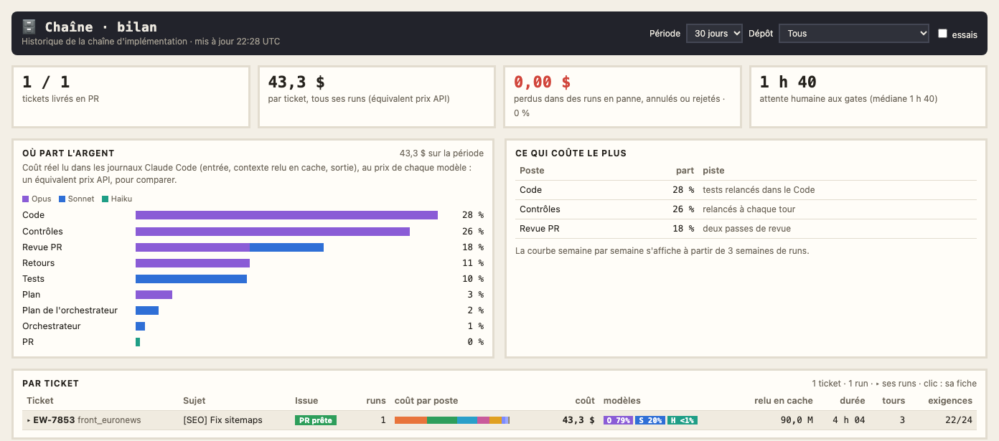
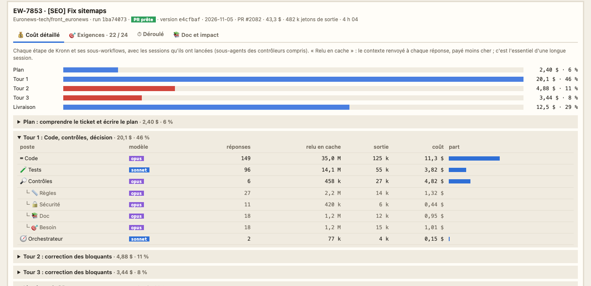
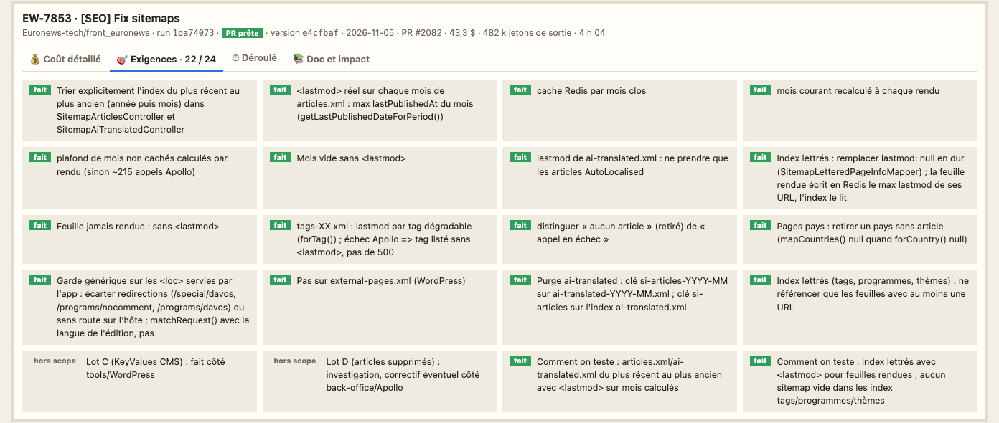

# Le bilan de la chaîne d'implémentation

Une page Kronn à part, « Chaîne · bilan », garde l'historique des tickets passés sur la chaîne de postes (l'[atelier d'implémentation](23-atelier.md)) : combien coûte chaque poste et chaque ticket, ce qu'a donné chaque version de la chaîne, où ça fait des allers-retours, ce que les contrôles trouvent vraiment. Elle sert à suivre la chaîne et à l'améliorer. Ses chiffres du haut tiennent dans l'écran du vidéoprojecteur.

## L'installer et la projeter

`python3 tools/install.py` crée la page avec la chaîne (`models.impl_chain`) et son cron « bilan de la chaîne (15 min) ». Pour la projeter dans la salle de réunion : « Mes pages Kronn » sur l'écran mural, « ＋ Ajouter » la page « Chaîne · bilan », puis « 📽 Projeter en TV ». Le vidéoprojecteur montre son chiffre clé : le coût par ticket (sans journaux Claude Code : les jetons par ticket, avec l'écart par rapport à la version d'avant de la chaîne).

## Ce qu'on y voit

En haut, les filtres : période (7 ou 30 jours), dépôt, et les essais (écartés par défaut, ils faussent les moyennes).

- **Quatre chiffres** : tickets livrés en PR, coût par ticket (tous ses runs), coût perdu dans des runs en panne, annulés ou rejetés, attente humaine aux gates. Le coût est un **équivalent prix API** : l'entrée, le contexte relu en cache et la sortie de chaque session, au prix de son modèle. Le compteur de jetons de Kronn ne compte que la sortie, alors que l'essentiel d'une longue session est le contexte relu à chaque réponse (EW-7853 : 482 k jetons de sortie, 43 $). Sans journaux, la page revient aux jetons de Kronn.
- **Où part l'argent** : le coût de chaque poste sur la période, une barre par poste coloriée par modèle (Opus, Sonnet, Haiku). À côté, **ce qui coûte le plus** : les trois postes les plus chers et la piste pour les alléger ; la courbe semaine par semaine prend sa place à partir de trois semaines de runs.
- **Par ticket** : une ligne par ticket et par dépôt, le plus récent d'abord : issue du dernier run, nombre de runs (🧯 ceux en panne), coût par poste, coût total, part de chaque modèle, contexte relu en cache, durée, tours de contrôles, exigences faites. ▸ déplie ses runs ; un clic ouvre la fiche du plus récent, un clic sur un run la sienne.
- **Analyse de la chaîne**, repliée : ce qui sert à régler la chaîne plutôt qu'à lire un ticket.
  - **Versions de la chaîne** : pour chaque version (empreinte des modèles `impl*.json`, et le dernier commit qui les a changés), tickets, jetons, tours et exigences faites.
  - **Jetons perdus** : étapes d'agent en échec relancées, runs tombés en panne.
  - **Allers-retours par ticket** : propositions du cadrage (runs d'avant le poste 📋 Plan), tes retours à chaque gate, essais du Code, tours de contrôles, escalades. Une colonne foncée sur plusieurs tickets montre un poste ou une gate à revoir.
  - **Ce que trouvent les contrôles** : bloquants et avis trouvés, corrigés au tour suivant, ou restés jusqu'à la livraison ; un contrôle qui trouve beaucoup sans rien faire corriger est marqué « à revoir ».
  - **Le schéma d'impact a-t-il vu juste ?** Les fichiers prévus par le poste 📋 Plan comparés à ceux que le diff touche vraiment, et **pourquoi tu dis « Changements »** (tes retours aux gates, classés par mots-clés).
  - **Où partent les jetons** (de Kronn, sortie seulement) et la courbe par semaine tant qu'elle n'a pas sa place en haut.

## La fiche d'un ticket

Quatre onglets :

- **💰 Coût détaillé** : le run résumé en blocs (le plan, un tour par passage au Code, en rouge les tours de correction, la livraison), puis chaque bloc déplié jusqu'aux sous-workflows et aux contrôleurs : modèle, réponses, contexte relu en cache, sortie et coût de chaque poste. Une revue ou des retours passés deux fois sont numérotés (passe 1, passe 2).
- **🎯 Exigences** : les exigences du ticket et leur état, en pleine largeur.
- **⏱ Déroulé** : agents, attente à tes gates, échecs ; ce qui en est sorti et tes retours.
- **📚 Doc et impact** : la doc modifiée et celle restée à mettre à jour, le schéma d'impact dessiné (le libellé d'une flèche au survol), les fichiers touchés sans être prévus.

Les fiches détaillées sont gardées pour les runs les plus récents.

## D'où viennent les données

Chaque run de la chaîne laisse son bilan dans `~/.local/share/pixel-bureau/historique/` (réglage `impl.historique`), réécrit après chaque étape : tours, retours, schéma, diff, exigences, contrôles, version. Le cron (sans jetons) le complète avec Kronn (jetons et durée de chaque étape et de chaque poste, attente aux gates, panne ou rejet) et avec les journaux Claude Code de chaque run (`~/.claude/projects/`, un dossier par copie de travail, sous-agents compris) : chaque session est rattachée à l'étape qui l'a lancée et chiffrée au prix de son modèle. Puis il publie le dataset `bilan` de la page.

Réglages (`impl` de la config ou du pack) :

| Clé | Par défaut | |
| --- | --- | --- |
| `prix` | Opus 4 / 5 / 0,2 / 20, Sonnet 2 / 2,5 / 0,2 / 10, Haiku 1 / 1,25 / 0,1 / 5 | $ par million de jetons : entrée, écriture du cache, relecture du cache, sortie, par famille de modèle (`{"opus": [4, 5, 0.2, 20]}`) |
| `bilan_depuis` | aucune | date (`2026-11-05`) : les runs d'avant sortent du rapport |
| `bilan_exclus` | aucun | débuts d'ids de runs à écarter (des essais de la chaîne qui ne sont pas marqués comme tels) | Un run d'avant l'historique est repris de Kronn seulement (marqué « partiel » : ni schéma ni exigences).

Après la mise à jour : `python3 tools/install.py` (crée la page et le cron), puis `python3 tools/publish.py all`.
