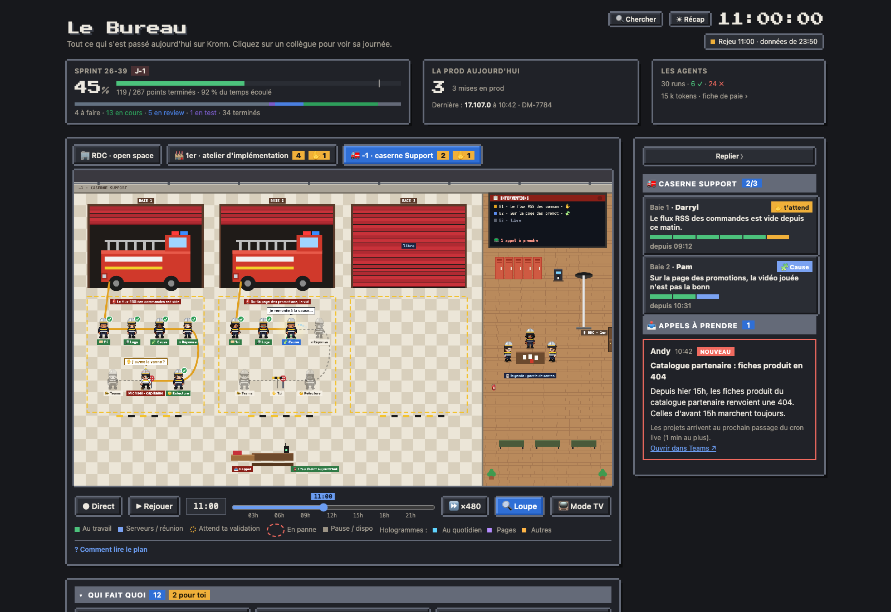
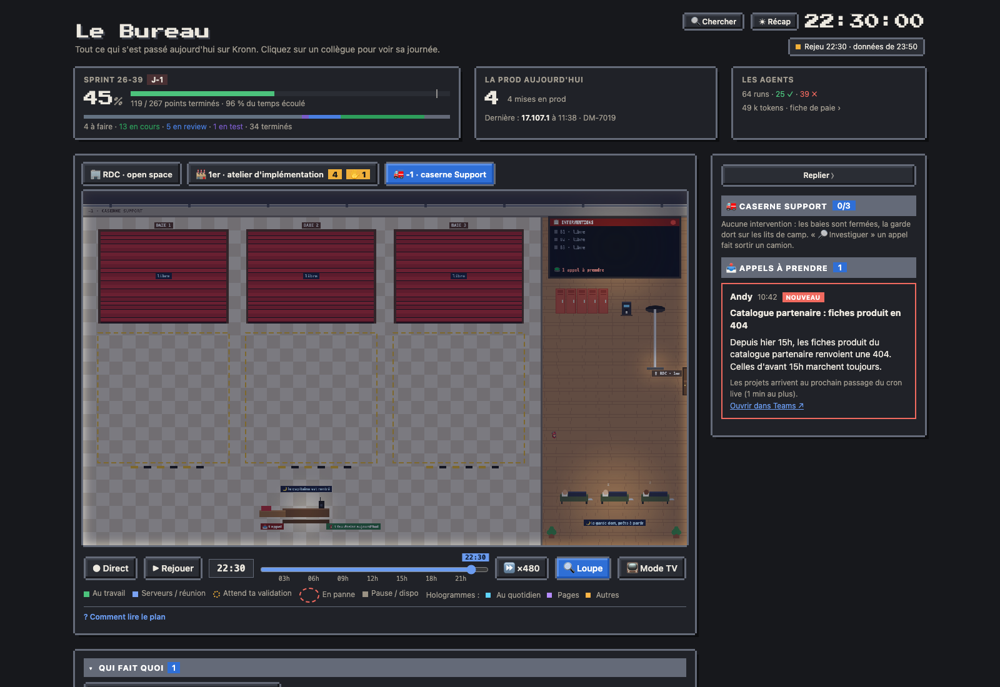

# La caserne Support (-1)

Sous le rez-de-chaussée, la caserne montre les demandes du canal Support en cours de traitement : une baie de camion par intervention, et devant chaque camion son équipe de pompiers, rangée dans l'ordre des postes. C'est la même console Support qu'au RDC (l'ordinateur du boss, l'agent Support en alerte) : la caserne la montre en grand, elle ne la remplace pas.

## Descendre à la caserne

L'onglet « 🚒 -1 · caserne Support » apparaît à côté de « 🏢 RDC · open space » dès que la console Support existe (`support.team` et `support.channel` réglés). Le chiffre compte les interventions en cours, « ✋ n » les réponses qui attendent ta validation. La page s'ouvre au RDC ; l'étage choisi ensuite est retenu par le navigateur.

## Ce qu'on y voit

- **Trois baies de camion.** Un fil du Support en investigation, une réponse à valider ou une investigation en panne occupe une baie : le rideau se lève, le camion est là. Un fil garde sa baie jusqu'à la fin ; au-delà de trois, le tableau des interventions dit combien attendent une baie libre. Une baie libre reste fermée.
- **L'équipe devant son camion**, dans la zone peinte en jaune au sol, rangée dans l'ordre des postes : 🏷 Tri, 🔎 Logs, 🧩 Cause, ✉ Réponse au premier rang, puis 🧐 Relecture, ✋ Toi et 📣 Teams au second. Tous portent la tenue des sapeurs-pompiers : casque F1 chromé, veste marine à bandes jaune et argent. Même langage qu'au 1er étage : **au travail** (un halo, une bulle, il arrose), **a travaillé** (✓), **attend son tour** (silhouette grise), **en panne** (! rouge et fumée, « relance l'investigation »).
- **Le tuyau** part de l'arrière du camion et passe de main en main dans l'ordre des postes : plein et jaune jusqu'au poste au travail, en pointillé gris pour ceux qui viennent ensuite. On lit l'avancement à la longueur de tuyau plein.
- **✋ La vanne** : quand la réponse est relue, elle attend ta validation. Le capitaine (le boss, casque à bande rouge) quitte son poste de commandement et vient ouvrir la vanne de la baie.
- **Le camion part** quand la réponse est postée dans Teams : l'équipe remonte à bord, les gyrophares s'allument, le camion sort par la baie et le rideau se referme. Un fil traité autrement (pris par un collègue, ignoré) libère sa baie sans sortie.
- **Le poste de commandement**, en bas : le bureau du capitaine et sa radio, la pile des appels à prendre (les nouveaux fils) et le compteur des feux éteints aujourd'hui (réponses postées).
- **La salle de garde**, à droite : le tableau des interventions (une ligne par baie, les appels à prendre, le voyant qui clignote quand un appel attend), les casiers, la machine à café, la garde qui joue aux cartes, les lits de camp. La porte des autres étages et la barre de pompier sont contre le mur de droite.
- **Le soir et le week-end**, la garde reste : la caserne passe en veilleuse, le capitaine reste à son poste, seules les baies occupées, le tableau, la porte et les lits de camp restent éclairés, et la garde dort, prête à partir. Les interventions continuent.

## Mode TV et scènes

- **Le mode TV** reste sur l'étage choisi : au -1, la colonne de droite montre les baies (qui a écrit, le sujet, le poste en cours, la barre des postes) et les appels à prendre. Le bouton d'étage de la barre (ou la touche E) passe au RDC, au 1er puis au -1. L'adresse de l'écran mural peut fixer l'étage (`?tv=1&floor=-1`) ou alterner les étages occupés (`?tv=1&floor=alt` : 60 s sur l'open space, 40 s sur chaque étage qui a du monde).
- **Les scènes** (« Comment lire le plan ») au -1 : un appel arrive, une intervention démarre, le tuyau avance, à toi de valider, le camion part, une intervention en panne, la garde de nuit. Toutes se jouent à toute heure : sans intervention en cours, elles partent des fils de la démo. « ▶ voir » la joue sur le plan, puis la caserne revient telle qu'elle était.

## Le panneau

Au -1, le panneau liste les baies (qui a écrit, le sujet, le poste en cours, la barre des postes) puis les appels à prendre, avec les mêmes cartes que la console (« 🔎 Investiguer », « 🔕 Ignorer »). Un clic sur une baie ou un pompier, dans le panneau ou sur le plan, ouvre sa fiche : l'état de chaque poste, puis la carte du fil, avec la réponse proposée et ses trois décisions quand elle attend ta validation.

## Données

Le dataset `support` (cron « relevé du Support », 0 token) et les runs de l'investigation. L'état de chaque poste vient du relevé quand il le donne (`run.postes`), sinon des étapes du run : une étape par poste, ou, avec le modèle d'investigation d'aujourd'hui (un seul agent), Logs, Cause et Réponse ensemble pendant l'investigation et Relecture pendant la mise en forme du brouillon.
