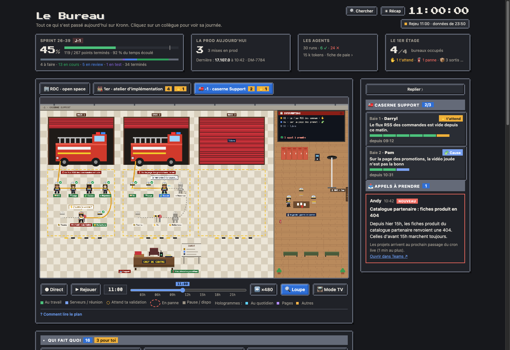
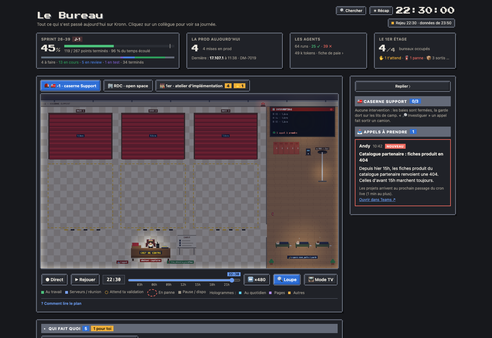

# La caserne Support (-1)

Sous le rez-de-chaussée, la caserne montre les demandes du canal Support en cours de traitement : une baie de camion par intervention, et devant chaque camion son équipe de pompiers, rangée dans l'ordre des postes. C'est la même console Support qu'au RDC (l'ordinateur du boss, l'agent Support en alerte) : la caserne la montre en grand, elle ne la remplace pas.

## Descendre à la caserne

Le bouton « 🚒 -1 » (la caserne Support, au survol) apparaît avant « 🏢 RDC » dès que la console Support existe (`support.team` et `support.channel` réglés) : les onglets suivent l'ordre des étages, comme les boutons d'un ascenseur (-1, RDC, 1er). Le chiffre compte les interventions en cours, « ✋ n » les réponses qui attendent ta validation. Un petit gyrophare rouge tourne sur l'onglet tant qu'un appel attend d'être pris ou qu'une intervention est en cours (il reste fixe si le système demande moins d'animations). La page s'ouvre au RDC ; l'étage choisi ensuite est retenu par le navigateur.

## Ce qu'on y voit

- **Trois baies de camion.** Un fil du Support en investigation, une réponse à valider ou une investigation en panne occupe une baie. Un fil garde sa baie jusqu'à la fin ; au-delà de trois, le tableau des interventions dit combien attendent une baie libre. Une baie libre reste fermée.
- **L'équipe devant son camion**, dans la zone peinte en jaune au sol, rangée dans l'ordre des postes : 🏷 Tri, 🔎 Logs, 🧩 Cause, ✉ Réponse au premier rang, puis 🧐 Relecture, ✋ Toi et 📣 Teams au second. Ce sont des agents : des hologrammes bleus, comme au RDC et au 1er étage, avec la tenue des sapeurs-pompiers (casque F1 chromé, bandes jaune et argent). Seul le capitaine, le boss, est en chair et en os. Sous chaque pompier, l'icône de son poste ; son nom aussi quand il travaille, est en panne ou attend ta validation (au survol, sinon). Même langage qu'au 1er étage : **au travail** (un halo, une bulle, il arrose), **a travaillé** (✓), **attend son tour** (silhouette grise), **en panne** (! rouge et fumée, « relance l'investigation »).
- **Comme au 1er étage** : la loupe (« 🔍 Loupe ») suit la caserne (départ en intervention, réponse qui attend ta validation à la vanne, poste en panne, camion qui rentre), et le rejeu accéléré s'arrête le temps qu'elle passe ; en lecture rapide, les pompiers marchent plus vite. Les thèmes décorent aussi le -1 (sapin et guirlande au-dessus des baies à Noël, citrouilles à Halloween, ballons). Le soir, après le 1er, l'agent d'entretien descend la barre, balaie l'allée devant chaque baie puis la salle de garde, et remonte.
- **La nuit**, la lampe du bureau du chef de centre reste allumée, et les pompiers qui descendent la barre ou remontent ont leur lumière.
- **Rejouer** : la caserne suit l'heure du plan. En rejeu, une intervention est à sa baie de son départ à la réponse postée, ses postes avancent avec les étapes du run, et le capitaine est à la vanne pendant que la gate attendait ; l'arrivée des pompiers et le départ du camion se jouent quand le curseur passe dessus (un saut pose la caserne, sauf une arrivée de moins de 2 min, qui se joue quand même, en direct aussi en descendant).
- **Le tuyau** part de l'arrière du camion et passe de main en main dans l'ordre des postes : plein et jaune jusqu'au poste au travail, en pointillé gris pour ceux qui viennent ensuite. On lit l'avancement à la longueur de tuyau plein.
- **✋ La vanne** : quand la réponse est relue, elle attend ta validation. Le capitaine (le boss, casque à bande rouge) quitte son bureau et vient ouvrir la vanne de la baie. Le pack d'équipe peut lui donner un dessin de pompier à part : `captain_sprite` sur la personne du boss dans `roster.json` (un sprite du pack, comme `boss_sprite`) ; il garde son nom, sa fiche et son rôle, seul son dessin change, et seulement à la caserne.
- **Une intervention démarre** : le rideau de la baie se lève et le camion sort du fond de la baie, gyrophares allumés. Les pompiers descendent la barre un par un, puis courent à leur place par l'allée sous les baies, sans traverser une baie ni un collègue : le premier rang d'abord, de gauche à droite, puis le second. Leur étiquette apparaît quand ils arrivent ; le tuyau se déroule depuis le camion quand toute l'équipe est là.
- **Le camion rentre** quand la réponse est postée dans Teams : le tuyau s'enroule, le camion rentre dans sa baie et le rideau se ferme sur lui. L'équipe qui a travaillé va prendre un café à la machine de la salle de garde, puis remonte la barre. Un fil traité autrement (pris par un collègue, ignoré) ferme aussi sa baie, et l'équipe remonte sans café.
- **Rien n'apparaît ni ne disparaît d'un coup.** En arrivant à l'étage, rien ne se rejoue : les équipes sont déjà devant leur camion. Seule une intervention partie il y a moins de 2 minutes, pendant que tu regardais un autre étage, joue son arrivée, une seule fois : en revenant ensuite, l'équipe est déjà en place, et la loupe ne la présente pas comme nouvelle. Si le système demande moins d'animations, tout est posé directement, sans arrivée ni départ.
- **Le bureau du chef de centre**, en bas : le capitaine s'y tient de face, derrière un grand bureau en bois (plaque « CHEF DE CENTRE », fauteuil rouge, radio verte aux heures de bureau, casque posé, corbeille des appels à prendre, cliquable). À côté, le **tableau de garde** sur pied : un voyant par baie (bleu : au travail, jaune : t'attend, rouge : en panne, vert : en route). Dessous, la pile des appels à prendre (les nouveaux fils) et le compteur des feux éteints aujourd'hui (réponses postées). Quand une réponse attend, il quitte son bureau par l'arrière pour aller à la vanne ; le bureau reste.
- **La salle de garde**, à droite : le tableau des interventions (une ligne par baie, les appels à prendre, le voyant qui clignote quand un appel attend), les casiers, la machine à café, la garde qui joue aux cartes, les lits de camp. Contre le mur de droite, la barre de pompier est le seul accès aux autres étages (« ⇅ RDC · 1er »). Au mur, entre la baie 3 et la salle de garde, le **gyrophare** tourne et balaie le sous-sol tant qu'un appel attend d'être pris ou qu'une intervention est en cours.
- **Le soir et le week-end**, la garde reste : la caserne passe en veilleuse, comme le RDC la nuit : chaque baie en intervention s'allume comme une pièce, avec ses plafonniers, et chaque pompier au travail a sa lampe ; le capitaine garde sa lumière, qui le suit jusqu'à la vanne ; la barre et la veilleuse des lits de camp restent éclairées, et la garde dort, prête à partir. Les interventions continuent.

## Mode TV et scènes

- **Le mode TV** reste sur l'étage choisi : au -1, la colonne de droite montre les baies (qui a écrit, le sujet, le poste en cours, la barre des postes) et les appels à prendre. Le bouton d'étage de la barre (ou la touche E) passe au RDC, au 1er puis au -1. L'adresse de l'écran mural peut fixer l'étage (`?tv=1&floor=-1`) ou alterner les étages occupés (`?tv=1&floor=alt` : 60 s sur l'open space, 40 s sur chaque étage qui a du monde).
- **Les scènes** (« Comment lire le plan ») au -1 : un appel arrive, une intervention démarre (la descente de la barre, le camion qui sort), le tuyau avance, à toi de valider, le camion part (il rentre, le café, la remontée), une intervention en panne, la garde de nuit. Toutes se jouent à toute heure : sans intervention en cours, elles partent des fils de la démo. « ▶ voir » la joue sur le plan, puis la caserne revient telle qu'elle était.

## Le panneau

Au -1, le panneau liste les baies (qui a écrit, le sujet, le poste en cours, la barre des postes) puis les appels à prendre, avec les mêmes cartes que la console (« 🔎 Investiguer », « 🔕 Ignorer »). Un clic sur une baie ou un pompier, dans le panneau ou sur le plan, ouvre sa fiche : l'état de chaque poste, puis la carte du fil, avec la réponse proposée et ses trois décisions quand elle attend ta validation. Comme au RDC, le pompier choisi reste dans la lumière et le plan s'assombrit autour de lui ; Échap ou un clic ailleurs l'enlève.

Un clic sur le capitaine ouvre la fiche du boss, la même qu'au RDC et au 1er, avec « ← La caserne » (ou Échap) pour revenir aux baies ; il est lui aussi dans la lumière, qui le suit quand il va à la vanne. Ses tickets, ses PR (le Kanban en fenêtre), ses todos et ses validations restent à la caserne ; un lien vers un collègue, un agent ou une autre fiche du RDC remonte au RDC et l'y ouvre. Sa fiche reste ouverte d'un étage à l'autre.

## Données

Le dataset `support` (cron « relevé du Support », 0 token) et les runs de l'investigation. L'état de chaque poste vient des étapes du run de l'investigation (cron live, chaque minute : une étape par poste, voir [les postes de l'investigation](17-console-support.md#les-postes-de-linvestigation)), sinon du relevé (`run.postes`). Avec l'ancien modèle à un seul agent, Logs, Cause et Réponse s'allument ensemble pendant l'investigation.
