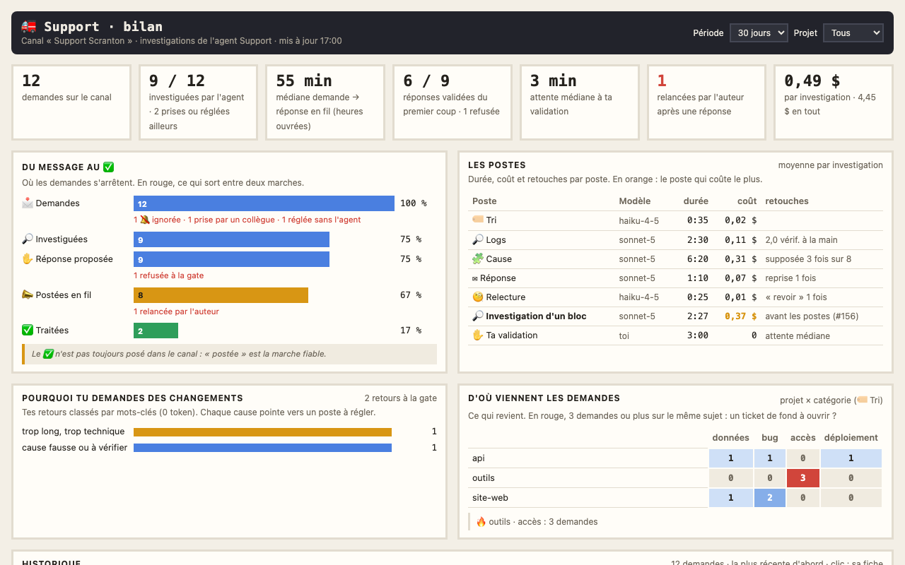
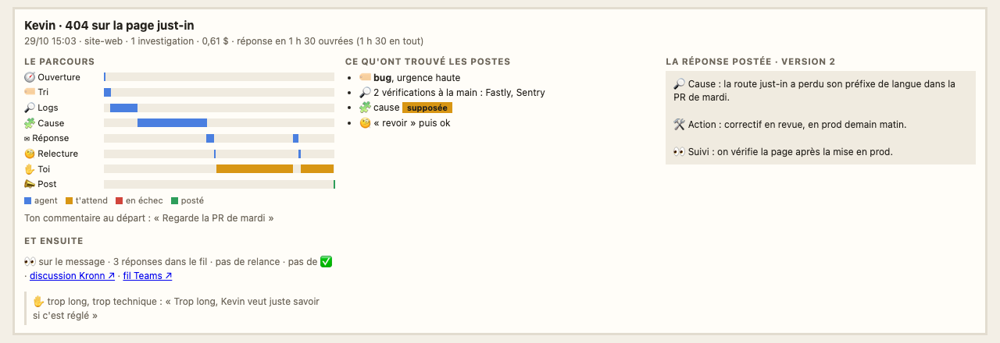

# Le bilan du Support

Une page Kronn à part, « Support · bilan », garde l'historique des demandes du canal Support et de leurs investigations par l'agent Support ([console Support](17-console-support.md), [caserne](25-caserne.md)) : où les demandes s'arrêtent, ce que coûte chaque poste, pourquoi tu demandes des changements, quels projets et quels sujets reviennent. Elle sert à suivre le Support et à régler ses postes. Son chiffre clé tient dans l'écran du vidéoprojecteur.

## L'installer et la projeter

`python3 tools/install.py` crée la page avec l'investigation Support (`models.support`, canal réglé) et son cron « bilan du Support (15 min) ». Pour la projeter : « Mes pages Kronn » sur l'écran mural, « ＋ Ajouter » la page « Support · bilan », puis « 📽 Projeter en TV ». Le vidéoprojecteur montre la médiane du temps de réponse sur 30 jours, en heures ouvrées.

## Ce qu'on y voit

En haut, les filtres : période (7, 30 ou 90 jours) et projet.

- **Les chiffres de la période** : demandes sur le canal, investiguées par l'agent (et celles prises ou réglées ailleurs), médiane du temps de réponse, réponses validées du premier coup, attente à ta validation, relances de l'auteur après une réponse, coût d'une investigation.
- **Du message au ✅** : l'entonnoir des demandes (investiguées, réponse proposée, postée en fil, ✅), et en rouge ce qui sort à chaque marche : ignorées, prises par un collègue, réglées sans l'agent, en panne, refusées, relancées. Le ✅ n'est pas toujours posé dans le canal : « postée » est la marche fiable.
- **Les postes** : pour 🏷 Tri, 🔎 Logs, 🧩 Cause, ✉ Réponse et 🧐 Relecture, le modèle, la durée et le coût moyens par investigation ; en orange, le poste qui coûte le plus. Sur la même ligne, ce qui dit si le poste fait bien son travail : demandes déjà traitées, vérifications laissées à la main, cause seulement supposée, reprises de la réponse, renvois de la relecture. Puis ton attente médiane à la gate. Les investigations d'avant le découpage en postes (#156) tiennent sur une ligne à part.
- **Pourquoi tu demandes des changements** : tes retours à la gate, classés par mots-clés (trop long ou trop technique, cause fausse ou à vérifier, action ou suivi manquant, ton ou langue).
- **D'où viennent les demandes** : projet × catégorie (donnée par le 🏷 Tri). Une case rouge, 3 demandes ou plus sur le même sujet, mérite peut-être un ticket de fond.
- **Historique**, la demande la plus récente d'abord : auteur, sujet, projet, catégorie, temps de réponse en heures ouvrées (le temps total au survol), coût, passages à la gate, issue. Un clic ouvre sa fiche.

## La fiche d'une demande

Le parcours de la dernière investigation (chaque poste, ton attente à la gate, la réponse postée), ton commentaire au départ, ce qu'a trouvé chaque poste (catégorie et urgence, vérifications à faire à la main et outils de logs cités, cause établie ou supposée, verdicts de la relecture), la **piste de fond** du 🧩 Cause (ce qui éviterait que ça se reproduise), la réponse postée, puis la suite dans Teams (réactions, réponses, relance, ✅), tes retours et les liens vers la discussion Kronn et le fil. Les fiches détaillées sont gardées pour les demandes investiguées les plus récentes.

## Les heures ouvrées

Le temps de réponse ne compte que les heures de bureau de l'équipe (`rhythm.office_hours`, hors `rhythm.weekend`, à l'heure de `rhythm.timezone`) : un message du dimanche soir répondu le lundi à 10 h compte 2 h, pas 14 h.

## D'où viennent les données

Le relevé du canal oublie un fil au bout de 14 jours, et une nouvelle investigation vide le dossier du message. Chaque fil a donc son bilan dans un historique jamais vidé, `~/.local/share/pixel-bureau/historique/support/<message>.json` (réglage `support.historique`), réécrit à chaque étape d'une investigation et toutes les 15 minutes par le cron : le sujet et le début du message, son état, chaque investigation (projet, ton commentaire, versions de la réponse, ce qu'a rendu chaque poste, renvois de la relecture, tes retours) et la réponse postée. Les postes rendent pour cela quelques lignes fixes (« Catégorie : », « Déjà traité : », « Certitude : », « Piste de fond : »), lues sans jetons ; les catégories se règlent avec `support.categories`.

Le cron (sans jetons) a trois étapes, chacune relançable seule : `archive` range les fils du relevé dans l'historique, `releve` lit dans Kronn ce que lui seul sait (durée, coût et modèle de chaque agent, passages à la gate et décision ; un run fini n'est relu qu'une fois), `bilan` assemble les deux et publie le dataset `support_bilan`.

Après la mise à jour : `python3 tools/install.py` (crée la page et le cron), puis `python3 tools/publish.py all`.
