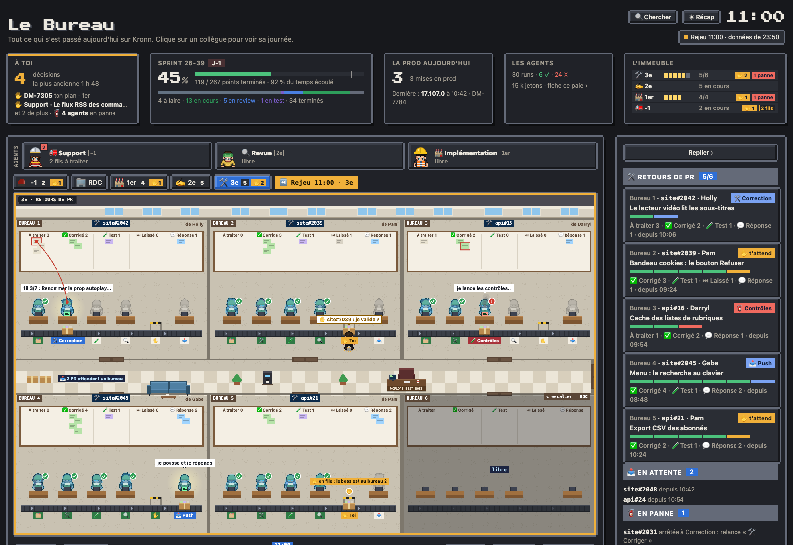
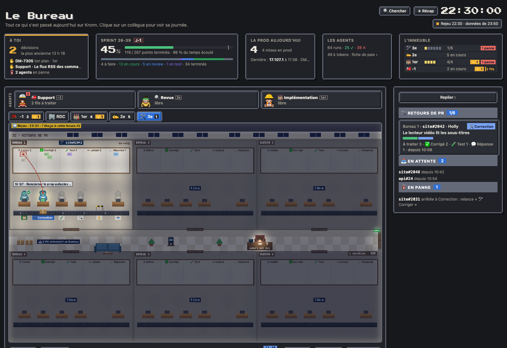
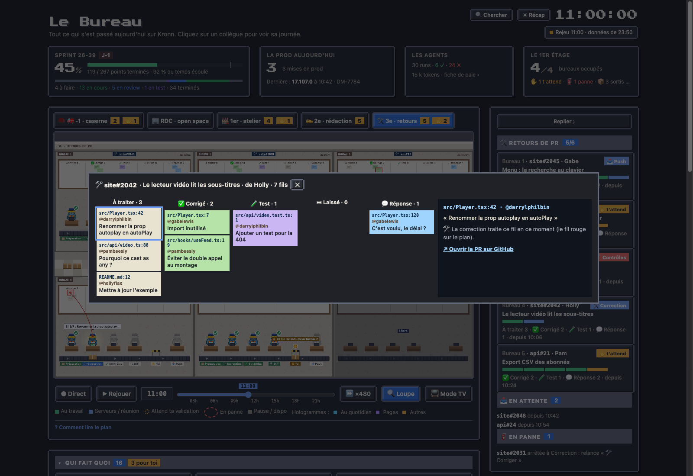

# Les retours de PR (3e étage)

Au 3e étage, on voit les PR dont un agent corrige les commentaires de review : un bureau par PR, six au plus. C'est le même workflow que le bouton « 🛠 Corriger » des fiches (modèle du Bureau « corriger les commentaires d'une PR », [fiches](07-fiches.md)) : l'étage le montre en grand, poste par poste et fil par fil.

## Monter au 3e

Le bouton « 🛠 3e » (les retours de PR, au survol) apparaît après « 🏭 1er » dès que le modèle est installé (`actions.fix_pr`). Les onglets suivent l'ordre des étages : -1, RDC, 1er, 3e. Le chiffre compte les PR en correction, « ✋ n » celles qui attendent ta validation. La page s'ouvre au RDC ; l'étage choisi ensuite est retenu par le navigateur.

## Ce qu'on y voit

- **Un bureau par PR**, en deux rangées de trois autour du couloir. Le nom de la PR (dépôt et numéro) et son auteur sont en haut du bureau. Un bureau libre est éteint et vide, sauf le bureau 1, dont l'équipe somnole à son poste (z Z), comme au 1er.
- **Le rail des postes**, comme au 1er : 🗂 Préparation, 🛠 Correction, 🧪 Contrôles, 🔍 Diff, ✋ Toi, 📤 Push, les étapes du workflow. Un agent par poste, assis derrière son bureau à écran, en chirurgien (calot, masque et blouse, la tenue de l'agent des retours au RDC). Dès qu'une PR a un bureau, toute l'équipe monte derrière Bernard, l'un après l'autre, et reste à son poste jusqu'au push ; la PR poussée, elle redescend. Sous chaque poste, son icône ; son nom aussi quand il travaille, est en panne ou attend ta validation (au survol, sinon). Même langage qu'aux autres étages : **au travail** (un halo, une bulle), **a travaillé** (✓ à côté de l'agent, comme au 1er), **attend son tour** (silhouette grise), **en panne** (! rouge et fumée : un correctif dont les contrôles restent rouges est annulé). La PR, un carton avec ses post-its, est posée devant le poste en cours.
- **Le Kanban des fils**, au mur de chaque bureau : une colonne par section de la réponse de l'agent (À traiter, ✅ Corrigé, 🧪 Test, ⏭ Laissé, 💬 Réponse), un post-it par fil de review non résolu. Un **fil rouge** relie le fil que la correction traite en ce moment à l'agent qui s'en occupe. Les post-its changent de colonne en direct : l'agent note son avancement fil par fil (voir Données).
- **Le boss est toujours là**, assis à son bureau du couloir, le même qu'au RDC. Quand une PR attend ta validation, il se lève, longe le couloir, entre par la porte du bureau et va à la barrière ✋. Il n'y a qu'un boss : il va d'abord au bureau qui attend depuis le plus longtemps, les autres clignotent à leur barrière (« en file : le boss est au bureau 2 ») et il y passe ensuite. Il ressort par où il est entré.
- **Bernard** sort de la porte de l'escalier avec la PR, la monte à son bureau, y pose le carton, et la redescend une fois les corrections poussées ; le bureau s'éteint.
- **Le couloir** : les PR qui attendent un bureau, le café, un banc, le bureau du boss et, au bout, la porte de l'escalier : la porte en bois de l'entrée du RDC, dans le mur de droite. Bernard en sort par derrière, elle s'ouvre à son passage ; la nuit, le panneau SORTIE vert s'allume au-dessus, comme au RDC.
- **Le soir et le week-end**, l'étage passe en veilleuse, comme le RDC la nuit : chaque bureau occupé s'allume comme une pièce, avec ses plafonniers, les bureaux libres restent dans l'ombre ; chaque agent au travail a sa lampe et son écran, la lampe du bureau du boss reste allumée, et sa lumière le suit quand il marche.

## Le Kanban en grand

Un clic sur le Kanban d'un bureau (ou « 🔍 Ouvrir le Kanban des fils » dans sa fiche) ouvre la fenêtre : la barre des postes, puis les fils en colonnes, avec le fichier et la ligne, qui a commenté et son commentaire. Le fil traité en ce moment est encadré de rouge. Un clic sur un fil le montre à droite, avec le lien vers son commentaire et vers la PR sur GitHub. Échap ou ✕ ferme la fenêtre.

## Le panneau

Au 3e, le panneau liste les bureaux (la PR, son auteur, le poste en cours, la barre des postes, les fils par colonne), puis les PR en attente d'un bureau et celles en panne (relance « 🛠 Corriger » sur la PR). Un clic sur un bureau, dans le panneau ou sur le plan, ouvre sa fiche : l'état de chaque poste, les fils par colonne et, quand elle t'attend, la carte de validation (le diff, les réponses prévues, « Approuver » pour pousser). La fiche a sa rangée de liens : la PR ↗, le diff ↗, son ticket ↗, le run et « 🔍 Ouvrir dans le Kanban » (le Mur Kanban de l'équipe). Un clic sur un agent, ou sur le nom d'un poste dans la fiche, ouvre la fiche de son poste : pour 🛠 Correction, le fil en cours (fichier, ligne, qui a commenté, le commentaire ↗) et les fils déjà traités ; pour 🗂 Préparation, 🔍 Diff et 📤 Push, les fils par colonne ; pour 🧪 Contrôles, leur état et le run. Un clic sur les cartons du couloir liste les PR qui attendent un bureau. Un clic sur le boss ouvre sa fiche, la même qu'au RDC.

## Depuis le RDC

- **Sa ligne dans la tuile « L'immeuble »** en haut de page : les PR en correction sur les six bureaux (une fenêtre allumée par bureau), celles dont les corrections t'attendent, les pannes ; les PR poussées aujourd'hui et la file au survol. Un clic monte au 3e.
- **« Qui fait quoi »** : sous les postes du 1er, une carte par bureau du 3e (« 🛠 3e étage ») : le poste en cours, ✋ quand ses corrections t'attendent, 🧯 quand un poste est en panne, les fils à traiter et corrigés, l'auteur. Le même numéro de bureau qu'à l'étage ; un clic y monte et ouvre le bureau. Le mode TV les montre aussi.
- **Le fil de la journée** : une PR qui monte au 3e, ses corrections qui t'attendent, les corrections poussées et les réponses postées, un poste en panne. Un clic monte au 3e et ouvre le bureau de la PR ; « ⏵ revoir » rejoue le moment sur le plan du 3e.
- **⌘K** trouve les PR du 3e par leur nom, leur dépôt, leur titre, leur auteur ou le poste en cours.
- **Le mode TV** : le bouton d'étage (ou la touche E) passe par le 3e ; `?tv=1&floor=alt` y passe quand il a une PR.
- **Les scènes** (« Comment lire le plan ») au 3e : une PR monte au 3e, le Kanban avance, à toi de valider, la PR est poussée, contrôles rouges, le soir au 3e. Elles se jouent à toute heure, dès le premier clic, depuis les PR de la démo quand aucune n'est en cours.
- **Le rejeu** : le curseur du temps reconstruit l'étage à l'heure choisie, d'après les moments du relevé.

## Données

Le dataset `retours`, publié chaque minute par le cron live (`workflows/retours_snapshot.py`, 0 token), lit les runs du modèle dans Kronn et, pour chacun, l'état que garde le workflow (`~/.cache/pixel-bureau/pr/runs/<run>.json` : la PR, son auteur, ses fils en bref). La colonne d'un fil vient de l'avancement que l'agent écrit au fil de son travail (`.bureau-fix-progress.json` du dossier de travail : le fil en cours et ceux qu'il a finis), puis, une fois l'agent fini, de l'icône de sa réponse prévue ; un fil sans réponse est laissé. Après la mise à jour : `python3 tools/install.py` (crée le dataset), puis `publish.py all`.
