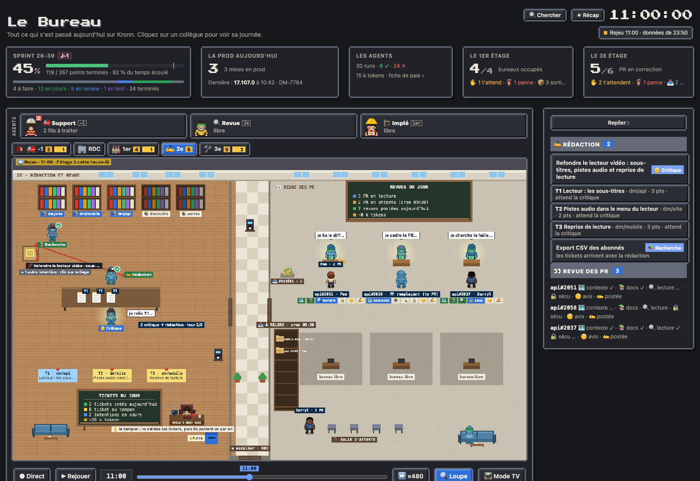
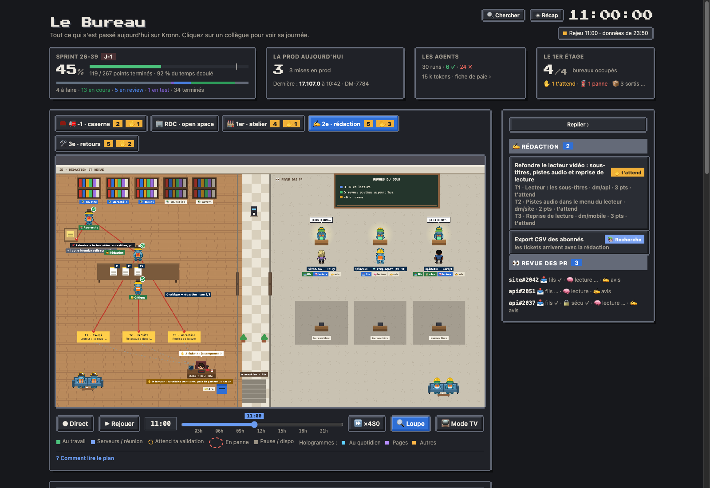

# La rédaction et la revue (2e étage)

Au 2e étage, deux salles de part et d'autre d'un couloir : à gauche, la rédaction des tickets ([Créer un ticket](20-creer-ticket.md)) ; à droite, la revue des PR (« Faire relire » et la revue automatique des PR ouvertes).

## Monter au 2e

Le bouton « ✍ 2e » (la rédaction et la revue, au survol) apparaît entre le 1er et le 3e dès que le modèle « créer un ticket » est installé. Le chiffre compte les intentions en rédaction et les PR en revue, « ✋ n » les tickets qui attendent ton tampon.

## La salle de rédaction

- **Les bibliothèques**, une par composant Jira de l'équipe (les quatre premiers de `jira.create.components`, puis « autres ») : celles que l'intention touche s'allument.
- **Les postes**, des reporters en chapeau mou et carte de presse : 📚 Recherche (à la bibliothèque), ✍ Rédaction et 🧐 Critique, face à face à la table. Les versions des tickets sont posées sur la table, et « ↺ critique → rédaction · tour 2/3 » dit quand la critique renvoie à la rédaction (trois tours au plus ; la critique repasse alors en gris). Même langage qu'aux autres étages : au travail (halo, bulle), a travaillé (✓ à côté de l'agent, comme au 1er), attend son tour (gris). Chaque poste a sa plaque à son nom, toujours au même endroit : le fil rouge y est épinglé.
- **Les trois reporters sont toujours là.** Pendant une intention, chacun reste à son poste jusqu'à la fin. Sans intention, le jour, ils se promènent : un café à la machine, le canapé, un livre devant la bibliothèque, leur poste. Le soir et le week-end, ils somnolent à leur poste (z Z), comme au 1er.
- **Le fil rouge** part de ton intention, punaisée au liège par le boss : quand une intention arrive, il se lève avec la fiche, va l'épingler, puis revient s'asseoir ; la recherche ne démarre qu'ensuite. Il passe par la recherche et la rédaction, puis se divise en un brin par ticket quand l'intention est découpée. Une carte par ticket, à sa couleur : attend la critique, en cours, t'attend, créé, écarté.
- **Le bureau du boss** (un pack d'équipe peut donner au boss un dessin pour cet étage, `redaction_sprite` dans le roster, par exemple en libraire qui lit à son bureau), celui du RDC (« WORLD'S BEST BOSS »), le tampon et son encreur posés dessus : le boss y est toujours assis, et tamponne la liste des tickets (« ✋ 3 tickets : je tamponne ? ») ; tes « Changements » renvoient à la rédaction. Les tickets partent ensuite un par un : pour chaque ticket tamponné, le boss se lève et va le glisser dans la boîte Jira ; sa carte passe au vert et son brin rejoint la boîte une fois le ticket dedans.
- **Le canapé**, en bas à gauche, et **la machine à café**, contre le mur du couloir, pour les reporters qui se promènent.
- **Le tableau noir des tickets du jour**, sur un chevalet devant le bureau du boss : les tickets créés depuis minuit, ceux qui attendent ton tampon, les intentions en cours, les jetons du jour. L'historique est dans la page « [Rédaction · bilan](30-redaction-bilan.md) ».
- Jusqu'à trois intentions en même temps : la table montre la plus ancienne, un clic sur le liège passe à la suivante.
- **La fiche d'un ticket** : un clic sur sa carte à la table, ou sur sa ligne dans le panneau, ouvre ce qui sera créé pour lui seul. On y voit le titre, le type, les points, le composant, l'épic et la description en texte lisible, avec la carte du tampon dessous. « ← Les tickets » ramène à la liste. Le tampon ne montre que le récap de la liste dès qu'elle est longue.

## La salle de revue

- **Un bureau par PR en revue**, six au plus : le relecteur, la visière verte des correcteurs, derrière son écran, et en face, de dos, l'auteur de la PR. Pour ta PR, ou celle de quelqu'un hors de l'équipe, l'auteur est un agent remplaçant.
- **Sous chaque bureau, les postes de sa revue**, lus du run : 🗺 contexte (le sens de la PR, ce qui est à risque), 📚 docs (les conventions du projet et la doc tenue à jour), 🔍 lecture (le code et ses tests), 🔒 sécu (sautée quand le diff ne touche rien de sensible), puis 🧐 avis (il vérifie les constats et rédige la review) et ✍ postée. Seul le poste en cours (ou en échec) écrit son nom, les autres montrent leur icône. La bulle du relecteur dit quel poste travaille.
- **La file du cron** : le cron des revues retient jusqu'à six PR à chaque passage (une revue prend 10 à 25 minutes, et Kronn arrête un passage au bout de 2 h ; les autres attendent le passage suivant), mais elles sont relues l'une après l'autre au premier bureau. Bernard monte la fournée sur son transpalette et range un dossier par PR dans le casier « À relire », dans l'ordre du cron (six cases, puis « +n »). Le relecteur va chercher le dossier du haut, les autres remontent d'une case ; l'avis posté, il tamponne le dossier de son verdict (✅ 💬 🔧) et le pose dans la corbeille « Postées », que Bernard vide au passage suivant du cron. Les auteurs attendent en salle d'attente, une chaise par personne et une pancarte qui compte leurs PR restantes : on reste au bureau si sa PR suivante est la prochaine, on retourne s'asseoir si quelqu'un passe avant, on ne redescend qu'après sa dernière PR, ses verdicts au-dessus de la tête. Les revues à la demande (« Faire relire ») prennent les autres bureaux : le relecteur et l'auteur arrivent par la porte de l'escalier et repartent la revue finie.
- **La porte de l'escalier**, en bas du couloir entre les deux salles : la porte en bois de l'entrée du RDC. Bernard et les auteurs en sortent par derrière, elle s'ouvre à leur passage ; la nuit, le panneau SORTIE vert s'allume au-dessus, comme au RDC.
- **Le tableau noir des revues du jour** : les PR en lecture, celles qui attendent (et l'heure du cron), les revues postées, les jetons.
- **Un banc** pour les relecteurs libres.

## Le soir et le week-end

L'étage passe en veilleuse, comme le RDC la nuit : la salle de rédaction s'allume comme une pièce tant qu'une intention y est, et chaque bureau de la revue quand une PR y est lue ; les bureaux libres restent dans l'ombre. Chaque agent au travail a sa lampe et son écran, et la lampe du bureau du boss reste allumée.

## Depuis le RDC

Le fil de la journée (une intention qui arrive, un ticket qui attend ton tampon, un ticket créé), ⌘K (les intentions par leur texte, leurs tickets, leurs composants), le mode TV (touche E et `?floor=alt`), et les scènes de l'étage dans la galerie. La rédaction : une intention découpée, le tampon, les tickets qui partent dans Jira, le soir au 2e. La revue des PR : la fournée du cron, le relecteur qui prend un dossier, l'avis posté, l'auteur qui repart, une revue à la demande ; elles se rejouent sur la journée de démo, à l'heure où elle les joue. Chaque scène a sa loupe, comme aux autres étages : les brins de l'intention découpée, le boss qui porte un ticket à la boîte Jira, Bernard et sa fournée, le dossier pris au casier, le tampon de l'avis, l'auteur qui redescend, le bureau d'une revue à la demande.

## Données

Le dataset `redaction`, publié chaque minute par le cron live (`workflows/redaction_snapshot.py`, 0 token) : les runs du modèle et de chaque ticket, et le dossier de chaque run (`~/.cache/pixel-bureau/ticket/<run>/` : la demande, les rapports des postes, les versions, les tickets créés). La revue se lit dans les runs de relecture (le sous-workflow de la revue). Après la mise à jour : `python3 tools/install.py` (crée les sous-workflows et le dataset), puis `publish.py all`.
