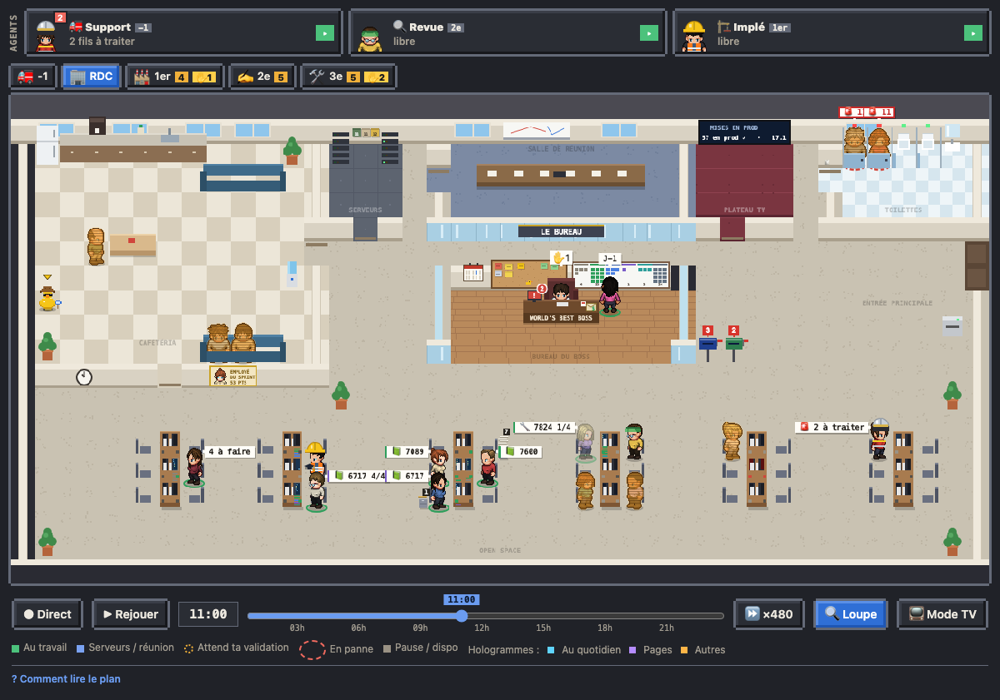

# Les agents des étages

Chaque étage a son agent au RDC : 🚒 Support (-1), 📰 Ticket (2e), 🔍 Revue (2e), 🩹 Retours (3e), 🏗 Implé (1er). Il reste toujours à sa place, même sans run du jour, pour qu'on le trouve et qu'on lance son workflow d'un clic.

## Au RDC

- **Toujours là** : sans run du jour, ou reparti, l'agent est à son bureau, au repos. Il garde ses états habituels quand il travaille (au travail, t'attend, en panne).
- **En couleurs pleines**, pas en hologramme, et **dans la tenue de son étage** : le casque de pompier, le chapeau mou et la carte de presse des reporters, la visière verte de la revue, le calot, la blouse et le masque du chirurgien (les retours, « les retouches »), le casque et le gilet de chantier.
- **Son métier pour étiquette** (« 🔍 Revue »), pas son prénom. Sa fiche garde son nom.
- **Sa place** est celle du plan (`seating` du plan d'équipe) : le pack peut leur réserver un îlot.

## La barre « AGENTS »

Au-dessus des onglets d'étage, visible à tous les étages (pas en mode TV) : le portrait en tenue, le métier, l'étage, et l'état en une ligne (libre, au travail, t'attend, en panne ; pour le Support, les fils à traiter). Un clic :

- **Support** : la console Support (le fil à investiguer, le projet, puis la carte Kronn).
- **Les autres** : sa fiche au RDC, avec en tête « À lancer » : les PR ouvertes à relire (Revue), les PR qui ont des fils de review à traiter (Retours), les tickets à faire ou en cours sans PR (Implé), six au plus, chacun avec son bouton. Le Ticket a son « ▶ Lancer… » (l'intention, le type, les points).

## Réglage

Dans `settings.json` du pack, la clé `metier` d'un agent : `support`, `ticket`, `revue`, `retours` ou `impl`. Un agent par métier (le premier de la liste). Pour un agent qui fait la revue du cron et la revue à la demande, son `wf` dans la config réunit les deux.
