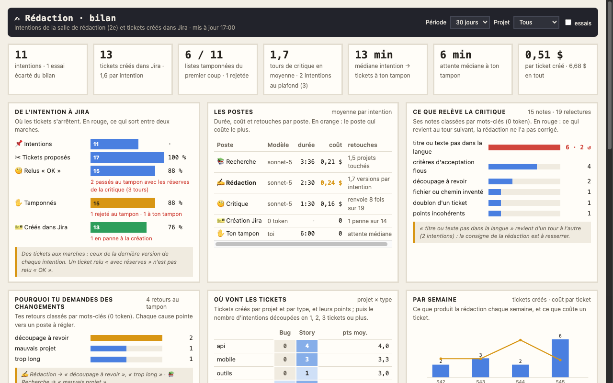
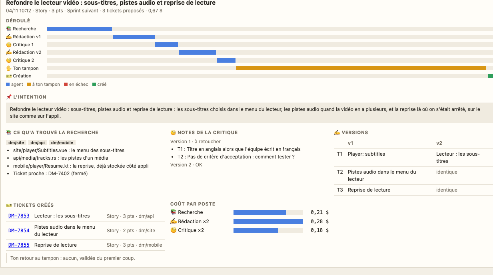

# Le bilan de la rédaction

Une page Kronn à part, « Rédaction · bilan », garde l'historique des intentions passées par la salle de rédaction du 2e étage ([La rédaction et la revue](28-redaction.md), [Créer un ticket](20-creer-ticket.md)) et des tickets créés dans Jira : où les tickets s'arrêtent, ce que coûte chaque poste, ce que relève la critique, pourquoi tu demandes des changements au tampon, vers quels projets partent les tickets. Elle sert à suivre la rédaction et à régler ses consignes. Son chiffre clé tient dans l'écran du vidéoprojecteur.

## L'installer et la projeter

`python3 tools/install.py` crée la page avec le modèle « créer un ticket » (`models.ticket`) et son cron « bilan de la rédaction (15 min) ». Pour la projeter : « Mes pages Kronn » sur l'écran mural, « ＋ Ajouter » la page « Rédaction · bilan », puis « 📽 Projeter en TV ». Le vidéoprojecteur montre les tickets créés sur 30 jours et le coût d'un ticket.

La page se met à jour toutes les 15 minutes, et tout de suite quand une intention finit par la création de ses tickets : la dernière étape du modèle relance le cron.

## Ce qu'on y voit

En haut, les filtres : période (7, 30 ou 90 jours), projet touché, et « essais » (les intentions qui commencent par « [ESSAI », écartées par défaut).

- **Les chiffres de la période** : intentions, tickets créés (et par intention), listes tamponnées du premier coup (et rejetées), tours de critique en moyenne (et intentions au plafond de 3 tours), temps de l'intention jusqu'à ton tampon, ton attente au tampon, coût d'un ticket créé.
- **De l'intention à Jira** : l'entonnoir en tickets (ceux de la dernière version de chaque intention) : proposés, relus « OK » par la critique, tamponnés, créés ; et en rouge ce qui sort à chaque marche : intention en panne avant le tampon, tickets passés au tampon avec les réserves de la critique, rejetés, en panne à la création.
- **Les postes** : pour 📚 Recherche, ✍ Rédaction et 🧐 Critique, le modèle, la durée et le coût moyens par intention ; en orange, le poste qui coûte le plus. Sur la même ligne : projets touchés, versions par intention, renvois de la critique. Puis la création dans Jira (pannes) et ton attente au tampon.
- **Ce que relève la critique** : ses notes classées par mots-clés (langue, critères d'acceptation, découpage, fichier inventé, doublon, points, composant). En rouge, ce qui revient au tour suivant : la rédaction ne l'a pas corrigé, sa consigne est à resserrer.
- **Pourquoi tu demandes des changements** : tes retours au tampon, classés (découpage, mauvais projet, trop long, titre, points), chacun rattaché au poste à régler.
- **Où vont les tickets** : projet × type des tickets créés et leurs points moyens, puis combien d'intentions se découpent en 1, 2, 3 tickets ou plus.
- **Par semaine** : les tickets créés et le coût d'un ticket.
- **Historique**, l'intention la plus récente d'abord : ses tickets (liens Jira), les projets touchés, les tours de critique, l'issue, la durée, le coût. Un clic ouvre sa fiche.

## La fiche d'une intention

Le déroulé poste par poste (chaque version de la rédaction, chaque relecture, ton tampon, la création), l'intention telle que tu l'as donnée, ce qu'a trouvé la recherche (projets et pistes), les notes de la critique à chaque version, les titres de chaque version côte à côte (« identique » quand rien n'a changé), les tickets créés avec leur lien, tes retours au tampon et le coût de chaque poste. Les fiches détaillées sont gardées pour les intentions les plus récentes.

## Au 2e étage

Dans la salle de rédaction, sur un chevalet entre les tickets épinglés et le bureau du boss, le tableau noir **TICKETS DU JOUR**, jumeau de celui des revues : les tickets créés depuis minuit, ceux qui attendent ton tampon, les intentions en cours et les jetons du jour. L'historique, lui, est dans la page.

## D'où viennent les données

Le dossier d'une intention (`~/.cache/pixel-bureau/ticket/<run>/`) ne garde que la dernière version des tickets et la dernière critique. Chaque intention a donc son bilan dans un historique jamais vidé, `~/.local/share/pixel-bureau/historique/ticket/<run>.json` (réglage `jira.create.historique`), réécrit à chaque étape du modèle : la demande, le rapport de la recherche, chaque version des tickets, chaque critique, tes retours datés et les tickets créés. Une intention d'avant l'historique se lit dans son dossier (dernière version seulement).

Le cron (sans jetons) a deux étapes, chacune relançable seule : `releve` lit dans Kronn ce que lui seul sait (durée, coût et modèle de chaque agent des postes, passages au tampon et décision, créations en échec, déroulé ; un run fini n'est relu qu'une fois), `bilan` assemble l'historique et ce relevé et publie le dataset `redaction_bilan`.

Après la mise à jour : `python3 tools/install.py` (crée la page et le cron), puis `python3 tools/publish.py all`.
