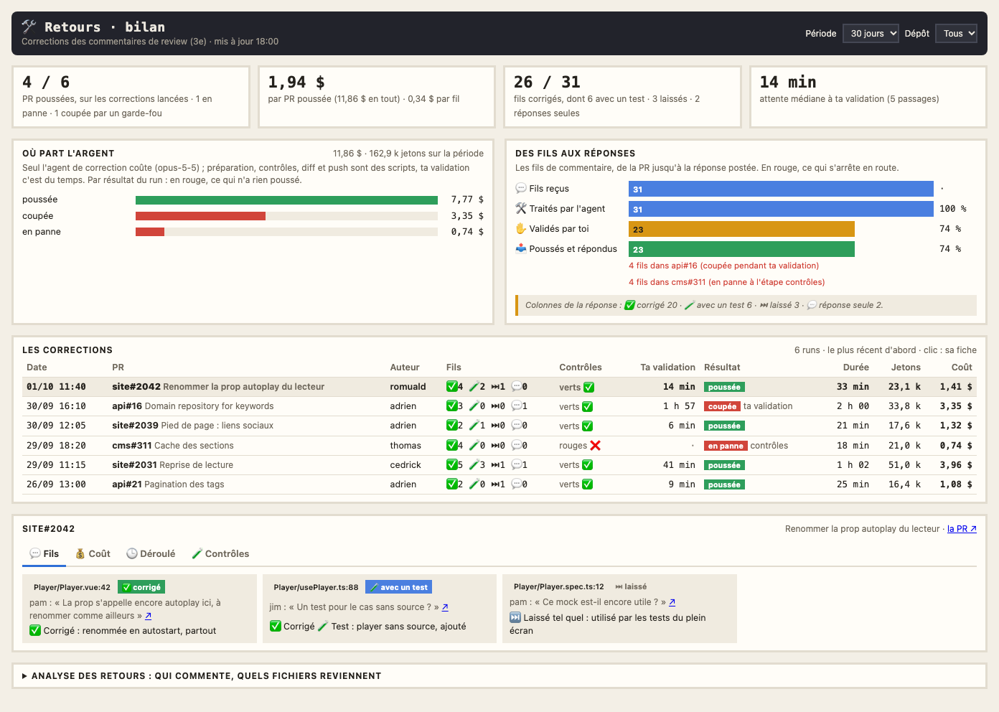

# Le bilan des retours

Une page Kronn à part, « Retours · bilan », garde l'historique des corrections de commentaires de review passées par le 3e étage ([Les retours de PR](27-retours.md)) : combien de PR ont été poussées, ce que coûte une correction, ce que deviennent les fils de commentaire, combien de temps les corrections t'attendent. Son chiffre clé tient dans l'écran du vidéoprojecteur.

## L'installer et la projeter

`python3 tools/install.py` crée la page avec le modèle « corriger les commentaires d'une PR » (`actions.fix_pr`) et son cron « bilan des retours (15 min) ». Pour la projeter : « Mes pages Kronn » sur l'écran mural, « ＋ Ajouter » la page « Retours · bilan », puis « 📽 Projeter en TV ». Le vidéoprojecteur montre les PR poussées sur les corrections lancées.

La page se met à jour toutes les 15 minutes, en semaine aux heures des crons.

## Ce qu'on y voit

En haut, les filtres : période (7, 30 ou 90 jours) et dépôt.

- **Quatre chiffres** : PR poussées sur les corrections lancées (et en panne, coupées par un garde-fou de Kronn, refusées par toi), coût par PR poussée et par fil, fils corrigés (dont avec un test, laissés, réponses seules), attente médiane à ta validation.
- **Où part l'argent** : le coût de la période par résultat du run, en rouge ce qui n'a rien poussé. Seul l'agent de correction coûte ; préparation, contrôles, diff et push sont des scripts, ta validation c'est du temps. Le coût vient de Kronn (entrée, contexte relu en cache, sortie) ; il est complet, l'agent ne lançant aucun sous-agent.
- **Des fils aux réponses** : les fils de commentaire reçus, traités par l'agent, validés par toi, poussés et répondus ; en rouge, la PR où des fils se sont arrêtés et pourquoi. Puis la répartition par colonne de la réponse (✅ corrigé, 🧪 avec un test, ⏭ laissé, 💬 réponse seule).
- **Les corrections**, la plus récente d'abord : PR et titre, auteur, fils par colonne, verdict des contrôles, attente à ta validation, résultat (et l'étape où un run s'est arrêté), durée, jetons, coût. Un clic ouvre sa fiche.
- **Analyse des retours**, repliée : qui commente le plus, quels fichiers reviennent.

## La fiche d'une correction

Quatre onglets :

- **💬 Fils** : une carte par fil (fichier et ligne, qui a commenté, le commentaire ↗, sa colonne et la réponse prévue).
- **💰 Coût** : l'agent de correction (modèle, durée, jetons, coût), les étapes sans jetons et ton attente ; le coût par fil.
- **🕒 Déroulé** : étape par étape, ta validation en orange, le push en vert ; une correction coupée par un garde-fou dit où et qu'il faut la relancer.
- **🧪 Contrôles** : le verdict et les commandes lancées, les fichiers non suivis écartés du commit.

Les fiches détaillées sont gardées pour les corrections les plus récentes. La réponse prévue à chaque fil est gardée depuis cette version ; une correction plus ancienne montre ses fils sans réponse.

## Au 3e étage

Au fond du couloir, à gauche, le tableau noir **RETOURS DU JOUR**, jumeau de ceux du 2e : les PR poussées depuis minuit et leurs fils, les bureaux au travail et les pannes, les jetons du jour et les PR poussées sur 7 jours. La file des PR qui attendent un bureau est juste après la porte du bureau 1. L'historique, lui, est dans la page.

## D'où viennent les données

L'état de chaque correction (`~/.cache/pixel-bureau/pr/runs/<run>.json`, écrit par `pr_update.py`) garde la PR, ses fils, leur colonne, la réponse prévue et le verdict des contrôles. Le cron (sans jetons) a deux étapes, chacune relançable seule : `releve` lit dans Kronn ce que lui seul sait (coût et modèle de l'agent, attente à ta validation, résultat, déroulé) et le joint à l'état de la PR ; un run fini n'est relu qu'une fois et reste en cache (`~/.cache/pixel-bureau/retours_bilan/`) quand Kronn l'oublie. `bilan` publie le dataset `retours_bilan`.

Après la mise à jour : `python3 tools/install.py` (crée la page et le cron), puis `python3 tools/publish.py all`.
