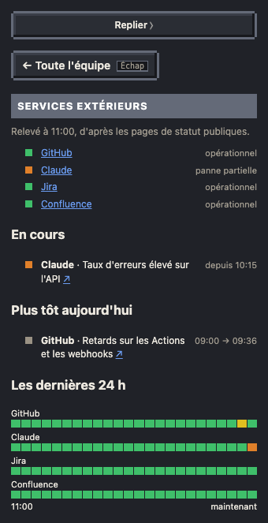

# Services extérieurs

Quand un agent plante ou qu'une PR traîne, la cause est parfois dehors : GitHub ralenti, Claude en panne, Jira en maintenance. Le Bureau lit les pages de statut publiques de ces services et le montre au RDC, sous l'écran « Mises en prod » du plateau TV.


## Sous l'écran du plateau TV

- **Tout va bien** : une rangée de points verts, un par service suivi. Un point gris : la page de statut n'a pas répondu au dernier relevé.
- **Un service ne va pas** : un bandeau rouge, comme une chaîne d'info, une ligne par service touché, le pire en haut : « ⚠ CLAUDE · panne partielle ». Les états : ralenti, panne partielle, en panne, maintenance.
- Le bandeau reste affiché quand le plateau est fermé (vendredi, week-end).
- Au survol, une infobulle résume ; au clic, la fiche des services s'ouvre dans le panneau.

## La fiche



- L'état de chaque service à l'heure affichée, son nom lié à sa page de statut, et l'heure du relevé.
- **En cours** : chaque incident ouvert, depuis quand, avec son lien.
- **Plus tôt aujourd'hui** : les incidents de la journée déjà résolus, de leur début à leur fin.
- **Les dernières 24 h** : une case par heure et par service, de la couleur du pire incident ouvert dans l'heure (vert sans incident), la dernière pour l'heure en cours ; au survol, l'heure et l'état. Seuls les incidents déclarés par la page de statut y laissent une trace.

## Dans le fil et en mode TV

Le début et la fin de chaque incident du jour entrent dans le [fil](04-fil-et-recap.md) : « 🌧️ Claude : panne partielle « Taux d'erreurs élevé sur l'API » », puis « ☀️ Claude rétabli · après 39 min ». Une maintenance n'est pas « Important ». Un clic sur la ligne ouvre la fiche. Ces lignes passent aussi dans le bandeau du bas du [mode TV](06-mode-tv.md).

## Au 1er étage

Quand un poste de la chaîne tombe sur « agent ou API indisponible », la fiche de la panne regarde la page de statut de Claude : pendant un incident, elle le dit (« Claude signale un incident depuis 10:15… : ce n'est pas le ticket ») et conseille d'attendre la fin avant de relancer.

## Rejouer la journée

Les incidents sont datés par la page de statut elle-même : en relecture, le bandeau et la fiche montrent l'état à l'heure rejouée. L'état des composants sans incident déclaré (un service ralenti que la page n'a pas encore annoncé) ne compte qu'autour de l'heure du relevé.

## D'où viennent les données

Le cron `office` (toutes les 10 minutes, 0 jeton) lit, pour chaque service, `summary.json` (l'état de ses composants) et `incidents.json` (ses 50 derniers incidents) de sa page Statuspage, sans clé ni compte, et publie le dataset `statuts` : l'état actuel et les incidents des 36 dernières heures. Un service injoignable garde sa place, sans état, et laisse un avertissement dans [Fraîcheur](10-fraicheur.md), où le relevé a sa ligne, sous Bureau.

## Régler la liste

Sans réglage, Le Bureau suit GitHub, Claude, Jira et Confluence. Pour Claude, seuls l'API et Claude Code comptent : un connecteur de claude.ai en panne ne touche pas les agents. Pour changer la liste, ajoute `statuts` à `bureau.config.json`, puis republie les workflows (`python3 tools/publish.py workflows`) :

```json
"statuts": [
  {"n": "GitHub", "url": "https://www.githubstatus.com"},
  {"n": "Claude", "url": "https://status.claude.com", "components": ["Claude API (api.anthropic.com)", "Claude Code"]},
  {"n": "Jira", "url": "https://jira-software.status.atlassian.com"},
  {"n": "Confluence", "url": "https://confluence.status.atlassian.com"}
]
```

- `n` : le nom affiché ; `url` : l'adresse de la page de statut (toute page Statuspage convient, qui répond à `/api/v2/summary.json`).
- `components` (facultatif) : les composants qui comptent, tels que la page les nomme ; sans lui, tous.
- `"statuts": []` : aucun relevé, rien sous l'écran.

Une installation existante doit relancer `python3 tools/install.py` une fois pour créer le dataset `statuts`, avant de republier les workflows.
