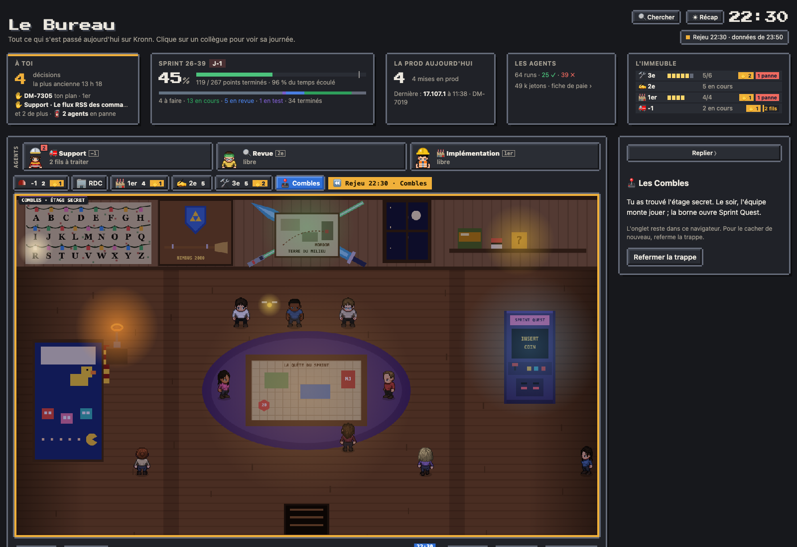
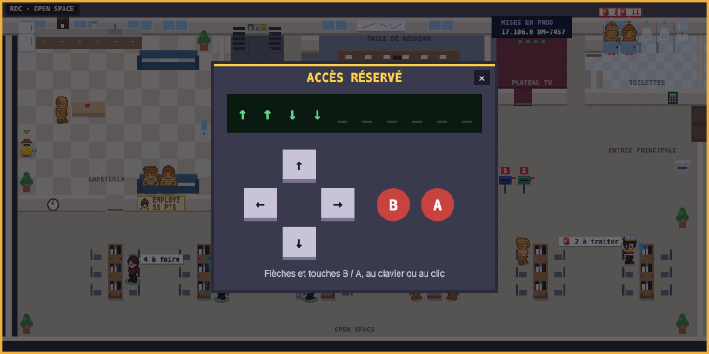
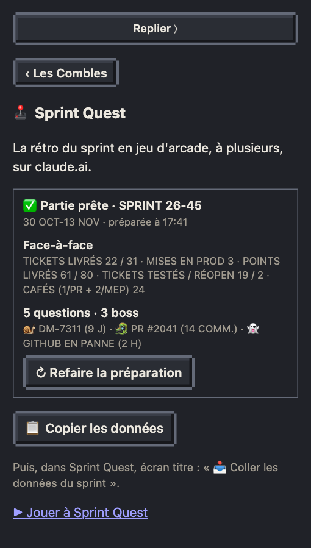

# Les Combles, l'étage secret

Sous le toit du Bureau, il y a une chambre de geek : l'alphabet de Stranger Things au mur, le bouclier d'Hyrule et le Nimbus 2000, la carte de la Terre du Milieu, un lit Pac-Man, une table de jeu de rôle et une borne d'arcade. Elle n'a pas d'onglet : il faut la trouver.



## Trouver l'étage

Un digicode est accroché au mur, juste à côté de l'entrée principale du RDC. Au clic, son pavé s'ouvre : quatre flèches et deux boutons, B et A. On tape au clavier (flèches, touches B et A) ou au clic, et chaque touche tapée s'affiche. À la dixième touche, le code est vérifié. Un mauvais code affiche « Accès refusé », et la touche suivante recommence la saisie. Le bon code ouvre une trappe au plafond et monte aux Combles. Échap ou un clic hors du pavé le referme.



Le code n'est écrit nulle part dans la page : seule son empreinte y est, pour le plaisir de chercher (ce n'est pas une sécurité).

Trois indices, tant que l'étage n'a pas été trouvé :

- la diode du boîtier clignote ;
- une fois par jour, une minute, le canard en plastique dit quelque chose ;
- un post-it est posé sur le bureau du boss, entre l'écran et le clavier : son survol le lit.

Une fois trouvé, l'onglet **🕹 Combles** reste au bout des onglets d'étage jusqu'au rechargement de la page : le cadre de Kronn n'a pas de stockage local, il faut donc refaire le code après chaque rechargement (hors de Kronn, dans l'aperçu local, l'onglet reste dans le navigateur). La trappe, au sol des Combles, redescend au RDC ; « Refermer la trappe », dans le panneau, cache de nouveau l'étage.

## Le soir, l'équipe monte

Des heures de bureau à 23 h, toute l'équipe présente ce jour-là est aux Combles, chacun à sa place. De temps en temps, quelqu'un se lève et va ailleurs : la table, la borne, le pied du lit. Le jour, la pièce est vide. Hors des heures de bureau, la lucarne montre la lune, une lettre du mur s'allume et la pièce passe en lumière de veillée. Le vif d'or, lui, se promène toute la journée.

Tout se déduit de l'heure : en rejeu, on voit la même soirée.

## La borne

Au clic, la borne ouvre sa fiche dans le panneau, avec le lien **▶ Jouer à Sprint Quest** : la rétro du sprint en jeu d'arcade, à plusieurs, sur claude.ai. Sans adresse réglée, la fiche explique comment la brancher.

## Préparer la partie du sprint



En fin de sprint, sans session Claude :

1. **⚙ Préparer la partie**, dans la fiche de la borne, lance le workflow « Le Bureau · Sprint Quest » (0 jeton, une à deux minutes). La fiche dit « Préparation en cours » ; si rien n'arrive au bout de 10 minutes, elle dit que la préparation n'a pas abouti (le détail est dans le run Kronn).
2. Le workflow lit le **dernier sprint fermé** dans Jira (ses tickets et leurs changements de statut), les **PR mergées** et les **mises en prod** de sa fenêtre (`gh`), et les **pannes des services extérieurs** (pages de statut, réglage `statuts`). Il écrit les données de la partie avec des textes fixes : le face-à-face (tickets et points livrés, mises en prod, testés et réouverts, cafés), quatre ou cinq questions de quiz (le jour le plus productif, qui a livré le plus, les PR mergées, le ticket le plus long en cours, le type de ticket le plus fréquent), trois boss (l'escargot : le ticket resté le plus longtemps en cours ; l'hydre : la PR la plus commentée ; le fantôme : la pire panne, sinon une mise en prod ratée ou le ticket le plus réouvert) et les vies de la carte. Une même préparation donne toujours la même partie.
3. Quand c'est prêt, la fiche résume la partie : **📋 Copier les données**. Si le cadre de Kronn refuse la copie, le texte s'affiche pour un Cmd+C.
4. Dans Sprint Quest, sur l'écran titre, l'hôte colle le texte, vérifie l'aperçu, puis **✓ Charger dans la partie**.

Une source en échec (gh absent, page de statut injoignable) laisse un avertissement dans [Fraîcheur](10-fraicheur.md), sous « Sprint Quest (borne) », et sa part du jeu se replie (pas de question sur les PR, pas d'hydre). Le bouton n'existe qu'avec Jira connecté ; après la mise à jour : `publish.py workflows` (crée le workflow), puis `publish.py page`.

## Régler l'adresse de la borne

Dans `bureau.config.json` (une adresse `https://` seulement), puis republier la page. `company`, facultatif, met le nom de l'entreprise sur l'écran titre de Sprint Quest (« La rétro de Dunder Mifflin ») :

```json
"combles": {"url": "https://claude.ai/artifact/…", "company": "Dunder Mifflin"}
```
