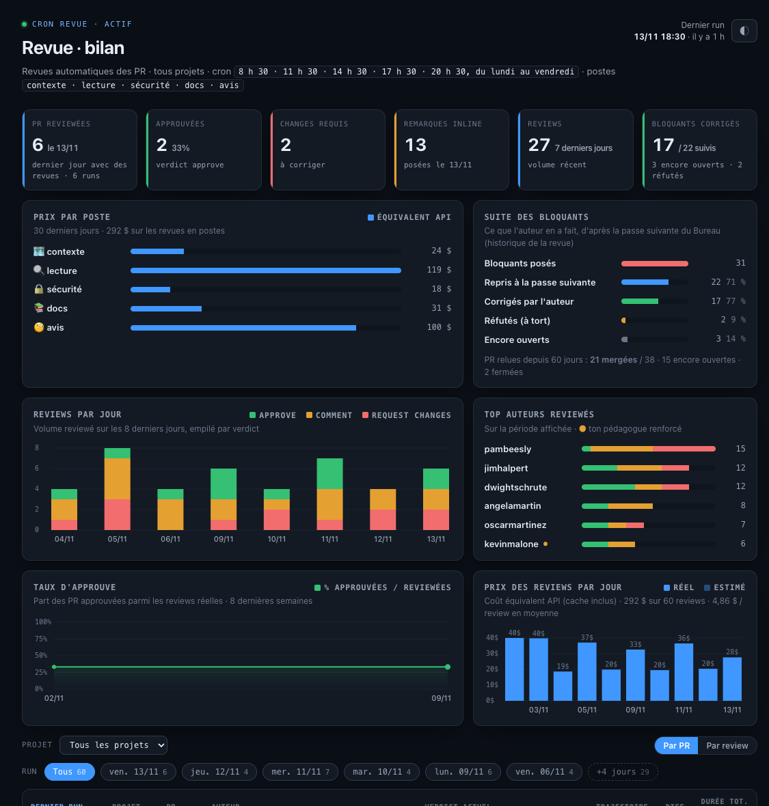

# Le bilan des revues

Une page Kronn à part, « Revue · bilan », garde l'historique des revues de PR du 2e étage ([La rédaction et la revue](28-redaction.md)) : combien de PR sont relues et avec quel verdict, ce que coûte chaque poste de la revue, ce que les auteurs font des bloquants, quelles PR finissent mergées. Chaque revue postée y ajoute sa ligne.

## L'installer et la projeter

`python3 tools/install.py` crée la page avec la revue de PR et son cron « bilan des revues (1 h) ». Si ton installation avait déjà réglé une page de récap des revues (`review.page_id`), c'est elle qui devient « Revue · bilan » : même adresse, historique gardé. Pour la projeter : « Mes pages Kronn » sur l'écran mural, « ＋ Ajouter » la page, puis « 📽 Projeter en TV ».

## Ce que montre la page

- **L'en-tête** : l'horaire du cron des revues, à l'heure du bureau, et les postes de la revue.
- **Six chiffres** : les PR relues le dernier jour avec des revues, les approuvées, les changements demandés, les remarques inline, les revues des 7 derniers jours, et les **bloquants corrigés** sur ceux que la passe suivante a repris (avec ceux encore ouverts et ceux réfutés).
- **Prix par poste**, sur 30 jours : contexte, lecture, sécurité, docs, avis.
- **Suite des bloquants** : posés, repris à la passe suivante, corrigés par l'auteur, réfutés, encore ouverts ; et combien de PR relues depuis 60 jours sont mergées.
- **Revues par jour** par verdict, **auteurs relus** (un point orange : la revue leur parle en pédagogue, réglage `review.pedago`), **taux d'approbation** par semaine, **prix par jour**.
- **Le tableau**, par PR ou par revue : verdict, trajectoire des passes, diff, durée et coût. À côté du verdict, un badge **« 2/3 ✓ »** dit les bloquants corrigés sur ceux repris, et **« mergée »** quand la PR l'est. Un clic ouvre la synthèse de chaque passe.

## D'où viennent les données

À chaque revue postée, la revue écrit sa ligne (`reviews`), la réponse de GitHub (`review_meta`) et le coût de ses postes (`review_sessions`). Le cron (sans jetons, une fois par heure) lit l'historique des revues (`review.historique`) : les bloquants de chaque passe, et ce que la passe suivante en dit. Il demande aussi à GitHub (`gh`) l'état de chaque PR relue depuis 60 jours, puis publie le dataset `revue_bilan`. Les réactions aux remarques ne sont pas comptées : le compte qui poste les revues est aussi celui d'une personne.

Après la mise à jour : `python3 tools/install.py` (reprend ou crée la page, crée le cron), puis `python3 tools/publish.py all`. Pour recalculer le coût par poste des revues déjà faites : `python3 -c "$(python3 -c 'import sys; sys.path.insert(0, "tools"); import templates, json; print(templates.script_code("workflows/review.py", json.load(open("bureau.config.json"))))')" couts --all`.
