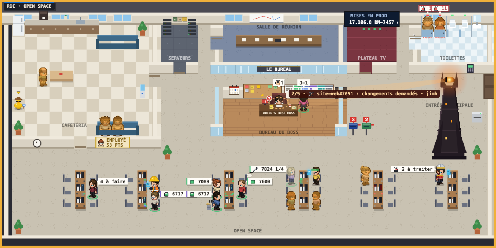
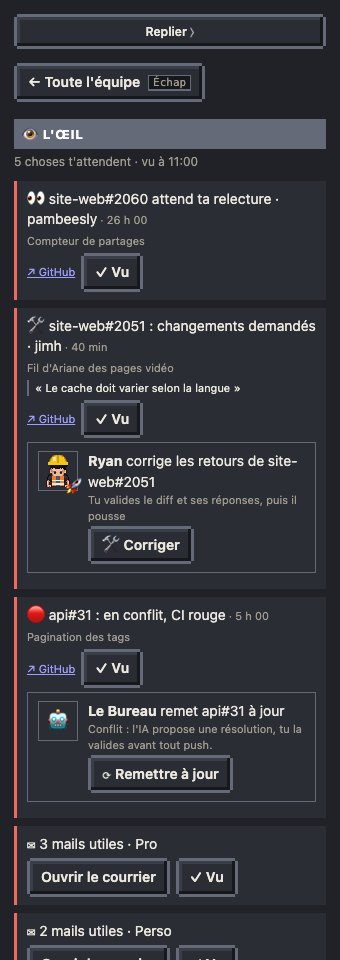

# L'Œil

Une tour sombre se dresse à l'entrée du RDC. Son œil se pose, une chose à la fois, sur ce qui t'attend vraiment sur le plan, et un clic sur la tour donne la liste avec le bouton qui va avec.

## Ce que l'œil regarde

Il fait sa ronde, la plus urgente d'abord, puis la plus ancienne :

| | Quoi | Où il regarde |
|---|---|---|
| ✋ | Une validation qui t'attend | ton bureau |
| 👀 | Une PR dont on te demande la relecture | le poste de son auteur (s'il est de l'équipe), sinon ton bureau |
| 🛠 | Une de tes PR avec des retours : changements demandés, fils d'un relecteur | ton bureau |
| 🔴 | Une de tes PR en conflit ou avec la CI rouge | ton bureau |
| 🔥 | Un service extérieur en alerte | le bandeau du plateau TV |
| ✉ | Des mails utiles | la boîte aux lettres du compte |

Toutes tes PR ouvertes comptent, de tous les dépôts que ton `gh` sait lire, pas seulement ceux que suit le Bureau. Un fil n'est « à traiter » que si le dernier mot n'est ni le tien ni celui d'un bot.

- Le faisceau va d'une cible à la suivante toutes les 4 secondes ; sous l'œil, une étiquette dit laquelle et pourquoi (« 2/5 · 🛠 site-web#2051 : changements demandés · jimh »).
- L'œil chauffe avec l'attente : orange au début, rouge, puis en flammes au-delà de 4 h.
- Rien ne t'attend : l'œil se ferme.

## La fiche

Une ligne par cible : le motif, depuis quand, le titre de la PR, le dernier mot du relecteur, et ses boutons.

- **🛠 Corriger** sur une de tes PR avec des retours : le workflow « corriger les commentaires d'une PR », qui la monte au [3e](31-retours-bilan.md).
- **⟳ Remettre à jour** sur une de tes PR en conflit.
- **✋ Décider** ouvre la validation, **Voir les services** et **Ouvrir le courrier** leurs fiches, **↗ GitHub** la PR.
- **✓ Vu** sort la cible de la ronde jusqu'à du nouveau (un autre commentaire, une autre review). C'est retenu dans ton navigateur.

## Le Mac te prévient

Avec la notification du Mac (réglage `notify_mac`, proposé à l'installation), chaque retour nouveau sur tes PR et chaque demande de relecture nouvelle t'envoient une notification, une seule fois. Les validations ont déjà la leur.

## Rejouer la journée

L'Œil voit tes PR telles qu'au dernier relevé : en relecture, il ne regarde qu'autour de l'heure du relevé et dort le reste du temps.

## D'où viennent les données

Le cron `office` (toutes les 10 minutes, 0 jeton) pose une seule question à GitHub avec ton `gh` : tes PR ouvertes et celles dont on te demande la relecture, avec leurs fils, leurs reviews, leur CI et leur état de fusion. Il publie le dataset `oeil`, que le cron équipe reprend pour que « Corriger » trouve aussi les PR des dépôts qu'il ne suit pas. Sans `gh`, la liste est vide et [Fraîcheur](10-fraicheur.md) le dit.

## Placer la tour

La tour se pose à l'objet `oeil` du plan : `"objects": {"oeil": {"x": 1160, "y": 412}}`, le pied de la tour en pixels. Le plan type l'a déjà, à l'entrée principale ; sans cet objet, pas de tour.
