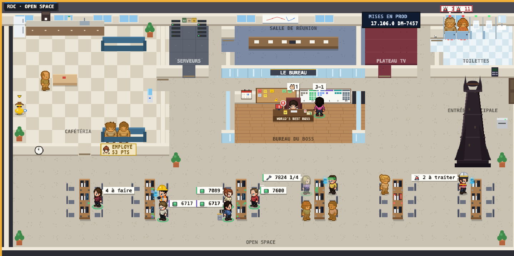
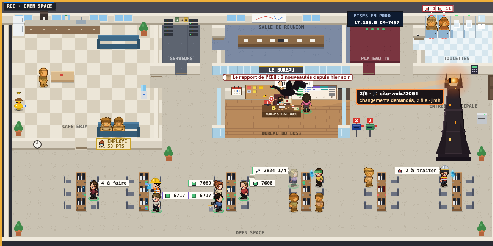

# L'Œil

Une tour sombre se dresse à l'entrée du RDC. Son œil se pose, une chose à la fois, sur ce qui t'attend vraiment sur le plan, et un clic sur la tour donne la liste avec le bouton qui va avec.

## Ce que l'œil regarde

Il fait sa ronde, la plus urgente d'abord, puis la plus ancienne :

| | Quoi | Où il regarde |
|---|---|---|
| ✋ | Une validation qui t'attend | ton bureau |
| 👀 | Une PR dont on te demande la relecture, prête | le poste de son auteur (s'il est de l'équipe), sinon ton bureau |
| 🛠 | Une de tes PR avec des retours | ton bureau |
| 🔴 | Une de tes PR en conflit ou avec la CI rouge | ton bureau |
| 🔥 | Un service extérieur en alerte | le bandeau du plateau TV |
| ✉ | Des mails utiles | la boîte aux lettres du compte |

- Le faisceau va d'une cible à la suivante toutes les 4 secondes ; sous l'œil, une carte dit laquelle (« 2/5 · 🛠 site-web#2051 ») et pourquoi (« changements demandés, 2 fils · jimh »).
- L'œil chauffe avec l'attente : orange au début, rouge, puis en flammes au-delà de 4 h.
- Rien ne t'attend : l'œil se ferme.

## Ce qui compte, ce qui ne compte pas

Toutes tes PR ouvertes comptent, de tous les dépôts que ton `gh` sait lire, pas seulement ceux que suit le Bureau. Les règles sont celles de la revue automatique et de « Corriger » :

- **Retours** : un fil compte s'il n'est ni résolu ni périmé et que le dernier mot vient d'un membre ou d'un collaborateur du dépôt, ni toi ni un bot. « Changements demandés » ne compte que si la review est plus récente que ton dernier commit : GitHub garde la décision après ta correction, tant que le relecteur n'a pas relu.
- **Relectures** : seulement celles qu'on te demande à toi (pas à une de tes équipes), sans les PR d'un bot ni celles qui portent le label `skip-auto-review`. Une relecture en conflit ou avec la CI rouge n'est pas prête : elle reste dans la fiche, en gris, hors de la ronde.
- **Hors de la ronde** : les brouillons et les PR sans activité depuis 30 jours. La fiche les range à part, repliés.

## La fiche

Par sections : ✋ À décider, 🛠 À corriger, 👀 À relire, 📬 Ailleurs (services, courrier), ⏸ Pas prêtes, puis 📝 Brouillons et PR qui dorment (repliés). Une carte par cible : la PR, depuis quand, son titre, des pastilles (changements demandés, nombre de fils, conflit, CI rouge, qui demande la relecture) et ses boutons.

- La carte que l'œil regarde porte le cadre « 👁 L'œil regarde » et le dernier mot du relecteur ; le cadre suit la ronde.
- **Clic sur une carte** : l'œil s'y pose 10 secondes sur le plan, puis reprend sa ronde.
- **🛠 Corriger** sur une de tes PR avec des retours : le workflow « corriger les commentaires d'une PR », qui la monte au [3e](31-retours-bilan.md). **⟳ Remettre à jour** sur une PR en conflit.
- **✋ Décider** ouvre la validation, **Voir les services** et **Ouvrir le courrier** leurs fiches, **👀 Relire sur GitHub** ou **↗ GitHub** la PR.

## Le Nazgûl, messager de l'Œil

Il ne fait le travail de personne : il porte ce que l'Œil a vu. Il part de la tour, fond sur ton bureau, y pose un parchemin, puis retourne à la tour.

- **Le rapport du matin**, 10 minutes avant le daily : ce qui est arrivé depuis la veille à 18 h (« 📜 Le rapport de l'Œil : 3 nouveautés depuis hier soir »), s'il y a du neuf.
- **Dans la journée**, chaque nouveauté pour toi : un nouveau retour sur une de tes PR (« 🛠 site-web#2051 : changements demandés · jimh »), une PR dont on te demande la relecture, quand elle a été ouverte dans la journée (GitHub ne date pas la demande elle-même).
- Jamais pour un brouillon. Chaque livraison a sa ligne dans le fil ; la galerie des scènes le joue (« ▶ voir »).

## Rejouer la journée

L'Œil voit tes PR telles qu'au dernier relevé : en relecture, il ne regarde qu'autour de l'heure du relevé et dort le reste du temps.

## D'où viennent les données

Le cron `office` (toutes les 10 minutes, 0 jeton) pose une seule question à GitHub avec ton `gh` : tes PR ouvertes et celles dont on te demande la relecture, avec leurs fils, leurs reviews, leur dernier commit, leur CI et leur état de fusion. Il publie le dataset `oeil`, que le cron équipe reprend pour que « Corriger » trouve aussi les PR des dépôts qu'il ne suit pas. Sans `gh`, la liste est vide et [Fraîcheur](10-fraicheur.md) le dit.

Une PR sans aucune vérification sur son dernier commit (une CI qui ne part qu'avec un label, par exemple) n'est jamais « CI rouge ».

## Placer la tour

La tour se pose à l'objet `oeil` du plan : `"objects": {"oeil": {"x": 1160, "y": 412}}`, le pied de la tour en pixels. Le plan type l'a déjà, à l'entrée principale ; sans cet objet, pas de tour.
