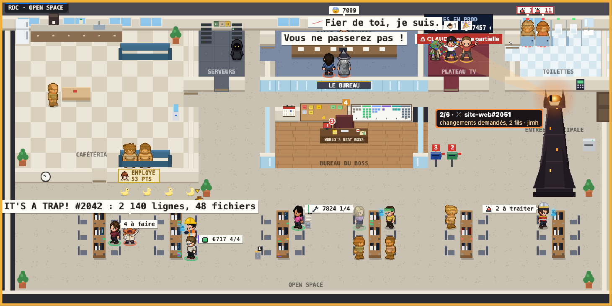
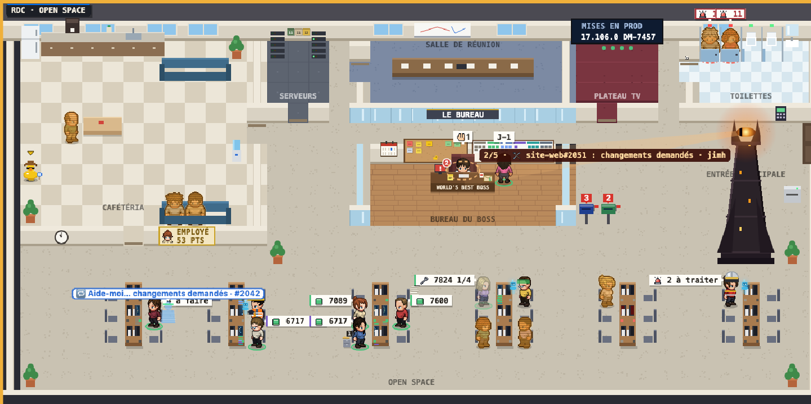
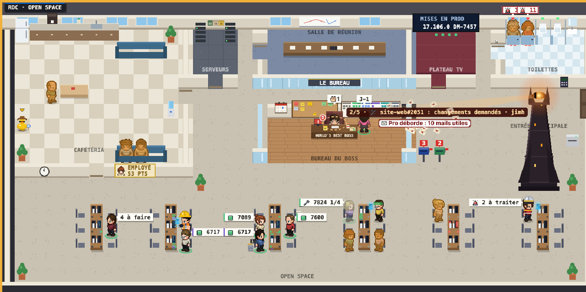
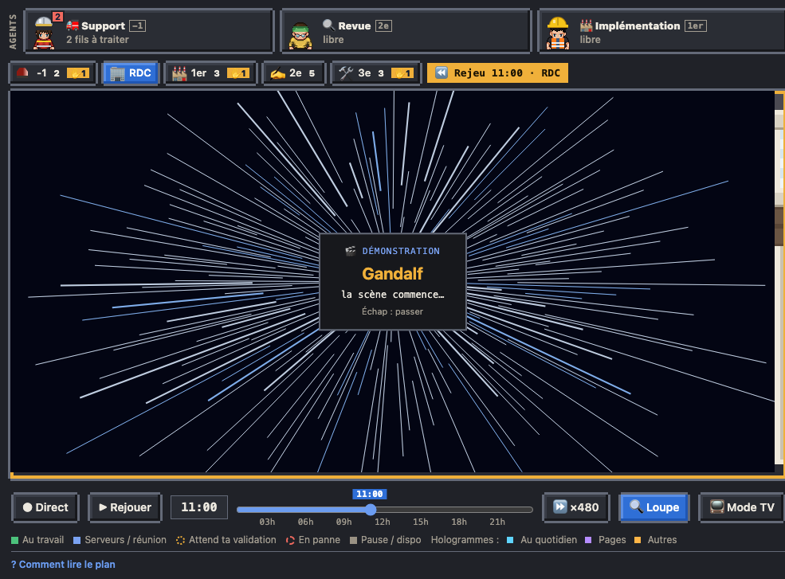

# Scènes pop

Quatre clins d'œil au RDC, chacun déclenché par un vrai événement. Comme les autres scènes, ils se rejouent à leur heure, passent dans le [fil](04-fil-et-recap.md) et dans la loupe, et la galerie des scènes sait les jouer (« ▶ voir », voir [Rejouer la journée](05-rejouer.md)).

## L'amiral Ackbar : une grosse PR



Une PR ouverte dans la journée dépasse 1000 lignes (ajoutées et retirées) ou 30 fichiers : l'amiral Ackbar entre par la porte, se plante à côté du poste de son auteur et crie, bras levés, « IT'S A TRAP! #2042 : 2 140 lignes, 48 fichiers » pendant 3 minutes, puis repart. C'est un invité commun, comme Gandalf et Yoda ; un pack peut changer sa réplique (`shout` : `{pr}`, `{lignes}`, `{fichiers}`, `{name}`) en reprenant sa clé `g_ackbar` dans `roster.json`.

## Le verdict de la revue



Quand une revue du Bureau est postée, son relecteur, à la visière verte de la salle de revue, apparaît en hologramme sur le poste de l'auteur de la PR, avec le verdict : « 🔁 Aide-moi… changements demandés », « 💬 Des remarques sur ta PR », ou, en doré, « ✅ Approuvée. Que la Force soit avec ta PR. ». Seules les revues du cron des revues ont leur verdict relevé (le 2e étage le lit) ; un collègue humain n'apparaît jamais en hologramme.

## Les lettres de Poudlard



Quand les mails utiles d'un compte atteignent 10, les lettres s'envolent de sa boîte aux lettres : « ✉ Pro déborde : 10 mails utiles ». Une fois par jour et par compte, au moment où arrive le dixième.

## L'hyperespace



Avant une scène de la galerie et avant le rejeu de la journée (« ▶ Rejouer » depuis le direct), 1,2 seconde d'étoiles qui s'étirent, avec le nom de la scène, ou le jour et sa plage horaire. L'heure attend la fin de la transition. Échap ou un clic pour passer. Rien en mode TV ni avec « réduire les animations ».

## Régler

Dans le `settings.json` du pack (la config peut surcharger) :

```json
"scenes": {
  "lettres": {"mails": 10},
  "grosse_pr": {"lignes": 1000, "fichiers": 30},
  "hyperespace": true
}
```

`hyperespace: false` retire la transition. Ackbar a besoin de la taille des PR, que le cron équipe demande à GitHub (`additions`, `deletions`, `changedFiles`) : `python3 tools/upgrade.py` le republie.
