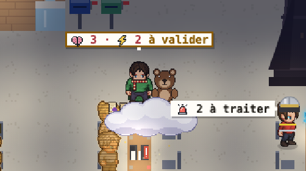

# La mémoire du soir

Les agents du Bureau refont parfois une erreur que tu as déjà corrigée la veille. La mémoire du soir sert à ça : chaque soir à 22 h, un cron relit tes retours du jour et un agent les réécrit en leçons courtes. Tu valides, et les agents les lisent dès leur run suivant.

Elle alimente quatre workflows : l'écriture de ticket (2e étage), la chaîne d'implémentation (1er), la revue de PR (2e) et la correction des commentaires d'une PR (3e).

## Ce qui est relevé

Rien de plus à faire de ton côté : le cron lit ce que les workflows gardent déjà, sans jetons.

- **Écriture de ticket** : ce que tu écris quand tu demandes des « Changements » au tampon.
- **Chaîne d'implémentation** : tes « Changements » aux gates du plan, de l'escalade et de la PR. Les essais de la chaîne sont écartés.
- **Revue de PR** : un bloquant que la passe suivante a dû réfuter, avec sa preuve. C'est une revue qui s'est trompée.
- **Correction des commentaires** : ton message « Changements » à la validation du diff.
- **Rejeu de Palpatine** : quand Palpatine rejoue un ticket déjà livré, son juge liste les écarts avec la vraie PR, chacun avec une cause et une leçon. Les rejeux du jeu témoin sont écartés (ils servent à mesurer), et un écart « acceptable » (une autre solution valable) n'apprend rien. Un écart « ticket vague » va avec les retours de l'écriture de ticket. Les écarts « choix de l'agent » et « convention » font une seconde proposition, pour la chaîne d'implémentation, que tu valides à part (plus bas).

S'il n'y a rien de nouveau, le run s'arrête là, sans agent ni jetons.

## Le marchand de sable

Tant qu'une de ses deux validations attend, le marchand de sable vient la porter : un monsieur brun à la cape verte et à l'écharpe rayée, debout sur son nuage, son ours à côté. Il ne marche pas : c'est le nuage qui le porte d'un îlot à l'autre. Il fait le tour des îlots de l'open space, s'arrête en haut de chacun, son nuage par-dessus les bureaux (une minute et demie), y sème un peu de sable, puis passe au suivant. Sa bulle dit combien de leçons t'attendent, en rouge : « 🧠 3 · ⚡ 2 à valider » (3 pour la mémoire, 2 du rejeu de Palpatine), ou une seule partie quand l'autre est vide. Il porte un parchemin par validation, posé sur son nuage : cachet violet pour la mémoire, cachet rouge à petit éclair pour les leçons du rejeu. Celui d'une validation décidée disparaît. Quand plus rien n'attend, il repart par la porte, toujours sur son nuage avec son ours.

Un clic sur lui ouvre sa fiche avec la validation. Elle est aussi chez le boss, comptée une fois, comme les règles du facteur. À son arrivée, la loupe l'agrandit et le fil le note (onglet Tout), puis « 🧠 2 leçons du rejeu à valider » quand leur validation s'ouvre ; « Comment lire le plan » › 🎬 Scènes le rejoue (« ▶ voir »). La gate décidée, il repart par la porte.

## Ce que tu valides

Une gate « 🧠 Mémoire du soir » s'ouvre sur la page, comme les autres validations. Elle montre :

- en première ligne, le nombre de leçons à valider (et celles retirées), puis le résumé de ce que la journée a appris ;
- un diff par fiche changée, avec la raison ;
- parfois, des leçons « à graver dans le dépôt » : une règle qui revient souvent et mérite d'aller dans la doc du dépôt, une skill ou les consignes de l'équipe. Ça, c'est à toi de le faire, en PR.

Elle t'attend jusqu'à trois jours : celle de 22 h se valide le lendemain matin, celle du vendredi soir le lundi. Tant qu'elle est ouverte, le soir suivant ne relance rien ; les retours de ces jours-là passent au relevé d'après.

**Approuver** écrit les fiches. **Changements** renvoie la proposition à l'agent avec ton message. **Rejeter** laisse tout tel quel.

### Les leçons du rejeu, à part

Quand le rejeu a appris quelque chose, la première validation l'annonce (« ⚡ Rejeu de Palpatine · 2 leçons à valider ensuite »), et une seconde s'ouvre juste après : « ⚡ Mémoire du soir · rejeu de Palpatine · 2 leçons à valider ». Chaque leçon y est avec sa source (« ⚡ DM-2041 · choix_agent » : le ticket rejoué et la cause de l'écart), et le poste de la chaîne qu'elle vise quand il y en a un.

- **Approuver** les ajoute à la fiche de la chaîne d'implémentation (`impl.md`).
- **Changements** renvoie ces leçons à l'agent avec ton message. La première validation, déjà décidée, ne revient pas.
- **Rejeter** n'en écrit aucune.

S'il n'y a rien pour la mémoire mais des leçons du rejeu, seule la seconde validation s'ouvre.

Un « Rejeter » arrête le run dans Kronn. C'est pour ça que la mémoire est écrite avant que la seconde validation ne s'ouvre. Si tu rejettes la première, la seconde ne s'ouvre pas ce soir-là : ses leçons reviennent au soir suivant, rien n'est perdu. Les leçons validées sont gardées dans `~/.local/share/pixel-bureau/rejeu/lecons.json` ; la page « Rejeu · bilan » les compte et les montre sur la courbe du jeu témoin.

## Les fiches

Une fiche commune (`equipe.md`) et une par workflow (`ticket.md`, `impl.md`, `revue.md`, `correction.md`), dans `~/.local/share/pixel-bureau/memoire/`. Une leçon par ligne. Une ligne qui commence par `[code]`, `[redaction]` ou `[avis]` ne va qu'à ce poste.

Elles restent courtes : 25 leçons pour la commune, 40 pour les autres. L'agent fusionne, reformule et oublie plutôt que d'ajouter. Tu peux aussi les modifier à la main, ce sont de simples fichiers texte. Chaque validation garde les versions précédentes dans `versions/`.

Tant qu'une fiche est vide, le workflow travaille comme avant. Pour l'écriture de ticket, les retours bruts des autres intentions restent utilisés jusqu'à ce que la fiche `ticket` ait ses premières leçons.

## Réglages

Dans `bureau.config.json`, sous `memoire` (tout est facultatif) :

| Réglage | Défaut | Effet |
|---|---|---|
| `actif` | `true` | `false` : rien n'est relevé ni lu, le cron n'est pas créé |
| `workflows` | les quatre | ceux qui lisent leur fiche et dont les retours sont relevés : `ticket`, `impl`, `revue`, `correction` |
| `heure` | `22` | l'heure du cron, à l'heure du bureau, du lundi au vendredi |
| `dossier` | `~/.local/share/pixel-bureau/memoire` | où vivent les fiches et le journal |

Après la mise à jour : `git pull && python3 tools/upgrade.py` crée le cron « mémoire du soir », puis publie.

## Voir si ça marche

Les bilans classent déjà les retours par cause : « Chaîne · bilan », « Rédaction · bilan » et « Retours · bilan ». Si une cause ne baisse pas dans les jours qui suivent une leçon, c'est que la leçon ne sert pas : rejette-la ou reformule-la.
